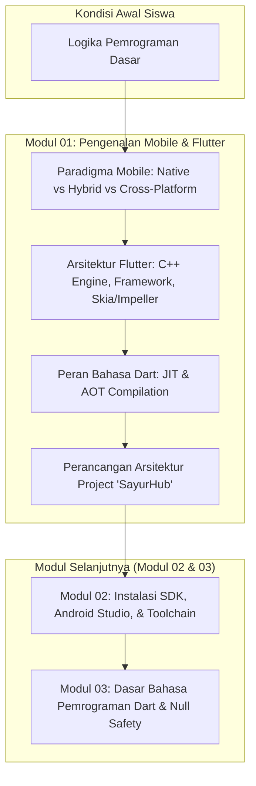
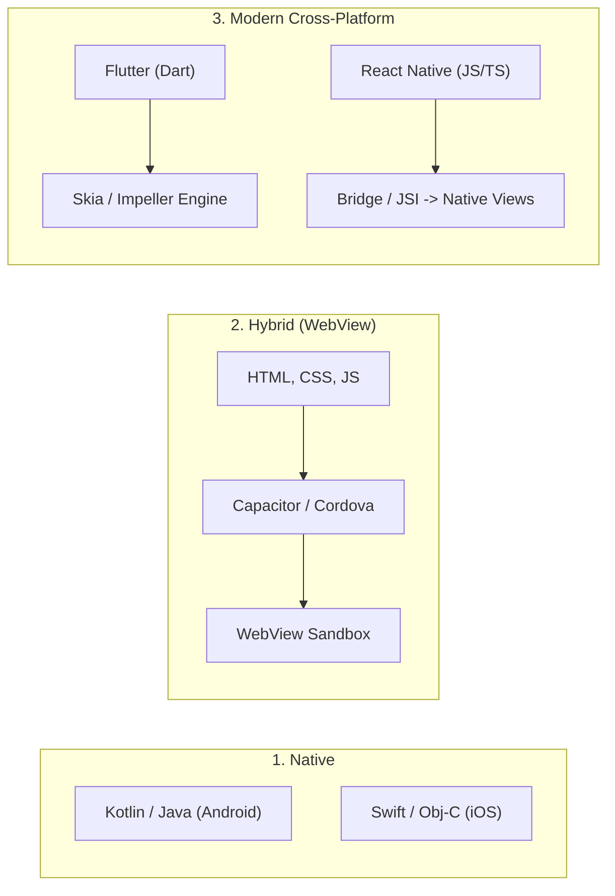
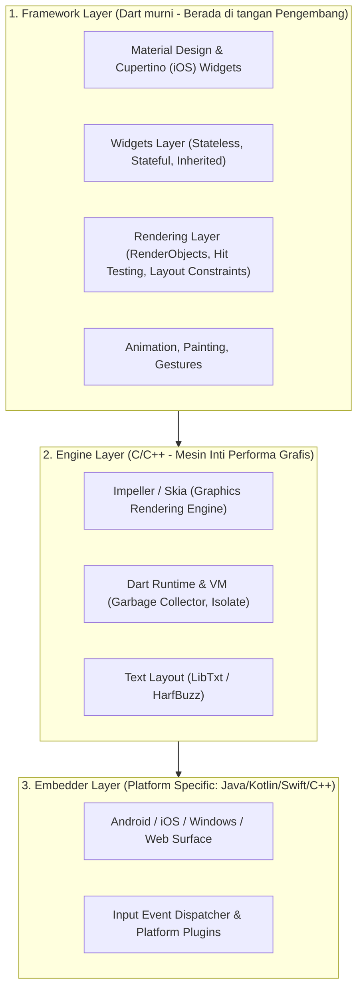
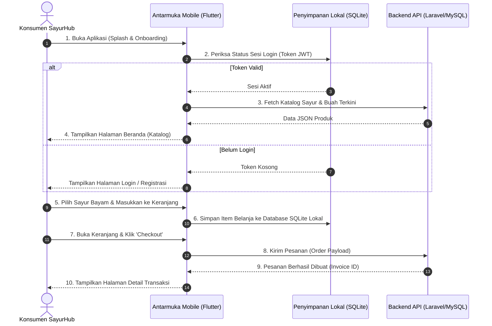

# MODUL 01: PENGENALAN PEMROGRAMAN MOBILE DAN EKOSISTEM FLUTTER
## PENGEMBANGAN APLIKASI MOBILE MULTIPLATFORM DARI DASAR HINGGA PRODUKSI
### KONSENTRASI KEAHLIAN REKAYASA PERANGKAT LUNAK (SMK RPL)

---

## A. IDENTITAS MODUL

- **Nomor Modul**: 01
- **Judul Modul**: Pengenalan Pemrograman Mobile dan Ekosistem Flutter
- **Tingkat Kesulitan**: Pemula (*Beginner*)
- **Estimasi Waktu**: 4 Jam Pelajaran (4 × 45 Menit = 180 Menit)
- **Prasyarat**: Dasar Logika Algoritma dan Konsep Dasar Pemrograman Komputer
- **Tujuan Pembelajaran**:
  1. Siswa mampu membedakan paradigma pengembangan aplikasi mobile (*Native*, *Hybrid*, dan *Cross-Platform*) beserta kelebihan dan kekurangannya masing-masing.
  2. Siswa mampu menjelaskan arsitektur dasar Flutter, cara kerja mesin *rendering* (Skia dan Impeller), serta perannya dalam menghasilkan performa setara *native*.
  3. Siswa memahami hubungan erat antara bahasa pemrograman Dart dengan framework Flutter.
  4. Siswa mampu menganalisis kebutuhan aplikasi bisnis nyata dan menuangkannya ke dalam rancangan awal (*Software Requirements Specification* & *Wireframe*) untuk project e-commerce **SayurHub**.
- **Kompetensi yang Akan Dicapai**:
  - **Kognitif**: Penguasaan konsep arsitektur mobile, komparasi framework, dan pemahaman alur kerja ekosistem Flutter.
  - **Psikomotorik**: Keterampilan menganalisis use case pengguna, merancang alur interaksi aplikasi (*user flow*), serta membuat sketsa tata letak antarmuka (*wireframing*).

---

## B. PETA KONSEP



- **Keterkaitan dengan Materi Sebelumnya**: Modul ini menjembatani kemampuan logika algoritma dasar siswa ke ranah pengembangan perangkat lunak bergerak (*mobile development*).
- **Keterkaitan dengan Materi Berikutnya**: Pemahaman arsitektur dan rancangan aplikasi SayurHub pada modul ini menjadi cetak biru (*blueprint*) mutlak sebelum siswa melakukan instalasi *toolchain* pada Modul 02 dan menulis kode program pada Modul 03 ke atas.

---

## C. MATERI TEORI

### 1. Pengertian Aplikasi Mobile
Aplikasi *mobile* adalah perangkat lunak yang dirancang khusus untuk berjalan pada perangkat komputasi bergerak berdaya baterai, seperti telepon pintar (*smartphone*) dan komputer tablet. Berbeda dengan aplikasi web desktop yang mengandalkan layar lebar dan koneksi listrik stabil, aplikasi mobile beroperasi dalam ekosistem yang dinamis dengan karakteristik:
- Masukan berbasis sentuhan (*touch screen* dan *gestures* seperti *swipe*, *pinch*, dan *long press*).
- Keterbatasan sumber daya (kapasitas RAM, konsumsi baterai, dan ukuran prosesor).
- Integrasi sensor perangkat keras (kamera, GPS, akselerometer, sensor biometrik/sidik jari).
- Konektivitas jaringan yang berfluktuasi (berpindah antara Wi-Fi dan sinyal seluler 4G/5G).

Dua sistem operasi penguasa pasar mobile dunia saat ini adalah **Android** (dikembangkan oleh Google) dan **iOS** (dikembangkan oleh Apple).

---

### 2. Tiga Paradigma Pengembangan Aplikasi Mobile

Dalam industri rekayasa perangkat lunak mobile, terdapat tiga pendekatan utama untuk membangun aplikasi:



Berikut adalah tabel komparasi teknis ketiga paradigma tersebut:

| Kriteria Komparasi | Native (Android/iOS) | Hybrid (WebView) | Modern Cross-Platform (Flutter) |
|---|---|---|---|
| **Bahasa Pemrograman** | Kotlin/Java (Android), Swift (iOS) | HTML, CSS, JavaScript | **Dart** |
| **Basis Kode (*Codebase*)** | Terpisah (2 tim, 2 kode berbeda) | Satu basis kode (*Single codebase*) | **Satu basis kode (*Single codebase*)** |
| **Performa Grafis & FPS** | Sangat Tinggi (Mendekati 60–120 FPS konstan) | Rendah ke Sedang (Sering terjadi *stutter/jank*) | **Sangat Tinggi (Konsisten 60–120 FPS)** |
| **Akses Hardware** | Langsung ke SDK sistem operasi | Terbatas melalui *plugin bridge* | **Lengkap via Platform Channels / FFI** |
| **Konsistensi Tampilan UI** | Mengikuti standar masing-masing OS | Rentan berbeda antar browser OS | **100% Identik piksel per piksel (*Pixel Perfect*)** |
| **Biaya & Waktu Pengembangan**| Sangat Tinggi (Dua kali lipat) | Rendah | **Efisien (Hemat waktu hingga 50%)** |

> [!NOTE]
> **Analogi Sederhana untuk Siswa SMK:**
> - **Aplikasi Native** seperti mobil balap Formula 1 yang dibuat khusus hanya untuk satu jenis sirkuit. Larinya sangat kencang, namun tidak bisa dipakai di sirkuit jenis lain tanpa membuat mobil baru dari nol.
> - **Aplikasi Hybrid** seperti menyematkan situs web toko online ke dalam pigura kaca aplikasi. Tampilannya seperti aplikasi mobile, tetapi jika digeser terasa lambat dan berat karena dipaksa merender melalui browser tersembunyi (*WebView*).
> - **Aplikasi Flutter** seperti seniman lukis profesional yang membawa kanvas dan cat sendiri ke mana pun ia pergi. Ia tidak bergantung pada komponen bawaan Android atau iOS; ia menggambar setiap tombol, teks, dan animasi langsung di layar menggunakan kanvas grafisnya sendiri dengan kecepatan sangat tinggi.

---

### 3. Pengertian dan Sejarah Singkat Flutter
**Flutter** adalah sebuah *framework* antarmuka (*UI software development kit*) sumber terbuka (*open-source*) yang diciptakan oleh Google untuk membangun aplikasi yang dikompilasi secara *native* (*multi-platform*) untuk Android, iOS, Web, Windows, macOS, dan Linux dari satu basis kode tunggal.

- **2015**: Proyek ini pertama kali diumumkan dengan nama kode **"Sky"** pada konferensi pengembang Dart, dengan fokus utama mampu merender grafik pada kecepatan konstan 120 FPS di Android.
- **Desember 2018**: Google merilis **Flutter 1.0** secara resmi ke publik di London, menandai kesiapan produksi untuk mobile (Android & iOS).
- **Maret 2021**: Google meluncurkan **Flutter 2.0**, memperluas dukungan produksi ke platform Web dan Desktop, serta memperkenalkan fitur *Sound Null Safety* pada Dart.
- **Mei 2022 – Sekarang**: Google merilis **Flutter 3.x**, dengan dukungan multi-platform lengkap secara *native*, mesin grafis generasi baru bernama **Impeller**, dan dukungan standar desain **Material Design 3**.

---

### 4. Mengapa Flutter Menggunakan Bahasa Dart?

Google memilih bahasa **Dart** untuk mentenagai Flutter bukan tanpa alasan yang matang. Terdapat dua kemampuan unik Dart yang menjadi pilar utama keunggulan Flutter:

1. **Dua Mode Kompilasi Sekaligus (JIT dan AOT)**:
   - **JIT (*Just-In-Time Compilation*)**: Digunakan saat tahap pengembangan (*development*). Kode program dikompilasi langsung di memori perangkat saat aplikasi berjalan. Hal ini memungkinkan fitur legendaris Flutter: **Stateful Hot Reload**. Pengembang dapat mengubah warna, tata letak tombol, atau logika kalkulasi dalam hitungan milidetik tanpa kehilangan status (*state*) aplikasi dan tanpa harus merestart aplikasi dari awal.
   - **AOT (*Ahead-Of-Time Compilation*)**: Digunakan saat aplikasi siap dirilis ke pengguna (*production/release mode*). Seluruh kode Dart diterjemahkan langsung menjadi kode mesin biner ARM atau x86 asli perangkat keras Android/iOS. Hasilnya: aplikasi terbuka seketika (*instant startup time*) dan berjalan sangat mulus tanpa memerlukan penerjemah (*interpreter*).

2. **Garbage Collection Generasional Cepat**:
   Dalam Flutter, widget dibuat dan dimusnahkan secara sangat cepat saat layar digulir (*scroll*). Alokator memori generasi muda pada Dart mampu membersihkan alokasi memori jangka pendek tanpa menghentikan rendering UI, sehingga animasi tidak pernah tersendat (*zero jank*).

---

### 5. Arsitektur Internal Flutter

Arsitektur Flutter dirancang berlapis (*layered architecture*) yang terdiri dari tiga lapisan utama:



- **Framework (Dart)**: Lapisan tertinggi tempat kita menulis kode. Berisi pustaka komponen visual yang siap pakai (seperti tombol Material 3, kolom, baris, teks, dan animasi).
- **Engine (C/C++)**: Jantung dari Flutter. Engine ini bertanggung jawab langsung menggambar setiap piksel ke layar (*rasterization*) menggunakan pustaka grafis **Skia** atau **Impeller**, serta mengelola runtime Dart.
- **Embedder**: Lapisan tipis khusus untuk masing-masing sistem operasi yang bertugas menginisialisasi benang eksekusi (*thread*), menangani input sentuhan layar, dan menyediakan kanvas gambar untuk Engine.

---

### 6. Kelebihan dan Kekurangan Flutter

Sebagai calon Software Engineer profesional, siswa SMK RPL wajib memahami pertimbangan objektif sebelum memilih Flutter untuk suatu proyek:

#### Kelebihan:
1. **Single Codebase**: Cukup menulis satu kali kode di Dart, aplikasi dapat langsung didistribusikan ke Google Play Store dan Apple App Store.
2. **Stateful Hot Reload**: Meningkatkan produktivitas pengembang hingga 3–5 kali lipat dibandingkan pengembangan native konvensional.
3. **Performa Luar Biasa**: Rendering langsung ke GPU tanpa melewati *JavaScript Bridge* (berbeda dari arsitektur React Native lama).
4. **Desain Fleksibel & Bebas Batas**: Pengembang memiliki kontrol 100% terhadap setiap piksel di layar, memudahkan kustomisasi desain antarmuka sesuai *branding* perusahaan.

#### Tantangan & Kekurangan:
1. **Ukuran File APK Awal Lebih Besar**: Karena engine C++ Flutter dan runtime Dart ikut dikemas ke dalam aplikasi, ukuran file APK kosong berkisar antara 15–20 MB (dapat dioptimasi hingga < 10 MB pada mode rilis split-ABI).
2. **Ketergantungan Ekosistem Plugin**: Jika ada pustaka perangkat keras yang sangat baru atau langka dari produsen hardware tertentu, pengembang mungkin harus menulis kode jembatan native (*Platform Channel*) sendiri menggunakan Kotlin atau Swift.

---

### 7. Contoh Aplikasi Nyata Pengguna Flutter di Dunia
Flutter bukan sekadar alat belajar, melainkan teknologi yang telah divalidasi oleh perusahaan raksasa dunia:
- **Google Pay & Google Ads**: Memproses miliaran dolar transaksi harian di Android dan iOS dengan antarmuka yang sangat responsif.
- **Alibaba (Xianyu)**: Platform e-commerce dengan lebih dari 50 juta pengguna aktif.
- **BMW App**: Aplikasi kendali kendaraan pintar yang digunakan oleh pemilik mobil BMW di seluruh dunia.
- **eBay Motors**: Aplikasi jual-beli otomotif berskala global.
- **Ruangguru / Bank Jago / MyPertamina (Indonesia)**: Banyak perusahaan teknologi dan perbankan digital terkemuka di Indonesia kini telah mengadopsi Flutter untuk aplikasi konsumen mereka.

---

### 8. Kesalahan Umum Pemula (*Common Pitfalls*)
- **Salah Kaprah Menganggap Flutter Berbasis Web**: Pemula sering mengira widget Flutter adalah elemen HTML `<div>` dan `<p>`. Padahal Flutter tidak menggunakan HTML atau CSS sama sekali; semua tampilan adalah objek kanvas 2D yang digambar langsung ke GPU.
- **Langsung Menulis Kode Tanpa Memahami Kebutuhan Sistem**: Banyak siswa langsung membuka IDE dan mengetik kode secara serampangan, sehingga di pertengahan jalan aplikasi menjadi berantakan (*spaghetti code*) karena tidak memiliki rancangan arsitektur dan model data yang jelas sejak awal.

---

## D. PEMBAHASAN ARSITEKTUR DAN STRUKTUR PROYEK "SAYURHUB"

Pada modul pengenalan ini, kita akan membedah logika rancangan proyek utama yang akan kita bangun sepanjang 22 modul ke depan: **Aplikasi E-Commerce "SayurHub"**.

SayurHub adalah solusi digital untuk mempertemukan petani sayur dan buah lokal dengan konsumen rumah tangga perkotaan, menjamin kesegaran bahan pangan melalui distribusi cepat.

### 1. Diagram Alur Pengguna (*User Flow Diagram*)



### 2. Struktur Spesifikasi Entitas Data Awal (Mental Model)
Meskipun kita belum mengetik kode Dart, siswa harus mulai memahami bahwa setiap entitas dunia nyata di pasar sayur memiliki representasi data di dalam program komputer:

- **Produk (Product)**: Memiliki `id`, `nama`, `kategori`, `harga_per_kg`, `stok_tersedia`, `foto_url`, dan `deskripsi`.
- **Kategori (Category)**: Memiliki `id`, `nama_kategori` (contoh: *Sayuran Daun*, *Buah Segar*, *Umbi-umbian*), dan `icon_url`.
- **Item Keranjang (CartItem)**: Menghubungkan satu `Product` dengan `kuantitas` (misal: 2 kg bayam) dan kalkulasi `subtotal`.
- **Pengguna (User)**: Memiliki `id`, `nama_lengkap`, `nomor_whatsapp`, `alamat_pengiriman`, dan `token_otentikasi`.

---

## E. PERSIAPAN PRAKTIKUM

Untuk menyelesaikan praktikum Modul 01, peralatan dan lingkungan yang dibutuhkan adalah:

1. **Perangkat Keras (*Hardware*)**:
   - Komputer / Laptop (Sistem Operasi: Linux, Windows 10/11, atau macOS) dengan RAM minimal 8 GB (disarankan 16 GB).
   - Akses koneksi internet untuk mengunduh modul dan referensi.
2. **Perangkat Lunak (*Software*)**:
   - Browser modern (Google Chrome, Firefox, atau Edge).
   - Alat bantu perancangan wireframe: Siswa dapat menggunakan akun gratis di **Figma** (https://figma.com), atau menggunakan kertas grafik / buku catatan berpetak (*graph paper*) dan pensil untuk membuat sketsa manual.
   - Text editor sederhana atau Visual Studio Code untuk menyusun dokumen Markdown.
3. **Folder Kerja Siswa**:
   - Siswa membuat folder khusus di komputernya: `/home/arif/flutter-1/sayur_hub/docs/designs/`.

---

## F. LANGKAH PRAKTIKUM

### Praktikum 1: Analisis Komparasi Aplikasi Mobile Nyata di Smartphone Siswa

**Tujuan**: Melatih kepekaan siswa dalam mengidentifikasi arsitektur aplikasi mobile yang terpasang di smartphone mereka sehari-hari.

1. Buka smartphone Android atau iOS Anda masing-masing.
2. Buka minimal dua aplikasi e-commerce atau perbankan yang berbeda (contoh: Tokopedia, Shopee, BCA Mobile, atau Bank Jago).
3. Lakukan pengujian respons antarmuka:
   - Geser (*scroll*) daftar katalog produk secara cepat dari atas ke bawah.
   - Matikan koneksi internet (aktifkan *Airplane Mode*) saat aplikasi sedang terbuka.
   - Perhatikan apakah aplikasi tetap menampilkan data yang tersimpan di memori atau langsung memunculkan layar putih kosong (*blank screen*).
4. Catat temuan Anda ke dalam tabel analisis lembar kerja siswa.

---

### Praktikum 2: Penyusunan Dokumen Spesifikasi Kebutuhan Sistem (SRS) SayurHub

**Tujuan**: Merumuskan batasan sistem yang akan dikembangkan secara disiplin layaknya tim rekayasa perangkat lunak profesional.

1. Buka text editor di komputer Anda.
2. Buat file baru bernama `SRS_SAYURHUB_V1.md` di dalam direktori `docs/designs/`.
3. Tuliskan rincian kebutuhan fungsional aplikasi SayurHub dengan mengelompokkannya menjadi 4 modul utama:
   - **Modul Pengguna**: Pendaftaran akun, login dengan nomor HP, dan simpan alamat rumah.
   - **Modul Katalog**: Pencarian sayur/buah berdasarkan kata kunci, filter kategori sayur, dan halaman detail nutrisi.
   - **Modul Transaksi**: Keranjang belanja dengan tombol tambah/kurang jumlah kg, kalkulasi ongkos kirim, dan pemilihan jadwal pengiriman pagi atau sore.
   - **Modul Riwayat**: Menampilkan status pesanan sayur (Menunggu Dipanen $\to$ Sedang Dikemas $\to$ Dalam Pengantaran Kurir $\to$ Selesai).
4. Simpan file tersebut sebagai acuan kerja tim.

---

### Praktikum 3: Perancangan Sketsa Antarmuka (Wireframing) 3 Layar Utama SayurHub

**Tujuan**: Menerjemahkan kebutuhan data ke dalam visualisasi tata letak layar mobile sebelum dikodekan dengan Flutter.

1. Buka kertas berpetak atau aplikasi Figma.
2. Gambar 3 bingkai layar (*frames*) berukuran rasio smartphone standar (9:16 atau 360 × 800 piksel).
3. **Layar 1 — Beranda (Katalog SayurHub)**:
   - Bagian atas: Alamat pengiriman pengguna ("Kirim ke: Jl. Mawar No. 12") dan kolom pencarian (*search bar*).
   - Bagian tengah: Banner promosi diskon panen sayur mingguan.
   - Bagian bawah banner: Baris kategori horizontal berbentuk lingkaran (*Sayuran Hijau*, *Buah Segar*, *Bumbu Dapur*).
   - Bagian konten utama: Dua kolom kartu produk (*2-column grid*), masing-masing kartu memuat foto sayur, label nama sayur, harga per kilogram, dan tombol hijau bertuliskan "+ Keranjang".
   - Bagian paling bawah: Bar navigasi bawah (*Bottom Navigation Bar*) dengan 4 icon: *Beranda*, *Kategori*, *Pesanan*, dan *Profil*.
4. **Layar 2 — Detail Produk (Detail Sayur Bayam Organik)**:
   - Header foto besar dengan tombol *back* panah kiri di pojok kiri atas dan icon hati (*wishlist*) di pojok kanan atas.
   - Nama produk dengan huruf tebal: **Bayam Hijau Organik (250 gr)**.
   - Harga: **Rp 4.500**.
   - Deskripsi manfaat nutrisi: "Bayam segar dipetik langsung pagi hari dari kebun hidroponik lokal. Bebas pestisida kimia."
   - Komponen pengatur kuantitas: Tombol minus `[-]`, angka jumlah `[ 1 ]`, tombol plus `[+]`.
   - Tombol aksi utama di dasar layar (*sticky bottom button*): **"Tambah ke Keranjang Belanja"**.
5. **Layar 3 — Keranjang Belanja (*Cart Screen*)**:
   - Daftar kartu item yang dibeli dengan checkbox centang untuk memilih item mana yang ingin di-checkout.
   - Ringkasan rincian biaya: Subtotal Belanja, Estimasi Ongkos Kirim, dan Total Bayar.
   - Tombol utama: **"Lanjutkan ke Pembayaran (Checkout)"**.
6. Simpan hasil gambar sketsa Anda (jika digambar di kertas, ambil foto yang jelas) dan letakkan di folder `docs/designs/wireframe_sayurhub.png`.

---

## G. ANALISIS DAN PEMAHAMAN

Jawablah pertanyaan analisis berikut untuk menguji pemahaman konsep Anda:

1. **Analisis Kritis**: Mengapa aplikasi mobile perbankan modern dan e-commerce besar lebih memilih beralih dari framework Hybrid (seperti Cordova/Ionic lama) ke Flutter? Jelaskan dari sudut pandang pengalaman pengguna (*User Experience*) dan *frame rate* animasi!
2. **Analisis Arsitektur**: Jelaskan apa yang akan terjadi pada performa aplikasi jika Flutter tidak memiliki mesin rendering mandiri (Skia/Impeller) dan dipaksa meminjam komponen antarmuka bawaan Android (OEM Widgets)!
3. **Analisis Produktivitas**: Bayangkan Anda adalah pimpinan tim pengembang di sebuah startup sayur online dengan tenggat waktu peluncuran aplikasi hanya 3 bulan. Mengapa fitur *Stateful Hot Reload* pada Flutter menjadi penentu keberhasilan tim Anda dibandingkan menulis aplikasi menggunakan native Kotlin dan Swift secara terpisah?

---

## H. LATIHAN DAN TANTANGAN

### 1. Soal Teori (Pilihan Ganda & Uraian Singkat)
1. Perbedaan mendasar antara proses kompilasi JIT (*Just-In-Time*) dan AOT (*Ahead-Of-Time*) pada bahasa Dart yang digunakan Flutter adalah:
   - A. JIT menghasilkan file biner ARM, sedangkan AOT berjalan di browser.
   - B. JIT digunakan saat proses debugging untuk mendukung Hot Reload, sedangkan AOT digunakan untuk kompilasi rilis produksi langsung ke kode mesin.
   - C. JIT hanya berjalan di Android, sedangkan AOT hanya berjalan di iOS.
   - D. JIT tidak membutuhkan memori RAM, sedangkan AOT membutuhkan RAM besar.
2. Lapisan arsitektur Flutter yang bertugas menggambar setiap piksel antarmuka langsung ke GPU perangkat adalah:
   - A. Framework Layer (Dart)
   - B. Embedder Layer
   - C. Engine Layer (C/C++ - Skia/Impeller)
   - D. Android Support Library
3. Sebutkan 3 alasan utama mengapa aplikasi berbasis *Hybrid* (WebView) sering terasa patah-patah (*stutter/lag*) saat pengguna menggulir daftar produk yang panjang!
4. Jelaskan apa yang dimaksud dengan istilah *Single Codebase* dalam pengembangan aplikasi multi-platform!
5. Apa peran file `pubspec.yaml` yang akan kita temui dalam ekosistem project Flutter?

### 2. Soal Praktik
1. **Analisis Ekosistem**: Lakukan penelusuran di situs resmi repositori package Flutter (https://pub.dev). Cari dan catat 3 nama pustaka (*packages*) resmi yang paling banyak digunakan oleh developer Flutter di seluruh dunia untuk menangani request HTTP, manajemen state, dan penyimpanan database lokal!
2. **Dokumentasi User Persona**: Buatlah satu profil calon pengguna (*User Persona*) aplikasi SayurHub. Beri nama persona tersebut (contoh: "Ibu Rina, 34 tahun, ibu rumah tangga sibuk"), jelaskan kebiasaan belanjanya, kesulitan yang ia hadapi saat berbelanja sayur ke pasar konvensional (*pain points*), dan bagaimana aplikasi SayurHub menyelesaikan masalahnya.
3. **Pemetaan Alur Error (*Edge Cases*)**: Pada rancangan halaman Checkout SayurHub, buatlah daftar minimal 3 skenario kegagalan transaksi yang mungkin dihadapi pengguna (misal: stok sayur habis tepat saat tombol checkout ditekan, atau alamat pengiriman berada di luar jangkauan kurir), serta bagaimana antarmuka aplikasi seharusnya menginformasikan error tersebut kepada pengguna secara ramah!

### 3. Tantangan Pemecahan Masalah (*Problem-Solving Challenges*)
- **Tantangan 1 (Offline First Strategy)**: Di pedesaan atau pasar tradisional, sinyal internet seringkali lemah atau hilang tiba-tiba. Rancanglah sebuah strategi sistem: fitur apa saja di aplikasi SayurHub yang harus tetap dapat dibuka dan dibaca oleh pengguna meskipun perangkat smartphone mereka sedang sama sekali tidak terhubung ke internet (*offline mode*)?
- **Tantangan 2 (Optimasi Waktu Muat)**: Aplikasi yang lambat saat dibuka pertama kali (*cold start*) akan segera dihapus (*uninstall*) oleh pengguna. Dari apa yang Anda pelajari mengenai arsitektur Flutter, jelaskan bagaimana kompilasi AOT membantu memangkas waktu *cold start* tersebut!

### 4. Studi Kasus Industri
**Studi Kasus**: "Koperasi Tani Sejahtera Mandiri" memiliki 150 petani mitra di daerah Jawa Barat. Selama ini pencatatan panen tomat dan wortel dilakukan manual di buku tulis, menyebabkan 20% hasil panen busuk sebelum sempat dipasarkan ke kota. Pengurus koperasi ingin membuat aplikasi mobile Android sederhana untuk para petani agar mereka bisa mendaftarkan jumlah panen mereka langsung dari kebun melalui smartphone.
- *Tugas Siswa*: Rancanglah arsitektur alur data sederhana: bagaimana aplikasi mobile petani tersebut mengirimkan data hasil panen hingga data tersebut dapat muncul di katalog aplikasi konsumen **SayurHub**!

---

## I. TROUBLESHOOTING & FAQ

Berikut adalah tabel permasalahan konseptual yang sering membingungkan siswa pemula saat pertama kali mengenal pemrograman mobile dan Flutter:

| Permasalahan / Miskonsepsi | Penyebab Miskonsepsi | Cara Mengidentifikasi | Langkah Klarifikasi & Solusi |
|---|---|---|---|
| **Siswa mengira Flutter hanya bisa membuat aplikasi Android** | Karena Flutter diciptakan oleh Google yang juga pemilik Android. | Siswa bertanya: *"Pak, apakah kita harus menulis ulang seluruh kode jika ingin merilis ke iPhone?"* | Jelaskan bahwa Flutter bersifat *multiplatform*. Kode Dart yang sama dikompilasi ke iOS menggunakan LLVM compiler menjadi biner asli iOS tanpa perubahan kode logika. |
| **Siswa bingung membedakan antara Dart dan Flutter** | Memperlakukan Dart dan Flutter sebagai satu kata yang identik. | Siswa menulis: *"Saya sedang belajar bahasa Flutter."* | Berikan analogi: **Dart adalah Bahasanya** (seperti bahasa Indonesia), sedangkan **Flutter adalah Kumpulan Alat / Kamusnya** (seperti meja tukang kayu yang menyediakan gergaji, palu, dan paku siap pakai). |
| **Kekhawatiran ukuran file APK hasil build terasa besar (>20 MB)** | Membandingkan APK debug Flutter dengan APK native Java sederhana yang hanya memuat teks "Hello World". | Muncul pertanyaan: *"Mengapa aplikasi kosong Flutter ukurannya lebih dari 15 MB?"* | Jelaskan bahwa pada mode *Debug*, APK menyertakan Flutter Engine, Skia, dan Dart VM untuk mendukung fitur Hot Reload. Pada mode *Release* dengan optimasi split per-ABI (`--split-per-abi`), ukuran APK akan menyusut signifikan (sekitar 7–9 MB). |
| **Ketakutan bahwa Flutter akan kalah performa dari Native murni** | Menganggap semua framework multiplatform lambat seperti WebView Hybrid masa lalu. | Siswa ragu menggunakan Flutter untuk aplikasi yang memiliki banyak animasi. | Tunjukkan bukti arsitektur bahwa Flutter tidak menggunakan jembatan (*bridge*). Flutter merender langsung 60-120 frame per detik menggunakan instruksi GPU perangkat keras. |

---

## J. PRAKTIKUM INTEGRASI ANTAR-MODUL: INITIAL BLUEPRINT "SAYURHUB"

Sebagai implementasi nyata dari standar kurikulum terpadu, pada setiap akhir modul siswa menghasilkan artefak nyata yang langsung menjadi bagian dari proyek aplikasi utama **SayurHub**.

### 1. Judul Praktikum Integrasi
**Penyusunan Cetak Biru Teknis (*Technical Blueprint*) dan Inisialisasi Repositori SayurHub**

### 2. Tujuan Praktikum Integrasi
Menghasilkan dokumen spesifikasi arsitektur proyek, skema basis data entitas awal, dan struktur direktori dokumentasi yang siap digunakan untuk instalasi Flutter SDK pada Modul 02.

### 3. Materi yang Diintegrasikan
- Pengenalan aplikasi mobile cross-platform (Modul 01).
- Konsep siklus hidup transaksi e-commerce (SayurHub project).
- Perancangan UI/UX berorientasi kenyamanan pengguna smartphone (*mobile-first design*).

### 4. Kondisi Awal Proyek (*Project State Before*)
Proyek belum memiliki kode Flutter; workspace masih berupa folder kosong di komputer pengembang.

### 5. Instruksi Langkah Demi Langkah
1. Buka terminal atau Command Prompt pada direktori kerja `/home/arif/flutter-1/`.
2. Buat folder proyek utama dan sub-folder dokumentasi dengan menjalankan perintah:
   ```bash
   mkdir -p sayur_hub/docs/designs
   mkdir -p sayur_hub/docs/specs
   ```
3. Di dalam folder `sayur_hub/docs/specs/`, buat file arsitektur bernama `ARCHITECTURE_SPEC.md`.
4. Isi file `ARCHITECTURE_SPEC.md` dengan rancangan modular yang membagi SayurHub menjadi 4 lapisan utama (*Core*, *Features*, *Data*, dan *UI Components*).
5. Buat file `.gitignore` awal untuk memastikan file dokumentasi tersimpan rapi dan mempersiapkan repository Git lokal:
   ```bash
   cd sayur_hub
   git init
   ```

### 6. Kode / Konten Dokumen `ARCHITECTURE_SPEC.md`

```markdown
# SPESIFIKASI ARSITEKTUR SISTEM APLIKASI SAYURHUB (VERSI 1.0)

## 1. DESKRIPSI PRODUK
SayurHub adalah aplikasi mobile e-commerce grocery on-demand yang berfokus pada penjualan komoditas sayuran hijau, buah-buahan segar, dan rempah bumbu dapur langsung dari petani lokal ke konsumen perkotaan.

## 2. TARGET PLATFORM
- Sistem Operasi Utama: Android (Minimum SDK: Android 6.0 Marshmallow / API Level 23)
- Target SDK: Android 14 / API Level 34
- Kompatibilitas Masa Depan: iOS 13+

## 3. IDENTITAS BRAND & PANDUAN VISUAL AWAL
- Warna Primer (Brand Color): Fresh Forest Green (#2E7D32) - Melambangkan kesegaran alam, organik, dan kesehatan.
- Warna Sekunder: Fresh Orange Sunlight (#FF9800) - Digunakan untuk badge diskon dan promo panen.
- Warna Latar Belakang (Surface): Soft Light Mint (#F8FAF8).
- Tipografi: Poppins (Google Fonts) - Memberikan kesan ramah, modern, dan mudah dibaca oleh semua kalangan usia.

## 4. DAFTAR MODUL FITUR UTAMA (ROADMAP PENGEMBANGAN)
1. Modul 02: Inisialisasi Framework & Toolchain Setup.
2. Modul 03-07: Logika Bisnis Dart (Kalkulasi Diskon, Model Entitas Sayur, Service Async).
3. Modul 08-12: Komponen Antarmuka Pengguna & Navigasi Antarhalaman.
4. Modul 13-17: Formulir Pesanan, Keranjang Belanja, Database SQLite, & REST API.
5. Modul 18-22: Arsitektur Skala Besar, Fitur Kamera, QA Testing, & Rilis APK.
```

### 7. Hasil yang Diharapkan
Terbentuknya struktur folder proyek `sayur_hub/` dengan repositori Git aktif dan dokumen spesifikasi arsitektur yang disepakati oleh seluruh siswa.

### 8. Kriteria Keberhasilan
- [x] Struktur folder `sayur_hub/docs/` terbentuk dengan benar.
- [x] Repositori Git lokal terinisialisasi (`git status` menampilkan cabang `main` atau `master`).
- [x] Dokumen `ARCHITECTURE_SPEC.md` terisi lengkap dan tidak ambigu.
- [x] Siswa mampu mempresentasikan alur aplikasi SayurHub di depan kelas dalam waktu 3 menit.

---

## K. EVALUASI MODUL 01

### 1. Rubrik Penilaian Teori dan Analisis
| Kriteria Penilaian | Skor Maksimal | Indikator Ketercapaian |
|---|---|---|
| **Pemahaman Paradigma Mobile** | 30 | Mampu membandingkan Native, Hybrid, dan Flutter secara akurat ditinjau dari bahasa, performa FPS, dan rendering engine. |
| **Pemahaman Arsitektur Flutter** | 30 | Mampu menjelaskan peran Framework, Engine C++, Skia/Impeller, dan kompilasi JIT vs AOT pada bahasa Dart. |
| **Kualitas Perancangan SayurHub** | 40 | Mampu menyusun alur pengguna (*user flow*), spesifikasi kebutuhan data produk sayur, dan wireframe antarmuka yang bersih dan logis. |
| **Total Skor** | **100** | **Kriteria Ketuntasan Minimal (KKM): 75** |

### 2. Lembar Uji Debugging Konsep
*Skenario Uji*: Seorang siswa berkata, *"Aplikasi SayurHub kita lambat saat dicoba di smartphone karena internet di lab sekolah sedang putus. Pasti karena Flutter butuh koneksi internet untuk menggambar tombol dan teksnya!"*
- **Pertanyaan**: Jelaskan mengapa pernyataan siswa tersebut salah secara konsep arsitektur, dan berikan penjelasan yang benar tentang apa fungsi koneksi internet sesungguhnya pada aplikasi Flutter!
- **Kunci Jawaban Siswa**: Pernyataan tersebut salah. Flutter tidak memerlukan internet untuk merender tombol, teks, atau gambar lokal karena seluruh mesin rendering dan komponen grafis tersimpan di dalam perangkat keras smartphone. Koneksi internet hanya dibutuhkan ketika aplikasi berkomunikasi dengan server backend untuk mengambil atau memperbarui data produk (REST API).

---

## L. KESIMPULAN DAN JEMBATAN KE MODUL BERIKUTNYA

### Rangkuman Kompetensi:
Melalui Modul 01 ini, Anda telah menguasai fondasi konseptual dunia pengembangan mobile modern:
1. Mengetahui bahwa **Flutter** menghadirkan kombinasi terbaik: efisiensi *single codebase* dengan performa grafis setara *native* berkat mesin rendering C++ independen dan kemampuan kompilasi ganda bahasa **Dart** (JIT untuk kecepatan coding, AOT untuk kecepatan eksekusi rilis).
2. Memahami bahwa membangun aplikasi profesional selalu dimulai dari **analisis kebutuhan sistem (*system analysis*)**, perancangan arsitektur data, dan pembuatan sketsa antarmuka pengguna (*wireframing*), bukan langsung mengetik kode tanpa arah.
3. Menghasilkan cetak biru awal (*technical blueprint*) dan struktur repositori untuk proyek utama kita: **SayurHub**.

### Penghubung Menuju Modul 02:
Sekarang cetak biru aplikasi SayurHub telah siap di tangan Anda. Namun, komputer Anda belum memiliki peralatan dan mesin kerja untuk mewujudkan rancangan tersebut ke dalam kode nyata!

Pada **Modul 02: Instalasi, Konfigurasi Lingkungan Pengembangan, dan Flutter Toolchain**, kita akan mulai menyingsingkan lengan baju untuk:
- Mengunduh dan memasang Flutter SDK serta Android SDK ke dalam sistem operasi komputer Anda.
- Mengonfigurasi variabel sistem (`PATH`) dan editor Visual Studio Code beserta ekstensi pendukungnya.
- Mengoperasikan perintah sakti penguji sistem: `flutter doctor`.
- Menyiapkan emulator Android virtual dan menghubungkan smartphone fisik Anda via kabel data USB Debugging.
- Melakukan kompilasi dan menjalankan aplikasi perdana proyek **SayurHub** langsung di layar smartphone Anda!
