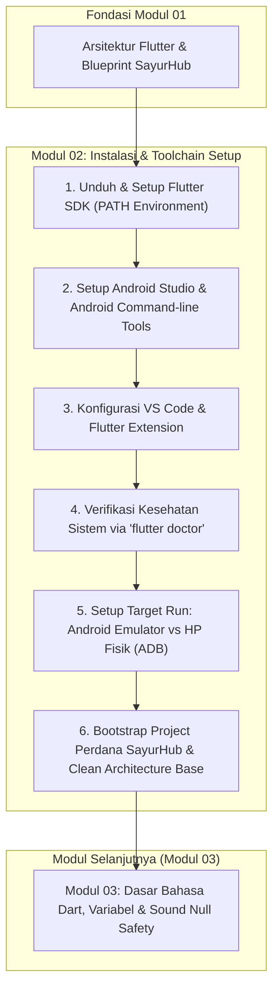
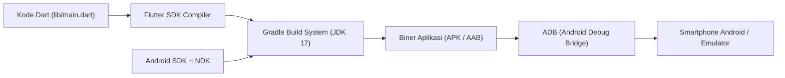
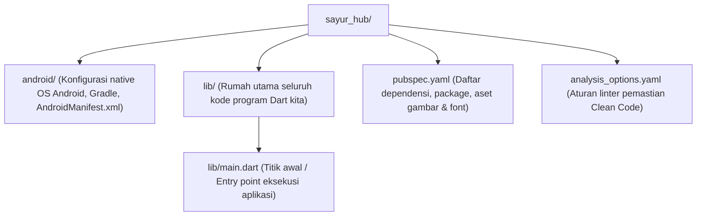

# MODUL 02: INSTALASI, KONFIGURASI LINGKUNGAN PENGEMBANGAN, DAN FLUTTER TOOLCHAIN
## PENGEMBANGAN APLIKASI MOBILE MULTIPLATFORM DARI DASAR HINGGA PRODUKSI
### KONSENTRASI KEAHLIAN REKAYASA PERANGKAT LUNAK (SMK RPL)

---

## A. IDENTITAS MODUL

- **Nomor Modul**: 02
- **Judul Modul**: Instalasi, Konfigurasi Lingkungan Pengembangan, dan Flutter Toolchain
- **Tingkat Kesulitan**: Pemula (*Beginner*)
- **Estimasi Waktu**: 6 Jam Pelajaran (6 × 45 Menit = 270 Menit)
- **Prasyarat**: Modul 01 (Pengenalan Pemrograman Mobile dan Ekosistem Flutter)
- **Tujuan Pembelajaran**:
  1. Siswa mampu mengunduh, mengekstrak, dan mengonfigurasi Flutter SDK serta Android SDK ke dalam variabel sistem lingkungan (*Environment Variable PATH*).
  2. Siswa mampu menginstal dan mengonfigurasi Integrated Development Environment (IDE) Visual Studio Code lengkap dengan ekstensi resmi Flutter & Dart.
  3. Siswa terampil mengoperasikan dan menganalisis keluaran perintah `flutter doctor` serta menyelesaikan setiap peringatan atau lisensi Android SDK yang belum disetujui.
  4. Siswa mampu mengonfigurasi perangkat pengujian: Android Emulator (Virtual Device) dan perangkat fisik Android asli melalui mode pengembang (*Developer Options*) dan *USB Debugging*.
  5. Siswa mampu menginisialisasi project Flutter resmi pertama untuk aplikasi **SayurHub** dan menjalankannya secara sukses tanpa bug.
- **Kompetensi yang Akan Dicapai**:
  - **Kognitif**: Pemahaman arsitektur *toolchain*, alur kompilasi Gradle pada Android, serta manajemen dependensi SDK.
  - **Psikomotorik**: Keterampilan CLI (*Command Line Interface*), konfigurasi sistem operasi (Linux/Windows), setup emulator Android AVD, dan debugging konektivitas ADB (*Android Debug Bridge*).

---

## B. PETA KONSEP



- **Keterkaitan dengan Modul 01**: Pada Modul 01, siswa telah menyusun *Software Requirements Specification* (SRS) dan cetak biru arsitektur SayurHub. Modul 02 menyediakan mesin dan lingkungan kerja fisik agar cetak biru tersebut dapat mulai dieksekusi.
- **Keterkaitan dengan Modul 03**: Setelah lingkungan terpasang sempurna dan project berjalan di layar smartphone, siswa siap mempelajari logika dasar pemrograman Dart pada Modul 03 tanpa terganggu kendala teknis lingkungan (*environment issues*).

---

## C. MATERI TEORI

### 1. Memahami Konsep "Toolchain" dalam Pengembangan Mobile
Dalam dunia rekayasa perangkat lunak, istilah **Toolchain** (rantai perkakas) merujuk pada sekumpulan program pendukung yang bekerja secara berantai untuk mengubah kode program yang ditulis manusia (*source code*) menjadi aplikasi biner yang dapat dieksekusi oleh sistem operasi perangkat keras.

Untuk menjalankan aplikasi Flutter di Android, rantai perkakas yang harus terhubung adalah:
1. **Flutter SDK**: Menyediakan *compiler* Dart, pustaka widget antarmuka, dan CLI `flutter`.
2. **Java Development Kit (JDK 17+)**: Diperlukan oleh sistem build Android (Gradle) untuk mengompilasi modul native Android.
3. **Android SDK (Software Development Kit)**: Menyediakan pustaka API sistem operasi Android, kompilator DEX, dan manajer emulator.
4. **Android SDK Command-line Tools & Platform-tools**: Menyediakan utilitas penting seperti `adb` (Android Debug Bridge).
5. **Code Editor / IDE**: Ruang kerja pengembang untuk menulis kode dengan bantuan *code completion*, *linter*, dan tombol *debugging*.



---

### 2. Apa itu Environment Variable `PATH`?
Salah satu kendala paling umum bagi siswa pemula adalah pesan kesalahan terminal:  
`bash: flutter: command not found` atau `'flutter' is not recognized as an internal or external command`.

Sistem operasi (baik Linux, macOS, maupun Windows) memiliki variabel sistem bernama **`PATH`**. Variabel ini berisi daftar alamat direktori tempat sistem operasi mencari file program biner saat sebuah perintah diketikkan di terminal.  
Dengan menambahkan direktori `flutter/bin` ke dalam `PATH`, Anda memberi tahu komputer: *"Kapan pun saya mengetik perintah `flutter` di folder mana pun, carilah program eksekusinya di dalam folder `flutter/bin` ini!"*

---

### 3. Anatomi Perintah Sakti: `flutter doctor`
Flutter dilengkapi dengan utilitas diagnosis mandiri tercanggih di industri pemrograman mobile, yaitu perintah:
```bash
flutter doctor -v
```
Bendera `-v` (*verbose*) meminta Flutter menampilkan laporan diagnosis mendalam mengenai 5 pilar kesehatan lingkungan pengembangan:
1. **Flutter Channel & Version**: Memeriksa versi Flutter yang terpasang dan kestabilan salurannya (*stable channel*).
2. **Android Toolchain**: Memeriksa apakah Android SDK, JDK, platform-tools, dan lisensi Google SDK telah disetujui.
3. **Chrome / Web Engine**: Memeriksa ketersediaan browser untuk debugging web.
4. **Android Studio / VS Code**: Memeriksa apakah ekstensi Flutter dan Dart telah terpasang pada editor.
5. **Connected Devices**: Memeriksa apakah ada emulator yang sedang aktif atau smartphone fisik yang terhubung melalui kabel data USB.

Simbol status pada keluaran `flutter doctor`:
- `[✓]` (Centang Hijau): Komponen terpasang sempurna dan siap digunakan.
- `[!]` (Tanda Seru Kuning): Peringatan non-fatal (lingkungan masih bisa berjalan, namun ada fitur opsional yang belum aktif).
- `[✗]` (Silang Merah): Kesalahan fatal yang memblokir proses build aplikasi dan harus segera diperbaiki.

---

### 4. Perangkat Pengujian: Emulator vs Perangkat Fisik (Smartphone Asli)

Siswa SMK RPL sering dihadapkan pada keterbatasan spesifikasi laptop di laboratorium sekolah. Oleh karena itu, penting memahami trade-off antara Emulator dan Smartphone fisik:

| Aspek Komparasi | Android Emulator (AVD) | Smartphone Fisik Asli (USB Debugging) |
|---|---|---|
| **Kebutuhan RAM Laptop** | Sangat Berat (Membutuhkan tambahan RAM 3–4 GB) | **Sangat Ringan (Laptop hanya menjalankan IDE)** |
| **Beban CPU & GPU Laptop** | Tinggi (Memerlukan virtualisasi hardware VT-x/AMD-V) | **Nol (Pemrosesan rendering dilakukan oleh chip smartphone)** |
| **Kemudahan Akses Sensor** | Terbatas (Kamera & GPS disimulasikan secara virtual) | **Nyata (Kamera, sensor sidik jari, dan GPS langsung asli)** |
| **Kenyamanan Siswa** | Tampilan layar muncul langsung di monitor laptop | Layar berada di genggaman tangan siswa |
| **Rekomendasi untuk SMK** | Cocok jika RAM laptop $\ge$ 16 GB | **Sangat Direkomendasikan untuk laptop dengan RAM 8 GB** |

> [!TIP]
> **Rekomendasi Instruktur untuk Siswa dengan Laptop RAM 8 GB:**  
> Gunakan smartphone Android fisik Anda yang dihubungkan dengan kabel data USB asli. Selain membuat laptop Anda tetap dingin dan cepat, Anda dapat merasakan langsung pengalaman sentuhan jari konsumen aplikasi SayurHub!

---

### 5. Mode Komunikasi Android Debug Bridge (ADB)
**ADB** adalah alat baris perintah serbaguna yang bertindak sebagai jembatan komunikasi antara komputer pengembang dengan perangkat Android.  
Ketika Anda menancapkan kabel USB dari HP ke laptop, ADB menjalankan sebuah proses latar belakang (*daemon*) yang bertugas:
1. Mengirim file APK hasil build dari laptop ke memori penyimpanan HP.
2. Memerintahkan sistem operasi Android untuk memasang (*install*) dan meluncurkan aplikasi.
3. Membuka saluran komunikasi dua arah untuk mengirimkan log debug dan sinyal **Hot Reload**.

---

## D. PEMBAHASAN STRUKTUR INTI PROJECT FLUTTER

Ketika sebuah project Flutter baru dibuat menggunakan perintah CLI:
```bash
flutter create --org com.smkrpl.sayurhub --platforms android sayur_hub
```
Flutter menghasilkan struktur direktori standar. Berikut adalah 4 file dan folder terpenting yang wajib dipahami siswa:



### 1. Membedah File `pubspec.yaml`
File `pubspec.yaml` menggunakan format penulisan YAML (*YAML Ain't Markup Language*) yang mengandalkan **indentasi spasi yang sangat ketat**.  
*Perhatian*: Jangan pernah menggunakan tombol Tab pada file YAML, selalu gunakan **2 spasi**.

Bagian-bagian penting `pubspec.yaml`:
```yaml
name: sayur_hub
description: "Aplikasi E-Commerce Sayur dan Buah Segar SMK RPL"
publish_to: "none" # Mencegah project pribadi terupload tidak sengaja ke pub.dev
version: 1.0.0+1   # 1.0.0 adalah Version Name, 1 adalah Version Code (Build Number)

environment:
  sdk: ^3.0.0      # Menentukan standar Dart SDK yang digunakan (Sound Null Safety aktif)

dependencies:
  flutter:
    sdk: flutter
  cupertino_icons: ^1.0.8

dev_dependencies:
  flutter_test:
    sdk: flutter
  flutter_lints: ^3.0.0 # Aturan penjaminan kualitas kode resmi Flutter Team

flutter:
  uses-material-design: true # Mengaktifkan pustaka ikon Material Design resmi
```

### 2. Membedah Kode Entry Point `lib/main.dart`
Berikut adalah struktur kode paling sederhana namun memenuhi kaidah *production best practice*:

```dart
import 'package:flutter/material.dart';

// 1. Fungsi main() adalah gerbang pertama yang dieksekusi saat aplikasi dibuka
void main() {
  // runApp bertugas menempelkan Widget akar (Root Widget) ke layar perangkat
  runApp(const SayurHubApp());
}

// 2. SayurHubApp bertindak sebagai konfigurator global aplikasi (MaterialApp)
class SayurHubApp extends StatelessWidget {
  const SayurHubApp({super.key});

  @override
  Widget build(BuildContext context) {
    return MaterialApp(
      title: 'SayurHub',
      debugShowCheckedModeBanner: false, // Menghilangkan banner DEBUG merah di pojok kanan atas
      theme: ThemeData(
        colorScheme: ColorScheme.fromSeed(
          seedColor: const Color(0xFF2E7D32), // Warna hijau daun organik SayurHub
        ),
        useMaterial3: true, // Mengaktifkan standar Material Design 3
      ),
      home: const WelcomePage(),
    );
  }
}

// 3. WelcomePage adalah kanvas visual pertama yang dilihat pengguna
class WelcomePage extends StatelessWidget {
  const WelcomePage({super.key});

  @override
  Widget build(BuildContext context) {
    return Scaffold(
      appBar: AppBar(
        title: const Text('SayurHub — Segar Tiap Hari'),
        backgroundColor: Theme.of(context).colorScheme.inversePrimary,
        centerTitle: true,
      ),
      body: Center(
        child: Padding(
          padding: const EdgeInsets.all(24.0),
          child: Column(
            mainAxisAlignment: MainAxisAlignment.center,
            children: [
              const Icon(
                Icons.eco_rounded,
                size: 80,
                color: Color(0xFF2E7D32),
              ),
              const SizedBox(height: 16),
              const Text(
                'Selamat Datang di SayurHub!',
                style: TextStyle(
                  fontSize: 22,
                  fontWeight: FontWeight.bold,
                ),
                textAlign: TextAlign.center,
              ),
              const SizedBox(height: 8),
              Text(
                'Aplikasi siap dikembangkan untuk Modul 03.',
                style: TextStyle(
                  fontSize: 14,
                  color: Colors.grey[700],
                ),
                textAlign: TextAlign.center,
              ),
            ],
          ),
        ),
      ),
    );
  }
}
```

#### Penjelasan Bagian Penting Kode di Atas:
- **`import 'package:flutter/material.dart';`**: Memuat seluruh pustaka komponen Material Design dari Flutter framework.
- **`void main() => runApp(...)`**: Titik masuk utama program. Tanpa fungsi `main()`, sistem operasi tidak tahu dari baris mana eksekusi harus dimulai.
- **`const SayurHubApp({super.key})`**: Penggunaan kata kunci `const` pada konstruktor menginstruksikan engine Flutter bahwa widget ini bersifat imutabel (tidak berubah), sehingga engine tidak perlu membuang memori CPU untuk me-render ulang widget ini. Ini adalah prinsip dasar *performance optimization*.
- **`debugShowCheckedModeBanner: false`**: Standar kerapian antarmuka produksi untuk menonaktifkan watermark pita merah "DEBUG" di pojok kanan layar.
- **`ColorScheme.fromSeed(seedColor: const Color(0xFF2E7D32))`**: Fitur modern Material Design 3 yang secara otomatis menghasilkan palet warna harmonis (warna teks, warna tombol, warna latar) hanya dari satu warna acuan hijau daun SayurHub.

---

## E. PERSIAPAN PRAKTIKUM

Sebelum memulai langkah praktikum, pastikan kebutuhan berikut telah tersedia:

1. **Spesifikasi Komputer Minimal**:
   - OS: Ubuntu Linux 22.04 LTS / Windows 10/11 64-bit.
   - Processor: Intel Core i3 / AMD Ryzen 3 (Dukungan Virtualisasi aktif di BIOS).
   - RAM: Minimal 8 GB.
   - Ruang Penyimpanan Kosong: Minimal 15 GB (untuk Flutter SDK, Android SDK, dan cache build Gradle).
2. **Paket Perangkat Lunak yang Harus Diunduh**:
   - Flutter SDK versi Stable terbaru (Flutter 3.x+).
   - Visual Studio Code versi terbaru.
   - Android Studio (atau Android Command-line Tools) + OpenJDK 17.
3. **Peralatan Tambahan**:
   - 1 unit Smartphone Android + kabel data USB yang mampu menghantarkan data (bukan sekadar kabel pengisi daya biasa).

---

## F. LANGKAH PRAKTIKUM STEP-BY-STEP

### Langkah 1 — Pemasangan dan Konfigurasi Flutter SDK

1. Buka terminal Linux Anda (atau PowerShell pada Windows).
2. Buat folder penyimpanan tools pengembangan pada direktori home pengguna:
   ```bash
   mkdir -p /home/arif/development
   cd /home/arif/development
   ```
3. Unduh bundel resmi Flutter SDK Stable (atau gunakan file tarball yang telah disediakan guru di server lab sekolah):
   ```bash
   # Alternatif via Git Clone resmi cabang Stable:
   git clone https://github.com/flutter/flutter.git -b stable
   ```
4. Tambahkan path Flutter ke dalam konfigurasi shell Anda (`~/.bashrc` untuk Linux):
   ```bash
   echo 'export PATH="$HOME/development/flutter/bin:$PATH"' >> ~/.bashrc
   source ~/.bashrc
   ```
5. Verifikasi pengenalan perintah dengan mengetik:
   ```bash
   which flutter
   ```
   *Hasil yang diharapkan*: Muncul path direktori biner, contoh: `/home/arif/development/flutter/bin/flutter`.

---

### Langkah 2 — Konfigurasi Android Studio dan Android SDK Command-line Tools

1. Jalankan aplikasi **Android Studio**.
2. Pada layar pembuka Android Studio (*Welcome Screen*), klik menu **More Actions** $\to$ pilih **SDK Manager**.
3. Buka tab **SDK Platforms**:
   - Centang **Android 14.0 (UpsideDownCake)** atau **Android 13.0 (Tiramisu)**.
4. Buka tab **SDK Tools**:
   - Pastikan mencentang komponen wajib berikut:
     - [x] **Android SDK Build-Tools**
     - [x] **Android SDK Command-line Tools (latest)** *(Sangat krusial untuk Flutter!)*
     - [x] **Android Emulator**
     - [x] **Android SDK Platform-Tools**
5. Klik tombol **Apply** di pojok kanan bawah, lalu setujui konfirmasi pengunduhan hingga selesai.

---

### Langkah 3 — Konfigurasi Visual Studio Code

1. Buka aplikasi **Visual Studio Code**.
2. Klik ikon kotak-kotak di bilah navigasi samping kiri (**Extensions**) atau tekan pintasan `Ctrl + Shift + X`.
3. Pada kolom pencarian, ketik **Flutter** (diterbitkan oleh *Dart Code*), lalu klik tombol **Install**.
   - *Catatan*: Memasang ekstensi Flutter akan secara otomatis memasang ekstensi pendampingnya, yaitu **Dart**.
4. Tekan tombol `Ctrl + Shift + P` untuk membuka *Command Palette*, lalu ketik:
   `Flutter: Run Flutter Doctor`.
   Perhatikan jendela terminal output yang muncul di bagian bawah VS Code.

---

### Langkah 4 — Menjalankan Diagnosis Sistem & Menyetujui Lisensi Android

1. Buka terminal VS Code atau terminal sistem.
2. Jalankan perintah persetujuan lisensi Android:
   ```bash
   flutter doctor --android-licenses
   ```
3. Saat terminal menampilkan lembar perjanjian lisensi SDK Google, ketik huruf `y` (*Yes*) lalu tekan `Enter` untuk setiap lisensi hingga muncul pesan:  
   `All SDK package licenses accepted`.
4. Jalankan kembali pemeriksaan menyeluruh:
   ```bash
   flutter doctor -v
   ```
5. *Hasil yang diharapkan*: Seluruh baris Android Toolchain dan Flutter bertanda centang hijau `[✓]`.

---

### Langkah 5 — Mengaktifkan USB Debugging pada Smartphone Android Fisik

Jika Anda menggunakan smartphone Android fisik (sangat dianjurkan):
1. Buka menu **Pengaturan / Settings** di smartphone Android Anda.
2. Gulir ke menu paling bawah, buka **Tentang Ponsel / About Phone**.
3. Temukan baris bertuliskan **Nomor Versi / Build Number**.
4. **Ketuk baris tersebut sebanyak 7 kali berturut-turut** hingga muncul pesan melayang di layar: *"Selamat, Anda sekarang adalah seorang pengembang!"* (*You are now a developer!*).
5. Kembali ke menu Pengaturan utama $\to$ buka **Sistem / Pengaturan Tambahan** $\to$ pilih **Opsi Pengembang / Developer Options**.
6. Aktifkan sakelar tombol **Debugging USB / USB Debugging**.
7. Hubungkan smartphone ke laptop menggunakan kabel USB.
8. Perhatikan layar smartphone Anda: Akan muncul kotak dialog pop-up konfirmasi bertuliskan: *"Izinkan debugging USB dari komputer ini?"*.  
   **Centang pilihan "Selalu izinkan dari komputer ini"**, lalu tekan tombol **Izinkan / OK**.
9. Verifikasi konektivitas di terminal laptop dengan perintah:
   ```bash
   flutter devices
   ```
   *Hasil yang diharapkan*: Nama tipe smartphone Anda (misal: *Samsung Galaxy A52*, *Xiaomi Redmi Note 10*, dll) terdeteksi dengan status `connected`.

---

### Langkah 6 — Bootstrap dan Uji Coba Build Perdana Project "SayurHub"

1. Arahkan terminal ke folder project kita:
   ```bash
   cd /home/arif/flutter-1/sayur_hub
   ```
2. Buat file `pubspec.yaml` dan `lib/main.dart` sesuai struktur produksi yang bersih (lihat Bagian J untuk kode integrasi lengkap).
3. Jalankan perintah pengambilan dependensi:
   ```bash
   flutter pub get
   ```
4. Jalankan aplikasi ke target perangkat:
   - **Opsi A (Smartphone Android / Emulator)**:
     ```bash
     flutter run
     ```
   - **Opsi B (Web Browser Google Chrome)**:
     ```bash
     flutter run -d chrome
     ```
   - **Opsi C (Web Server Ringan — Sangat Direkomendasikan di WSL / Server)**:
     ```bash
     flutter config --enable-web
     flutter run -d web-server --web-port 8080 --web-hostname 0.0.0.0
     ```
     Lalu buka browser di komputer/laptop Anda pada alamat: `http://localhost:8080`.
5. Tunggu proses kompilasi pertama kali selesai.
6. *Hasil yang diharapkan*: Layar perangkat/browser Anda menyala menampilkan aplikasi **SayurHub** dengan AppBar hijau, ikon daun, dan teks sambutan "Selamat Datang di SayurHub!".
7. Lakukan uji coba fitur **Stateful Hot Reload**:
   - Ubah baris teks `'Selamat Datang di SayurHub!'` menjadi `'SayurHub — Belanja Sayur Segar Mudah!'`.
   - Simpan file (`Ctrl + S`) atau tekan tombol huruf `r` di jendela terminal.
   - Perhatikan layar smartphone Anda: Teks berubah dalam waktu kurang dari 1 detik tanpa aplikasi keluar atau me-restart!

---

## G. ANALISIS DAN PEMAHAMAN

Jawablah pertanyaan analisis berikut berdasarkan pengalaman praktikum Anda:

1. **Analisis Toolchain**: Mengapa saat pertama kali menjalankan perintah `flutter run` membutuhkan waktu yang jauh lebih lama (1–3 menit) dibandingkan saat kita menekan tombol Hot Reload (`r`) yang hanya butuh waktu kurang dari 1 detik? Jelaskan peran Gradle dan mode kompilasi JIT di balik fenomena ini!
2. **Analisis Konfigurasi**: Apa risiko yang akan dialami oleh pengembang jika file `pubspec.yaml` ditulis menggunakan kombinasi karakter Tab dan Spasi secara tidak sengaja? Mengapa parser YAML menolak karakter Tab?
3. **Analisis Lisensi SDK**: Mengapa Google mewajibkan pengembang menyetujui lisensi SDK Android secara eksplisit melalui perintah `flutter doctor --android-licenses` sebelum diizinkan mengompilasi file APK?

---

## H. LATIHAN DAN TANTANGAN

### 1. Soal Teori
1. Perintah CLI Flutter yang digunakan untuk memeriksa kelengkapan lingkungan pengembangan beserta dependensi sistem adalah:
   - A. `flutter check`
   - B. `flutter doctor`
   - C. `flutter analyze`
   - D. `flutter status`
2. Ekstensi file yang digunakan untuk mengonfigurasi metadata dan dependensi eksternal pada project Flutter adalah:
   - A. `build.gradle`
   - B. `package.json`
   - C. `pubspec.yaml`
   - D. `config.xml`
3. Komponen Android SDK yang bertindak sebagai jembatan pengiriman data dan kompilasi debug antara komputer pengembang dan smartphone Android fisik adalah:
   - A. Gradle Daemon
   - B. Android Virtual Device (AVD)
   - C. Android Debug Bridge (ADB)
   - D. Dalvik Virtual Machine
4. Jelaskan perbedaan mendasar antara perintah **Hot Reload** (tombol `r`) dan **Hot Restart** (tombol `R`) pada Flutter CLI!
5. Apa kegunaan dari parameter `debugShowCheckedModeBanner: false` pada widget `MaterialApp`?

### 2. Soal Praktik
1. **Inspeksi Device**: Jalankan perintah `flutter devices` di terminal. Dokumentasikan nama model perangkat, Device ID, Target OS Version, dan mode arsitektur CPU (contoh: `android-arm64`) yang tertera pada layar terminal Anda!
2. **Eksperimen Hot Reload**: Pada file `lib/main.dart` SayurHub yang sedang berjalan, ubah nilai warna tema `seedColor: const Color(0xFF2E7D32)` menjadi warna oranye `const Color(0xFFFF9800)`. Lakukan Hot Reload dan amati perubahan warna elemen AppBar dan ikon secara instan. Kembalikan ke warna hijau setelah selesai.
3. **Pembersihan Cache Build**: Jalankan perintah `flutter clean`, lalu perhatikan folder apa saja yang terhapus di dalam direktori project Anda. Jelaskan mengapa perintah `flutter clean` sering menjadi jurus penyelamat saat terjadi error kompilasi aneh pada Gradle!

### 3. Tantangan Pemecahan Masalah (*Problem-Solving Challenges*)
- **Tantangan 1 (Troubleshoot Port ADB Bentrok)**: Kadang-kadang proses ADB server di komputer mengalami *freeze* atau port 5037 digunakan oleh aplikasi lain sehingga HP tidak terdeteksi oleh `flutter devices`. Tuliskan baris perintah CLI untuk mematikan paksa (*kill*) server ADB dan menyalakannya kembali secara segar!
- **Tantangan 2 (Konfigurasi Git Ignore)**: Project Flutter menghasilkan ribuan file kompilasi sementara di folder `build/` dan `.dart_tool/` yang ukurannya bisa mencapai ratusan Megabyte. Rancanglah aturan file `.gitignore` yang tepat agar file-file sampah tersebut tidak ikut ter-upload ke repositori GitHub SayurHub!

### 4. Studi Kasus Industri
**Studi Kasus**: Di laboratorium komputer SMK yang terdiri dari 36 unit PC tanpa koneksi internet berkecepatan tinggi, instruktur harus menyiapkan lingkungan Flutter untuk seluruh siswa dalam waktu 1 hari kerja. Mengunduh Flutter SDK dan dependensi Gradle di setiap komputer satu per satu secara online akan memakan waktu berhari-hari dan menghabiskan kuota lab.  
*Tugas Siswa*: Rancanglah strategi efisien (metode *Offline SDK Distribution* & *Local Gradle Cache Sharing*) agar seluruh 36 PC lab dapat terinstal Flutter SDK lengkap dengan offline cache tanpa harus mendownload ulang dari internet di masing-masing komputer!

---

## I. TROUBLESHOOTING & FAQ

Berikut adalah tabel permasalahan teknis nyata yang sering dihadapi saat instalasi lingkungan Flutter beserta solusinya:

| Permasalahan Teknis | Penyebab Utama | Gejala / Pesan Error | Solusi Langkah Demi Langkah |
|---|---|---|---|
| **Android license status unknown** | Komponen Android SDK Command-line Tools belum terpasang dari SDK Manager. | `[!] Android toolchain - Some Android licenses not accepted. Run 'flutter doctor --android-licenses'.` namun saat dijalankan muncul error `Android SDK tools not found`. | 1. Buka Android Studio $\to$ SDK Manager.<br>2. Buka tab **SDK Tools**.<br>3. Centang **Android SDK Command-line Tools (latest)** lalu klik Apply.<br>4. Jalankan ulang `flutter doctor --android-licenses` di terminal. |
| **HP Fisik Tidak Terdeteksi (`No devices found`)** | 1. Kabel USB hanya mendukung charging (bukan kabel data).<br>2. Opsi USB Debugging belum aktif.<br>3. Otorisasi RSA key komputer belum diizinkan di layar HP. | Terminal `flutter devices` menampilkan: `0 connected devices`. | 1. Ganti kabel data dengan kabel original bawaan HP.<br>2. Buka Developer Options di HP $\to$ nyalakan USB Debugging.<br>3. Cabut dan tancapkan kembali kabel USB $\to$ centang "Selalu izinkan komputer ini" $\to$ tekan OK. |
| **Gradle Build Timeout / Hang Saat Pertama Kali Running** | Proses download file Gradle Wrapper (`gradle-x.x-all.zip`) terputus karena koneksi internet lambat. | Terminal macet berjam-jam pada baris: `Running Gradle task 'assembleDebug'...` tanpa ada pergerakan. | 1. Tekan `Ctrl + C` untuk membatalkan proses.<br>2. Periksa kecepatan koneksi internet.<br>3. Masuk ke folder `android/` lalu jalankan `./gradlew assembleDebug` secara mandiri untuk melihat progres unduhan file Gradle secara transparan. |
| **Pesan Kesalahan "Waiting for another flutter command to release the startup lock"** | Ada proses Flutter sebelumnya yang ditutup paksa atau masih berjalan di latar belakang sehingga file lock memori tertinggal. | Terminal terkunci dan menolak menjalankan perintah Flutter baru. | 1. Tutup seluruh terminal.<br>2. Buka direktori Flutter SDK Anda: `flutter/bin/cache/`.<br>3. Hapus file bernama `lockfile`.<br>4. Buka kembali terminal dan jalankan perintah Flutter seperti biasa. |

---

## J. PRAKTIKUM INTEGRASI ANTAR-MODUL: INITIAL CODEBASE "SAYURHUB"

Pada praktikum integrasi ini, kita mewujudkan cetak biru Modul 01 ke dalam basis kode Flutter nyata yang siap dikembangkan untuk pembelajaran logika Dart pada modul-modul berikutnya.

### 1. Judul Praktikum Integrasi
**Inisialisasi Basis Kode (*Codebase Bootstrap*), Konfigurasi Linter Kualitas Kode, dan Pengujian Build Perdana SayurHub**

### 2. Tujuan Praktikum Integrasi
- Menyiapkan konfigurasi dependensi resmi pada file `pubspec.yaml`.
- Mengonfigurasi linter kode profesional pada `analysis_options.yaml` guna menjamin kode bebas bug (*Zero Warning / Zero Bug*).
- Menjalankan aplikasi perdana `sayur_hub` dan mengonfirmasi bahwa seluruh komponen dasar berfungsi sempurna di layar perangkat pengujian.

### 3. Materi yang Diintegrasikan
- Cetak biru arsitektur dan identitas warna SayurHub dari Modul 01 (Hijau Organik `#2E7D32`).
- Penguasaan Flutter CLI dan toolchain dari Modul 02.
- Standar penulisan widget dan Clean Architecture dasar.

### 4. Kondisi Awal Proyek (*Project State Before*)
Folder `/home/arif/flutter-1/sayur_hub/` baru berisi folder dokumentasi `docs/specs/` dan repositori Git awal.

### 5. Instruksi Langkah Demi Langkah

1. Pastikan Anda berada di root project SayurHub:
   ```bash
   cd /home/arif/flutter-1/sayur_hub
   ```
2. Buat struktur folder arsitektur bersih di dalam folder `lib/`:
   ```bash
   mkdir -p lib/core/theme
   mkdir -p lib/core/constants
   mkdir -p lib/features/home
   ```
3. Buat file konfigurasi dependensi `pubspec.yaml`.
4. Buat file aturan linter `analysis_options.yaml`.
5. Buat file konstanta warna tema `lib/core/theme/app_colors.dart`.
6. Buat file halaman sambutan `lib/features/home/welcome_screen.dart`.
7. Buat file titik masuk utama `lib/main.dart`.
8. Verifikasi kualitas kode dengan menjalankan static analyzer resmi Flutter:
   ```bash
   flutter analyze
   ```
   *Kriteria Keberhasilan Analyzer*: `No issues found! (ran in 1.2s)`.
9. Commit seluruh perubahan basis kode perdana ke repositori Git:
   ```bash
   git add .
   git commit -m "feat(bootstrap): initial flutter codebase, theme configuration, and welcome screen for sayurhub"
   ```

---

### 6. Kode Program Integrasi Lengkap

#### A. File: `pubspec.yaml`
```yaml
name: sayur_hub
description: "Aplikasi E-Commerce Sayur dan Buah Segar SMK RPL"
publish_to: "none"
version: 1.0.0+1

environment:
  sdk: ^3.0.0

dependencies:
  flutter:
    sdk: flutter
  cupertino_icons: ^1.0.8

dev_dependencies:
  flutter_test:
    sdk: flutter
  flutter_lints: ^3.0.0

flutter:
  uses-material-design: true
```

#### B. File: `analysis_options.yaml`
```yaml
include: package:flutter_lints/flutter.yaml

linter:
  rules:
    prefer_const_constructors: true
    prefer_const_declarations: true
    avoid_print: true
    prefer_single_quotes: true
    always_use_package_imports: true
```

#### C. File: `lib/core/theme/app_colors.dart`
```dart
import 'package:flutter/material.dart';

/// Kelas penyedia palet warna resmi aplikasi SayurHub
/// Menjamin seluruh tampilan memiliki warna yang konsisten sesuai standar UI/UX
class AppColors {
  // Mencegah instansiasi kelas utility
  AppColors._();

  /// Warna Primer: Hijau Daun Organik Segar
  static const Color primaryGreen = Color(0xFF2E7D32);

  /// Warna Sekunder: Oranye Sinar Matahari untuk badge promo & diskon
  static const Color accentOrange = Color(0xFFFF9800);

  /// Warna Latar Belakang: Putih Mint Lembut
  static const Color backgroundLight = Color(0xFFF8FAF8);

  /// Warna Teks Utama: Abu-abu Gelap Pekat (Keterbacaan tinggi)
  static const Color textDark = Color(0xFF1E293B);

  /// Warna Teks Sekunder: Abu-abu Netral
  static const Color textMuted = Color(0xFF64748B);
}
```

#### D. File: `lib/features/home/welcome_screen.dart`
```dart
import 'package:flutter/material.dart';
import 'package:sayur_hub/core/theme/app_colors.dart';

/// Halaman pembuka perdana aplikasi SayurHub
/// Memverifikasi bahwa antarmuka berhasil di-render oleh Flutter Engine
class WelcomeScreen extends StatelessWidget {
  const WelcomeScreen({super.key});

  @override
  Widget build(BuildContext context) {
    return Scaffold(
      backgroundColor: AppColors.backgroundLight,
      appBar: AppBar(
        title: const Text(
          'SayurHub',
          style: TextStyle(
            fontWeight: FontWeight.bold,
            color: Colors.white,
          ),
        ),
        centerTitle: true,
        backgroundColor: AppColors.primaryGreen,
        elevation: 0,
      ),
      body: SafeArea(
        child: Center(
          child: Padding(
            padding: const EdgeInsets.symmetric(horizontal: 24.0),
            child: Column(
              mainAxisAlignment: MainAxisAlignment.center,
              children: [
                // Ikon Branding Utama
                Container(
                  width: 100,
                  height: 100,
                  decoration: BoxDecoration(
                    color: AppColors.primaryGreen.withOpacity(0.12),
                    shape: BoxShape.circle,
                  ),
                  child: const Icon(
                    Icons.eco_rounded,
                    size: 54,
                    color: AppColors.primaryGreen,
                  ),
                ),
                const SizedBox(height: 24),

                // Judul Aplikasi
                const Text(
                  'Sayur & Buah Segar Tiap Hari',
                  style: TextStyle(
                    fontSize: 22,
                    fontWeight: FontWeight.bold,
                    color: AppColors.textDark,
                  ),
                  textAlign: TextAlign.center,
                ),
                const SizedBox(height: 12),

                // Deskripsi Singkat
                const Text(
                  'Langsung dipetik dari petani mitra lokal. Belanja pangan sehat kini lebih mudah dan higienis.',
                  style: TextStyle(
                    fontSize: 14,
                    color: AppColors.textMuted,
                    height: 1.5,
                  ),
                  textAlign: TextAlign.center,
                ),
                const SizedBox(height: 32),

                // Badge Indikator Status Kesiapan Lingkungan
                Container(
                  padding: const EdgeInsets.symmetric(
                    horizontal: 16,
                    vertical: 8,
                  ),
                  decoration: BoxDecoration(
                    color: Colors.white,
                    borderRadius: BorderRadius.circular(20),
                    border: Border.all(
                      color: AppColors.primaryGreen.withOpacity(0.3),
                    ),
                  ),
                  child: const Row(
                    mainAxisSize: MainAxisSize.min,
                    children: [
                      Icon(
                        Icons.check_circle_rounded,
                        color: AppColors.primaryGreen,
                        size: 18,
                      ),
                      SizedBox(width: 8),
                      Text(
                        'Toolchain & Engine Siap (Modul 02 Selesai)',
                        style: TextStyle(
                          fontSize: 12,
                          fontWeight: FontWeight.w600,
                          color: AppColors.primaryGreen,
                        ),
                      ),
                    ],
                  ),
                ),
              ],
            ),
          ),
        ),
      ),
    );
  }
}
```

#### E. File: `lib/main.dart`
```dart
import 'package:flutter/material.dart';
import 'package:sayur_hub/core/theme/app_colors.dart';
import 'package:sayur_hub/features/home/welcome_screen.dart';

void main() {
  runApp(const SayurHubRootApp());
}

/// Root Widget aplikasi SayurHub
class SayurHubRootApp extends StatelessWidget {
  const SayurHubRootApp({super.key});

  @override
  Widget build(BuildContext context) {
    return MaterialApp(
      title: 'SayurHub',
      debugShowCheckedModeBanner: false,
      theme: ThemeData(
        useMaterial3: true,
        scaffoldBackgroundColor: AppColors.backgroundLight,
        colorScheme: ColorScheme.fromSeed(
          seedColor: AppColors.primaryGreen,
          primary: AppColors.primaryGreen,
          secondary: AppColors.accentOrange,
        ),
      ),
      home: const WelcomeScreen(),
    );
  }
}
```

---

### 7. Hasil yang Diharapkan
1. Seluruh kode tersimpan rapi pada struktur arsitektur `lib/core/` dan `lib/features/`.
2. Tidak ada kesalahan linter atau peringatan warning (`0 errors, 0 warnings`).
3. Commit Git terdaftar dengan pesan deskriptif.

### 8. Kriteria Keberhasilan
- [x] Struktur folder `sayur_hub/lib/core/` dan `sayur_hub/lib/features/` terbentuk.
- [x] Perintah `flutter pub get` berhasil dieksekusi tanpa galat.
- [x] Perintah `flutter analyze` menghasilkan status bersih (*Clean code*).
- [x] Layar smartphone menampilkan Welcome Screen SayurHub dengan visual hijau yang proporsional.

---

## K. EVALUASI MODUL 02

### 1. Rubrik Penilaian Kinerja Praktikum
| Aspek Keterampilan | Skor Maksimal | Indikator Pencapaian |
|---|---|---|
| **Konfigurasi Lingkungan & Toolchain** | 30 | Berhasil mengatur PATH Flutter SDK, menyetujui seluruh Android licenses, dan `flutter doctor` bebas tanda silang merah. |
| **Konektivitas Perangkat Uji** | 25 | Berhasil menghubungkan smartphone fisik (ADB) atau emulator AVD dengan otorisasi aktif. |
| **Penerapan Clean Code & Linter** | 25 | Mampu menyusun kode starter dengan aturan `analysis_options.yaml` tanpa menghasilkan warning / lint error. |
| **Pemahaman Mekanisme Hot Reload** | 20 | Mampu mendemonstrasikan perubahan UI seketika menggunakan Hot Reload dan menjelaskan bedanya dengan Hot Restart. |
| **Total Skor** | **100** | **Kriteria Ketuntasan Minimal (KKM): 75** |

### 2. Soal Uji Debugging Lingkungan
*Skenario Masalah*: Siswa mengetikkan perintah `flutter run` di terminal, namun terminal berhenti dengan pesan error:
```
Target file "lib/main.dart" not found.
```
- **Pertanyaan**: Apa penyebab error tersebut dan sebutkan 2 kemungkinan langkah cepat untuk menyelesaikannya!
- **Kunci Jawaban**:
  1. *Penyebab*: Siswa menjalankan perintah `flutter run` dari luar direktori root project (misalnya masih berada di folder home `/home/arif/` bukan di dalam `/home/arif/flutter-1/sayur_hub/`), ATAU nama file `main.dart` di dalam folder `lib/` salah ketik (contoh: `Main.dart` atau `app.dart`).
  2. *Solusi*: Arahkan terminal masuk ke folder project dengan perintah `cd /home/arif/flutter-1/sayur_hub`, dan pastikan file entry point berada di `lib/main.dart` dengan huruf kecil.

---

## L. KESIMPULAN DAN JEMBATAN KE MODUL BERIKUTNYA

### Rangkuman Kompetensi:
Selamat! Anda telah sukses melewati gerbang pertama yang paling menantang dalam dunia mobile development:
1. Menyiapkan seluruh ekosistem **Flutter SDK**, **Android Toolchain**, lisensi SDK, serta ekstensi editor **VS Code**.
2. Menguasai pengoperasian **Android Debug Bridge (ADB)** untuk berkomunikasi secara langsung dengan perangkat smartphone fisik maupun virtual emulator.
3. Membangun fondasi basis kode perdana untuk proyek **SayurHub** dengan standar penataan folder arsitektur bersih, palet warna sentral (`AppColors`), serta linter penjamin kualitas kode.

### Penghubung Menuju Modul 03:
Kini mesin mobil balap Anda sudah siap dan terparkir sempurna di garasi! Namun, Anda belum bisa mengendarainya secara lincah tanpa memahami bahasa yang digunakan oleh mesin tersebut.

Pada **Modul 03: Dasar Bahasa Pemrograman Dart, Variabel, Tipe Data, dan Sound Null Safety**, kita akan membedah logika inti bahasa Dart:
- Bagaimana cara komputer menyimpan harga sayur, nama buah, dan status diskon di memori.
- Menghindari momok terbesar crash aplikasi di industri: **Null Pointer Exception**, melalui fitur modern **Sound Null Safety** (`?`, `!`, `late`, `??`).
- Menulis script kalkulasi belanjaan sayur pertama kita dengan bahasa Dart murni!
