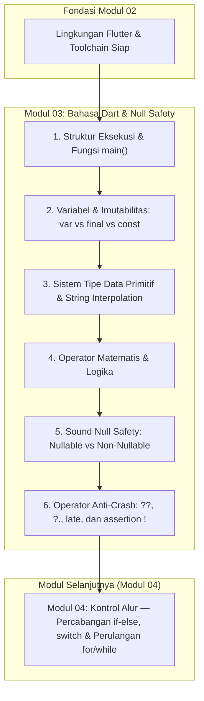
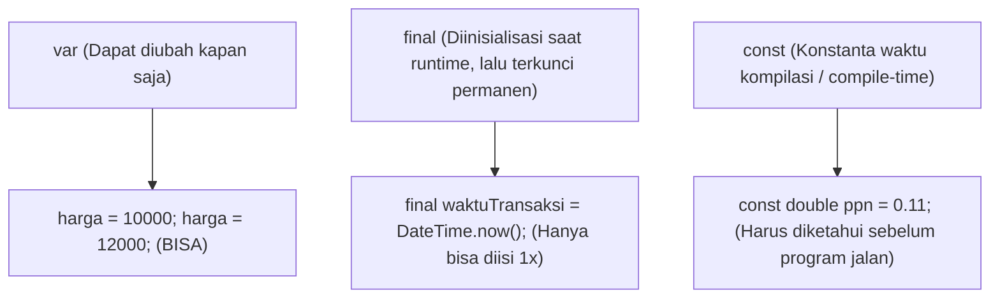
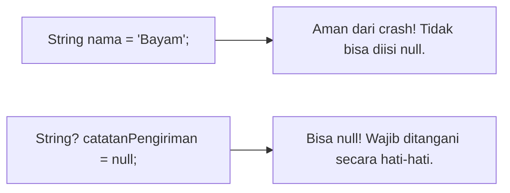

# MODUL 03: DASAR BAHASA PEMROGRAMAN DART, VARIABEL, TIPE DATA, DAN SOUND NULL SAFETY
## PENGEMBANGAN APLIKASI MOBILE MULTIPLATFORM DARI DASAR HINGGA PRODUKSI
### KONSENTRASI KEAHLIAN REKAYASA PERANGKAT LUNAK (SMK RPL)

---

## A. IDENTITAS MODUL

- **Nomor Modul**: 03
- **Judul Modul**: Dasar Bahasa Pemrograman Dart, Variabel, Tipe Data, dan Sound Null Safety
- **Tingkat Kesulitan**: Pemula (*Beginner*)
- **Estimasi Waktu**: 6 Jam Pelajaran (6 × 45 Menit = 270 Menit)
- **Prasyarat**: Modul 02 (Instalasi, Konfigurasi Lingkungan Pengembangan, dan Flutter Toolchain)
- **Tujuan Pembelajaran**:
  1. Siswa memahami struktur eksekusi kode Dart melalui titik masuk fungsi utama `void main()`.
  2. Siswa mampu membedakan dan mengimplementasikan deklarasi variabel menggunakan `var`, `final`, `const`, serta tipe data eksplisit.
  3. Siswa terampil mengolah tipe data dasar Dart (`int`, `double`, `String`, `bool`, `num`) serta memanfaatkan manipulasi string (*string interpolation*).
  4. Siswa menguasai penggunaan operator aritmatika, operator penugasan, operator perbandingan, dan operator logika.
  5. Siswa menguasai konsep dan implementasi **Sound Null Safety** (`?`, `!`, `late`, `??`, `?.`) untuk menjamin aplikasi terbebas 100% dari kesalahan fatal *Null Pointer Exception*.
  6. Siswa mampu membuat script utilitas kalkulator transaksi komoditas sayur dan buah untuk aplikasi **SayurHub**.
- **Kompetensi yang Akan Dicapai**:
  - **Kognitif**: Penguasaan konsep manajemen memori variabel, type inference, dan prinsip imutabilitas data (*immutability*).
  - **Psikomotorik**: Keterampilan menulis script Dart murni di lingkungan terminal, melakukan kompilasi CLI `dart run`, dan menyelesaikan isu peringatan linter static analysis.

---

## B. PETA KONSEP



- **Keterkaitan dengan Modul 02**: Lingkungan pengembangan dan Flutter SDK yang telah dipasang pada Modul 02 kini digunakan untuk mengeksekusi engine Dart secara mandiri.
- **Keterkaitan dengan Modul 04**: Pemahaman variabel, tipe data, dan nilai null adalah syarat mutlak sebelum menyusun logika evaluasi kondisi (`if-else`) dan iterasi data pada Modul 04.

---

## C. MATERI TEORI

### 1. Mengenal Bahasa Pemrograman Dart
**Dart** adalah bahasa pemrograman modern berorientasi objek (*object-oriented*), berbasis kelas (*class-based*), dengan sistem pengetikan ketat dan aman (*strongly-typed language*). Dart diciptakan oleh Google dengan tujuan utama memberikan pengalaman terbaik bagi pengembang (*developer ergonomics*) dalam membangun aplikasi antarmuka klien (*client-side UI apps*).

Beberapa keunggulan karakteristik Dart:
- **Mudah Dipelajari**: Sintaks Dart sangat ramah dan intuitif bagi siswa yang sebelumnya pernah mempelajari Java, C++, JavaScript, atau C#.
- **Type-Safe**: Variabel yang telah dideklarasikan dengan tipe tertentu tidak dapat diisi oleh tipe data yang tidak cocok secara sembarangan, mencegah bug saat aplikasi berjalan.
- **Sound Null Safety**: Sistem kompilator Dart menjamin bahwa variabel biasa tidak akan pernah bernilai `null` tanpa izin eksplisit dari pengembang.

---

### 2. Struktur Program Dart dan Fungsi `main()`
Setiap aplikasi yang dibangun menggunakan bahasa Dart (termasuk aplikasi Flutter) selalu membutuhkan sebuah fungsi khusus bernama **`main()`** sebagai pintu gerbang (*entry point*) pertama. Tanpa fungsi `main()`, komputer tidak akan tahu baris kode mana yang harus dijalankan pertama kali.

```dart
void main() {
  // Kode program Anda ditulis di dalam kurung kurawal ini
}
```
- Kata kunci `void` menunjukkan bahwa fungsi `main` ini tidak mengembalikan nilai data apapun setelah selesai dieksekusi.
- Tanda kurung kurawal `{ ... }` membungkus blok pernyataan yang akan dijalankan dari atas ke bawah secara sekuensial.
- Setiap pernyataan baris kode dalam bahasa Dart **wajib diakhiri dengan tanda titik koma (`;`)**.

---

### 3. Variabel, Type Inference, dan Imutabilitas (`var`, `final`, `const`)

Dalam memori komputer, **variabel** dianalogikan seperti sebuah kotak penyimpanan yang diberi label nama. Kita menyimpan suatu nilai ke dalam kotak tersebut agar dapat dibaca atau diperbarui di kemudian hari.

#### A. Deklarasi Dinamis vs Deklarasi Eksplisit
Dart memiliki fitur cerdas bernama **Type Inference** (Inferensi Tipe Otomatis). Anda dapat mendeklarasikan variabel menggunakan kata kunci `var`, dan Dart akan secara otomatis mengenali tipe data berdasarkan nilai yang pertama kali dimasukkan.

```dart
// Menggunakan Type Inference (tipe otomatis terdeteksi sebagai String)
var namaSayur = 'Bayam Organik';

// Menggunakan Pengetikan Eksplisit (Sangat disarankan untuk produksi)
String namaBuah = 'Alpukat Mentega';
```

#### B. Mengapa Imutabilitas Sangat Penting di Industri? (`final` vs `const`)
Dalam aplikasi e-commerce seperti SayurHub, banyak data yang setelah ditentukan tidak boleh diubah-ubah secara tidak sengaja oleh proses lain (misalnya: ID transaksi unik, persentase pajak PPN, atau tanggal pembuatan pesanan).  
Untuk mengamankan data tersebut, kita menggunakan prinsip **Imutabilitas** (*data tidak dapat diubah*):



| Kata Kunci | Waktu Penentuan Nilai | Dapat Diubah (*Reassignable*)? | Contoh Kasus di SayurHub |
|---|---|---|---|
| `var` | Runtime | **Ya** | `var jumlahKuantitas = 2;` (bisa ditambah/dikurangi oleh pembeli). |
| `final` | Runtime | **Tidak** (Hanya 1 kali pengisian) | `final idTransaksi = 'TRX-98213';` (diambil dari server saat checkout). |
| `const` | Kompilasi (*Compile-time*) | **Tidak** (Tersimpan permanen di memori) | `const double biayaLayanan = 2000.0;` (nilai baku tetap). |

---

### 4. Sistem Tipe Data Primitif pada Dart

Bahasa Dart menyediakan tipe data bawaan yang efisien:

1. **`int` (Integer)**: Bilangan bulat tanpa koma desimal (contoh: stok sayur `50`, jumlah ikat `3`).
2. **`double`**: Bilangan pecahan / desimal presisi ganda (contoh: berat timbangan sayur `1.75` kg, harga diskon `15400.50`).
3. **`num`**: Tipe induk numerik yang dapat menampung baik `int` maupun `double`.
4. **`String`**: Kumpulan karakter teks yang diapit oleh tanda petik tunggal (`'...'`) atau ganda (`"..."`). Rekomendasi resmi Flutter adalah menggunakan petik tunggal.
5. **`bool` (Boolean)**: Tipe logika yang hanya memiliki dua kemungkinan nilai: `true` (benar) atau `false` (salah).

#### String Interpolation (Penggabungan Teks Modern)
Alih-alih menggabungkan teks menggunakan tanda tambah (`+`) yang rawan kesalahan dan lambat, Dart menyediakan fitur **String Interpolation** menggunakan simbol dolar (`$namaVariabel` atau `${ekspresi}`):

```dart
String komoditas = 'Wortel Brastagi';
double hargaPerKg = 12000.0;
double beratKg = 2.5;

// Interpolasi ekspresi matematika langsung di dalam teks:
print('Total beli $komoditas: Rp ${hargaPerKg * beratKg}');
```

---

### 5. Operator pada Dart

1. **Operator Aritmatika**:
   - `+` (Penjumlahan), `-` (Pengurangan), `*` (Perkalian), `/` (Pembagian menghasilkan `double`), `~/` (Pembagian pembulatan ke bawah menghasilkan `int`), `%` (Sisa bagi / Modulo).
2. **Operator Penugasan (*Assignment*)**:
   - `=`, `+=`, `-=`, `*=`, `/=`.
3. **Operator Perbandingan**:
   - `==` (Sama dengan), `!=` (Tidak sama dengan), `>` (Lebih besar), `<` (Lebih kecil), `>=` (Lebih besar atau sama dengan), `<=` (Lebih kecil atau sama dengan).
4. **Operator Logika**:
   - `&&` (AND - Bernilai benar hanya jika kedua sisi benar).
   - `||` (OR - Bernilai benar jika salah satu sisi benar).
   - `!` (NOT - Pembalik nilai logika).

---

### 6. Sound Null Safety: Benteng Pertahanan Crash Aplikasi

> [!CAUTION]
> **Momok Terbesar Programmer Mobile: "The Billion Dollar Mistake"**  
> Pencipta konsep nilai `null`, Sir Tony Hoare, menyebut penciptaan `null` sebagai kesalahan bernilai miliaran dolar. Mengapa? Karena di masa lalu, jika sebuah aplikasi mencoba memanggil properti dari variabel yang ternyata kosong / `null` (contoh: `user.nama.toUpperCase()` padahal `user.nama` belum diisi), sistem operasi akan langsung menutup paksa aplikasi secara mendadak (*Crash* / *Force Close*).

Sejak Dart 2.12 hingga Dart 3.x modern, Dart menerapkan sistem **Sound Null Safety**.  
Prinsip dasarnya sangat tegas: **Secara default, semua variabel di Dart TIDAK BISA bernilai `null` (*Non-Nullable*)!**



#### Simbol dan Operator Kunci Null Safety:
1. **Tanda Tanya (`?`) — Deklarasi Nullable**:
   Menandai bahwa variabel ini diizinkan kosong / bernilai `null`.
   ```dart
   String? kodeVoucherDiskon = null; // Valid! Boleh null jika pembeli tidak punya voucher.
   ```
2. **Null-Aware Operator (`??`) — Nilai Cadangan / Fallback**:
   Jika variabel di sebelah kiri bernilai `null`, gunakan nilai cadangan di sebelah kanan.
   ```dart
   String voucherAktif = kodeVoucherDiskon ?? 'TIDAK_ADA_VOUCHER';
   ```
3. **Null-Aware Access (`?.`) — Pemanggilan Aman**:
   Hanya panggil fungsi/properti jika objek tersebut tidak `null`. Jika `null`, kembalikan `null` tanpa membuat aplikasi crash.
   ```dart
   int? panjangKarakter = kodeVoucherDiskon?.length;
   ```
4. **Kata Kunci `late` — Inisialisasi Tertunda**:
   Memberi tahu kompilator: *"Variabel ini belum memiliki nilai saat ini, namun saya berjanji akan mengisinya sebelum pertama kali dibaca!"*.
   ```dart
   late String alamatTerkonfirmasi;
   ```
5. **Null Assertion Operator (`!`) — Tanda Seru**:
   Memaksa kompilator percaya: *"Saya yakin 100% variabel ini tidak mungkin null saat baris ini berjalan!"*.  
   *Peringatan*: Hindari penggunaan operator `!` jika tidak benar-benar terpaksa, karena jika tebakan Anda salah, aplikasi akan tetap crash.

---

## D. PEMBAHASAN KODE PROGRAM: KALKULATOR TRANSAKSI SAYURHUB

Mari kita bedah sebuah program Dart utuh yang memproses transaksi belanja sayuran segar dengan menerapkan seluruh konsep tipe data, operator, dan penanganan `null safety`.

```dart
void main() {
  // 1. Deklarasi data produk dengan konstanta dan tipe eksplisit
  const String namaProduk = 'Brokoli Hijau Segar';
  const double hargaPerKg = 24000.0;
  final double jumlahBeliKg = 2.5;

  // 2. Deklarasi data opsional yang bisa bernilai null (Nullable Type)
  String? catatanPembeli; // Pengguna belum menulis catatan pengiriman
  double? persentaseDiskon = 0.10; // Diskon promo 10% (0.10)

  // 3. Operasi aritmatika kalkulasi subtotal
  final double subtotalAwal = hargaPerKg * jumlahBeliKg;

  // 4. Perhitungan diskon aman menggunakan operator ??
  // Jika persentaseDiskon bernilai null, maka fallback ke 0.0 (tanpa diskon)
  final double diskonAktif = persentaseDiskon ?? 0.0;
  final double nominalPotongan = subtotalAwal * diskonAktif;
  final double totalBayar = subtotalAwal - nominalPotongan;

  // 5. Penanganan teks catatan aman menggunakan null-aware fallback
  final String keteranganCatatan = catatanPembeli ?? 'Tidak ada catatan khusus dari pembeli.';

  // 6. Evaluasi logika kelayakan gratis ongkir (Pembelian di atas Rp 50.000)
  const double ambangGratisOngkir = 50000.0;
  final bool berhakGratisOngkir = totalBayar >= ambangGratisOngkir;

  // 7. Menampilkan struk kalkulasi ke terminal
  print('========================================');
  print('          STRUK TRANSAKSI SAYURHUB      ');
  print('========================================');
  print('Nama Komoditas   : $namaProduk');
  print('Harga Satuan     : Rp ${hargaPerKg.toStringAsFixed(0)} / kg');
  print('Kuantitas Belanja: $jumlahBeliKg kg');
  print('Subtotal Kotor   : Rp ${subtotalAwal.toStringAsFixed(0)}');
  print('Potongan Diskon  : Rp ${nominalPotongan.toStringAsFixed(0)} (${diskonAktif * 100}%)');
  print('----------------------------------------');
  print('TOTAL PEMBAYARAN : Rp ${totalBayar.toStringAsFixed(0)}');
  print('Status Ongkir    : ${berhakGratisOngkir ? "GRATIS ONGKIR" : "ONGKIR NORMAL"}');
  print('Catatan Kurir    : $keteranganCatatan');
  print('========================================');
}
```

### Penjelasan Baris-Baris Kunci Kode:
- **`const double hargaPerKg = 24000.0;`**: Nilai harga per kg dikunci sebagai konstanta waktu kompilasi agar tidak dapat diubah oleh logika lain secara tidak sengaja.
- **`String? catatanPembeli;`**: Diberi tanda tanya (`?`) karena di dunia nyata, konsumen tidak selalu mengisi kolom catatan saat berbelanja. Variabel ini secara aman bernilai `null`.
- **`final double diskonAktif = persentaseDiskon ?? 0.0;`**: Penggunaan operator `??` menjamin bahwa variabel `diskonAktif` dijamin bertipe `double` non-nullable, sehingga perkalian matematis di baris berikutnya aman dari crash.
- **`hargaPerKg.toStringAsFixed(0)`**: Memformat angka desimal agar tidak menampilkan pecahan `.0` di layar terminal (misal: `24000` bukan `24000.0`).
- **`berhakGratisOngkir ? "GRATIS ONGKIR" : "ONGKIR NORMAL"`**: Menggunakan operator ternary untuk menampilkan status berdasarkan evaluasi nilai boolean.

---

## E. PERSIAPAN PRAKTIKUM

1. **Perangkat Lunak yang Dibutuhkan**:
   - Visual Studio Code dengan ekstensi Dart & Flutter aktif.
   - Terminal sistem (Bash pada Linux / PowerShell pada Windows).
2. **Kondisi Awal Proyek**:
   - Basis kode `sayur_hub` dari Modul 02 telah siap di direktori `/home/arif/flutter-1/sayur_hub/`.
3. **Struktur File yang Akan Dibuat**:
   - File script eksekusi terminal: `sayur_hub/bin/modul_03_transaction.dart`.
   - File utilitas logika kalkulasi resmi: `sayur_hub/lib/core/utils/price_calculator.dart`.

---

## F. LANGKAH PRAKTIKUM STEP-BY-STEP

### Langkah 1 — Menyiapkan Folder `bin/` untuk Pembelajaran Script Dart Murni

1. Buka aplikasi **Visual Studio Code**.
2. Buka folder kerja proyek: `/home/arif/flutter-1/sayur_hub/`.
3. Buka terminal terintegrasi di VS Code (`Ctrl + ~`).
4. Buat folder bernama `bin` di root project SayurHub:
   ```bash
   mkdir -p bin
   ```
   *Penjelasan*: Dalam konvensi standar bahasa Dart, folder `bin/` digunakan untuk menyimpan file script baris perintah (*command-line programs*) yang dapat dijalankan langsung dengan perintah `dart run`.

---

### Langkah 2 — Membuat Script Simulasi Transaksi Kasir SayurHub

1. Buat file baru di dalam folder `bin/` dengan nama: `modul_03_transaction.dart`.
2. Salin dan ketikkan kode program berikut:

```dart
// Lokasi File: sayur_hub/bin/modul_03_transaction.dart

void main() {
  print('>>> MEMULAI SIMULASI SISTEM KASIR SAYURHUB <<<\n');

  // Input Data Transaksi Sayuran
  const String namaItem = 'Wortel Hidroponik Manis';
  final double beratTimbanganKg = 3.25;
  const double hargaDasarKg = 18000.0;

  // Catatan khusus pengiriman (Uji coba kasus bernilai null)
  String? catatanPengiriman;

  // Kalkulasi dasar
  final double totalKotor = hargaDasarKg * beratTimbanganKg;

  // Periksa promo diskon belanja
  double? voucherToko = 5000.0; // Kupon potongan Rp 5.000

  // Mengamankan nilai voucher dari null
  final double potonganVoucher = voucherToko ?? 0.0;
  final double totalBersih = totalKotor - potonganVoucher;

  // Penanganan catatan kurir dengan default fallback
  final String instruksiKurir = catatanPengiriman ?? 'Paling lambat sampai jam 10 pagi';

  // Cetak hasil evaluasi transaksi
  print('Komoditas Pangan : $namaItem');
  print('Berat Timbangan  : $beratTimbanganKg Kg');
  print('Harga per Kg     : Rp ${hargaDasarKg.toStringAsFixed(0)}');
  print('Subtotal         : Rp ${totalKotor.toStringAsFixed(0)}');
  print('Voucher Potongan : Rp ${potonganVoucher.toStringAsFixed(0)}');
  print('TOTAL TAGIHAN    : Rp ${totalBersih.toStringAsFixed(0)}');
  print('Catatan Tambahan : $instruksiKurir\n');

  print('>>> STATUS: TRANSAKSI BERHASIL DIPROSES SECARA TYPE-SAFE! <<<');
}
```

3. Simpan file (`Ctrl + S`).

---

### Langkah 3 — Menjalankan Program Menggunakan Dart CLI

1. Pastikan terminal berada di direktori `/home/arif/flutter-1/sayur_hub/`.
2. Jalankan script tersebut dengan mengetikkan perintah:
   ```bash
   dart run bin/modul_03_transaction.dart
   ```
3. *Hasil yang Diharapkan*: Terminal mencetak keluaran struk perhitungan rapi tanpa galat:
   ```
   >>> MEMULAI SIMULASI SISTEM KASIR SAYURHUB <<<

   Komoditas Pangan : Wortel Hidroponik Manis
   Berat Timbangan  : 3.25 Kg
   Harga per Kg     : Rp 18000
   Subtotal         : Rp 58500
   Voucher Potongan : Rp 5000
   TOTAL TAGIHAN    : Rp 53500
   Catatan Tambahan : Paling lambat sampai jam 10 pagi

   >>> STATUS: TRANSAKSI BERHASIL DIPROSES SECARA TYPE-SAFE! <<<
   ```

---

### Langkah 4 — Eksperimen Deteksi Kesalahan Null Safety

1. Buka kembali file `bin/modul_03_transaction.dart`.
2. Ubah baris deklarasi string non-nullable menjadi:
   ```dart
   String namaItem = null; // Menghilangkan nilai teks dan mencoba memasukkan null
   ```
3. Perhatikan editor VS Code Anda: Kompilator Dart akan langsung memberikan garis bawah merah (*red squiggly line*) di bawah kata `null`.
4. Arahkan kursor mouse ke teks yang bergaris merah tersebut untuk membaca pesan kompilator:
   `The value 'null' can't be assigned to a variable of type 'String' because 'String' is not nullable.`
5. Kembalikan kode ke kondisi semula yang benar. Eksperimen ini membuktikan bahwa sistem Sound Null Safety mencegah kesalahan fatal sejak dini di editor sebelum aplikasi sempat dijalankan.

---

## G. ANALISIS DAN PEMAHAMAN

Jawablah pertanyaan analisis berikut untuk menguji pemahaman logika program Anda:

1. **Analisis Memori**: Mengapa pada aplikasi e-commerce yang berjalan di smartphone, penggunaan kata kunci `const` pada data statis (seperti warna tema dan tarif ongkir dasar) dapat menghemat konsumsi baterai dan RAM dibandingkan jika semua variabel dideklarasikan menggunakan `var`?
2. **Analisis Null Safety**: Perhatikan potongan kode berikut:
   ```dart
   String? namaKurir;
   print(namaKurir!.toUpperCase());
   ```
   Apa yang akan terjadi ketika kode di atas dieksekusi oleh mesin Dart? Mengapa penggunaan tanda seru (`!`) dianggap sebagai praktik yang berbahaya bagi calon programmer profesional?
3. **Analisis Tipe Data**: Mengapa untuk data timbangan sayur (berat) kita wajib menggunakan tipe data `double` dan tidak boleh menggunakan `int`? Sebutkan potensi kerugian finansial bagi pembeli atau penjual sayur jika timbangan dipaksa dibulatkan ke `int`!

---

## H. LATIHAN DAN TANTANGAN

### 1. Soal Teori
1. Tipe data pada bahasa Dart yang digunakan untuk menampung bilangan desimal pecahan adalah:
   - A. `int`
   - B. `num_decimal`
   - C. `double`
   - D. `float`
2. Operator yang digunakan untuk memberikan nilai alternatif pengganti jika suatu variabel bernilai `null` adalah:
   - A. `?.`
   - B. `??`
   - C. `!`
   - D. `::`
3. Perbedaan mendasar antara deklarasi `final` dan `const` pada Dart adalah:
   - A. `final` bisa diubah nilainya berulang kali, sedangkan `const` tidak bisa.
   - B. `const` nilainya harus sudah diketahui saat waktu kompilasi (*compile-time*), sedangkan `final` nilainya baru bisa ditentukan saat program berjalan (*runtime*).
   - C. `final` hanya untuk angka, sedangkan `const` untuk teks.
   - D. `final` membutuhkan internet, sedangkan `const` berjalan offline.
4. Tuliskan contoh deklarasi variabel nomor WhatsApp Indonesia yang boleh bernilai `null` secara sintaksis Dart yang benar!
5. Apa output dari baris kode berikut:
   ```dart
   int a = 14;
   int b = 4;
   print(a ~/ b);
   ```

### 2. Soal Praktik
1. **Kalkulator Pajak PPN Sayur**: Buat script baru di `bin/soal_pajak.dart` yang menghitung total belanja sayur ditambah tarif PPN 11% (`const double tarifPpn = 0.11;`). Cetak subtotal belanja, nominal pajak PPN, dan grand total bayar ke terminal.
2. **Manipulasi String**: Buat variabel nama lengkap pengguna `String? inputNama = '   budi santoso pratama   ';`. Gunakan method `.trim()` untuk membersihkan spasi di awal/akhir dan tampilkan teks tersebut dengan huruf kapital menggunakan `.toUpperCase()`. Pastikan kode aman jika `inputNama` bernilai `null`!
3. **Konversi Tipe Data**: Buat variabel string harga produk yang dikirim dari API berupa teks `String hargaString = '35000';`. Ubah string tersebut menjadi `double` menggunakan method `double.parse()`, lalu hitung harga setelah diskon 15%!

### 3. Tantangan Pemecahan Masalah (*Problem-Solving Challenges*)
- **Tantangan 1 (Safety String Fallback)**: Di aplikasi SayurHub, konsumen dapat mengosongkan kolom catatan alamat ("catatan patokan rumah"). Rancang sebuah ekspresi satu baris (*one-liner expression*) menggunakan operator null safety agar jika catatan alamat kosong (`null`) atau hanya berisi spasi kosong, sistem secara otomatis mengisi teks `'Patokan rumah tidak dicantumkan oleh pelanggan'`.
- **Tantangan 2 (Pencegahan Pembagian Nol / Zero Division)**: Dalam algoritma pembagian paket parcel buah (misal: 10 kg apel dibagikan rata ke sejumlah keranjang kecil `int jumlahKeranjang`), jika `jumlahKeranjang` bernilai `0`, operasi pembagian matematika akan menghasilkan error infinity. Rancang logika pengaman agar perhitungan menghasilkan nilai `0.0` jika keranjang berjumlah nol atau bernilai `null`.

### 4. Studi Kasus Industri
**Studi Kasus**: Mitra Petani Sayur Lembang menjual 3 jenis sayur: Bayam (Rp 4.000/ikat), Kangkung (Rp 3.500/ikat), dan Selada Air (Rp 6.000/ikat). Toko memiliki promo bundling: Jika pembeli membeli ketiga jenis sayur tersebut sekaligus dengan total belanja kotor $\ge$ Rp 30.000, pembeli mendapatkan potongan voucher ongkir sebesar Rp 5.000.  
*Tugas Siswa*: Rancang variabel, tipe data, dan kalkulasi rumus matematika Dart untuk memproses transaksi di atas secara akurat!

---

## I. TROUBLESHOOTING & FAQ

Berikut adalah tabel permasalahan sintaks dan error Dart yang paling sering ditemui siswa beserta solusinya:

| Pesan Error Kompilator | Penyebab Utama | Cara Mengidentifikasi | Langkah Penyelesaian |
|---|---|---|---|
| **A value of type 'Null' can't be assigned to a variable of type 'X'** | Mencoba memasukkan nilai `null` ke variabel yang dideklarasikan non-nullable. | Garis bawah merah di editor pada kata kunci `null`. | Tambahkan tanda tanya (`?`) pada tipe data variabel jika memang bernilai nullable: `String? nama = null;` |
| **The method 'X' can't be unconditionally invoked because the receiver can be 'null'** | Memanggil method/fungsi pada variabel yang memiliki kemungkinan bernilai `null`. | Contoh: `nama.toUpperCase()` padahal tipe `nama` adalah `String?`. | Gunakan operator null-aware access: `nama?.toUpperCase()` atau berikan fallback: `(nama ?? '').toUpperCase()`. |
| **Const variables must be initialized with a constant value** | Mendeklarasikan variabel `const` namun mengisinya dengan ekspresi yang baru bisa dihitung saat runtime. | Contoh: `const waktu = DateTime.now();` | Ubah kata kunci `const` menjadi `final`: `final waktu = DateTime.now();` karena jam saat ini hanya bisa diketahui saat aplikasi sedang berjalan. |
| **Undefined name 'main'** | Lupa menuliskan fungsi utama `void main()` pada file script Dart. | Terminal menampilkan: `No 'main' method found in '...dart'.` | Pastikan membungkus kode program di dalam blok fungsi `void main() { ... }`. |

---

## J. PRAKTIKUM INTEGRASI ANTAR-MODUL: UTILITY CALCULATOR "SAYURHUB"

Untuk mengintegrasikan materi dasar Dart dan Sound Null Safety ini ke dalam basis kode utama proyek SayurHub, kita akan membuat sebuah modul utilitas resmi bernama **`PriceCalculator`**. Modul ini akan digunakan oleh halaman katalog, keranjang belanja, dan halaman checkout pada modul-modul mendatang.

### 1. Judul Praktikum Integrasi
**Pembangunan Komponen Utilitas Kalkulator Harga dan Validasi Transaksi SayurHub**

### 2. Tujuan Praktikum Integrasi
- Membuat class utilitas `PriceCalculator` yang bersih (*Clean Code*) dengan dokumentasi resmi Dart Doc (`///`).
- Mengimplementasikan kalkulasi diskon, subtotal, dan pemformatan mata uang Rupiah secara type-safe.
- Menjamin fungsi mampu menangani input nullable secara elegan tanpa pernah memicu *NullPointerException*.

### 3. Materi yang Diintegrasikan
- Basis kode dan standar arsitektur folder `lib/core/` dari Modul 02.
- Penguasaan tipe data numerik, imutabilitas, dan operator null safety dari Modul 03.

### 4. Kondisi Awal Proyek (*Project State Before*)
Proyek `sayur_hub` telah memiliki struktur folder dasar dan halaman WelcomeScreen. Belum ada utilitas logika kalkulasi harga di dalam folder `lib/core/utils/`.

### 5. Instruksi Langkah Demi Langkah
1. Buat folder `lib/core/utils/` di dalam direktori `sayur_hub`:
   ```bash
   mkdir -p lib/core/utils
   ```
2. Buat file baru bernama `price_calculator.dart` di dalam folder `lib/core/utils/`.
3. Tuliskan kode kelas utilitas `PriceCalculator` lengkap dengan dokumentasi teknis.
4. Buat script pengujian verifikasi di `bin/modul_03_transaction.dart` yang mengimpor dan memanggil method dari `PriceCalculator`.
5. Jalankan verifikasi statis:
   ```bash
   flutter analyze
   ```
6. Jalankan pengujian di terminal:
   ```bash
   dart run bin/modul_03_transaction.dart
   ```
7. Commit seluruh perubahan ke repositori Git:
   ```bash
   git add .
   git commit -m "feat(core): add PriceCalculator utility with sound null safety support"
   ```

---

### 6. Kode Program Integrasi Lengkap

#### File: `lib/core/utils/price_calculator.dart`
```dart
/// Kelas utilitas mandiri untuk seluruh kalkulasi harga dan transaksi di aplikasi SayurHub.
/// Menerapkan prinsip Sound Null Safety secara ketat untuk mencegah bug kalkulasi.
class PriceCalculator {
  // Konstruktor privat mencegah instansiasi kelas utilitas murni
  PriceCalculator._();

  /// Menghitung subtotal kotor berdasarkan harga per satuan dan kuantitas belanja
  /// Mendukung kuantitas pecahan desimal (contoh: 1.5 kg sayur)
  static double calculateSubtotal({
    required double pricePerUnit,
    required double quantity,
  }) {
    if (pricePerUnit < 0 || quantity < 0) {
      return 0.0;
    }
    return pricePerUnit * quantity;
  }

  /// Menghitung nominal potongan diskon secara aman dari persentase diskon yang bersifat opsional (nullable).
  /// [discountPercentage] bernilai antara 0.0 (0%) hingga 1.0 (100%).
  /// Jika bernilai null, maka diskon dianggap 0.0 (tanpa potongan).
  static double calculateDiscountAmount({
    required double subtotal,
    double? discountPercentage,
  }) {
    // Penggunaan operator ?? menjamin nilai diskon tidak null
    final double safeDiscountRate = discountPercentage ?? 0.0;

    // Validasi batas logis persentase diskon
    if (safeDiscountRate <= 0.0) {
      return 0.0;
    }
    if (safeDiscountRate >= 1.0) {
      return subtotal;
    }

    return subtotal * safeDiscountRate;
  }

  /// Menghitung total akhir pembayaran setelah dipotong diskon dan ditambah ongkir opsional
  static double calculateFinalTotal({
    required double subtotal,
    double? discountPercentage,
    double? shippingFee,
  }) {
    final double discount = calculateDiscountAmount(
      subtotal: subtotal,
      discountPercentage: discountPercentage,
    );
    final double safeShipping = shippingFee ?? 0.0;

    final double totalAfterDiscount = subtotal - discount;
    return totalAfterDiscount + safeShipping;
  }

  /// Memformat angka numerik ke representasi string mata uang Rupiah standar
  /// Contoh: 25000 -> "Rp 25.000"
  static String formatRupiah(num amount) {
    final int roundedAmount = amount.round();
    final String rawString = roundedAmount.toString();

    final StringBuffer buffer = StringBuffer();
    int count = 0;

    for (int i = rawString.length - 1; i >= 0; i--) {
      buffer.write(rawString[i]);
      count++;
      if (count % 3 == 0 && i != 0) {
        buffer.write('.');
      }
    }

    final String reversedFormatted = buffer.toString().split('').reversed.join('');
    return 'Rp $reversedFormatted';
  }
}
```

#### File: `bin/modul_03_transaction.dart`
```dart
import 'package:sayur_hub/core/utils/price_calculator.dart';

void main() {
  print('====================================================');
  print('    SISTEM KALKULASI TRANSAKSI RESMI SAYURHUB       ');
  print('====================================================\n');

  // Simulasi Data Belanja Pelanggan
  const String namaSayur = 'Bayam Organik Hidroponik';
  const double hargaPerKg = 15000.0;
  const double beratBeli = 2.5; // Beli 2.5 kg

  // Parameter Opsional (Uji Null Safety)
  const double? promoPanenRaya = 0.15; // Diskon 15%
  const double? ongkosKirim = 10000.0;
  String? catatanPelanggan; // Konsumen tidak mengisi catatan

  // 1. Eksekusi Perhitungan Subtotal
  final double subtotal = PriceCalculator.calculateSubtotal(
    pricePerUnit: hargaPerKg,
    quantity: beratBeli,
  );

  // 2. Eksekusi Perhitungan Diskon Aman
  final double nominalDiskon = PriceCalculator.calculateDiscountAmount(
    subtotal: subtotal,
    discountPercentage: promoPanenRaya,
  );

  // 3. Eksekusi Perhitungan Total Akhir
  final double grandTotal = PriceCalculator.calculateFinalTotal(
    subtotal: subtotal,
    discountPercentage: promoPanenRaya,
    shippingFee: ongkosKirim,
  );

  // 4. Fallback Catatan Aman
  final String catatanFinal = catatanPelanggan ?? 'Tidak ada instruksi khusus.';

  // 5. Cetak Hasil Menggunakan Formatter Rupiah
  print('Komoditas       : $namaSayur');
  print('Harga Satuan    : ${PriceCalculator.formatRupiah(hargaPerKg)} / kg');
  print('Kuantitas       : $beratBeli kg');
  print('Subtotal        : ${PriceCalculator.formatRupiah(subtotal)}');
  print('Potongan Diskon : ${PriceCalculator.formatRupiah(nominalDiskon)} (15%)');
  print('Ongkos Kirim    : ${PriceCalculator.formatRupiah(ongkosKirim ?? 0)}');
  print('----------------------------------------------------');
  print('TOTAL PEMBAYARAN: ${PriceCalculator.formatRupiah(grandTotal)}');
  print('Catatan Kurir   : $catatanFinal\n');
  print('====================================================');
  print('>> VERIFIKASI LOGIKA MODUL 03: SUKSES DAN TYPE-SAFE <<');
}
```

---

### 7. Hasil yang Diharapkan
Ketika script `bin/modul_03_transaction.dart` dijalankan, terminal akan mencetak hasil kalkulasi rupiah berformat rapi dengan pemisah titik ribuan:
```
====================================================
    SISTEM KALKULASI TRANSAKSI RESMI SAYURHUB       
====================================================

Komoditas       : Bayam Organik Hidroponik
Harga Satuan    : Rp 15.000 / kg
Kuantitas       : 2.5 kg
Subtotal        : Rp 37.500
Potongan Diskon : Rp 5.625 (15%)
Ongkos Kirim    : Rp 10.000
----------------------------------------------------
TOTAL PEMBAYARAN: Rp 41.875
Catatan Kurir   : Tidak ada instruksi khusus.

====================================================
>> VERIFIKASI LOGIKA MODUL 03: SUKSES DAN TYPE-SAFE <<
```

### 8. Kriteria Keberhasilan
- [x] File `lib/core/utils/price_calculator.dart` tersimpan dan bebas dari kesalahan statis.
- [x] Perhitungan diskon menangani nilai `null` dengan aman (default ke 0.0).
- [x] Pemformatan angka Rupiah menghasilkan tanda titik ribuan yang tepat (`Rp 37.500`, bukan `Rp 37500.0`).
- [x] Perintah `flutter analyze` melaporkan `No issues found!`.

---

## K. EVALUASI MODUL 03

### 1. Rubrik Penilaian Penguasaan Logika & Null Safety
| Kriteria Evaluasi | Skor Maksimal | Indikator Ketercapaian |
|---|---|---|
| **Pemahaman Variabel & Tipe Data** | 25 | Mampu membedakan penggunaan `var`, `final`, `const`, serta memilih tipe data numerik yang tepat. |
| **Penerapan Sound Null Safety** | 35 | Mampu mengidentifikasi tipe data nullable (`?`) dan menggunakan operator pengaman (`??`, `?.`) secara tepat tanpa menyebabkan runtime crash. |
| **Kualitas Implementasi Logika Bisnis** | 25 | Berhasil membuat method kalkulasi transaksi dengan validasi batas input matematis (mencegah nilai negatif). |
| **Kerapian Kode & Linter Standards** | 15 | Kode mematuhi standar penulisan Dart, dilengkapi komentar dokumentasi (`///`), dan bebas peringatan linter. |
| **Total Skor** | **100** | **Kriteria Ketuntasan Minimal (KKM): 75** |

### 2. Soal Uji Debugging Kode
*Tinjau potongan kode berikut yang ditulis oleh seorang siswa:*
```dart
void main() {
  String? deskripsiProduk;
  print("Panjang karakter: " + deskripsiProduk.length.toString());
}
```
- **Pertanyaan**: Jelaskan mengapa kode di atas gagal dikompilasi oleh Dart, dan perbaiki kode tersebut menjadi bentuk yang benar dan aman!
- **Kunci Jawaban**:
  1. *Penyebab*: Variabel `deskripsiProduk` berstatus nullable (`String?`), sehingga properti `.length` tidak dapat dipanggil langsung tanpa pengaman karena variabel berpotensi bernilai `null`. Selain itu, penggabungan string menggunakan tanda `+` kurang dianjurkan.
  2. *Perbaikan*: Gunakan null-aware access (`?.`), fallback (`??`), dan string interpolation:
     ```dart
     void main() {
       String? deskripsiProduk;
       final int panjang = deskripsiProduk?.length ?? 0;
       print('Panjang karakter: $panjang');
     }
     ```

---

## L. KESIMPULAN DAN JEMBATAN KE MODUL BERIKUTNYA

### Rangkuman Kompetensi:
Pada Modul 03 ini, Anda telah menguasai pilar dasar pemrograman modern dengan bahasa Dart:
1. Memahami bagaimana program dieksekusi secara terstruktur mulai dari fungsi `main()`.
2. Mampu memilih jenis variabel yang tepat: variabel dinamis (`var`), variabel imutabel runtime (`final`), dan konstanta waktu kompilasi (`const`).
3. Menguasai benteng pertahanan **Sound Null Safety** (`?`, `??`, `?.`, `late`) untuk memastikan aplikasi komersial bebas dari bahaya *Null Pointer Exception*.
4. Menghasilkan modul utilitas produksi pertama untuk proyek **SayurHub**, yaitu `PriceCalculator`.

### Penghubung Menuju Modul 04:
Saat ini program kasir SayurHub kita baru bisa menghitung satu transaksi sederhana secara lurus dari atas ke bawah. Namun di pasar nyata, bisnis perdagangan selalu melibatkan **pengambilan keputusan** dan **pemrosesan banyak barang sekaligus**:
- *Bagaimana jika pelanggan membeli lebih dari 5 ikat kangkung dan kita ingin memberikan diskon bertingkat otomatis?*
- *Bagaimana jika kita ingin memeriksa 100 stok sayur di gudang dan menyaring mana sayur yang sudah lewat masa simpan?*

Untuk menjawab kebutuhan tersebut, pada **Modul 04: Kontrol Alur Eksekusi — Percabangan dan Perulangan Algoritmik**, kita akan mempelajari struktur kendali `if`, `else if`, `else`, fitur *Pattern Matching Switch* terbaru pada Dart 3, serta beragam perulangan `for` dan `while`!
