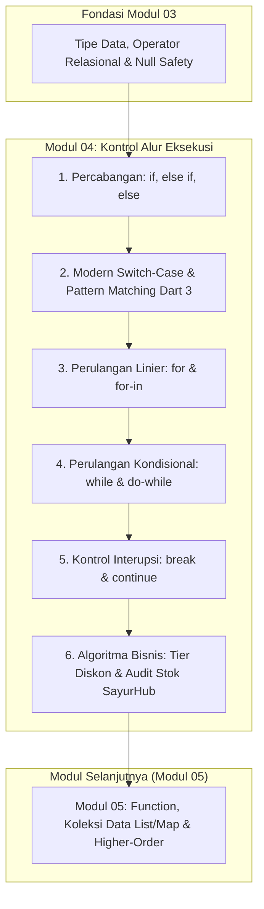
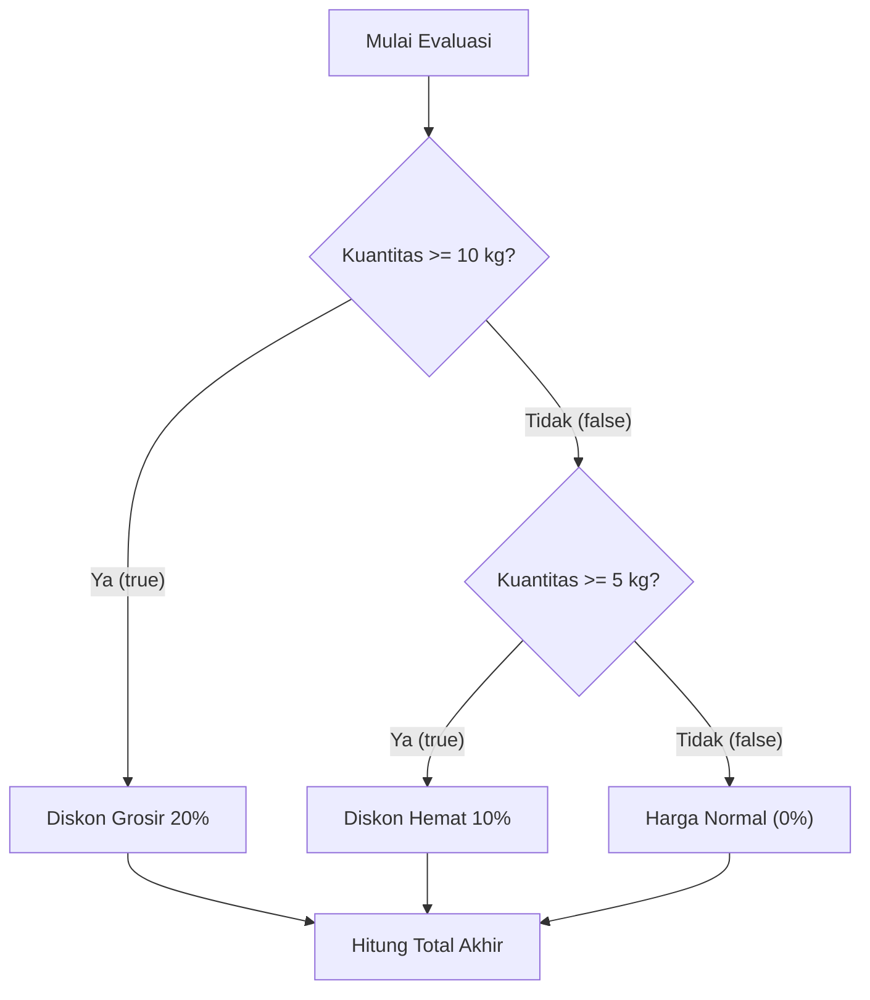

# MODUL 04: KONTROL ALUR EKSEKUSI — PERCABANGAN DAN PERULANGAN ALGORITMIK PADA DART
## PENGEMBANGAN APLIKASI MOBILE MULTIPLATFORM DARI DASAR HINGGA PRODUKSI
### KONSENTRASI KEAHLIAN REKAYASA PERANGKAT LUNAK (SMK RPL)

---

## A. IDENTITAS MODUL

- **Nomor Modul**: 04
- **Judul Modul**: Kontrol Alur Eksekusi — Percabangan dan Perulangan Algoritmik pada Dart
- **Tingkat Kesulitan**: Pemula (*Beginner*)
- **Estimasi Waktu**: 6 Jam Pelajaran (6 × 45 Menit = 270 Menit)
- **Prasyarat**: Modul 03 (Dasar Bahasa Pemrograman Dart, Variabel, Tipe Data, dan Sound Null Safety)
- **Tujuan Pembelajaran**:
  1. Siswa mampu merancang dan mengimplementasikan pengambilan keputusan logika berlapis menggunakan struktur `if`, `else if`, dan `else`.
  2. Siswa menguasai penggunaan struktur `switch-case`, termasuk fitur modern *Switch Expression* dan *Pattern Matching* pada Dart 3.
  3. Siswa terampil mengimplementasikan struktur perulangan `for` klasik, `for-in`, `while`, dan `do-while` untuk memproses data berulang.
  4. Siswa mampu mengendalikan jalannya iterasi menggunakan perintah `break` dan `continue` serta perulangan bersarang (*nested loops*).
  5. Siswa mampu memecahkan masalah algoritma bisnis e-commerce nyata: sistem diskon kuantitas bertingkat (*volume tier discount*) dan audit stok gudang sayur kadaluarsa untuk aplikasi **SayurHub**.
- **Kompetensi yang Akan Dicapai**:
  - **Kognitif**: Pemahaman logika predikat Boolean, efisiensi alur eksekusi percabangan, serta kompleksitas waktu perulangan (*Time Complexity* dasar).
  - **Psikomotorik**: Keterampilan menyusun algoritma penyeleksian kondisi, menulis fungsi audit inventaris, dan menghindari jebakan *infinite loop* serta *arrow anti-pattern*.

---

## B. PETA KONSEP



- **Keterkaitan dengan Modul 03**: Nilai Boolean (`true`/`false`) dan operator pembanding (`>`, `<`, `==`, `!=`) yang dipelajari pada Modul 03 kini menjadi pengemudi utama (*condition driver*) dalam blok percabangan dan perulangan.
- **Keterkaitan dengan Modul 05**: Perulangan yang dipelajari pada modul ini akan menjadi modal dasar sebelum siswa memproses struktur data koleksi (`List`, `Set`, `Map`) menggunakan *higher-order functions* pada Modul 05.

---

## C. MATERI TEORI

### 1. Mengapa Program Membutuhkan Kontrol Alur?
Secara *default*, komputer mengeksekusi baris kode secara lurus dari baris 1 hingga baris terakhir (sekuensial). Namun, dalam aplikasi dunia nyata, alur program tidak pernah sesederhana itu:
- *Jika pengguna belum login, arahkan ke halaman Login; jika sudah, buka Beranda.*
- *Jika total belanja sayur $\ge$ 5 kg, berikan diskon 15%; jika di bawah itu, kenakan harga normal.*
- *Ulangi pengecekan 100 stok sayur di rak sampai ditemukan sayur yang layu.*

Kemampuan komputer untuk berbelok (*branching*) dan berputar (*looping*) inilah yang disebut dengan **Kontrol Alur Eksekusi** (*Control Flow*).

---

### 2. Percabangan `if`, `else if`, dan `else`

Struktur `if` mengevaluasi suatu kondisi logika (ekspresi Boolean). Jika kondisi bernilai `true`, maka blok kode di dalamnya akan dieksekusi. Jika bernilai `false`, program melompat ke blok berikutnya.



#### Contoh Penerapan pada Dart:
```dart
double hitungDiskonKuantitas(double beratKg) {
  if (beratKg >= 10.0) {
    return 0.20; // 20%
  } else if (beratKg >= 5.0) {
    return 0.10; // 10%
  } else {
    return 0.0;  // Tanpa diskon
  }
}
```

> [!TIP]
> **Praktik Clean Code: Hindari "Arrow Anti-Pattern" (Nested Ifs Berlebihan)**  
> Siswa pemula sering membuat sarang `if` di dalam `if` hingga membentuk pola panah condong ke kanan yang sulit dibaca. Gunakan teknik **Guard Clauses** (kembalikan hasil secepat mungkin menggunakan `return`) untuk merapikan alur kode:
> ```dart
> // Buruk (Arrow Anti-Pattern):
> if (isTokoBuka) {
>   if (stokAda) {
>     if (saldoCukup) {
>       prosesPesanan();
>     }
>   }
> }
>
> // Bersih (Guard Clauses):
> if (!isTokoBuka) return;
> if (!stokAda) return;
> if (!saldoCukup) return;
> prosesPesanan();
> ```

---

### 3. Struktur `switch-case` dan Fitur Baru Dart 3 (Switch Expression)

Struktur `switch` digunakan ketika kita memiliki satu variabel yang ingin dibandingkan dengan banyak nilai konstan yang berbeda.

#### A. Switch Statement Klasik
```dart
String statusPesanan = 'DIKIRIM';

switch (statusPesanan) {
  case 'PENDING':
    print('Menunggu konfirmasi petani.');
    break;
  case 'DIKEMAS':
    print('Sayur sedang dicuci dan dikemas.');
    break;
  case 'DIKIRIM':
    print('Kurir sedang menuju alamat Anda.');
    break;
  case 'SELESAI':
    print('Pesanan telah diterima.');
    break;
  default:
    print('Status pesanan tidak dikenali.');
}
```

#### B. Switch Expression Modern Dart 3 (Pattern Matching)
Sejak peluncuran Dart 3, `switch` dapat digunakan sebagai sebuah **ekspresi yang langsung menghasilkan nilai** (*return value*), menghasilkan sintaks yang jauh lebih ringkas, aman, dan tanpa kata kunci `break`:

```dart
String statusPesanan = 'DIKIRIM';

// Switch Expression Dart 3:
final String pesanStatus = switch (statusPesanan) {
  'PENDING' => 'Menunggu konfirmasi petani.',
  'DIKEMAS' => 'Sayur sedang dicuci dan dikemas.',
  'DIKIRIM' => 'Kurir sedang menuju alamat Anda.',
  'SELESAI' => 'Pesanan telah diterima.',
  _         => 'Status pesanan tidak dikenali.', // Karakter '_' adalah wildcard default
};
```

---

### 4. Struktur Perulangan (Loops)

Perulangan memungkinkan komputer menjalankan satu blok instruksi berkali-kali secara otomatis tanpa menulis ulang kodenya.

#### A. Perulangan `for` Klasik (Iterasi dengan Pencacah / Index)
Digunakan ketika jumlah perulangan sudah diketahui secara pasti sebelumnya.
```dart
// Format: for (inisialisasi; kondisi; inkremen)
for (int i = 1; i <= 5; i++) {
  print('Menimbang keranjang sayur ke-$i');
}
```

#### B. Perulangan `for-in` (Iterasi Elemen Koleksi)
Format paling bersih dan elegan di Dart untuk menelusuri seluruh isi kumpulan data:
```dart
final List<String> daftarSayur = ['Bayam', 'Kangkung', 'Sawi', 'Brokoli'];

for (final String sayur in daftarSayur) {
  print('Komoditas siap kirim: $sayur');
}
```

#### C. Perulangan `while` (Evaluasi di Awal)
Perulangan dijalankan selama kondisi bernilai `true`. Pengecekan kondisi dilakukan **sebelum** blok kode dijalankan. Jika sejak awal kondisi sudah `false`, blok kode tidak akan pernah dijalankan sekalipun.
```dart
int stokBayam = 3;

while (stokBayam > 0) {
  print('1 ikat bayam terjual! Sisa stok: ${stokBayam - 1}');
  stokBayam--; // Mengurangi pencacah agar tidak terjadi infinite loop
}
```

#### D. Perulangan `do-while` (Evaluasi di Akhir)
Blok kode dijamin **dijalankan minimal satu kali**, baru kemudian kondisinya diperiksa di akhir.
```dart
int percobaanKoneksi = 0;

do {
  percobaanKoneksi++;
  print('Mencoba menyambung ke server SayurHub (Percobaan $percobaanKoneksi)...');
} while (percobaanKoneksi < 3);
```

---

### 5. Pengendali Alur Iterasi: `break` dan `continue`

- **`break`**: Menghentikan perulangan secara paksa seketika dan langsung melompat keluar dari blok loop.  
  *Contoh use case*: Berhenti mencari sayur segera setelah sayur yang dicari pembeli ditemukan.
- **`continue`**: Melewati sisa baris pada iterasi saat ini, dan langsung melompat ke iterasi berikutnya.  
  *Contoh use case*: Lewati sayur yang sudah busuk dan lanjutkan memeriksa sayur segar berikutnya.

```dart
for (int berat = 1; berat <= 10; berat++) {
  if (berat == 4) {
    print('>> Keranjang 4 rusak, lewati! (continue)');
    continue;
  }
  if (berat == 8) {
    print('>> Kapasitas motor kurir penuh di 8 kg! Berhenti. (break)');
    break;
  }
  print('Memuat paket sayur seberat: $berat kg');
}
```

---

## D. PEMBAHASAN KODE PROGRAM: SISTEM AUDIT INVENTARIS GUDANG

Berikut adalah program Dart yang menyimulasikan proses audit mutu di gudang SayurHub dengan mengombinasikan `for`, `switch expression`, `if-else`, dan `continue`.

```dart
void main() {
  // Simulasi data batch sayuran di gudang SayurHub
  // Format: [Nama Sayur, Jumlah Hari Sejak Panen, Stok Ikat Tersedia]
  final List<String> daftarNama = ['Bayam', 'Wortel', 'Kangkung', 'Tomat', 'Selada'];
  final List<int> hariPanen = [1, 7, 4, 2, 6];
  final List<int> stokTersedia = [20, 0, 15, 30, 10]; // Wortel stoknya 0 (habis)

  print('=== LAPORAN AUDIT MUTU GUDANG SAYURHUB ===\n');

  for (int i = 0; i < daftarNama.length; i++) {
    final String nama = daftarNama[i];
    final int usiaHari = hariPanen[i];
    final int stok = stokTersedia[i];

    // 1. Guard Clause: Lewati produk yang stoknya habis (continue)
    if (stok <= 0) {
      print('[-] $nama: STOK HABIS (Lewati inspeksi mutu)\n');
      continue;
    }

    // 2. Evaluasi grade kesegaran menggunakan Switch Expression Dart 3
    final String statusKesegaran = switch (usiaHari) {
      <= 2 => 'GRADE A (Sangat Segar / Panen Baru)',
      <= 4 => 'GRADE B (Kondisi Baik / Segera Jual)',
      <= 5 => 'GRADE C (Promo Flash Sale / Diskon 40%)',
      _    => 'KADALUARSA (Tarik dari Rak Penjualan!)',
    };

    // 3. Evaluasi kelayakan jual menggunakan Percabangan if-else
    final bool layakJual = usiaHari <= 5;

    print('[+] Komoditas : $nama');
    print('    Stok Fisik: $stok ikat');
    print('    Usia Panen: $usiaHari hari');
    print('    Status    : $statusKesegaran');
    print('    Tindakan  : ${layakJual ? "TAMPILKAN DI APLIKASI" : "MUSNAHKAN / BUAT KOMPOS"}');
    print('-------------------------------------------');
  }

  print('\n=== AUDIT SELESAI: SELURUH DATA TERVERIFIKASI ===');
}
```

### Penjelasan Baris-Baris Kunci Kode:
- **`if (stok <= 0) continue;`**: Jika stok produk sama dengan nol, komputer tidak perlu membuang waktu memeriksa usianya; `continue` langsung melompat ke indeks produk berikutnya.
- **`switch (usiaHari) { <= 2 => ... }`**: Penggunaan ekspresi *Relational Pattern Matching* Dart 3 yang sangat ekspresif. Kita dapat menguji perbandingan numerik langsung di dalam blok `switch` tanpa perlu menulis banyak `case` manual.
- **`final bool layakJual = usiaHari <= 5;`**: Penentuan status kelayakan dengan ekspresi logika Boolean yang bersih tanpa perlu blok `if (usiaHari <= 5) { layakJual = true; } else { layakJual = false; }`.

---

## E. PERSIAPAN PRAKTIKUM

1. **Perangkat Lunak**:
   - Visual Studio Code dengan integrasi terminal Dart.
2. **Kondisi Awal Proyek**:
   - Repositori `sayur_hub` dari Modul 03 berada dalam kondisi *clean working tree*.
3. **Target File yang Akan Dibuat**:
   - Script simulasi kontrol alur: `sayur_hub/bin/modul_04_control_flow.dart`.
   - Modul utilitas bisnis resmi: `sayur_hub/lib/core/utils/inventory_manager.dart`.

---

## F. LANGKAH PRAKTIKUM STEP-BY-STEP

### Langkah 1 — Membuat Script Uji Percabangan & Perulangan

1. Buka project `/home/arif/flutter-1/sayur_hub/` di VS Code.
2. Buat file baru di dalam folder `bin/` dengan nama: `modul_04_control_flow.dart`.
3. Tuliskan kode program pengujian kontrol alur berikut:

```dart
// File: sayur_hub/bin/modul_04_control_flow.dart
import 'package:sayur_hub/core/utils/price_calculator.dart';

void main() {
  print('>>> SIMULASI SISTEM DISKON BERTINGKAT SAYURHUB <<<\n');

  // Daftar pembelian sayur oleh pelanggan katering (dalam kilogram)
  final List<double> daftarPembelian = [1.5, 5.0, 8.5, 12.0, 25.0];
  const double hargaDasarPerKg = 20000.0;

  for (int i = 0; i < daftarPembelian.length; i++) {
    final double kuantitas = daftarPembelian[i];

    // Penentuan persentase diskon bertingkat (Volume Tier Discount)
    double tierDiskon = 0.0;
    String kategoriPembeli = 'Retail Normal';

    if (kuantitas >= 20.0) {
      tierDiskon = 0.25; // Diskon 25% untuk pemborong besar
      kategoriPembeli = 'Distributor / Restoran';
    } else if (kuantitas >= 10.0) {
      tierDiskon = 0.15; // Diskon 15% untuk katering
      kategoriPembeli = 'Katering UMKM';
    } else if (kuantitas >= 5.0) {
      tierDiskon = 0.10; // Diskon 10% untuk keluarga besar
      kategoriPembeli = 'Keluarga Sehat';
    } else {
      tierDiskon = 0.0;  // Tanpa potongan
      kategoriPembeli = 'Konsumen Harian';
    }

    final double subtotal = PriceCalculator.calculateSubtotal(
      pricePerUnit: hargaDasarPerKg,
      quantity: kuantitas,
    );

    final double totalBayar = PriceCalculator.calculateFinalTotal(
      subtotal: subtotal,
      discountPercentage: tierDiskon,
    );

    print('Pesanan #${i + 1} ($kategoriPembeli):');
    print('  Volume Beli : $kuantitas kg');
    print('  Subtotal    : ${PriceCalculator.formatRupiah(subtotal)}');
    print('  Tier Diskon : ${(tierDiskon * 100).toInt()}%');
    print('  Total Akhir : ${PriceCalculator.formatRupiah(totalBayar)}\n');
  }

  print('>>> SELESAI: SELURUH SKENARIO DISKON BERHASIL DIUJI! <<<');
}
```

---

### Langkah 2 — Menjalankan dan Mengamati Alur Program

1. Buka terminal di VS Code pada direktori root `sayur_hub`.
2. Jalankan script tersebut:
   ```bash
   dart run bin/modul_04_control_flow.dart
   ```
3. *Hasil yang Diharapkan*: Terminal menampilkan kalkulasi berulang untuk 5 pesanan berbeda dengan tier diskon yang otomatis menyesuaikan kuantitas beli:
   - Pesanan 1.5 kg: Diskon 0% (Konsumen Harian).
   - Pesanan 5.0 kg: Diskon 10% (Keluarga Sehat).
   - Pesanan 8.5 kg: Diskon 10% (Keluarga Sehat).
   - Pesanan 12.0 kg: Diskon 15% (Katering UMKM).
   - Pesanan 25.0 kg: Diskon 25% (Distributor / Restoran).

---

### Langkah 3 — Eksperimen Deteksi Infinite Loop (Loop Tak Berujung)

1. Buka file baru sementara untuk eksperimen pemahaman bahaya perulangan tak terbatas.
2. Amati kode berikut secara teliti:
   ```dart
   int hitung = 1;
   while (hitung <= 5) {
     print('Iterasi ke-$hitung');
     // Lupa menulis: hitung++;
   }
   ```
3. *Analisis Siswa*: Jika baris `hitung++` dihilangkan, variabel `hitung` akan selamanya bernilai `1`. Karena `1 <= 5` selalu bernilai `true`, komputer akan mencetak teks tanpa henti sampai memori hang atau laptop menjadi panas.  
   *Pelajaran*: Pastikan setiap perulangan `while` selalu memiliki pernyataan yang mengubah kondisi perulangan menuju kondisi terminasi (*exit condition*).

---

## G. ANALISIS DAN PEMAHAMAN

Jawablah pertanyaan analisis berikut:

1. **Analisis Algoritma**: Mengapa pada struktur percabangan diskon bertingkat:
   ```dart
   if (kuantitas >= 20.0) { ... }
   else if (kuantitas >= 10.0) { ... }
   else if (kuantitas >= 5.0) { ... }
   ```
   Urutan pengecekan **harus dimulai dari angka terbesar ke angka terkecil**? Apa yang akan terjadi jika kita menulis `if (kuantitas >= 5.0)` di posisi paling atas?
2. **Analisis Kinerja**: Dalam proses pencarian data sayur di antara 10.000 item di memori, mengapa penggunaan kata kunci `break` segera setelah item ditemukan sangat berdampak besar terhadap kecepatan aplikasi dan daya tahan baterai smartphone?
3. **Analisis Dart 3**: Jelaskan 2 keunggulan utama penulisan *Switch Expression* pada Dart 3 dibandingkan dengan penulisan *Switch Statement* klasik!

---

## H. LATIHAN DAN TANTANGAN

### 1. Soal Teori
1. Struktur perulangan yang menjamin blok kode di dalamnya dieksekusi minimal satu kali sebelum kondisi diperiksa adalah:
   - A. `for`
   - B. `while`
   - C. `do-while`
   - D. `for-in`
2. Perintah yang digunakan untuk melompati iterasi saat ini dan langsung menuju ke iterasi berikutnya tanpa menghentikan perulangan adalah:
   - A. `exit`
   - B. `skip`
   - C. `continue`
   - D. `break`
3. Karakter wildcard yang digunakan sebagai nilai penampung default pada Switch Expression Dart 3 adalah:
   - A. `default:`
   - B. `*`
   - C. `_`
   - D. `else`
4. Berapa kali teks akan dicetak oleh perulangan berikut:
   ```dart
   for (int i = 0; i < 5; i += 2) {
     print('SayurHub');
   }
   ```
5. Jelaskan apa yang dimaksud dengan *Dead Code* (kode mati) pada struktur percabangan dan berikan satu contohnya!

### 2. Soal Praktik
1. **Filter Bilangan Genap/Ganjil Kupon Belanja**: Buat perulangan `for` dari angka 1 sampai 20. Gunakan operator modulo (`%`) untuk mencetak hanya nomor antrean yang bernilai ganjil ("Antrean Prioritas Pagi").
2. **Hitung Rata-Rata Berat Panen**: Diberikan data `List<double> timbangan = [2.4, 3.1, 1.8, 4.0, 2.7];`. Gunakan perulangan `for-in` untuk menjumlahkan seluruh berat dan hitung nilai rata-rata berat timbangan tersebut.
3. **Simulasi PIN Transaksi**: Buat perulangan `while` yang menyimulasikan percobaan memasukkan PIN pembayaran SayurHub dengan maksimal 3 kali kesempatan gagal sebelum akun dibekukan.

### 3. Tantangan Pemecahan Masalah (*Problem-Solving Challenges*)
- **Tantangan 1 (Matrix Nested Loop Rak Sayur)**: Gudang SayurHub memiliki 3 lantai rak display, dan setiap lantai memiliki 4 kompartemen kotak. Tuliskan perulangan bersarang (*nested for loop*) untuk mencetak seluruh kode rak dengan format: `Rak [Lantai X - Kotak Y]` (Total ada 12 rak).
- **Tantangan 2 (Optimasi Binary Search vs Linear Search)**: Jika terdapat daftar 1.000 nama sayur yang sudah berurutan alfabetis dari A sampai Z, jelaskan bagaimana perulangan bersyarat dapat menghentikan pencarian lebih cepat daripada harus menelusuri 1.000 nama satu per satu dari awal!

### 4. Studi Kasus Industri
**Studi Kasus**: Gudang SayurHub menerapkan kebijakan promosi "Flash Sale Senja":
- Setiap hari pukul 17.00 WIB, semua sayur daun yang usianya sudah masuk hari ke-3 diberi diskon 30%.
- Sayur yang usianya sudah masuk hari ke-4 diberi diskon 50%.
- Sayur yang usianya $\ge$ 5 hari dilarang dijual dan harus dialihkan ke tong pakan ternak kelinci mitra.  
*Tugas Siswa*: Rancanglah sebuah fungsi Dart terstruktur yang menerima input `usiaSayurHari` dan mengembalikan nilai diskon serta rekomendasi tindakan gudang secara otomatis!

---

## I. TROUBLESHOOTING & FAQ

Berikut adalah tabel kendala umum logika percabangan dan perulangan beserta cara mengatasinya:

| Permasalahan | Penyebab Utama | Gejala / Cara Identifikasi | Solusi Tepat |
|---|---|---|---|
| **Infinite Loop (Terminal membeku / Hang)** | Variabel pengontrol pada perulangan `while` tidak pernah diubah nilainya di dalam blok loop. | Terminal terus mencetak teks tanpa henti dan CPU laptop melonjak 100%. | 1. Tekan `Ctrl + C` segera di terminal untuk mematikan program.<br>2. Periksa kembali dan pastikan ada perintah inkremen seperti `counter++` atau pembaruan nilai kondisi. |
| **Logika `if-else` Selalu Masuk ke Cabang Pertama** | Urutan evaluasi kondisi salah (kondisi yang lebih luas diletakkan di atas kondisi yang lebih spesifik). | Pembelian 50 kg hanya mendapat diskon 5% padahal seharusnya mendapat diskon 25%. | Letakkan kondisi dengan kriteria paling ketat / angka terbesar di bagian paling atas (`kuantitas >= 20` sebelum `kuantitas >= 5`). |
| **Peringatan "Dead Code" dari Linter** | Ada baris kode yang berada di bawah `return` atau `break`, sehingga tidak akan pernah dieksekusi. | Garis bawah kuning di editor dengan pesan: *Dead code: this statement will never be executed.* | Hapus kode tersebut atau letakkan sebelum pernyataan `return`/`break`. |
| **Error Switch Expression "The type 'X' is not exhaustively matched"** | Menggunakan switch expression pada enum atau tipe data tetapi tidak menyediakan kasus penanganan default (`_`). | Kompilator menolak kompilasi dengan peringatan exhaustive error. | Tambahkan cabang penutup wildcard `_ => 'Nilai Cadangan',` di akhir blok switch expression. |

---

## J. PRAKTIKUM INTEGRASI ANTAR-MODUL: INVENTORY & TIER DISCOUNT SYSTEM

Pada praktikum integrasi Modul 04, kita akan menambahkan modul inventaris dan kalkulasi diskon bertingkat ke dalam basis kode utama proyek **SayurHub**.

### 1. Judul Praktikum Integrasi
**Pembangunan Komponen Manajer Inventaris (`InventoryManager`) dan Sistem Diskon Bertingkat SayurHub**

### 2. Tujuan Praktikum Integrasi
- Membuat class `InventoryManager` di `lib/core/utils/` yang mengelola evaluasi stok, grade mutu sayur, dan sistem diskon bertingkat.
- Mengintegrasikan fungsi perhitungan harga dari `PriceCalculator` (Modul 03) dengan logika percabangan dan perulangan (Modul 04).
- Memastikan seluruh fungsi bebas dari *dead code* dan memenuhi standar *Clean Code*.

### 3. Materi yang Diintegrasikan
- Utilitas `PriceCalculator` dari Modul 03.
- Percabangan `if-else` bersyarat dan modern *Switch Expression* dari Modul 04.

### 4. Kondisi Awal Proyek (*Project State Before*)
Proyek `sayur_hub` telah memiliki `PriceCalculator`. Belum ada utilitas yang mengotomatisasi penentuan tier diskon volume dan inspeksi kelayakan stok.

### 5. Instruksi Langkah Demi Langkah
1. Buat file baru bernama `inventory_manager.dart` di dalam folder `lib/core/utils/`.
2. Tuliskan kelas `InventoryManager` lengkap dengan dokumentasi teknis.
3. Perbarui script `bin/modul_04_control_flow.dart` untuk menguji integrasi kelas `InventoryManager`.
4. Jalankan pengujian statis dengan linter resmi:
   ```bash
   flutter analyze
   ```
5. Eksekusi pengujian di terminal:
   ```bash
   dart run bin/modul_04_control_flow.dart
   ```
6. Simpan dan commit seluruh pekerjaan ke repositori Git:
   ```bash
   git add .
   git commit -m "feat(core): add InventoryManager with tier discount and quality audit algorithms"
   ```

---

### 6. Kode Program Integrasi Lengkap

#### File: `lib/core/utils/inventory_manager.dart`
```dart
import 'package:sayur_hub/core/utils/price_calculator.dart';

/// Kelas utilitas pengelola evaluasi inventaris, mutu komoditas,
/// dan kebijakan diskon bertingkat pada aplikasi SayurHub.
class InventoryManager {
  // Konstruktor privat mencegah instansiasi kelas utilitas
  InventoryManager._();

  /// Menghitung persentase diskon bertingkat (Volume Tier Discount)
  /// berdasarkan total berat komoditas yang dibeli konsumen
  static double getVolumeTierDiscount(double weightInKg) {
    if (weightInKg >= 20.0) {
      return 0.25; // Diskon 25% untuk pesanan grosir / restoran
    } else if (weightInKg >= 10.0) {
      return 0.15; // Diskon 15% untuk katering
    } else if (weightInKg >= 5.0) {
      return 0.10; // Diskon 10% untuk pesanan keluarga besar
    } else {
      return 0.0;  // Harga eceran normal
    }
  }

  /// Menentukan status grade mutu komoditas sayur berdasarkan umur simpan pascapanen
  /// Menggunakan fitur Switch Expression modern Dart 3
  static String evaluateProduceGrade(int daysSinceHarvest) {
    return switch (daysSinceHarvest) {
      <= 1 => 'Grade A (Super Segar)',
      <= 3 => 'Grade B (Segar Standar)',
      <= 5 => 'Grade C (Promo Cuci Gudang)',
      _    => 'Kadaluarsa (Tidak Layak Konsumsi)',
    };
  }

  /// Memeriksa apakah suatu komoditas masih aman dan diizinkan untuk dipajang di katalog aplikasi
  static bool isProductSalable({
    required int stockAvailable,
    required int daysSinceHarvest,
  }) {
    // Guard clause: Stok kosong tidak boleh dijual
    if (stockAvailable <= 0) {
      return false;
    }

    // Produk dengan usia lebih dari 5 hari ditarik dari penjualan
    if (daysSinceHarvest > 5) {
      return false;
    }

    return true;
  }

  /// Menghitung ringkasan tagihan lengkap dengan otomatisasi diskon bertingkat
  static Map<String, dynamic> calculateOrderSummary({
    required String produceName,
    required double pricePerKg,
    required double weightInKg,
    double? shippingFee,
  }) {
    final double discountRate = getVolumeTierDiscount(weightInKg);
    final double subtotal = PriceCalculator.calculateSubtotal(
      pricePerUnit: pricePerKg,
      quantity: weightInKg,
    );

    final double discountAmount = PriceCalculator.calculateDiscountAmount(
      subtotal: subtotal,
      discountPercentage: discountRate,
    );

    final double finalTotal = PriceCalculator.calculateFinalTotal(
      subtotal: subtotal,
      discountPercentage: discountRate,
      shippingFee: shippingFee,
    );

    return {
      'produceName': produceName,
      'weightInKg': weightInKg,
      'pricePerKg': pricePerKg,
      'subtotal': subtotal,
      'discountRate': discountRate,
      'discountAmount': discountAmount,
      'shippingFee': shippingFee ?? 0.0,
      'finalTotal': finalTotal,
    };
  }
}
```

#### File: `bin/modul_04_control_flow.dart`
```dart
import 'package:sayur_hub/core/utils/inventory_manager.dart';
import 'package:sayur_hub/core/utils/price_calculator.dart';

void main() {
  print('====================================================');
  print('    SAYURHUB INVENTORY & ORDER MANAGEMENT SYSTEM    ');
  print('====================================================\n');

  // 1. Data Uji Audit Mutu Gudang Sayuran
  final List<String> komoditasList = ['Bayam Hijau', 'Kangkung Hidroponik', 'Wortel Manis', 'Tomat Ceri'];
  final List<int> hariPanenList = [1, 4, 7, 2];
  final List<int> stokFisikList = [50, 25, 10, 0]; // Tomat habis

  print('>>> 1. LAPORAN AUDIT MUTU PRODUK SAYURHUB <<<');
  for (int i = 0; i < komoditasList.length; i++) {
    final String nama = komoditasList[i];
    final int usia = hariPanenList[i];
    final int stok = stokFisikList[i];

    final String grade = InventoryManager.evaluateProduceGrade(usia);
    final bool layakJual = InventoryManager.isProductSalable(
      stockAvailable: stok,
      daysSinceHarvest: usia,
    );

    print('• $nama ($stok ikat tersedia):');
    print('  - Usia Panen : $usia hari');
    print('  - Kualitas   : $grade');
    print('  - Status Jual: ${layakJual ? "[AKTIF DI KATALOG]" : "[NONAKTIF / TARIK]"}');
  }

  print('\n----------------------------------------------------');
  print('>>> 2. SIMULASI TRANSAKSI GROSIR DISKON BERTINGKAT <<<');

  // 2. Data Uji Transaksi Katering
  const String itemBeli = 'Bayam Hijau';
  const double hargaKg = 15000.0;
  final List<double> skenarioBeratBeli = [3.0, 7.5, 15.0, 22.0];

  for (final double berat in skenarioBeratBeli) {
    final Map<String, dynamic> ringkasan = InventoryManager.calculateOrderSummary(
      produceName: itemBeli,
      pricePerKg: hargaKg,
      weightInKg: berat,
      shippingFee: 10000.0,
    );

    final double discountPercent = (ringkasan['discountRate'] as double) * 100;
    print('\nPembelian seberat ${berat} kg ($itemBeli):');
    print('  Subtotal Kotor : ${PriceCalculator.formatRupiah(ringkasan['subtotal'] as num)}');
    print('  Diskon Volume  : ${discountPercent.toInt()}% (-${PriceCalculator.formatRupiah(ringkasan['discountAmount'] as num)})');
    print('  Ongkos Kirim   : ${PriceCalculator.formatRupiah(ringkasan['shippingFee'] as num)}');
    print('  TOTAL TAGIHAN  : ${PriceCalculator.formatRupiah(ringkasan['finalTotal'] as num)}');
  }

  print('\n====================================================');
  print('>> VERIFIKASI KONTROL ALUR MODUL 04: SUKSES 100% <<');
}
```

---

### 7. Hasil yang Diharapkan
Terminal mengeksekusi proses audit dan transaksi dengan keluaran terformat sempurna:
```
====================================================
    SAYURHUB INVENTORY & ORDER MANAGEMENT SYSTEM    
====================================================

>>> 1. LAPORAN AUDIT MUTU PRODUK SAYURHUB <<<
• Bayam Hijau (50 ikat tersedia):
  - Usia Panen : 1 hari
  - Kualitas   : Grade A (Super Segar)
  - Status Jual: [AKTIF DI KATALOG]
• Kangkung Hidroponik (25 ikat tersedia):
  - Usia Panen : 4 hari
  - Kualitas   : Grade C (Promo Cuci Gudang)
  - Status Jual: [AKTIF DI KATALOG]
• Wortel Manis (10 ikat tersedia):
  - Usia Panen : 7 hari
  - Kualitas   : Kadaluarsa (Tidak Layak Konsumsi)
  - Status Jual: [NONAKTIF / TARIK]
• Tomat Ceri (0 ikat tersedia):
  - Usia Panen : 2 hari
  - Kualitas   : Grade A (Super Segar)
  - Status Jual: [NONAKTIF / TARIK]

----------------------------------------------------
>>> 2. SIMULASI TRANSAKSI GROSIR DISKON BERTINGKAT <<<

Pembelian seberat 3.0 kg (Bayam Hijau):
  Subtotal Kotor : Rp 45.000
  Diskon Volume  : 0% (-Rp 0)
  Ongkos Kirim   : Rp 10.000
  TOTAL TAGIHAN  : Rp 55.000

Pembelian seberat 7.5 kg (Bayam Hijau):
  Subtotal Kotor : Rp 112.500
  Diskon Volume  : 10% (-Rp 11.250)
  Ongkos Kirim   : Rp 10.000
  TOTAL TAGIHAN  : Rp 111.250

Pembelian seberat 15.0 kg (Bayam Hijau):
  Subtotal Kotor : Rp 225.000
  Diskon Volume  : 15% (-Rp 33.750)
  Ongkos Kirim   : Rp 10.000
  TOTAL TAGIHAN  : Rp 201.250

Pembelian seberat 22.0 kg (Bayam Hijau):
  Subtotal Kotor : Rp 330.000
  Diskon Volume  : 25% (-Rp 82.500)
  Ongkos Kirim   : Rp 10.000
  TOTAL TAGIHAN  : Rp 257.500

====================================================
>> VERIFIKASI KONTROL ALUR MODUL 04: SUKSES 100% <<
```

### 8. Kriteria Keberhasilan
- [x] Class `InventoryManager` tersimpan dan bebas dari kesalahan statis.
- [x] Algoritma tier diskon memberikan persentase yang akurat sesuai volume belanja.
- [x] Metode `evaluateProduceGrade` menggunakan sintaks modern *Switch Expression* Dart 3.
- [x] Perintah `flutter analyze` menghasilkan `No issues found!`.

---

## K. EVALUASI MODUL 04

### 1. Rubrik Penilaian Algoritma dan Kontrol Alur
| Aspek Evaluasi | Skor Maksimal | Indikator Ketercapaian |
|---|---|---|
| **Penerapan Percabangan Bertingkat** | 25 | Mampu menyusun `if-else if-else` dengan urutan kondisi yang benar tanpa menimbulkan anomali logika. |
| **Penguasaan Modern Switch Dart 3** | 25 | Mampu menggunakan *Switch Expression* dan *relational pattern matching* secara elegan dan tepat. |
| **Penguasaan Perulangan & Loop Control** | 25 | Mampu mengimplementasikan `for`, `while`, serta menggunakan `break` dan `continue` untuk optimasi eksekusi. |
| **Pencegahan Error Algoritmik** | 25 | Program bebas dari bahaya *infinite loop*, *dead code*, dan *index out of bounds*. |
| **Total Skor** | **100** | **Kriteria Ketuntasan Minimal (KKM): 75** |

### 2. Soal Uji Debugging Logika
*Tinjau algoritma verifikasi voucher berikut:*
```dart
double hitungVoucher(double totalBelanja) {
  if (totalBelanja >= 50000) {
    return 5000;
  } else if (totalBelanja >= 100000) {
    return 15000;
  } else {
    return 0;
  }
}
```
- **Pertanyaan**: Pelanggan belanja sebesar Rp 120.000, namun hanya mendapatkan potongan Rp 5.000 bukan Rp 15.000. Jelaskan letak kesalahan algoritmanya dan tuliskan perbaikannya!
- **Kunci Jawaban**:
  1. *Penyebab*: Kesalahan urutan evaluasi kondisi. Karena angka 120.000 sudah memenuhi kondisi pertama (`>= 50000`), maka blok pertama langsung dieksekusi dan mengembalikan 5000; cabang kedua (`>= 100000`) tidak akan pernah sempat dievaluasi.
  2. *Perbaikan*:
     ```dart
     double hitungVoucher(double totalBelanja) {
       if (totalBelanja >= 100000) {
         return 15000;
       } else if (totalBelanja >= 50000) {
         return 5000;
       } else {
         return 0;
       }
     }
     ```

---

## L. KESIMPULAN DAN JEMBATAN KE MODUL BERIKUTNYA

### Rangkuman Kompetensi:
Melalui Modul 04 ini, Anda telah menguasai kendali penuh atas alur eksekusi program:
1. Memahami bagaimana program mengambil keputusan rasional menggunakan `if`, `else if`, dan `else`.
2. Menguasai fitur modern **Switch Expression** dan *Pattern Matching* pada Dart 3 yang menghasilkan kode lebih ringkas dan deklaratif.
3. Mengoperasikan variasi perulangan (`for`, `for-in`, `while`, `do-while`) serta memanfaatkan `break` dan `continue` untuk mengoptimasi beban komputasi perangkat.
4. Menghasilkan modul utilitas bisnis kedua proyek **SayurHub**: `InventoryManager`.

### Penghubung Menuju Modul 05:
Hingga saat ini, data produk sayuran kita masih disimpan secara terpisah-pisah dalam variabel sederhana. Di dunia nyata, sebuah supermarket sayur memiliki ratusan bahkan ribuan varian produk dengan informasi yang kompleks.

Pada **Modul 05: Function Lanjutan, Koleksi Data (List, Set, Map), dan Pengolahan Data Fungsional (Higher-Order Functions)**, kita akan mempelajari:
- Bagaimana menyatukan ribuan produk ke dalam struktur data terorganisir: `List` dan `Map`.
- Membuat fungsi-fungsi modular dengan *Named Parameters* yang fleksibel.
- Menguasai teknik manipulasi data modern tanpa perulangan manual menggunakan metode sakti: `.map()`, `.where()`, `.reduce()`, dan `.fold()`!
