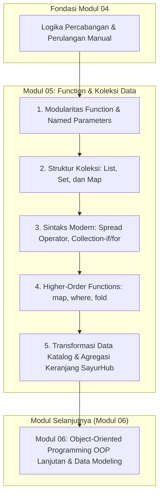
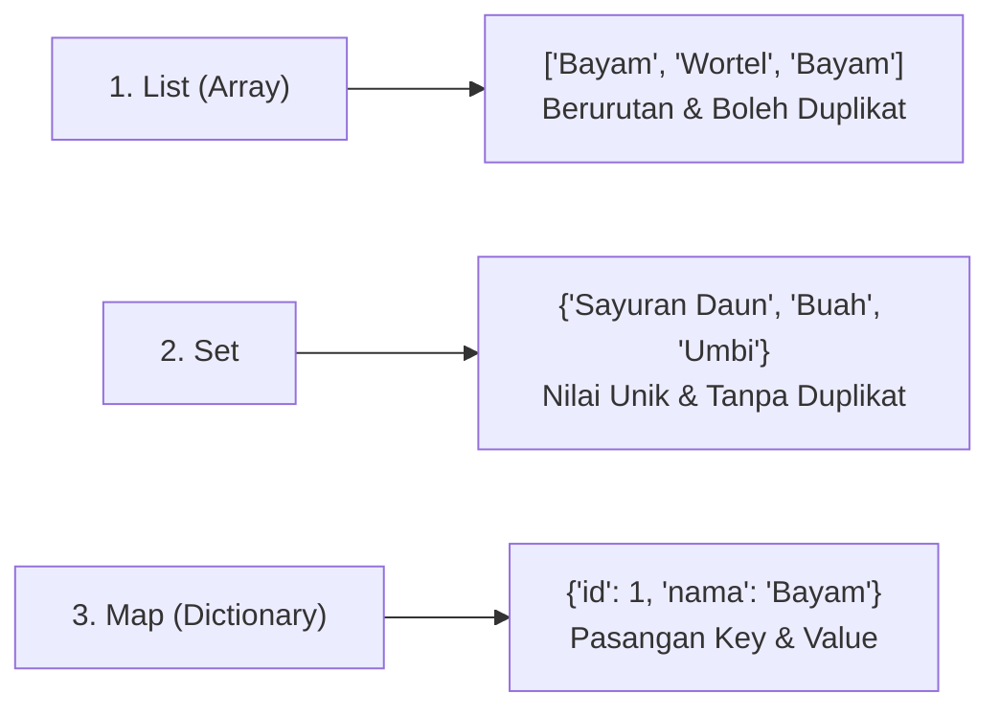
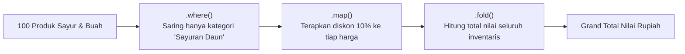

# MODUL 05: FUNCTION LANJUTAN, KOLEKSI DATA (LIST, SET, MAP), DAN PENGOLAHAN DATA FUNGSIONAL PADA DART
## PENGEMBANGAN APLIKASI MOBILE MULTIPLATFORM DARI DASAR HINGGA PRODUKSI
### KONSENTRASI KEAHLIAN REKAYASA PERANGKAT LUNAK (SMK RPL)

---

## A. IDENTITAS MODUL

- **Nomor Modul**: 05
- **Judul Modul**: Function Lanjutan, Koleksi Data (List, Set, Map), dan Pengolahan Data Fungsional pada Dart
- **Tingkat Kesulitan**: Pemula ke Menengah (*Beginner to Intermediate*)
- **Estimasi Waktu**: 6 Jam Pelajaran (6 × 45 Menit = 270 Menit)
- **Prasyarat**: Modul 04 (Kontrol Alur Eksekusi — Percabangan dan Perulangan Algoritmik pada Dart)
- **Tujuan Pembelajaran**:
  1. Siswa mampu merancang fungsi modular dengan variasi parameter: *Positional*, *Named Parameter* (`required` & nilai default), serta sintaks ringkas *Arrow Function* (`=>`).
  2. Siswa memahami konsep *First-Class Functions* dan mampu memperlakukan fungsi sebagai argumen ke dalam fungsi lain (*Higher-Order Functions*).
  3. Siswa menguasai tiga struktur data koleksi utama pada Dart: `List<T>` (kumpulan berurutan dengan indeks), `Set<T>` (kumpulan nilai unik tanpa duplikat), dan `Map<K, V>` (pasangan kunci dan nilai).
  4. Siswa terampil memanfaatkan fitur modern Dart: *Spread Operator* (`...` dan `...?`), *Collection-if*, dan *Collection-for*.
  5. Siswa menguasai teknik pengolahan data fungsional deklaratif tanpa perulangan manual melalui method `.map()`, `.where()`, `.fold()`, `.reduce()`, `.any()`, dan `.every()`.
  6. Siswa mampu membangun basis data mock katalog sayur/buah dan modul pemrosesan pencarian, penyaringan kategori, dan kalkulasi keranjang untuk aplikasi **SayurHub**.
- **Kompetensi yang Akan Dicapai**:
  - **Kognitif**: Pemahaman struktur data di memori, generic types (`<T>`), dan paradigma pemrograman fungsional (*functional programming*).
  - **Psikomotorik**: Keterampilan mentransformasi kumpulan data mentah (*raw data filtering & mapping*) serta merancang algoritma pengurutan (*sorting*) dan agregasi nilai.

---

## B. PETA KONSEP



- **Keterkaitan dengan Modul 04**: Perulangan `for` klasik pada Modul 04 kini dievolusikan menjadi metode fungsional deklaratif yang jauh lebih ringkas, aman, dan mudah dirawat.
- **Keterkaitan dengan Modul 06**: Penguasaan `Map<String, dynamic>` pada modul ini adalah pondasi wajib sebelum siswa mempelajari serialisasi JSON (`fromJson` & `toJson`) pada class model OOP di Modul 06.

---

## C. MATERI TEORI

### 1. Fungsi Lanjutan: Positional vs Named Parameters
Dalam perancangan perangkat lunak profesional, sebuah fungsi sering kali membutuhkan banyak parameter. Jika kita hanya menggunakan parameter posisional biasa, pemanggilan fungsi akan menjadi sangat rawan tertukar dan sulit dibaca:

```dart
// Posisional Biasa (Membingungkan: angka 15000 itu harga atau diskon? true itu apa?):
prosesItem('Bayam', 15000, 2.5, true, 0.1);
```

Dart menyediakan solusi industri terbaik berupa **Named Parameters** (Parameter Bernama yang dibungkus dengan kurung kurawal `{}`):

```dart
// Named Parameters (Sangat jelas dan urutannya bebas):
void prosesItem({
  required String namaProduk,
  required double hargaPerKg,
  double beratKg = 1.0, // Nilai default jika tidak diisi pemanggil
  bool isOrganik = false,
  double? diskonPromo,  // Nullable opsional
}) {
  // Logika fungsi...
}

// Cara pemanggilan yang ramah dan ekspresif:
prosesItem(
  namaProduk: 'Bayam',
  hargaPerKg: 15000,
  isOrganik: true,
);
```

#### Arrow Function Syntax (`=>`)
Jika sebuah fungsi hanya memiliki **satu baris ekspresi**, kita dapat menggantikan blok kurung kurawal `{ return ...; }` dengan tanda panah kurus `=>`:
```dart
// Bentuk biasa:
double hitungPajak(double subtotal) {
  return subtotal * 0.11;
}

// Bentuk Arrow Syntax (Ringkas & Bersih):
double hitungPajak(double subtotal) => subtotal * 0.11;
```

---

### 2. Tiga Struktur Data Koleksi Utama (Collections)



#### A. `List<T>` (Daftar Terurut Berbasis Indeks)
Analoginya seperti **rak display sayuran di supermarket** yang diberi nomor urut (indeks) mulai dari 0:
```dart
// Deklarasi list sayuran dengan tipe spesifik String:
final List<String> rakSayur = ['Bayam', 'Kangkung', 'Wortel'];

// Mengakses data berdasarkan indeks (0-based index):
print(rakSayur[0]); // Menghasilkan: 'Bayam'

// Menambah data baru ke akhir list:
rakSayur.add('Brokoli');

// Mengubah isi elemen tertentu:
rakSayur[1] = 'Kangkung Hidroponik';
```

#### B. `Set<T>` (Kumpulan Nilai Unik Tanpa Duplikat)
Analoginya seperti **kumpulan stempel kategori sayur**. Jika kita memasukkan kategori yang sama berulang kali, Set akan secara otomatis menolaknya dan hanya menyimpan satu nilai unik:
```dart
final Set<String> kategoriUnik = {'Sayuran Daun', 'Buah Segar', 'Sayuran Daun'};

print(kategoriUnik); // Menghasilkan: {'Sayuran Daun', 'Buah Segar'} (Duplikat hilang otomatis!)

// Uji keberadaan data secara instan O(1):
if (kategoriUnik.contains('Buah Segar')) {
  print('Kategori tersedia di SayurHub!');
}
```

#### C. `Map<K, V>` (Pasangan Kunci dan Nilai)
Analoginya seperti **buku telepon atau kamus istilah**. Kita mencari suatu nilai (*Value*) berdasarkan kata kuncinya (*Key*), bukan berdasarkan nomor urut:
```dart
final Map<String, dynamic> produkBayam = {
  'id': 'PROD-001',
  'nama': 'Bayam Hijau Organik',
  'hargaPerKg': 15000.0,
  'stokTersedia': 45,
  'isPromo': true,
};

// Mengakses nilai berdasarkan key:
print(produkBayam['nama']);       // Menghasilkan: 'Bayam Hijau Organik'
print(produkBayam['hargaPerKg']); // Menghasilkan: 15000.0

// Menambah properti baru:
produkBayam['kebunAsal'] = 'Lembang, Bandung Barat';
```

---

### 3. Fitur Modern: Spread Operator, Collection-If, dan Collection-For

Dart memiliki fitur sintaksis yang sangat memanjakan pengembang antarmuka:

#### A. Spread Operator (`...` dan `...?`)
Digunakan untuk memasukkan seluruh isi koleksi ke dalam koleksi lain secara elegan:
```dart
final List<String> sayurDaun = ['Bayam', 'Kangkung'];
final List<String> buahSegar = ['Apel', 'Pisang'];

// Menggabungkan kedua list:
final List<String> semuaKatalog = [...sayurDaun, ...buahSegar];
```

#### B. Collection-If dan Collection-For
Memungkinkan penyisipan elemen ke dalam list secara kondisional langsung di dalam deklarasi:
```dart
bool sedangPanenRaya = true;

final List<String> promoBanner = [
  'Gratis Ongkir Akhir Pekan',
  if (sedangPanenRaya) 'Diskon Panen Raya Tomat 50%',
  for (int i = 1; i <= 3; i++) 'Voucher Belanja VIP #$i',
];
```

---

### 4. Pengolahan Data Fungsional (Higher-Order Functions)

Alih-alih menulis perulangan `for` manual yang panjang dan rentan salah indeks, pengembang modern menggunakan metode rantai (*method chaining*) yang deklaratif:



1. **`.where()` (Filtering / Penyaringan Data)**:
   Menyaring elemen koleksi berdasarkan kondisi logika tertentu. Hanya elemen yang mengembalikan `true` yang akan lolos:
   ```dart
   final sayurMurah = daftarProduk.where((p) => p['hargaPerKg'] < 20000).toList();
   ```
2. **`.map()` (Transformasi Elemen)**:
   Mengubah setiap elemen dalam koleksi menjadi bentuk baru:
   ```dart
   // Mengambil hanya nama sayurnya saja dari daftar Map produk:
   final List<String> namaProdukSaja = daftarProduk.map((p) => p['nama'] as String).toList();
   ```
3. **`.fold()` dan `.reduce()` (Agregasi / Akumulasi Nilai)**:
   Menggabungkan seluruh elemen menjadi satu nilai tunggal (contoh: menghitung grand total nilai belanja):
   ```dart
   // Menjumlahkan subtotal keranjang belanja:
   final double totalKeranjang = itemKeranjang.fold(
     0.0, // Nilai awal akumulator
     (akumulator, item) => akumulator + (item['subtotal'] as double),
   );
   ```
4. **`.any()` dan `.every()` (Pengujian Boolean Cepat)**:
   - `.any()`: Mengembalikan `true` jika **minimal satu** elemen memenuhi syarat.
   - `.every()`: Mengembalikan `true` hanya jika **seluruh** elemen memenuhi syarat.

---

## D. PEMBAHASAN KODE PROGRAM: PEMROSESAN KATALOG SAYURHUB

Mari kita bedah program pengolahan data katalog yang mendemonstrasikan pencarian (*search*), pemfilteran kategori (*category filter*), dan kalkulasi total belanja.

```dart
void main() {
  // 1. Data mentah katalog SayurHub (List of Map)
  final List<Map<String, dynamic>> rawCatalog = [
    {'id': 'P1', 'nama': 'Bayam Hijau', 'kategori': 'Sayuran Daun', 'harga': 12000.0, 'stok': 30},
    {'id': 'P2', 'nama': 'Apel Fuji Segar', 'kategori': 'Buah Segar', 'harga': 35000.0, 'stok': 15},
    {'id': 'P3', 'nama': 'Kangkung Air', 'kategori': 'Sayuran Daun', 'harga': 8000.0, 'stok': 0}, // Habis
    {'id': 'P4', 'nama': 'Wortel Brastagi', 'kategori': 'Umbi-umbian', 'harga': 16000.0, 'stok': 20},
    {'id': 'P5', 'nama': 'Jeruk Medan Manis', 'kategori': 'Buah Segar', 'harga': 28000.0, 'stok': 25},
  ];

  print('=== SISTEM PENGOLAHAN KATALOG & KERANJANG SAYURHUB ===\n');

  // 2. Mengambil seluruh kategori unik menggunakan Set
  final Set<String> kategoriTersedia = rawCatalog.map((p) => p['kategori'] as String).toSet();
  print('Kategori Terdaftar: $kategoriTersedia\n');

  // 3. Filtering: Cari hanya komoditas 'Buah Segar' yang stoknya > 0
  final List<Map<String, dynamic>> buahReady = rawCatalog.where((item) {
    final bool isBuah = item['kategori'] == 'Buah Segar';
    final bool isTersedia = (item['stok'] as int) > 0;
    return isBuah && isTersedia;
  }).toList();

  print('Daftar Buah Segar Siap Beli:');
  buahReady.forEach((b) => print(' - ${b['nama']} : Rp ${b['harga']} (Stok: ${b['stok']})'));

  // 4. Transformasi & Agregasi: Simulasi Keranjang Belanja Pelanggan
  // Pelanggan membeli 2 kg Bayam dan 1.5 kg Wortel
  final List<Map<String, dynamic>> keranjangBelanja = [
    {'produkId': 'P1', 'nama': 'Bayam Hijau', 'harga': 12000.0, 'qty': 2.0},
    {'produkId': 'P4', 'nama': 'Wortel Brastagi', 'harga': 16000.0, 'qty': 1.5},
  ];

  // Hitung subtotal tiap item menggunakan .map()
  final rincianTagihan = keranjangBelanja.map((item) {
    final double subtotal = (item['harga'] as double) * (item['qty'] as double);
    return {
      'nama': item['nama'],
      'qty': item['qty'],
      'subtotal': subtotal,
    };
  }).toList();

  // Hitung total bayar menggunakan .fold()
  final double grandTotal = rincianTagihan.fold(
    0.0,
    (total, item) => total + (item['subtotal'] as double),
  );

  print('\n--- RINCIAN CHECKOUT KERANJANG BELANJA ---');
  for (final item in rincianTagihan) {
    print('• ${item['nama']} (${item['qty']} kg) -> Subtotal: Rp ${item['subtotal']}');
  }
  print('------------------------------------------');
  print('GRAND TOTAL BAYAR: Rp $grandTotal');
}
```

### Penjelasan Baris-Baris Kunci:
- **`rawCatalog.map((p) => p['kategori'] as String).toSet()`**: Mengekstrak string kategori dari setiap item produk, lalu langsung mengubahnya menjadi `Set` sehingga kategori duplikat seperti `'Sayuran Daun'` otomatis digabungkan.
- **`rawCatalog.where((item) { ... }).toList()`**: Mengembalikan `Iterable` baru yang telah difilter sesuai logika predikat, lalu method `.toList()` mengonversinya kembali menjadi list data nyata.
- **`rincianTagihan.fold(0.0, (total, item) => total + ...)`**: Menjumlahkan seluruh subtotal belanjaan secara berantai dari item pertama hingga terakhir dengan nilai dasar awal `0.0`.

---

## E. PERSIAPAN PRAKTIKUM

1. **Perangkat Lunak**:
   - Visual Studio Code dengan integrasi terminal Dart CLI.
2. **Kondisi Awal Proyek**:
   - Folder kerja: `/home/arif/flutter-1/sayur_hub/` dalam status Git bersih.
3. **Struktur File yang Akan Dibuat**:
   - Data sumber tiruan: `sayur_hub/lib/core/mock/mock_produce_data.dart`.
   - Modul pemroses data: `sayur_hub/lib/core/utils/catalog_processor.dart`.
   - Script pengujian terminal: `sayur_hub/bin/modul_05_collections.dart`.

---

## F. LANGKAH PRAKTIKUM STEP-BY-STEP

### Langkah 1 — Menyiapkan Folder Mock Data

1. Buka project SayurHub di VS Code.
2. Buat direktori baru `lib/core/mock/`:
   ```bash
   mkdir -p lib/core/mock
   ```
   *Penjelasan*: Dalam pengembangan mobile profesional, sebelum API server backend siap, pengembang selalu membuat data tiruan (*mock data*) agar pengerjaan antarmuka dan logika bisnis tidak terhambat.

---

### Langkah 2 — Membuat Basis Data Mock Katalog SayurHub

1. Buat file baru di `lib/core/mock/mock_produce_data.dart`.
2. Tuliskan kode kumpulan data produk mentah berikut:

```dart
// File: sayur_hub/lib/core/mock/mock_produce_data.dart

/// Kumpulan data tiruan resmi katalog SayurHub (Mock Data)
/// Mewakili respon JSON yang kelak akan diterima dari REST API Backend
class MockProduceData {
  MockProduceData._();

  static final List<Map<String, dynamic>> rawProducts = [
    {
      'id': 'PROD-001',
      'name': 'Bayam Hijau Hidroponik',
      'category': 'Sayuran Daun',
      'pricePerKg': 14000.0,
      'stock': 35,
      'rating': 4.8,
      'isOrganic': true,
    },
    {
      'id': 'PROD-002',
      'name': 'Kangkung Segar Kebun',
      'category': 'Sayuran Daun',
      'pricePerKg': 9000.0,
      'stock': 50,
      'rating': 4.6,
      'isOrganic': false,
    },
    {
      'id': 'PROD-003',
      'name': 'Alpukat Mentega Super',
      'category': 'Buah Segar',
      'pricePerKg': 32000.0,
      'stock': 20,
      'rating': 4.9,
      'isOrganic': true,
    },
    {
      'id': 'PROD-004',
      'name': 'Wortel Manis Berastagi',
      'category': 'Umbi-umbian',
      'pricePerKg': 18000.0,
      'stock': 0, // Stok kosong (Habis)
      'rating': 4.5,
      'isOrganic': false,
    },
    {
      'id': 'PROD-005',
      'name': 'Pisang Sunpride Cavendish',
      'category': 'Buah Segar',
      'pricePerKg': 24000.0,
      'stock': 18,
      'rating': 4.7,
      'isOrganic': false,
    },
    {
      'id': 'PROD-006',
      'name': 'Bawang Merah Brebes',
      'category': 'Bumbu Dapur',
      'pricePerKg': 38000.0,
      'stock': 15,
      'rating': 4.8,
      'isOrganic': false,
    },
  ];
}
```

---

### Langkah 3 — Membuat Script Pengujian Fungsional

1. Buat file baru di `bin/modul_05_collections.dart`.
2. Tuliskan kode program pengujian pengolahan data:

```dart
// File: sayur_hub/bin/modul_05_collections.dart
import 'package:sayur_hub/core/mock/mock_produce_data.dart';
import 'package:sayur_hub/core/utils/price_calculator.dart';

void main() {
  print('====================================================');
  print('     PENGUJIAN METODE KOLEKSI DAN DATA SAYURHUB     ');
  print('====================================================\n');

  final products = MockProduceData.rawProducts;

  // 1. Ekstraksi kategori unik dengan Set
  final Set<String> categories = products
      .map((item) => item['category'] as String)
      .toSet();
  print('1. Kategori Produk Unik Tersedia:');
  for (final cat in categories) {
    print('   • $cat');
  }

  // 2. Filter produk organik yang stoknya tersedia
  final organicReady = products.where((p) {
    final bool isOrg = p['isOrganic'] as bool;
    final int stock = p['stock'] as int;
    return isOrg && stock > 0;
  }).toList();

  print('\n2. Produk Organik Siap Beli:');
  for (final p in organicReady) {
    print('   - ${p['name']} (${PriceCalculator.formatRupiah(p['pricePerKg'] as num)}/kg) | Rating: ${p['rating']}');
  }

  // 3. Pencarian produk berdasarkan kata kunci (Case-insensitive)
  const String keyword = 'alpukat';
  final searchResult = products.where((p) {
    final String name = (p['name'] as String).toLowerCase();
    return name.contains(keyword.toLowerCase());
  }).toList();

  print('\n3. Hasil Pencarian Kata Kunci "$keyword":');
  if (searchResult.isEmpty) {
    print('   (Produk tidak ditemukan)');
  } else {
    for (final p in searchResult) {
      print('   [Ditemukan] ${p['name']} - Stok: ${p['stock']} kg');
    }
  }

  // 4. Perhitungan nilai total aset gudang SayurHub menggunakan .fold()
  final double totalNilaiGudang = products.fold(0.0, (acc, p) {
    final double price = p['pricePerKg'] as double;
    final int stock = p['stock'] as int;
    return acc + (price * stock);
  });

  print('\n4. Total Nilai Aset Seluruh Sayur di Gudang:');
  print('   ${PriceCalculator.formatRupiah(totalNilaiGudang)}');
  print('\n====================================================');
}
```

3. Jalankan script tersebut:
   ```bash
   dart run bin/modul_05_collections.dart
   ```
4. *Hasil yang Diharapkan*: Terminal mengeksekusi operasi mapping, filtering, pencarian kata kunci "alpukat", dan kalkulasi total aset gudang secara presisi.

---

## G. ANALISIS DAN PEMAHAMAN

Jawablah pertanyaan analisis berikut:

1. **Analisis Deklaratif vs Imperatif**: Bandingkan cara memfilter produk menggunakan perulangan `for` klasik dengan cara menggunakan method `.where()`. Mengapa pendekatan fungsional `.where()` dianggap lebih aman dari bug mutasi data dan lebih disukai dalam arsitektur Flutter?
2. **Analisis Struktur Data**: Mengapa untuk menyimpan daftar kategori sayur kita memilih `Set<String>` daripada `List<String>`? Apa yang akan terjadi jika kita menggunakan `List` saat tombol tab kategori di antarmuka SayurHub dirender?
3. **Analisis Kompleksitas Pencarian**: Mengapa operasi pencarian kata kunci pada nama produk (`name.toLowerCase().contains(...)`) harus mengubah kedua teks menjadi huruf kecil terlebih dahulu? Sebutkan masalah yang dialami pengguna jika langkah tersebut diabaikan!

---

## H. LATIHAN DAN TANTANGAN

### 1. Soal Teori
1. Tipe koleksi pada Dart yang dijamin tidak akan pernah memiliki dua elemen dengan nilai yang sama persis adalah:
   - A. `List`
   - B. `Map`
   - C. `Set`
   - D. `Array`
2. Operator yang digunakan untuk menyebarkan (*spread*) seluruh elemen dari satu koleksi ke dalam koleksi lain adalah:
   - A. `&&`
   - B. `...`
   - C. `->`
   - D. `::`
3. Method higher-order pada List yang digunakan untuk mengakumulasi atau merangkum seluruh elemen menjadi satu nilai tunggal (seperti menjumlahkan total harga) adalah:
   - A. `.filter()`
   - B. `.reduce()` atau `.fold()`
   - C. `.transform()`
   - D. `.collect()`
4. Apa output dari potongan kode berikut:
   ```dart
   final List<int> angka = [1, 2, 3, 4, 5];
   final genap = angka.where((n) => n % 2 == 0).toList();
   print(genap.length);
   ```
5. Jelaskan perbedaan antara parameter bertipe `required` dengan parameter yang memiliki nilai default (*default value*) pada fungsi dengan Named Parameters!

### 2. Soal Praktik
1. **Pengurutan Harga Termurah ke Termahal (Sorting)**: Gunakan method `.sort()` pada `List<Map<String, dynamic>>` untuk mengurutkan daftar produk sayuran dari harga yang paling murah ke yang paling mahal.
2. **Deteksi Stok Habis Cepat dengan `.any()`**: Buat fungsi satu baris (*arrow syntax*) yang memeriksa apakah ada produk di dalam katalog yang stoknya bernilai `0`. Jika ada, cetak peringatan *"Gudang memerlukan restock segera!"*.
3. **Penyusunan Format Ringkas dengan `.map()`**: Dari daftar produk mock, gunakan method `.map()` untuk menghasilkan `List<String>` baru dengan format: `"[KATEGORI] Nama Produk - Rp Harga"`.

### 3. Tantangan Pemecahan Masalah (*Problem-Solving Challenges*)
- **Tantangan 1 (Filter Multi-Kriteria Dinamis)**: Rancanglah sebuah fungsi pencarian tingkat lanjut `filterCatalog({String? category, double? maxPrice, bool? onlyOrganic})` yang mampu menerima parameter opsional nullable dan menyaring daftar produk berdasarkan kriteria-kriteria yang diisi saja (jika parameter bernilai `null`, lewati filter tersebut).
- **Tantangan 2 (Grouping Produk Berdasarkan Kategori)**: Diberikan daftar 100 produk sayur dan buah. Rancanglah algoritma untuk mengelompokkan data tersebut ke dalam struktur `Map<String, List<Map<String, dynamic>>>`, di mana *Key* adalah nama kategori (contoh: `'Sayuran Daun'`) dan *Value*-nya adalah list produk yang termasuk dalam kategori tersebut!

### 4. Studi Kasus Industri
**Studi Kasus**: Keranjang belanja aplikasi SayurHub memiliki promo "Paket Sup Segar": Jika pembeli memiliki item Wortel, Kentang, dan Daun Seledri sekaligus di keranjang belanjanya, seluruh paket tersebut mendapatkan potongan langsung sebesar Rp 4.000.  
*Tugas Siswa*: Rancanglah fungsi validator keranjang menggunakan method `.every()` atau `.contains()` untuk mendeteksi apakah ketiga ID produk tersebut hadir di dalam keranjang belanja pelanggan!

---

## I. TROUBLESHOOTING & FAQ

Berikut adalah tabel kesalahan umum pengolahan koleksi data pada Dart beserta solusinya:

| Permasalahan Teknis | Penyebab Utama | Cara Identifikasi | Langkah Penyelesaian Tepat |
|---|---|---|---|
| **Pesan Error "type 'X' is not a subtype of type 'Y' in type cast"** | Mencoba melakukan *type casting* yang salah saat membaca nilai dari `Map<String, dynamic>`. | Error runtime saat membaca nilai: `p['price'] as int` padahal tipe aslinya di Map adalah `double`. | Periksa tipe data asli atau gunakan `(p['price'] as num).toDouble()` agar aman menerima baik `int` maupun `double`. |
| **Pesan Error "Concurrent modification during iteration"** | Mencoba menghapus (`.remove()`) atau menambah (`.add()`) elemen pada `List` di dalam perulangan `for-in` yang sedang aktif menelusuri list tersebut. | Aplikasi crash saat looping sedang berjalan. | Jangan ubah list yang sedang di-loop. Gunakan method fungsional `.where()` untuk membuat list baru tanpa item yang ingin dihapus. |
| **Koleksi Menghasilkan 'Instance of WhereIterable' bukan List** | Lupa menambahkan pemanggilan method `.toList()` di akhir pemanggilan `.where()` atau `.map()`. | Teks dicetak sebagai `(Instance of 'WhereIterable<...>')` bukan daftar array `[...]`. | Tambahkan `.toList()` pada akhir rantai fungsi: `daftar.where(...).toList()`. |
| **Nilai Map Mengembalikan `null` Saat Key Dipanggil** | Salah penulisan huruf besar/kecil (*case-sensitive typo*) pada nama Key Map. | `p['kategori']` mengembalikan `null` karena nama key di deklarasi adalah `'category'`. | Gunakan konstanta atau segera migrasikan struktur Map mentah ke Class Model OOP bertipe kuat (Materi Modul 06). |

---

## J. PRAKTIKUM INTEGRASI ANTAR-MODUL: CATALOG PROCESSOR "SAYURHUB"

Pada praktikum integrasi Modul 05, kita akan membangun kelas utilitas resmi bernama **`CatalogProcessor`**. Kelas ini bertindak sebagai otak pengolah data katalog, mesin filter pencarian, dan kalkulator ringkasan keranjang belanja sebelum data dihubungkan ke antarmuka Flutter pada modul-modul mendatang.

### 1. Judul Praktikum Integrasi
**Pembangunan Modul Pengolah Katalog dan Mesin Pencarian Produk Fungsional SayurHub**

### 2. Tujuan Praktikum Integrasi
- Membuat kelas `CatalogProcessor` di `lib/core/utils/` yang menyediakan metode-metode pemrosesan data berbasis *Higher-Order Functions*.
- Mengintegrasikan data tiruan dari `MockProduceData` dengan utilitas harga dari `PriceCalculator` dan `InventoryManager`.
- Menjamin seluruh metode bersifat murni (*pure functions*), tidak memutasi data asli, dan bebas peringatan linter.

### 3. Materi yang Diintegrasikan
- Utilitas `PriceCalculator` dari Modul 03.
- Utilitas `InventoryManager` dari Modul 04.
- Penguasaan `List`, `Set`, `Map`, dan higher-order methods dari Modul 05.

### 4. Kondisi Awal Proyek (*Project State Before*)
Proyek `sayur_hub` telah memiliki mock data dasar. Belum ada utilitas terstandarisasi untuk memfilter, mengurutkan, dan mengagregasi data katalog secara terpusat.

### 5. Instruksi Langkah Demi Langkah
1. Buat file baru bernama `catalog_processor.dart` di dalam folder `lib/core/utils/`.
2. Tuliskan kelas `CatalogProcessor` lengkap dengan dokumentasi teknis.
3. Perbarui script `bin/modul_05_collections.dart` untuk memverifikasi fungsionalitas kelas `CatalogProcessor`.
4. Jalankan analisis kualitas kode:
   ```bash
   flutter analyze
   ```
5. Eksekusi pengujian di terminal:
   ```bash
   dart run bin/modul_05_collections.dart
   ```
6. Simpan dan commit seluruh pekerjaan ke repositori Git:
   ```bash
   git add .
   git commit -m "feat(core): add MockProduceData and CatalogProcessor with functional higher-order methods"
   ```

---

### 6. Kode Program Integrasi Lengkap

#### File: `lib/core/utils/catalog_processor.dart`
```dart
import 'package:sayur_hub/core/utils/price_calculator.dart';

/// Kelas utilitas fungsional untuk mengolah, menyaring, mencari,
/// dan mengurutkan data katalog produk di aplikasi SayurHub.
class CatalogProcessor {
  CatalogProcessor._();

  /// Mengambil daftar kategori unik dari sekumpulan data produk mentah
  static Set<String> getUniqueCategories(List<Map<String, dynamic>> products) {
    return products.map((item) => item['category'] as String).toSet();
  }

  /// Menyaring produk berdasarkan nama kategori tertentu
  /// Jika [categoryName] bernilai null atau 'Semua', kembalikan seluruh produk
  static List<Map<String, dynamic>> filterByCategory({
    required List<Map<String, dynamic>> products,
    String? categoryName,
  }) {
    if (categoryName == null || categoryName.trim().isEmpty || categoryName == 'Semua') {
      return List.unmodifiable(products);
    }

    return products
        .where((item) => (item['category'] as String).toLowerCase() == categoryName.toLowerCase())
        .toList();
  }

  /// Melakukan pencarian produk berdasarkan kata kunci nama produk (Case-insensitive)
  static List<Map<String, dynamic>> searchProducts({
    required List<Map<String, dynamic>> products,
    required String query,
  }) {
    final String cleanQuery = query.trim().toLowerCase();
    if (cleanQuery.isEmpty) {
      return List.unmodifiable(products);
    }

    return products.where((item) {
      final String name = (item['name'] as String).toLowerCase();
      final String category = (item['category'] as String).toLowerCase();
      return name.contains(cleanQuery) || category.contains(cleanQuery);
    }).toList();
  }

  /// Mengurutkan daftar produk berdasarkan harga termurah atau termahal
  /// [ascending] = true untuk harga termurah -> termahal
  static List<Map<String, dynamic>> sortByPrice({
    required List<Map<String, dynamic>> products,
    bool ascending = true,
  }) {
    // Membuat salinan list agar tidak memutasi koleksi data asli
    final List<Map<String, dynamic>> sortedList = List.from(products);

    sortedList.sort((a, b) {
      final num priceA = a['pricePerKg'] as num;
      final num priceB = b['pricePerKg'] as num;
      return ascending ? priceA.compareTo(priceB) : priceB.compareTo(priceA);
    });

    return sortedList;
  }

  /// Menghitung grand total nilai belanja dari sekumpulan item keranjang
  static double calculateCartGrandTotal(List<Map<String, dynamic>> cartItems) {
    return cartItems.fold(0.0, (accumulatedTotal, item) {
      final double price = (item['pricePerKg'] as num).toDouble();
      final double quantity = (item['quantity'] as num).toDouble();
      return accumulatedTotal + PriceCalculator.calculateSubtotal(
        pricePerUnit: price,
        quantity: quantity,
      );
    });
  }
}
```

#### File: `bin/modul_05_collections.dart`
```dart
import 'package:sayur_hub/core/mock/mock_produce_data.dart';
import 'package:sayur_hub/core/utils/catalog_processor.dart';
import 'package:sayur_hub/core/utils/price_calculator.dart';

void main() {
  print('====================================================');
  print('    SAYURHUB FUNCTIONAL CATALOG ENGINE TEST         ');
  print('====================================================\n');

  final products = MockProduceData.rawProducts;

  // 1. Uji Pengambilan Kategori Unik
  final Set<String> categories = CatalogProcessor.getUniqueCategories(products);
  print('>>> 1. KATEGORI TERDAFTAR DI SISTEM (${categories.length} Kategori):');
  for (final cat in categories) {
    print('    [•] $cat');
  }

  // 2. Uji Filter Kategori: Sayuran Daun
  const String filterTarget = 'Sayuran Daun';
  final filteredProduce = CatalogProcessor.filterByCategory(
    products: products,
    categoryName: filterTarget,
  );
  print('\n>>> 2. PRODUK KATEGORI "$filterTarget" (${filteredProduce.length} Item):');
  for (final p in filteredProduce) {
    print('    - ${p['name']} | ${PriceCalculator.formatRupiah(p['pricePerKg'] as num)}/kg | Stok: ${p['stock']}');
  }

  // 3. Uji Pengurutan Harga: Termurah ke Termahal
  final sortedProducts = CatalogProcessor.sortByPrice(
    products: products,
    ascending: true,
  );
  print('\n>>> 3. DAFTAR HARGA TERMURAH -> TERMAHAL:');
  for (final p in sortedProducts) {
    print('    • ${PriceCalculator.formatRupiah(p['pricePerKg'] as num).padRight(12)} : ${p['name']}');
  }

  // 4. Uji Pencarian Live Search Kata Kunci "Manis"
  const String searchQuery = 'manis';
  final searchResults = CatalogProcessor.searchProducts(
    products: products,
    query: searchQuery,
  );
  print('\n>>> 4. HASIL PENCARIAN KATA KUNCI "$searchQuery":');
  for (final p in searchResults) {
    print('    [Cocok] ${p['name']} (${p['category']})');
  }

  // 5. Uji Kalkulasi Keranjang Belanja Pelanggan
  final List<Map<String, dynamic>> simulasiKeranjang = [
    {'name': 'Bayam Hijau Hidroponik', 'pricePerKg': 14000.0, 'quantity': 2.0},
    {'name': 'Alpukat Mentega Super', 'pricePerKg': 32000.0, 'quantity': 1.5},
    {'name': 'Bawang Merah Brebes', 'pricePerKg': 38000.0, 'quantity': 0.5},
  ];

  final double totalTagihan = CatalogProcessor.calculateCartGrandTotal(simulasiKeranjang);
  print('\n>>> 5. SIMULASI PERHITUNGAN TOTAL KERANJANG BELANJA:');
  for (final item in simulasiKeranjang) {
    final double sub = (item['pricePerKg'] as double) * (item['quantity'] as double);
    print('    • ${item['name']} (${item['quantity']} kg) = ${PriceCalculator.formatRupiah(sub)}');
  }
  print('    ------------------------------------------------');
  print('    TOTAL AKHIR KERANJANG: ${PriceCalculator.formatRupiah(totalTagihan)}');

  print('\n====================================================');
  print('>> VERIFIKASI PENGOLAHAN DATA MODUL 05: SUKSES 100% <<');
}
```

---

### 7. Hasil yang Diharapkan
Keluaran terminal menampilkan hasil transformasi data fungsional secara presisi:
```
====================================================
    SAYURHUB FUNCTIONAL CATALOG ENGINE TEST         
====================================================

>>> 1. KATEGORI TERDAFTAR DI SISTEM (4 Kategori):
    [•] Sayuran Daun
    [•] Buah Segar
    [•] Umbi-umbian
    [•] Bumbu Dapur

>>> 2. PRODUK KATEGORI "Sayuran Daun" (2 Item):
    - Bayam Hijau Hidroponik | Rp 14.000/kg | Stok: 35
    - Kangkung Segar Kebun | Rp 9.000/kg | Stok: 50

>>> 3. DAFTAR HARGA TERMURAH -> TERMAHAL:
    • Rp 9.000     : Kangkung Segar Kebun
    • Rp 14.000    : Bayam Hijau Hidroponik
    • Rp 18.000    : Wortel Manis Berastagi
    • Rp 24.000    : Pisang Sunpride Cavendish
    • Rp 32.000    : Alpukat Mentega Super
    • Rp 38.000    : Bawang Merah Brebes

>>> 4. HASIL PENCARIAN KATA KUNCI "manis":
    [Cocok] Wortel Manis Berastagi (Umbi-umbian)

>>> 5. SIMULASI PERHITUNGAN TOTAL KERANJANG BELANJA:
    • Bayam Hijau Hidroponik (2.0 kg) = Rp 28.000
    • Alpukat Mentega Super (1.5 kg) = Rp 48.000
    • Bawang Merah Brebes (0.5 kg) = Rp 19.000
    ------------------------------------------------
    TOTAL AKHIR KERANJANG: Rp 95.000

====================================================
>> VERIFIKASI PENGOLAHAN DATA MODUL 05: SUKSES 100% <<
```

### 8. Kriteria Keberhasilan
- [x] File `MockProduceData` dan `CatalogProcessor` tersimpan rapi dan bebas dari peringatan linter.
- [x] Metode pencarian tidak memicu *NullPointerException* atau error saat query berupa spasi kosong.
- [x] Metode sorting tidak merusak atau memutasi urutan pada data list asli (*Immutability preserved*).
- [x] Perintah `flutter analyze` menghasilkan `No issues found!`.

---

## K. EVALUASI MODUL 05

### 1. Rubrik Penilaian Pengolahan Koleksi Data
| Kriteria Evaluasi | Skor Maksimal | Indikator Pencapaian |
|---|---|---|
| **Penerapan Koleksi List, Set, dan Map** | 25 | Mampu memilih dan mengoperasikan struktur koleksi yang tepat sesuai karakteristik data bisnis. |
| **Penguasaan Higher-Order Functions** | 35 | Terampil menggunakan `.map()`, `.where()`, `.fold()`, dan `.sort()` untuk mentransformasi dan mengagregasi data secara deklaratif. |
| **Kualitas Perancangan Fungsi (Named Parameters)** | 25 | Mampu membuat fungsi modular dengan penamaan yang jelas, pemanfaatan `required`, dan penanganan parameter opsional. |
| **Kerapian & Kepatuhan Standar Clean Code** | 15 | Kode bersih, tidak menghasilkan mutasi sampingan yang berbahaya (*no side effects*), dan terdokumentasi rapi. |
| **Total Skor** | **100** | **Kriteria Ketuntasan Minimal (KKM): 75** |

### 2. Soal Uji Debugging Kode Fungsional
*Tinjau potongan kode filter berikut:*
```dart
void main() {
  final List<Map<String, dynamic>> produk = [
    {'nama': 'Bayam', 'harga': 10000},
    {'nama': 'Wortel', 'harga': 15000},
  ];

  final hasil = produk.where((p) => p['harga'] > 12000);
  print(hasil[0]['nama']); // Baris ini memicu error kompilasi!
}
```
- **Pertanyaan**: Jelaskan mengapa baris `print(hasil[0]['nama'])` memicu error kompilasi dan bagaimana cara memperbaikinya!
- **Kunci Jawaban**:
  1. *Penyebab*: Method `.where()` tidak mengembalikan objek `List`, melainkan tipe data `Iterable`. Objek `Iterable` tidak memiliki operator indeks `[0]`.
  2. *Perbaikan*: Panggil method `.toList()` pada hasil filter sebelum mengakses indeks:
     ```dart
     final hasil = produk.where((p) => (p['harga'] as int) > 12000).toList();
     print(hasil[0]['nama']); // Menghasilkan: 'Wortel'
     ```

---

## L. KESIMPULAN DAN JEMBATAN KE MODUL BERIKUTNYA

### Rangkuman Kompetensi:
Selamat! Melalui Modul 05 ini Anda telah melompat dari pemrogram tingkat dasar ke tingkat menengah:
1. Mampu merancang fungsi dengan **Named Parameters** yang mudah dibaca dan aman digunakan di aplikasi berskala besar.
2. Menguasai pemanfaatan tiga koleksi utama Dart: **List** (berurutan), **Set** (nilai unik), dan **Map** (kunci-nilai).
3. Menguasai paradigma pemrograman fungsional modern menggunakan metode rantai sakti: `.map()`, `.where()`, `.fold()`, dan `.sort()`.
4. Berhasil memprogram mesin pengolah data `CatalogProcessor` dan dataset mock untuk aplikasi **SayurHub**.

### Penghubung Menuju Modul 06:
Meskipun pengolahan data menggunakan `Map<String, dynamic>` sangat fleksibel, di industri perangkat lunak penggunaan Map mentah memiliki bahaya laten yang besar: **Typo pada nama key**. Jika Anda salah mengetik `'hargaperkg'` alih-alih `'pricePerKg'`, kompilator tidak akan memberi tahu Anda hingga aplikasi crash saat dipakai oleh pembeli!

Untuk mengatasi kelemahan ini, pada **Modul 06: Object-Oriented Programming (OOP) Lanjutan pada Dart**, kita akan mentransformasi data Map mentah ini menjadi **Class Model Objek yang Bertipe Kuat (*Strongly-Typed Data Entities*)** seperti `class Product`, `class Category`, `class CartItem`, dan `class User` lengkap dengan mekanisme otomatis serialisasi JSON (`fromJson` & `toJson`)!
