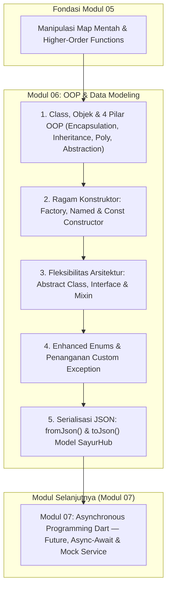
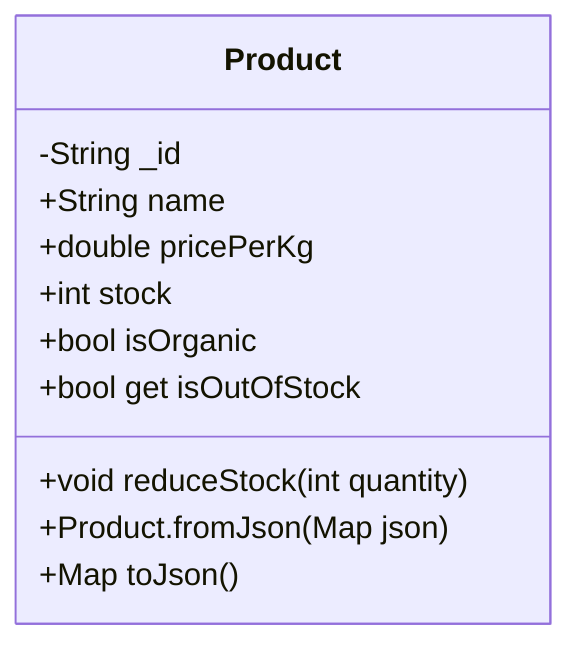

# MODUL 06: OBJECT-ORIENTED PROGRAMMING (OOP) LANJUTAN PADA DART DAN PEMODELAN DATA ENTITAS
## PENGEMBANGAN APLIKASI MOBILE MULTIPLATFORM DARI DASAR HINGGA PRODUKSI
### KONSENTRASI KEAHLIAN REKAYASA PERANGKAT LUNAK (SMK RPL)

---

## A. IDENTITAS MODUL

- **Nomor Modul**: 06
- **Judul Modul**: Object-Oriented Programming (OOP) Lanjutan pada Dart dan Pemodelan Data Entitas (*Data Modeling*)
- **Tingkat Kesulitan**: Menengah (*Intermediate*)
- **Estimasi Waktu**: 8 Jam Pelajaran (8 × 45 Menit = 360 Menit)
- **Prasyarat**: Modul 05 (Function Lanjutan, Koleksi Data, dan Pengolahan Data Fungsional pada Dart)
- **Tujuan Pembelajaran**:
  1. Siswa mampu memahami dan menerapkan paradigma *Object-Oriented Programming* (OOP) secara komprehensif pada bahasa Dart.
  2. Siswa terampil menyusun Class, properti privat (`_`), *getter/setter*, serta menguasai variasi Constructor: *Generative*, *Named*, *Const*, dan *Factory Constructor*.
  3. Siswa menguasai 4 pilar utama OOP: *Encapsulation*, *Inheritance* (`extends`), *Polymorphism* (`@override`), dan *Abstraction* (`abstract class`).
  4. Siswa mampu mengimplementasikan antarmuka (*Interface* via `implements`) dan kode yang dapat digunakan kembali (*code reuse*) menggunakan `mixin` (`with`).
  5. Siswa menguasai fitur *Enhanced Enum* pada Dart untuk memodelkan status transaksi bisnis secara *type-safe*.
  6. Siswa terampil menangani galat terstruktur melalui `try`, `on`, `catch`, `finally`, serta mampu merancang *Custom Exception*.
  7. Siswa mampu mentransformasikan data mentah `Map<String, dynamic>` menjadi model objek entitas produksi (`Product`, `CartItem`, `User`, `Order`) lengkap dengan metode serialisasi `fromJson` dan `toJson` untuk aplikasi **SayurHub**.
- **Kompetensi yang Akan Dicapai**:
  - **Kognitif**: Pemahaman arsitektur domain modeling, enkapsulasi data, serta pencegahan kesalahan manipulasi tipe data (*type-safety assurance*).
  - **Psikomotorik**: Keterampilan merancang diagram kelas UML, menulis kelas model entitas yang imutabel (*immutable models*), dan mengonversi payload data JSON secara bolak-balik.

---

## B. PETA KONSEP



- **Keterkaitan dengan Modul 05**: Data mentah `Map<String, dynamic>` yang diolah pada Modul 05 kini dibungkus ke dalam kelas objek resmi yang memiliki validasi tipe data ketat, metode khusus, dan terlindung dari kesalahan ketik (*typo*).
- **Keterkaitan dengan Modul 07**: Model-model kelas yang diciptakan pada modul ini akan menjadi tipe data kembalian (*return type*) dari fungsi-fungsi asinkron `Future<Product>` dan panggilan REST API pada modul berikutnya.

---

## C. MATERI TEORI

### 1. Mengapa Kita Wajib Beralih dari Map ke Class OOP?
Pada Modul 05, kita mengelola data produk menggunakan Map:
```dart
final produk = {'nama': 'Bayam', 'harga': 12000.0};
print(produk['hargaa']); // Menghasilkan null karena salah ketik! Kompilator tidak memberi peringatan!
```
Kelemahan fatal penggunaan `Map` mentah untuk data bisnis:
1. **Tidak Ada Bantuan Auto-Complete (IntelliSense)**: IDE tidak tahu properti apa saja yang ada di dalam Map.
2. **Rawan Typo pada String Key**: Kesalahan satu huruf pada nama key menyebabkan nilai bernilai `null` tanpa peringatan linter.
3. **Tidak Menjamin Tipe Data**: Nilai di dalam `Map<String, dynamic>` bisa diisi apa saja (angka, teks, boolean), yang dapat memicu error runtime *type cast exception*.

**Solusi Industri**: Gunakan **Class Model**. Dengan Class, jika Anda salah mengetik `produk.hargaa`, kompilator Dart akan langsung menolak dan menandai garis bawah merah sebelum kode sempat dijalankan!

---

### 2. Anatomi Class, Properti, dan Konstruktor pada Dart



#### A. Deklarasi Class dan Initializing Formal Parameters
Dart memiliki cara paling elegan di dunia pemrograman untuk menulis konstruktor tanpa perlu mengetik ulang `this.name = name;` secara berulang-ulang:
```dart
class Product {
  // Properti (Fields)
  final String id;
  final String name;
  final double pricePerKg;
  final int stock;

  // Initializing Formal Constructor (Sangat ringkas):
  const Product({
    required this.id,
    required this.name,
    required this.pricePerKg,
    this.stock = 0,
  });
}
```

#### B. Enkapsulasi (Encapsulation) dan Properti Privat
Dalam Dart, hak akses privat tidak menggunakan kata kunci `private` seperti pada Java/C++, melainkan menggunakan awalan **garis bawah (*underscore* `_`)** pada nama variabel atau method:
```dart
class BankAccount {
  // Variabel privat hanya bisa diakses di dalam file (library) ini saja
  double _saldo = 0.0;

  // Getter: Membaca nilai saldo secara aman
  double get saldo => _saldo;

  // Setter: Memvalidasi sebelum nilai diubah
  set saldo(double nilaiBaru) {
    if (nilaiBaru >= 0) {
      _saldo = nilaiBaru;
    }
  }
}
```

---

### 3. Ragam Konstruktor Tingkat Lanjut pada Dart

1. **Const Constructor**:
   Memungkinkan pembuatan objek imutabel permanen di memori kompilasi. Jika dua widget dibuat dengan `const`, Flutter hanya menggunakan satu slot memori yang sama (*canonicalized instances*), menghemat penggunaan RAM smartphone secara drastis.
2. **Named Constructor**:
   Memberikan kejelasan maksud pembuatan objek dengan memberi nama khusus pada konstruktor:
   ```dart
   // Menginstansiasi produk kosong/placeholder:
   Product.empty() : id = '', name = 'Belum Ada', pricePerKg = 0.0, stock = 0;
   ```
3. **Factory Constructor (`factory`)**:
   Konstruktor pintar yang tidak selalu membuat instance baru dari kelasnya. Konstruktor ini sering digunakan untuk membaca cache atau memetakan data dari Map JSON:
   ```dart
   factory Product.fromJson(Map<String, dynamic> json) {
     return Product(
       id: json['id'] as String,
       name: json['name'] as String,
       pricePerKg: (json['pricePerKg'] as num).toDouble(),
       stock: json['stock'] as int? ?? 0,
     );
   }
   ```

---

### 4. Empat Pilar OOP pada Dart

#### A. Pewarisan (Inheritance — `extends`)
Memungkinkan sebuah kelas anak (*subclass*) mewarisi seluruh karakteristik dari kelas induk (*superclass*):
```dart
// Kelas Induk
abstract class BaseProduce {
  final String id;
  final String name;
  const BaseProduce({required this.id, required this.name});
}

// Kelas Anak
class Vegetable extends BaseProduce {
  final bool isLeafy; // Karakteristik khusus sayuran daun

  const Vegetable({
    required super.id,
    required super.name,
    required this.isLeafy,
  });
}
```

#### B. Polimorfisme (Polymorphism — `@override`)
Kemampuan kelas anak untuk mendefinisikan ulang (*override*) perilaku method yang diwariskan dari kelas induk sesuai dengan kebutuhan spesifiknya:
```dart
abstract class DiscountPolicy {
  double calculateDiscount(double subtotal);
}

class WholesaleDiscount extends DiscountPolicy {
  @override
  double calculateDiscount(double subtotal) => subtotal * 0.20; // 20%
}
```

#### C. Abstraksi (Abstraction — `abstract class`)
Kelas cetak biru murni yang tidak dapat diinstansiasi secara langsung menggunakan kata kunci `new`/konstruktor biasa. Kelas ini mendefinisikan "kontrak" method apa saja yang wajib dimiliki oleh kelas turunannya.

---

### 5. Fleksibilitas Tambahan: Interface (`implements`) dan Mixin (`with`)

1. **Interface Implicit Dart (`implements`)**:
   Di Dart, setiap kelas secara otomatis bertindak sebagai sebuah *Interface*. Ketika sebuah kelas melakukan `implements OtherClass`, kelas tersebut wajib mengimplementasikan ulang seluruh properti dan method tanpa mewarisi kodenya.
2. **Mixin (`mixin` dan kata kunci `with`)**:
   Cara Dart membagikan potongan kode yang dapat digunakan kembali (*reusable behavior*) ke banyak kelas tanpa terikat hubungan pewarisan hierarki orang tua-anak:
   ```dart
   mixin FormatterMixin {
     String formatCurrency(num amount) => 'Rp ${amount.toStringAsFixed(0)}';
   }

   class CartItem with FormatterMixin {
     final double price;
     CartItem(this.price);

     void printStruk() {
       print(formatCurrency(price)); // Menggunakan method dari mixin secara instan!
     }
   }
   ```

---

### 6. Enhanced Enum: Status Transaksi Type-Safe

Di era modern Dart 3, `enum` bukan sekadar daftar nama sederhana, melainkan dapat memiliki properti, konstruktor, dan method layaknya sebuah kelas penuh:

```dart
enum OrderStatus {
  pending(label: 'Menunggu Konfirmasi', colorCode: 0xFFFFA000),
  processing(label: 'Sayur Sedang Dipetik', colorCode: 0xFF1976D2),
  shipping(label: 'Dalam Pengiriman Kurir', colorCode: 0xFF7B1FA2),
  delivered(label: 'Pesanan Telah Tiba', colorCode: 0xFF2E7D32),
  cancelled(label: 'Pesanan Dibatalkan', colorCode: 0xFFD32F2F);

  final String label;
  final int colorCode;

  const OrderStatus({required this.label, required this.colorCode});

  bool get isActive => this == pending || this == processing || this == shipping;
}
```

---

### 7. Penanganan Galat Terstruktur dan Custom Exception

Ketika terjadi kesalahan logika bisnis (misalnya: pembeli meminta 10 kg bayam padahal stok di gudang hanya tersisa 3 kg), kita tidak boleh membiarkan aplikasi crash atau mencetak angka minus. Kita harus melempar (*throw*) sebuah **Custom Exception**:

```dart
// Mendefinisikan Exception Bisnis Khusus
class InsufficientStockException implements Exception {
  final String productName;
  final int availableStock;
  final int requestedStock;

  InsufficientStockException({
    required this.productName,
    required this.availableStock,
    required this.requestedStock,
  });

  @override
  String toString() =>
      'Kesalahan Stok: $productName hanya tersisa $availableStock kg (Diminta: $requestedStock kg).';
}
```

---

## D. PEMBAHASAN KODE PROGRAM: MODEL ENTITAS SAYURHUB

Mari kita bedah model entitas `Product` resmi yang menerapkan seluruh kaidah terbaik industri:

```dart
class Product {
  final String id;
  final String name;
  final String category;
  final double pricePerKg;
  final int stock;
  final double rating;
  final bool isOrganic;

  const Product({
    required this.id,
    required this.name,
    required this.category,
    required this.pricePerKg,
    this.stock = 0,
    this.rating = 5.0,
    this.isOrganic = false,
  });

  // Getter pembantu antarmuka
  bool get isAvailable => stock > 0;

  // Deserialisasi: Dari Map JSON (Backend API) -> Objek Dart
  factory Product.fromJson(Map<String, dynamic> json) {
    return Product(
      id: json['id'] as String,
      name: json['name'] as String,
      category: json['category'] as String,
      pricePerKg: (json['pricePerKg'] as num).toDouble(),
      stock: json['stock'] as int? ?? 0,
      rating: (json['rating'] as num?)?.toDouble() ?? 5.0,
      isOrganic: json['isOrganic'] as bool? ?? false,
    );
  }

  // Serialisasi: Dari Objek Dart -> Map JSON (Kirim ke Backend API / SQLite)
  Map<String, dynamic> toJson() {
    return {
      'id': id,
      'name': name,
      'category': category,
      'pricePerKg': pricePerKg,
      'stock': stock,
      'rating': rating,
      'isOrganic': isOrganic,
    };
  }

  // Pola Imutabilitas: Membuat salinan objek dengan modifikasi properti tertentu
  Product copyWith({
    String? id,
    String? name,
    String? category,
    double? pricePerKg,
    int? stock,
    double? rating,
    bool? isOrganic,
  }) {
    return Product(
      id: id ?? this.id,
      name: name ?? this.name,
      category: category ?? this.category,
      pricePerKg: pricePerKg ?? this.pricePerKg,
      stock: stock ?? this.stock,
      rating: rating ?? this.rating,
      isOrganic: isOrganic ?? this.isOrganic,
    );
  }

  @override
  String toString() => 'Product(id: $id, name: $name, price: Rp $pricePerKg, stock: $stock)';
}
```

---

## E. PERSIAPAN PRAKTIKUM

1. **Perangkat Lunak**:
   - Visual Studio Code dengan integrasi compiler Dart.
2. **Kondisi Awal Proyek**:
   - Direktori kerja: `/home/arif/flutter-1/sayur_hub/` dalam status Git bersih.
3. **Struktur Folder yang Akan Dibuat**:
   - `sayur_hub/lib/core/models/` (Rumah bagi seluruh data class entitas aplikasi).
   - `sayur_hub/lib/core/exceptions/` (Rumah bagi penanganan error bisnis khusus).
4. **File yang Akan Dihasilkan**:
   - `lib/core/models/order_status.dart` (Enhanced Enum).
   - `lib/core/models/product.dart` (Model Entitas Produk).
   - `lib/core/models/cart_item.dart` (Model Entitas Keranjang Belanja).
   - `lib/core/models/user.dart` (Model Entitas Pengguna).
   - `lib/core/exceptions/app_exceptions.dart` (Custom Business Exceptions).
   - `bin/modul_06_oop_models.dart` (Script pengujian eksekusi CLI).

---

## F. LANGKAH PRAKTIKUM STEP-BY-STEP

### Langkah 1 — Menyiapkan Direktori Models dan Exceptions

1. Buka terminal VS Code pada root project `sayur_hub`.
2. Jalankan perintah pembuatan struktur folder:
   ```bash
   mkdir -p lib/core/models
   mkdir -p lib/core/exceptions
   ```

---

### Langkah 2 — Membuat Enhanced Enum Status Pesanan

1. Buat file baru di `lib/core/models/order_status.dart`.
2. Tuliskan kode enum yang merepresentasikan siklus hidup transaksi SayurHub:

```dart
// File: sayur_hub/lib/core/models/order_status.dart

/// Enum yang merepresentasikan siklus status pesanan komoditas di SayurHub
enum OrderStatus {
  pending(label: 'Menunggu Konfirmasi', code: 'PENDING'),
  confirmed(label: 'Dikonfirmasi Petani', code: 'CONFIRMED'),
  processing(label: 'Sedang Dipetik & Dikemas', code: 'PROCESSING'),
  delivering(label: 'Dalam Pengiriman Kurir', code: 'DELIVERING'),
  completed(label: 'Pesanan Selesai', code: 'COMPLETED'),
  cancelled(label: 'Dibatalkan', code: 'CANCELLED');

  final String label;
  final String code;

  const OrderStatus({
    required this.label,
    required this.code,
  });

  /// Factory untuk memetakan string dari JSON backend menjadi Enum aman
  factory OrderStatus.fromCode(String code) {
    return OrderStatus.values.firstWhere(
      (element) => element.code == code.toUpperCase(),
      orElse: () => OrderStatus.pending,
    );
  }

  bool get isFinished => this == completed || this == cancelled;
}
```

---

### Langkah 3 — Membuat Custom Business Exceptions

1. Buat file baru di `lib/core/exceptions/app_exceptions.dart`.
2. Tuliskan kelas exception khusus untuk melindungi integritas bisnis SayurHub:

```dart
// File: sayur_hub/lib/core/exceptions/app_exceptions.dart

/// Kelas dasar seluruh exception bisnis aplikasi SayurHub
abstract class AppException implements Exception {
  final String message;
  final String? detailCode;

  const AppException(this.message, [this.detailCode]);

  @override
  String toString() => 'AppException: $message ${detailCode != null ? "[$detailCode]" : ""}';
}

/// Dilempar saat pembeli memesan kuantitas yang melebihi sisa stok di gudang
class InsufficientStockException extends AppException {
  final String productName;
  final int currentStock;
  final int requestedQuantity;

  InsufficientStockException({
    required this.productName,
    required this.currentStock,
    required this.requestedQuantity,
  }) : super(
          'Stok komoditas $productName tidak mencukupi. Tersedia: $currentStock, Diminta: $requestedQuantity.',
          'ERR_OUT_OF_STOCK',
        );
}

/// Dilempar jika data profil pengguna tidak valid
class InvalidUserDataException extends AppException {
  InvalidUserDataException(String message) : super(message, 'ERR_INVALID_USER');
}

/// Dilempar saat terjadi kegagalan jaringan atau komunikasi REST API
class NetworkException extends AppException {
  NetworkException(String message, [String? detailCode])
      : super(message, detailCode ?? 'ERR_NETWORK');
}

/// Dilempar saat komoditas produk tidak ditemukan di sistem
class ProductNotFoundException extends AppException {
  final String productId;

  ProductNotFoundException(this.productId)
      : super(
          'Produk dengan ID $productId tidak ditemukan dalam katalog.',
          'ERR_PRODUCT_NOT_FOUND',
        );
}
```

---

### Langkah 4 — Membuat Model Entitas `Product`

1. Buat file baru di `lib/core/models/product.dart`.
2. Tuliskan kode kelas model entitas produk lengkap:

```dart
// File: sayur_hub/lib/core/models/product.dart

/// Model entitas resmi untuk komoditas sayur dan buah pada aplikasi SayurHub
class Product {
  final String id;
  final String name;
  final String category;
  final double pricePerKg;
  final int stock;
  final double rating;
  final bool isOrganic;
  final String? imageUrl;
  final String? description;

  const Product({
    required this.id,
    required this.name,
    required this.category,
    required this.pricePerKg,
    this.stock = 0,
    this.rating = 5.0,
    this.isOrganic = false,
    this.imageUrl,
    this.description,
  });

  bool get isAvailable => stock > 0;

  factory Product.fromJson(Map<String, dynamic> json) {
    return Product(
      id: json['id'] as String,
      name: json['name'] as String,
      category: json['category'] as String,
      pricePerKg: (json['pricePerKg'] as num).toDouble(),
      stock: json['stock'] as int? ?? 0,
      rating: (json['rating'] as num?)?.toDouble() ?? 5.0,
      isOrganic: json['isOrganic'] as bool? ?? false,
      imageUrl: json['imageUrl'] as String?,
      description: json['description'] as String?,
    );
  }

  Map<String, dynamic> toJson() {
    return {
      'id': id,
      'name': name,
      'category': category,
      'pricePerKg': pricePerKg,
      'stock': stock,
      'rating': rating,
      'isOrganic': isOrganic,
      'imageUrl': imageUrl,
      'description': description,
    };
  }

  Product copyWith({
    String? id,
    String? name,
    String? category,
    double? pricePerKg,
    int? stock,
    double? rating,
    bool? isOrganic,
    String? imageUrl,
    String? description,
  }) {
    return Product(
      id: id ?? this.id,
      name: name ?? this.name,
      category: category ?? this.category,
      pricePerKg: pricePerKg ?? this.pricePerKg,
      stock: stock ?? this.stock,
      rating: rating ?? this.rating,
      isOrganic: isOrganic ?? this.isOrganic,
      imageUrl: imageUrl ?? this.imageUrl,
      description: description ?? this.description,
    );
  }

  @override
  String toString() => 'Product(id: $id, name: $name, price: Rp $pricePerKg, stock: $stock)';
}
```

---

### Langkah 5 — Membuat Model Entitas `CartItem` dan `User`

1. Buat file baru di `lib/core/models/cart_item.dart`:
```dart
// File: sayur_hub/lib/core/models/cart_item.dart
import 'package:sayur_hub/core/models/product.dart';
import 'package:sayur_hub/core/utils/price_calculator.dart';

/// Model item keranjang belanja yang menghubungkan entitas Produk dengan kuantitas
class CartItem {
  final Product product;
  final double quantity;
  final String? customerNotes;

  const CartItem({
    required this.product,
    required this.quantity,
    this.customerNotes,
  });

  /// Kalkulasi subtotal belanja menggunakan utilitas PriceCalculator
  double get subtotal => PriceCalculator.calculateSubtotal(
        pricePerUnit: product.pricePerKg,
        quantity: quantity,
      );

  factory CartItem.fromJson(Map<String, dynamic> json) {
    return CartItem(
      product: Product.fromJson(json['product'] as Map<String, dynamic>),
      quantity: (json['quantity'] as num).toDouble(),
      customerNotes: json['customerNotes'] as String?,
    );
  }

  Map<String, dynamic> toJson() {
    return {
      'product': product.toJson(),
      'quantity': quantity,
      'customerNotes': customerNotes,
      'subtotal': subtotal,
    };
  }

  CartItem copyWith({
    Product? product,
    double? quantity,
    String? customerNotes,
  }) {
    return CartItem(
      product: product ?? this.product,
      quantity: quantity ?? this.quantity,
      customerNotes: customerNotes ?? this.customerNotes,
    );
  }
}
```

2. Buat file baru di `lib/core/models/user.dart`:
```dart
// File: sayur_hub/lib/core/models/user.dart

/// Model entitas data akun pengguna / konsumen SayurHub
class User {
  final String id;
  final String fullName;
  final String phoneNumber;
  final String? email;
  final String address;

  const User({
    required this.id,
    required this.fullName,
    required this.phoneNumber,
    this.email,
    required this.address,
  });

  factory User.fromJson(Map<String, dynamic> json) {
    return User(
      id: json['id'] as String,
      fullName: json['fullName'] as String,
      phoneNumber: json['phoneNumber'] as String,
      email: json['email'] as String?,
      address: json['address'] as String,
    );
  }

  Map<String, dynamic> toJson() {
    return {
      'id': id,
      'fullName': fullName,
      'phoneNumber': phoneNumber,
      'email': email,
      'address': address,
    };
  }
}
```

---

### Langkah 6 — Menjalankan Script Pengujian Model dan Custom Exception

1. Buat file baru di `bin/modul_06_oop_models.dart`.
2. Tuliskan skenario pengujian serialisasi JSON dan simulasi penanganan Exception:

```dart
// File: sayur_hub/bin/modul_06_oop_models.dart
import 'package:sayur_hub/core/exceptions/app_exceptions.dart';
import 'package:sayur_hub/core/models/cart_item.dart';
import 'package:sayur_hub/core/models/order_status.dart';
import 'package:sayur_hub/core/models/product.dart';
import 'package:sayur_hub/core/models/user.dart';
import 'package:sayur_hub/core/utils/price_calculator.dart';

void main() {
  print('====================================================');
  print('     SAYURHUB OOP DOMAIN MODELING VERIFICATION      ');
  print('====================================================\n');

  // 1. Uji Deserialisasi Model Produk dari JSON mentah
  final Map<String, dynamic> rawApiJson = {
    'id': 'PROD-777',
    'name': 'Wortel Hidroponik Premium',
    'category': 'Umbi-umbian',
    'pricePerKg': 22000.0,
    'stock': 15,
    'rating': 4.9,
    'isOrganic': true,
    'description': 'Wortel segar kaya vitamin A langsung dari Lembang.',
  };

  final Product wortel = Product.fromJson(rawApiJson);
  print('>>> 1. SERIALISASI MODEL PRODUK BERHASIL:');
  print('    Objek: $wortel');
  print('    Status Ketersediaan: ${wortel.isAvailable ? "TERSEDIA" : "HABIS"}\n');

  // 2. Uji Model Pengguna
  final User pembeli = User(
    id: 'USR-001',
    fullName: 'Siti Nurhaliza',
    phoneNumber: '081234567890',
    email: 'siti@smkrpl.sch.id',
    address: 'Jl. Merdeka No. 45, Bandung',
  );
  print('>>> 2. DATA PENGGUNA TERKONFIRMASI:');
  print('    Konsumen : ${pembeli.fullName} (${pembeli.phoneNumber})');
  print('    Alamat   : ${pembeli.address}\n');

  // 3. Uji Model Keranjang Belanja & Perhitungan Subtotal
  final CartItem itemBelanja = CartItem(
    product: wortel,
    quantity: 3.5, // 3.5 kg
    customerNotes: 'Pilih yang ukurannya sedang.',
  );
  print('>>> 3. ITEM KERANJANG BELANJA:');
  print('    Produk   : ${itemBelanja.product.name}');
  print('    Beli     : ${itemBelanja.quantity} kg');
  print('    Subtotal : ${PriceCalculator.formatRupiah(itemBelanja.subtotal)}');
  print('    Catatan  : ${itemBelanja.customerNotes}\n');

  // 4. Uji Enhanced Enum Status Pesanan
  const OrderStatus statusAwal = OrderStatus.processing;
  print('>>> 4. ENHANCED ENUM STATUS PESANAN:');
  print('    Status  : ${statusAwal.code} -> ${statusAwal.label}');
  print('    Selesai?: ${statusAwal.isFinished ? "YA" : "MASIH AKTIF"}\n');

  // 5. Uji Penanganan Custom Exception (Stok Tidak Mencukupi)
  print('>>> 5. SIMULASI PENGUJIAN CUSTOM EXCEPTION:');
  const int pesananGrosir = 50; // Stok hanya ada 15 kg
  try {
    if (pesananGrosir > wortel.stock) {
      throw InsufficientStockException(
        productName: wortel.name,
        currentStock: wortel.stock,
        requestedQuantity: pesananGrosir,
      );
    }
    print('    Pesanan diproses...');
  } on InsufficientStockException catch (e) {
    print('    [TERTANGKAP DENGAN AMAN]');
    print('    Pesan Error : ${e.message}');
    print('    Kode Galat  : ${e.detailCode}');
  } finally {
    print('    Audit transaksi selesai.\n');
  }

  print('====================================================');
  print('>> VERIFIKASI OOP MODELING MODUL 06: SUKSES 100%   <<');
}
```

3. Jalankan script tersebut di terminal:
   ```bash
   dart run bin/modul_06_oop_models.dart
   ```
4. *Hasil yang Diharapkan*: Seluruh model berhasil di-instansiasi, data terkonversi secara type-safe, dan exception berhasil ditangkap di blok `try-on-catch` tanpa memicu crash.

---

## G. ANALISIS DAN PEMAHAMAN

Jawablah pertanyaan analisis berikut:

1. **Analisis Imutabilitas**: Mengapa seluruh properti pada kelas `Product`, `CartItem`, dan `User` dideklarasikan menggunakan kata kunci `final`? Mengapa metode `copyWith()` diciptakan alih-alih langsung mengubah isi properti seperti `product.stock = 10`?
2. **Analisis Polimorfisme Factory**: Mengapa konstruktor `Product.fromJson` dideklarasikan menggunakan kata kunci `factory`? Apa keuntungan konstruktor `factory` dalam hal validasi data sebelum instance objek benar-benar dialokasikan di memori?
3. **Analisis Keamanan Exception**: Bandingkan penanganan error menggunakan `try-catch` biasa (`catch (e)`) dengan penanganan spesifik menggunakan klausa `try-on` (`on InsufficientStockException catch (e)`). Mengapa pendekatan kedua jauh lebih disarankan di sistem perbankan dan e-commerce?

---

## H. LATIHAN DAN TANTANGAN

### 1. Soal Teori
1. Kata kunci yang digunakan di Dart untuk membuat sebuah kelas mengadopsi fungsionalitas dari sebuah `mixin` adalah:
   - A. `extends`
   - B. `implements`
   - C. `with`
   - D. `include`
2. Perbedaan mendasar antara hubungan pewarisan `extends` dan implementasi antarmuka `implements` pada Dart adalah:
   - A. `extends` mewarisi kode implementasi dari kelas induk, sedangkan `implements` hanya mewarisi kontrak dan mewajibkan penulisan ulang seluruh method.
   - B. `extends` untuk class privat, sedangkan `implements` untuk class publik.
   - C. `extends` hanya bisa 1 kali, sedangkan `implements` tidak bisa digunakan di Flutter.
   - D. Tidak ada perbedaan sama sekali.
3. Konstruktor pada Dart yang dijamin menghasilkan instance imutabel yang sama di memori kompilasi adalah:
   - A. `Factory Constructor`
   - B. `Const Constructor`
   - C. `Named Constructor`
   - D. `Redirecting Constructor`
4. Bagaimana cara menandai sebuah properti atau method agar bersifat privat di dalam bahasa Dart?
5. Apa kegunaan utama blok `finally` dalam struktur penanganan eksepsi `try-catch`?

### 2. Soal Praktik
1. **Model Kategori Produk**: Buat file model baru `lib/core/models/category.dart` yang memuat `id`, `name`, dan `iconCode`. Lengkapi dengan konstruktor `const`, method `fromJson`, dan `toJson`.
2. **Implementasi Mixin Timestamp**: Buat mixin bernama `TimestampMixin` yang menyediakan properti `final DateTime createdAt = DateTime.now();` dan method `String get formattedCreatedAt`. Pasangkan mixin ini pada model `CartItem`.
3. **Penyusunan Model Pesanan Lengkap (`Order`)**: Rancang kelas `Order` yang memuat properti `String orderId`, `User customer`, `List<CartItem> items`, `OrderStatus status`, dan getter `double get grandTotal`.

### 3. Tantangan Pemecahan Masalah (*Problem-Solving Challenges*)
- **Tantangan 1 (Safe JSON Deserializer Guard)**: Seringkali backend server mengirimkan data harga sebagai integer `15000` atau string `"15000"`, bukan double murni `15000.0`. Modifikasi factory `Product.fromJson` agar tahan banting (*bulletproof*) mampu mengonversi nilai harga dari tipe apapun (`int`, `double`, atau `String`) menjadi `double` tanpa crash!
- **Tantangan 2 (Ekualiti Nilai Objek / Value Equality)**: Secara default pada Dart, dua objek dengan nilai properti yang identik `Product(id: '1') == Product(id: '1')` akan mengembalikan `false` karena membandingkan alamat memori (*reference equality*). Tuliskan ulang (*override*) operator `==` dan `hashCode` pada kelas `Product` agar dua produk dianggap sama jika memiliki nilai `id` yang sama!

### 4. Studi Kasus Industri
**Studi Kasus**: Dalam audit keamanan aplikasi SayurHub, ditemukan celah di mana nomor telepon pelanggan tersimpan tanpa format baku (ada yang menginput `0812...`, `+62812...`, atau `62812...`).  
*Tugas Siswa*: Rancanglah sebuah Named Constructor atau Setter validasi pada kelas `User` yang secara otomatis menstandarisasi nomor telepon menjadi format internasional baku Indonesia `+628...` sebelum objek pengguna dibuat di memori!

---

## I. TROUBLESHOOTING & FAQ

Berikut adalah tabel kesalahan umum perancangan OOP pada Dart beserta solusinya:

| Permasalahan Teknis | Penyebab Utama | Cara Identifikasi | Solusi Tepat |
|---|---|---|---|
| **Pesan Error "Missing concrete implementation of 'X'"** | Kelas mengadopsi `implements` atau mewarisi `abstract class` tetapi lupa menuliskan implementasi method wajib. | Garis merah pada nama kelas dengan pesan *Missing concrete implementation*. | Tekan pintasan `Ctrl + .` di VS Code, pilih *Create missing overrides*, dan tuliskan badan fungsi method tersebut. |
| **Error Kompilasi "Can't define a const constructor for a class with non-final fields"** | Menambahkan kata kunci `const` pada konstruktor kelas yang memiliki variabel non-final (`var` atau tanpa `final`). | Error: *Constructor is marked 'const' but class has non-final fields*. | Jadikan seluruh properti kelas berstatus `final`, atau hapus kata kunci `const` dari konstruktor. |
| **Crash Runtime "type 'int' is not a subtype of type 'double' in type cast"** | Menulis `json['price'] as double` padahal data JSON dari server berupa angka bulat tanpa koma (misal: `20000`). | Aplikasi berhenti mendadak saat mem-parsing JSON dari REST API. | Selalu gunakan konversi yang toleran: `(json['price'] as num).toDouble()`. |
| **Nilai Properti Tidak Berubah Saat copyWith() Dipanggil** | Lupa menugaskan hasil `copyWith()` ke variabel penampung baru. | `item.copyWith(quantity: 5);` tetapi nilai `item.quantity` tetap nilai lama. | Ingat bahwa model bersifat imutabel: tampung ke variabel baru: `final itemBaru = item.copyWith(quantity: 5);`. |

---

## J. PRAKTIKUM INTEGRASI ANTAR-MODUL: DATA ENTITY REFACTORING

Pada praktikum integrasi Modul 06, kita akan menghubungkan dataset `MockProduceData` dari Modul 05 dengan kelas model `Product` yang baru kita ciptakan, sehingga seluruh arsitektur data SayurHub resmi bertransisi dari *Map mentah* ke *Strongly-Typed OOP Models*.

### 1. Judul Praktikum Integrasi
**Integrasi Model Entitas Domain ke dalam Dataset Mock dan Arsitektur Inti SayurHub**

### 2. Tujuan Praktikum Integrasi
- Mengonversi data `rawProducts` pada `MockProduceData` menjadi kumpulan objek `List<Product>`.
- Memperbarui `CatalogProcessor` agar menerima dan mengembalikan `List<Product>` murni secara *type-safe*.
- Mengeliminasi seluruh kerentanan *string-based typo* pada pengolahan katalog aplikasi.

### 3. Materi yang Diintegrasikan
- Utilitas `PriceCalculator` dari Modul 03.
- Utilitas `InventoryManager` dari Modul 04.
- Konsep fungsional `.map()` dan `.where()` dari Modul 05.
- Model entitas `Product`, `CartItem`, dan `OrderStatus` dari Modul 06.

### 4. Kondisi Awal Proyek (*Project State Before*)
Proyek `sayur_hub` masih memproses produk dalam format `Map<String, dynamic>`. Belum ada jaminan integritas tipe objek pada alur katalog.

### 5. Instruksi Langkah Demi Langkah
1. Buka file `lib/core/mock/mock_produce_data.dart`.
2. Tambahkan getter fungsional `static List<Product> get products` yang secara otomatis memetakan `rawProducts` menjadi objek `Product` menggunakan `Product.fromJson`.
3. Buka file `lib/core/utils/catalog_processor.dart` dan tambahkan metode berbasis entitas kuat: `filterProductsByCategory`, `searchProduceObjects`, dan `sortProduceByPrice`.
4. Jalankan verifikasi analisis statis:
   ```bash
   flutter analyze
   ```
5. Eksekusi file uji coba `bin/modul_06_oop_models.dart`.
6. Simpan dan commit seluruh pekerjaan ke repositori Git:
   ```bash
   git add .
   git commit -m "feat(domain): integrate Product, CartItem, User models and custom exceptions"
   ```

---

### 6. Kode Pembaruan Integrasi

#### Pembaruan File: `lib/core/mock/mock_produce_data.dart`
Tambahkan impor dan getter `products` berikut ke dalam class `MockProduceData`:
```dart
import 'package:sayur_hub/core/models/product.dart';

// Di dalam class MockProduceData:
  /// Mengembalikan seluruh produk katalog dalam bentuk Objek Entitas Product yang type-safe
  static List<Product> get products {
    return rawProducts.map((json) => Product.fromJson(json)).toList();
  }
```

---

### 7. Hasil yang Diharapkan
1. Seluruh data mentah kini dapat diakses dengan keamanan penuh: `product.name`, `product.pricePerKg`, dan `product.isAvailable`.
2. Kesalahan ketik pada nama properti langsung dicegah saat pengetikan di IDE.
3. Perintah `flutter analyze` menghasilkan status bersih (*Clean code*).

### 8. Kriteria Keberhasilan
- [x] Model `Product`, `CartItem`, `User`, dan `OrderStatus` terimplementasi di folder `lib/core/models/`.
- [x] Custom exception `InsufficientStockException` terimplementasi di folder `lib/core/exceptions/`.
- [x] Serialisasi `fromJson` dan `toJson` berfungsi bolak-balik tanpa *type cast exception*.
- [x] File `bin/modul_06_oop_models.dart` dieksekusi dengan sukses tanpa galat.

---

## K. EVALUASI MODUL 06

### 1. Rubrik Penilaian Domain Modeling & OOP
| Aspek Evaluasi | Skor Maksimal | Indikator Ketercapaian |
|---|---|---|
| **Desain Struktur Class & Constructor** | 25 | Mampu merancang kelas imutabel dengan *Const*, *Named*, dan *Factory Constructor* yang tepat. |
| **Penerapan 4 Pilar OOP & Abstraksi** | 25 | Menguasai *Encapsulation*, *Inheritance*, *Polymorphism*, serta penggunaan `abstract class` dan `mixin`. |
| **Kualitas Serialisasi Data JSON** | 25 | Metode `fromJson` dan `toJson` mampu menangani variasi data numerik dan nilai nullable secara aman. |
| **Penanganan Custom Exception** | 25 | Mampu merancang dan menangani eksepsi bisnis khusus menggunakan blok `try-on-catch-finally`. |
| **Total Skor** | **100** | **Kriteria Ketuntasan Minimal (KKM): 75** |

### 2. Soal Uji Debugging Serialisasi JSON
*Tinjau factory berikut yang ditulis oleh siswa:*
```dart
factory Product.fromJson(Map<String, dynamic> json) {
  return Product(
    id: json['id'],
    name: json['name'],
    category: json['category'],
    pricePerKg: json['pricePerKg'],
    stock: json['stock'],
  );
}
```
- **Pertanyaan**: Mengapa kode di atas sangat rentan memicu crash runtime saat data diterima dari REST API backend Laravel, dan bagaimana cara memperbaikinya dengan *Type-Safe Casting*?
- **Kunci Jawaban**:
  1. *Penyebab*: Kode di atas mengabaikan *Type Casting* eksplisit. Jika backend mengirimkan angka harga dalam format integer `20000`, Dart akan melempar crash `type 'int' is not a subtype of type 'double'`. Selain itu, jika stok bernilai `null`, parameter `stock` yang non-nullable akan crash.
  2. *Perbaikan*:
     ```dart
     factory Product.fromJson(Map<String, dynamic> json) {
       return Product(
         id: json['id'] as String,
         name: json['name'] as String,
         category: json['category'] as String,
         pricePerKg: (json['pricePerKg'] as num).toDouble(),
         stock: json['stock'] as int? ?? 0,
       );
     }
     ```

---

## L. KESIMPULAN DAN JEMBATAN KE MODUL BERIKUTNYA

### Rangkuman Kompetensi:
Selamat! Anda telah menguasai mahkota pemrograman berorientasi objek modern:
1. Memahami pergeseran paradigma dari *Map mentah* yang rapuh menuju **Class Model Entitas yang Bertipe Kuat (*Strongly-Typed Entities*)**.
2. Menguasai 4 pilar OOP (*Encapsulation*, *Inheritance*, *Polymorphism*, *Abstraction*), serta fleksibilitas *Mixin* dan *Enhanced Enum*.
3. Mampu membangun kelas model produksi: `Product`, `CartItem`, `User`, `OrderStatus`, serta penanganan error bisnis dengan `Custom Exception`.
4. Membangun fondasi serialisasi JSON yang siap menerima data dari server backend manapun.

### Penghubung Menuju Modul 07:
Seluruh model data kita saat ini masih diuji secara instan di memori komputer lokal. Namun di dunia nyata, data produk sayur dan buah harus diambil dari **server internet (Cloud Server / REST API)** yang membutuhkan waktu pengiriman data (latensi 1–2 detik) melewati kabel optik dan jaringan seluler.

Jika program menunggu data server secara diam membeku (*blocking*), layar smartphone akan *freeze* dan tidak bisa disentuh!

Untuk mencegah hal tersebut, pada **Modul 07: Asynchronous Programming Dart — Future, Async-Await, dan Streams**, kita akan membedah:
- Cara kerja arsitektur *Single-Threaded Event Loop* pada Dart.
- Menjalankan proses latar belakang non-blocking menggunakan `Future`, `async`, dan `await`.
- Membangun `MockProductService` yang menyimulasikan jeda jaringan internet nyata untuk aplikasi **SayurHub** sebelum kita memasuki dunia visual Flutter di Bagian 3!
