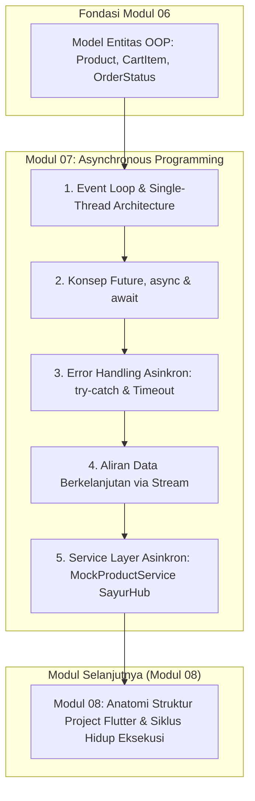
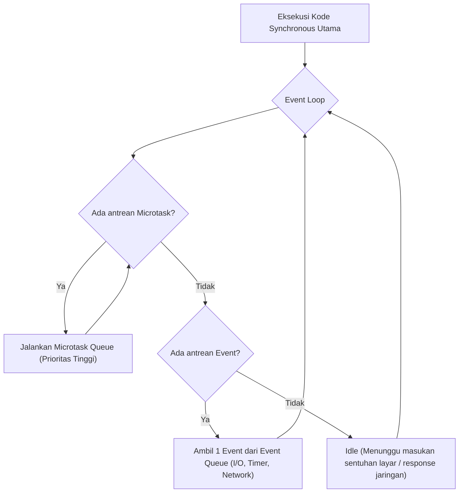
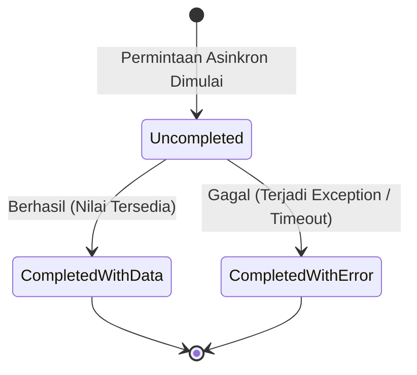
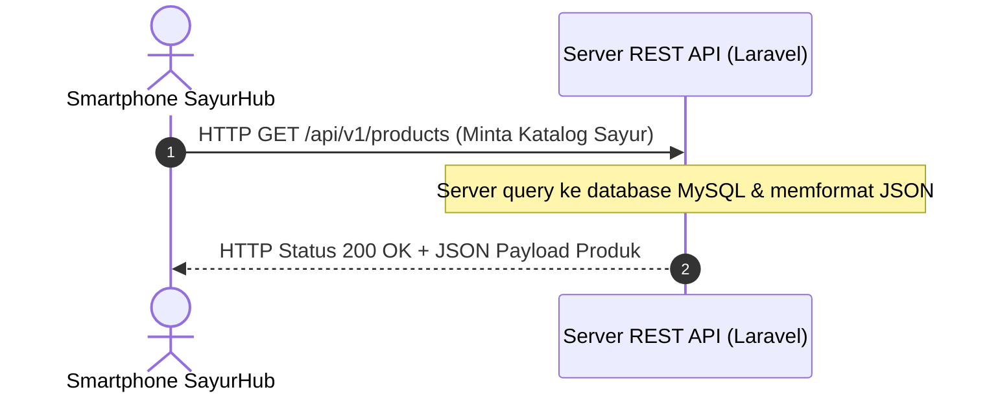
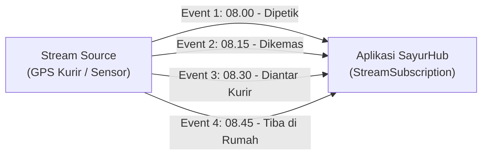

# MODUL 07: ASYNCHRONOUS PROGRAMMING DART — FUTURE, ASYNC-AWAIT, STREAMS, DAN SIMULASI JARINGAN
## PENGEMBANGAN APLIKASI MOBILE MULTIPLATFORM DARI DASAR HINGGA PRODUKSI
### KONSENTRASI KEAHLIAN REKAYASA PERANGKAT LUNAK (SMK RPL)

---

## A. IDENTITAS MODUL

- **Nomor Modul**: 07
- **Judul Modul**: Asynchronous Programming Dart — Future, Async-Await, Streams, dan Simulasi Jaringan
- **Tingkat Kesulitan**: Menengah (*Intermediate*)
- **Estimasi Waktu**: 6 Jam Pelajaran (6 × 45 Menit = 270 Menit)
- **Prasyarat**: Modul 06 (Object-Oriented Programming Lanjutan pada Dart dan Pemodelan Data Entitas)
- **Tujuan Pembelajaran**:
  1. Siswa memahami perbedaan mendasar arsitektur eksekusi *Synchronous* (pemblokiran antrean) vs *Asynchronous* (non-blocking).
  2. Siswa memahami cara kerja arsitektur *Single-Threaded Event Loop* pada Dart (Microtask Queue dan Event Queue).
  3. Siswa menguasai siklus hidup objek `Future<T>` (*uncompleted*, *completed with data*, *completed with error*).
  4. Siswa terampil menulis kode asinkron modern yang bersih menggunakan kata kunci `async` dan `await`.
  5. Siswa mampu menangani kegagalan jaringan secara anggun menggunakan blok penanganan `try-catch` dan menangani *timeout*.
  6. Siswa memahami konsep aliran data reaktif berkelanjutan menggunakan `Stream<T>`.
  7. Siswa mampu membangun service asinkron `MockProductService` yang menyimulasikan latensi server dan sistem pelacak kurir pengiriman sayur real-time untuk aplikasi **SayurHub**.
- **Kompetensi yang Akan Dicapai**:
  - **Kognitif**: Pemahaman konkurensi non-blocking, latency toleration, serta protokol komunikasi data Client-Server HTTP dasar.
  - **Psikomotorik**: Keterampilan merancang method asinkron `Future`, mengonsumsi data `Stream`, menyimulasikan *network latency*, serta mencegah terjadinya *UI Freeze / Application Not Responding (ANR)*.

---

## B. PETA KONSEP



- **Keterkaitan dengan Modul 06**: Model data `Product` dan enum `OrderStatus` yang telah dibuat pada Modul 06 kini menjadi tipe data yang dikemas di dalam kembalian asinkron `Future<List<Product>>` dan `Stream<OrderStatus>`.
- **Keterkaitan dengan Modul 08**: Modul 07 adalah bab penutup Bagian 2 (Bahasa Dart). Penguasaan asinkron ini mutlak diperlukan sebelum siswa menggunakan widget Flutter seperti `FutureBuilder` dan `StreamBuilder` pada modul-modul antarmuka mendatang.

---

## C. MATERI TEORI

### 1. Masalah Utama: Mengapa Mobile App Butuh Asynchronous?
Bayangkan Anda sedang berbelanja di kasir toko sayur konvensional:
- Jika kasir melayani pembeli pertama yang sedang menunggu transfer bank selama 5 menit, dan kasir **menolak melayani pembeli lain sebelum uang masuk**, maka seluruh antrean di belakang akan macet total. Ini adalah analogi **Synchronous (Blocking)**.
- Sebaliknya, jika kasir memberikan **nomor antrean / buzzer alarm** kepada pembeli pertama lalu langsung melayani pembeli kedua, dan ketika buzzer bergetar (uang masuk) pembeli pertama baru dipanggil mengambil sayurnya, maka toko berjalan lancar tanpa hambatan. Ini adalah analogi **Asynchronous (Non-Blocking)**.

Di dalam smartphone, sistem operasi merender layar antarmuka sebanyak **60 hingga 120 kali per detik** (1 frame setiap 16 milidetik).  
Jika Anda melakukan operasi lambat (seperti mengunduh foto katalog sayur dari server yang butuh waktu 2 detik) secara *synchronous*, maka layar HP akan seketika membeku (*Freeze*), tombol tidak bisa disentuh, dan Android akan memunculkan dialog peringatan:  
`"SayurHub isn't responding. Do you want to close it? (ANR - Application Not Responding)"`.

---

### 2. Cara Kerja Single-Threaded Event Loop pada Dart

Dart adalah bahasa yang berjalan pada satu benang eksekusi utama (*Single Thread*). Untuk menangani banyak tugas tanpa macet, Dart menggunakan mekanisme cerdas bernama **Event Loop**:



1. **Synchronous Code**: Seluruh baris kode biasa dijalankan terlebih dahulu hingga tuntas dari atas ke bawah.
2. **Event Queue**: Tugas-tugas yang membutuhkan waktu (seperti timer `Future.delayed()`, klik tombol pengguna, pembacaan file database, atau respons paket data internet dari server) dimasukkan ke dalam antrean *Event Queue*.
3. **Event Loop**: Mesin yang berputar terus-menerus memeriksa antrean: saat benang eksekusi utama kosong, ia mengambil event berikutnya dan menjalankannya.

---

### 3. Memahami Objek `Future<T>`

`Future` adalah sebuah objek yang merepresentasikan **nilai potensial atau kesalahan yang baru akan tersedia di masa depan**.  
Analoginya seperti **surat tanda terima / resi paket pengiriman**: saat kurir memberikan resi, barang sayur belum Anda pegang secara fisik; resi tersebut adalah bukti janji (*promise*) bahwa sayur akan tiba dalam beberapa waktu ke depan.

#### Siklus Hidup Objek `Future`:

1. **Uncompleted**: Operasi sedang berjalan di latar belakang (misal: paket HTTP sedang dikirim).
2. **Completed with Data**: Operasi sukses selesai dan menghasilkan nilai konkret bertipe `T` (misal: mengembalikan `List<Product>`).
3. **Completed with Error**: Terjadi kegagalan (misal: kabel internet terputus, server mati menghasilkan error HTTP 500).

---

### 4. Menulis Kode Asinkron: Gaya Kuno (`.then()`) vs Gaya Modern (`async` - `await`)

#### Gaya Kuno: Menggunakan Callback `.then()` (Rawan Callback Hell)
```dart
fetchProducts().then((data) {
  print('Data diterima: $data');
}).catchError((error) {
  print('Gagal: $error');
});
```

#### Gaya Modern Standar Industri: `async` dan `await`
Dart menyediakan kata kunci `async` dan `await` yang membuat kode asinkron dapat ditulis dan dibaca lurus layaknya kode biasa tanpa nesting yang membingungkan:

```dart
// 1. Tambahkan kata kunci 'async' pada deklarasi fungsi
Future<void> loadKatalog() async {
  try {
    print('1. Mengambil data sayur...');
    // 2. Gunakan 'await' untuk menghentikan eksekusi baris ini secara non-blocking
    // sampai Future selesai mengembalikan data
    final List<Product> data = await fetchProducts();
    print('2. Data sukses dimuat: ${data.length} produk.');
  } catch (e) {
    print('Terjadi kesalahan: $e');
  }
}
```

> [!IMPORTANT]
> **Aturan Emas Penggunaan `await`:**  
> Kata kunci `await` **HANYA BISA DIGUNAKAN** di dalam badan fungsi yang ditandai dengan kata kunci `async`. Memanggil `await` di luar fungsi `async` akan langsung memicu error kompilasi.

---

### 5. Konsep Dasar Komunikasi Jaringan HTTP/HTTPS
Saat aplikasi SayurHub berkomunikasi dengan server backend di cloud, komunikasi tersebut menggunakan protokol **HTTP (Hypertext Transfer Protocol)** melalui siklus **Request-Response**:



#### Kode Status HTTP Standar (*HTTP Status Codes*):
- **200 OK**: Permintaan berhasil dan data disertakan.
- **201 Created**: Data baru berhasil disimpan (misal: sukses mendaftar akun).
- **400 Bad Request**: Permintaan klien salah format atau parameter tidak lengkap.
- **401 Unauthorized**: Akses ditolak karena token login tidak valid atau kadaluarsa.
- **404 Not Found**: Halaman atau produk yang dicari tidak ditemukan di server.
- **500 Internal Server Error**: Server backend mengalami crash/gangguan basis data.

---

### 6. Aliran Data Berkelanjutan: `Stream<T>`

Jika `Future` dianalogikan seperti memesan satu cangkir kopi (satu permintaan, satu hasil), maka **`Stream`** dianalogikan seperti **aliran air keran atau siaran stasiun radio**: data mengalir berkali-kali secara kontinu seiring berjalannya waktu.



Di aplikasi SayurHub, `Stream` digunakan untuk:
1. **Pelacakan Lokasi Kurir (*Live Tracking*)**: Koordinat posisi motor kurir dikirimkan setiap beberapa detik ke layar pembeli.
2. **Notifikasi Transaksi Realtime**: Status pesanan berubah dari *Dipetik* $\to$ *Dikemas* $\to$ *Dikirim*.

---

## D. PEMBAHASAN KODE PROGRAM: SIMULASI PANGGILAN JARINGAN

Mari kita bedah kode simulasi layanan API produk yang menyimulasikan latensi server internet selama 2 detik:

```dart
class MockProductService {
  // Simulasi pemanggilan API asinkron
  Future<List<Product>> getProducts({bool simulateFailure = false}) async {
    print('[Service] Mengirim request HTTP GET /api/v1/products...');

    // Menyimulasikan latensi jaringan internet selama 2 detik secara non-blocking
    await Future.delayed(const Duration(seconds: 2));

    // Simulasi jika internet mati atau server 500
    if (simulateFailure) {
      throw Exception('Gagal menghubungi server SayurHub (HTTP 500: Timeout)');
    }

    print('[Service] Response HTTP 200 OK diterima dari server.');
    return MockProduceData.products;
  }
}
```

### Penjelasan Bagian Penting Kode:
- **`Future<List<Product>>`**: Menandai bahwa fungsi ini tidak mengembalikan data secara instan, melainkan menjanjikan sebuah daftar `List<Product>` di masa depan.
- **`await Future.delayed(const Duration(seconds: 2));`**: Menunda eksekusi selama 2 detik tanpa membuat benang UI macet. Di sinilah letak kehebatan event loop.
- **`throw Exception(...)`**: Memungkinkan pengujian skenario kegagalan koneksi agar kita dapat memverifikasi ketangguhan blok `try-catch`.

---

## E. PERSIAPAN PRAKTIKUM

1. **Perangkat Lunak**:
   - Visual Studio Code dengan integrasi terminal Dart.
2. **Kondisi Awal Proyek**:
   - Repositori `sayur_hub` dari Modul 06 berada dalam status Git bersih.
3. **Struktur Folder yang Akan Dibuat**:
   - `sayur_hub/lib/core/services/` (Rumah bagi kelas-kelas komunikasi data backend).
4. **File yang Akan Dihasilkan**:
   - `lib/core/services/mock_product_service.dart` (Layanan API asinkron dan Stream pelacakan pesanan).
   - `bin/modul_07_async_service.dart` (Script pengujian eksekusi CLI).

---

## F. LANGKAH PRAKTIKUM STEP-BY-STEP

### Langkah 1 — Menyiapkan Folder Services

1. Buka project SayurHub di VS Code.
2. Buat folder baru di dalam `lib/core/`:
   ```bash
   mkdir -p lib/core/services
   ```

---

### Langkah 2 — Membuat Layanan Asinkron `MockProductService`

1. Buat file baru di `lib/core/services/mock_product_service.dart`.
2. Tuliskan kode kelas layanan berikut yang menyediakan fungsi `Future` dan `Stream`:

```dart
// File: sayur_hub/lib/core/services/mock_product_service.dart
import 'dart:async';
import 'package:sayur_hub/core/exceptions/app_exceptions.dart';
import 'package:sayur_hub/core/mock/mock_produce_data.dart';
import 'package:sayur_hub/core/models/order_status.dart';
import 'package:sayur_hub/core/models/product.dart';

/// Layanan resmi pemrosesan data asinkron SayurHub
/// Menyimulasikan panggilan REST API backend dan aliran data Stream pelacak pesanan
class MockProductService {
  /// Mengambil daftar seluruh produk katalog dengan simulasi latensi jaringan
  Future<List<Product>> fetchCatalog({
    int latencySeconds = 2,
    bool forceError = false,
  }) async {
    // 1. Simulasi jeda pengiriman data jaringan (Non-blocking)
    await Future.delayed(Duration(seconds: latencySeconds));

    // 2. Simulasi penanganan kegagalan koneksi
    if (forceError) {
      throw AppException(
        'Koneksi ke server SayurHub terputus. Silakan periksa jaringan internet Anda.',
        'HTTP_ERR_CONNECTION_FAILED',
      );
    }

    // 3. Mengembalikan data produk dalam bentuk entitas kuat
    return MockProduceData.products;
  }

  /// Mengambil detail satu produk spesifik berdasarkan ID
  Future<Product?> fetchProductById(String id) async {
    await Future.delayed(const Duration(milliseconds: 800));

    try {
      return MockProduceData.products.firstWhere((p) => p.id == id);
    } catch (_) {
      return null; // Produk tidak ditemukan
    }
  }

  /// Menyimulasikan pembaruan status pengiriman pesanan secara reaktif via Stream
  /// Mengirimkan status baru setiap 1 detik
  Stream<OrderStatus> trackOrderDelivery(String orderId) async* {
    yield OrderStatus.confirmed;
    await Future.delayed(const Duration(seconds: 1));

    yield OrderStatus.processing;
    await Future.delayed(const Duration(seconds: 1));

    yield OrderStatus.delivering;
    await Future.delayed(const Duration(seconds: 1));

    yield OrderStatus.completed;
  }
}
```

---

### Langkah 3 — Membuat Script Pengujian Asinkron

1. Buat file baru di `bin/modul_07_async_service.dart`.
2. Tuliskan skenario pengujian `Future`, penanganan error, dan konsumsi `Stream`:

```dart
// File: sayur_hub/bin/modul_07_async_service.dart
import 'package:sayur_hub/core/exceptions/app_exceptions.dart';
import 'package:sayur_hub/core/models/order_status.dart';
import 'package:sayur_hub/core/models/product.dart';
import 'package:sayur_hub/core/services/mock_product_service.dart';
import 'package:sayur_hub/core/utils/price_calculator.dart';

void main() async {
  print('====================================================');
  print('   SAYURHUB ASYNCHRONOUS ENGINE & STREAM RUNNER     ');
  print('====================================================\n');

  final service = MockProductService();

  // 1. Uji Pengambilan Data Asinkron Sukses (Future)
  print('>>> 1. MEMULAI FETCH KATALOG ASINKRON (Tunggu 2 Detik)...');
  final Stopwatch stopwatch = Stopwatch()..start();

  try {
    final List<Product> catalog = await service.fetchCatalog(latencySeconds: 2);
    stopwatch.stop();

    print('    [SUKSES] ${catalog.length} Produk berhasil diambil dalam ${stopwatch.elapsedMilliseconds} ms!');
    for (final item in catalog.take(3)) {
      print('    • ${item.name.padRight(26)} : ${PriceCalculator.formatRupiah(item.pricePerKg)}/kg');
    }
  } catch (e) {
    print('    [GAGAL] Terjadi error: $e');
  }

  // 2. Uji Penanganan Error Jaringan (Simulasi Server Down)
  print('\n>>> 2. UJI KETANGGUHAN SIMULASI ERROR JARINGAN:');
  try {
    print('    Mencoba menghubungi server bermasalah...');
    await service.fetchCatalog(latencySeconds: 1, forceError: true);
    print('    (Baris ini tidak boleh dieksekusi)');
  } on AppException catch (e) {
    print('    [TERTANGKAP DENGAN AMAN]');
    print('    Pesan Error : ${e.message}');
    print('    Kode Status : ${e.detailCode}');
  }

  // 3. Uji Konsumsi Aliran Data Reaktif (Stream Tracking)
  print('\n>>> 3. MEMULAI LIVE TRACKING PESANAN KURIR (STREAM):');
  const String sampleOrderId = 'ORDER-SAYUR-999';
  print('    Memantau Pesanan: $sampleOrderId\n');

  final Stream<OrderStatus> deliveryStream = service.trackOrderDelivery(sampleOrderId);

  // Mendengarkan data yang mengalir dari Stream menggunakan 'await for'
  await for (final OrderStatus status in deliveryStream) {
    final String timestamp = DateTime.now().toIso8601String().substring(11, 19);
    print('    [$timestamp] Status Diperbarui: ${status.label} (${status.code})');
  }

  print('\n    [SELESAI] Kurir telah menyerahkan sayur ke tangan pelanggan!');
  print('\n====================================================');
  print('>> VERIFIKASI ASYNC DART MODUL 07: SUKSES 100%    <<');
}
```

3. Jalankan script tersebut di terminal:
   ```bash
   dart run bin/modul_07_async_service.dart
   ```
4. *Hasil yang Diharapkan*:
   - Program menunggu secara tenang selama 2 detik lalu menampilkan produk.
   - Panggilan gagal berhasil ditangkap oleh blok `on AppException`.
   - Status kurir pada Stream mengalir setiap 1 detik secara berurutan hingga selesai (*completed*).

---

## G. ANALISIS DAN PEMAHAMAN

Jawablah pertanyaan analisis berikut:

1. **Analisis Non-Blocking**: Saat baris `await Future.delayed(Duration(seconds: 2))` dijalankan, jelaskan apa yang sesungguhnya dilakukan oleh Event Loop Dart! Mengapa laptop/smartphone Anda tidak mengalami pembekuan sistem (*freeze*) selama 2 detik penundaan tersebut?
2. **Analisis Generator Function**: Pada metode `trackOrderDelivery`, mengapa kata kunci `async*` (dengan tanda bintang) dan perintah `yield` digunakan? Apa perbedaan mendasar antara `return` pada fungsi biasa dengan `yield` pada fungsi generator Stream?
3. **Analisis Timeout**: Di dunia nyata, koneksi internet pengguna di pedesaan bisa mengalami macet tanpa putus (*hanging indefinitely*). Tuliskan bagaimana cara menambahkan batasan waktu maksimal (.timeout) pada pemanggilan `Future` agar aplikasi tidak menunggu selamanya!

---

## H. LATIHAN DAN TANTANGAN

### 1. Soal Teori
1. Objek pada Dart yang merepresentasikan nilai potensial atau kesalahan yang baru akan selesai diproses di masa depan adalah:
   - A. `Promise`
   - B. `Future`
   - C. `Deferred`
   - D. `AsyncObject`
2. Kata kunci yang digunakan untuk menghentikan sementara pembacaan kode di dalam fungsi asinkron hingga sebuah `Future` selesai mengembalikan data adalah:
   - A. `wait`
   - B. `pause`
   - C. `await`
   - D. `yield`
3. Antrean prioritas tinggi di dalam Event Loop Dart yang dieksekusi sebelum antrean Event biasa adalah:
   - A. `Microtask Queue`
   - B. `Thread Queue`
   - C. `Priority Buffer`
   - D. `High Queue`
4. Kata kunci yang digunakan untuk mengirimkan nilai baru ke dalam sebuah aliran data pada fungsi generator `async*` adalah:
   - A. `emit`
   - B. `send`
   - C. `yield`
   - D. `push`
5. Sebutkan arti dari kode status HTTP berikut: 200, 401, 404, dan 500!

### 2. Soal Praktik
1. **Penerapan Timeout Otomatis**: Gunakan method `.timeout(Duration(seconds: 3))` pada pemanggilan `service.fetchCatalog()`. Tangani eksepsi `TimeoutException` yang muncul jika jaringan lambat dan cetak pesan ramah pengguna.
2. **Pencarian Produk Asinkron**: Buat method baru di `MockProductService` bernama `Future<List<Product>> searchProductsAsync(String query)` yang menunda eksekusi selama 500 ms (simulasi *debouncing* pencarian) sebelum mengembalikan hasil filter objek `Product`.
3. **Stream Hitung Mundur Panen**: Buat fungsi generator `Stream<int> countdownPanen(int totalDetik)` yang memancarkan angka sisa detik setiap 1 detik mundur hingga mencapai angka 0.

### 3. Tantangan Pemecahan Masalah (*Problem-Solving Challenges*)
- **Tantangan 1 (Eksekusi Paralel vs Sekuensial dengan Future.wait)**: Jika Anda harus mengambil data profil pengguna (`Future<User>`) dan data katalog (`Future<List<Product>>`) sekaligus saat aplikasi SayurHub dibuka:
  - Jika dipanggil berurutan dengan dua kali `await`, total waktu tunggu adalah $2 + 2 = 4$ detik.
  - Tuliskan kode menggunakan `Future.wait([fetchUser(), fetchCatalog()])` agar kedua data diambil secara **bersamaan (paralel)** sehingga total waktu tunggu terpangkas menjadi hanya 2 detik!
- **Tantangan 2 (Pencegahan Memory Leak pada Stream)**: Di Flutter, jika sebuah `StreamSubscription` terus mendengarkan data sementara layarnya sudah ditutup oleh pengguna, memori smartphone akan bocor (*Memory Leak*). Jelaskan pentingnya memanggil method `.cancel()` pada langganan Stream!

### 4. Studi Kasus Industri
**Studi Kasus**: Saat checkout pesanan sayur di SayurHub, aplikasi memanggil endpoint pembayaran gateway perbankan. Namun, sinyal pengguna tiba-tiba terputus di tengah jalan (*packet loss*). Jika aplikasi langsung menganggap transaksi gagal, uang pengguna mungkin sudah terpotong di bank tetapi pesanan tidak tercatat di toko (*double charge / status menggantung*).  
*Tugas Siswa*: Rancanglah arsitektur penanganan *Retry Mechanism* (mencoba ulang request maksimal 3 kali dengan jeda eksponensial 2 detik, 4 detik, 8 detik) menggunakan blok perulangan dan `try-catch` sebelum menyerah dan menampilkan pesan error!

---

## I. TROUBLESHOOTING & FAQ

Berikut adalah tabel permasalahan umum pemrograman asinkron pada Dart beserta solusinya:

| Permasalahan Teknis | Penyebab Utama | Cara Identifikasi | Solusi Tepat |
|---|---|---|---|
| **Pesan Error "await isn't allowed outside an async function"** | Menuliskan kata kunci `await` di dalam badan fungsi biasa yang tidak ditandai dengan `async`. | Garis bawah merah di editor pada kata kunci `await`. | Tambahkan kata kunci `async` sebelum kurung kurawal pembuka fungsi: `void main() async { ... }`. |
| **Nilai yang Didapat Berupa "Instance of 'Future<T>'" Bukan Nilai Asli** | Lupa menuliskan kata kunci `await` di depan pemanggilan fungsi asinkron. | Mencetak objek ke terminal menghasilkan teks: `Instance of 'Future<List<Product>>'`. | Tambahkan `await` di depan pemanggilan: `final data = await service.fetchCatalog();`. |
| **Aplikasi Tidak Merespons Perubahan Data Stream** | Lupa menambahkan kata kunci `yield` pada fungsi generator `async*`. | Stream selesai tanpa memancarkan data sama sekali ke listener. | Pastikan setiap data yang ingin dikirimkan ke stream didahului perintah `yield nilai;`. |
| **Unhandled Exception: TimeoutException** | Pemanggilan API melebihi batas waktu `.timeout()` yang ditentukan dan tidak dibungkus dalam blok `try-on-catch`. | Program crash dengan unhandled exception di terminal. | Bungkus pemanggilan di dalam blok: `try { ... } on TimeoutException { print('Koneksi timeout'); }`. |

---

## J. PRAKTIKUM INTEGRASI ANTAR-MODUL: ASYNC SERVICE & STREAM TRACKING

Pada praktikum integrasi Modul 07, kita menyempurnakan seluruh fondasi logika Bagian 2 (Bahasa Pemrograman Dart) dengan menyediakan lapisan layanan (*Service Layer*) asinkron yang siap dihubungkan langsung ke antarmuka grafis Flutter pada Modul 08 dan seterusnya.

### 1. Judul Praktikum Integrasi
**Pembangunan Layanan Asinkron `MockProductService` dan Simulasi Siklus Transaksi Jaringan SayurHub**

### 2. Tujuan Praktikum Integrasi
- Mengintegrasikan model data `Product` dan `OrderStatus` dari Modul 06 ke dalam antarmuka asinkron `Future` dan `Stream`.
- Memverifikasi ketahanan penanganan galat jaringan (*network resilience*) menggunakan `AppException`.
- Mengonfirmasi bahwa seluruh basis kode bebas dari peringatan linter dan siap melangkah ke Bagian 3 (Pengembangan Antarmuka Flutter).

### 3. Materi yang Diintegrasikan
- Model entitas `Product`, `OrderStatus`, dan `AppException` dari Modul 06.
- Logika filtering dan transformasi fungsional dari Modul 05.
- Eksekusi non-blocking `Future`, `async-await`, dan `Stream` dari Modul 07.

### 4. Kondisi Awal Proyek (*Project State Before*)
Proyek `sayur_hub` telah memiliki model entitas OOP dan dataset mock statis. Belum ada lapisan layanan asinkron yang menyimulasikan komunikasi Client-Server.

### 5. Instruksi Langkah Demi Langkah
1. Buat file `lib/core/services/mock_product_service.dart`.
2. Tuliskan implementasi lengkap `MockProductService` yang menyediakan method `fetchCatalog`, `fetchProductById`, dan generator `trackOrderDelivery`.
3. Buat script pengujian komprehensif di `bin/modul_07_async_service.dart`.
4. Jalankan analisis static code:
   ```bash
   flutter analyze
   ```
5. Eksekusi pengujian di terminal:
   ```bash
   dart run bin/modul_07_async_service.dart
   ```
6. Simpan dan commit seluruh pekerjaan ke repositori Git:
   ```bash
   git add .
   git commit -m "feat(services): implement MockProductService with Future and Stream order tracking"
   ```

---

### 6. Hasil yang Diharapkan
1. Pemanggilan katalog berjalan asinkron dan berhasil menampilkan data produk terstruktur.
2. Skenario kesalahan jaringan tertangkap dengan rapi tanpa memicu unhandled exception.
3. Aliran Stream status pesanan kurir tercetak secara real-time dari detik ke detik.
4. Linter melaporkan `No issues found!`.

### 7. Kriteria Keberhasilan
- [x] File `lib/core/services/mock_product_service.dart` terpasang dan bersih dari kesalahan statis.
- [x] Method `fetchCatalog` mengembalikan `Future<List<Product>>`.
- [x] Method `trackOrderDelivery` memancarkan `Stream<OrderStatus>`.
- [x] Script `bin/modul_07_async_service.dart` dieksekusi dengan sukses.

---

## K. EVALUASI MODUL 07

### 1. Rubrik Penilaian Pemrograman Asinkron
| Aspek Evaluasi | Skor Maksimal | Indikator Ketercapaian |
|---|---|---|
| **Pemahaman Konsep Event Loop & Non-Blocking** | 25 | Mampu menjelaskan cara kerja Event Loop dan alasan mengapa operasi I/O harus asinkron. |
| **Keterampilan Penggunaan Future, async & await** | 35 | Terampil merancang fungsi asinkron, menggunakan `await` secara benar, dan menghindari unhandled future errors. |
| **Penguasaan Aliran Data Stream** | 25 | Menguasai pembuatan generator fungsi `async*`, perintah `yield`, serta konsumsi stream via `await for`. |
| **Kualitas Error Handling & Resiliensi Jaringan** | 15 | Mampu menangani kegagalan koneksi dan timeout secara elegan menggunakan `try-on-catch`. |
| **Total Skor** | **100** | **Kriteria Ketuntasan Minimal (KKM): 75** |

### 2. Soal Uji Debugging Asinkron
*Tinjau potongan kode berikut:*
```dart
void muatData() {
  final service = MockProductService();
  final data = service.fetchCatalog();
  print('Total sayur: ${data.length}'); // Memunculkan error kompilasi!
}
```
- **Pertanyaan**: Mengapa pemanggilan `data.length` memicu error kompilasi, dan bagaimana cara memperbaikinya?
- **Kunci Jawaban**:
  1. *Penyebab*: Fungsi `fetchCatalog()` mengembalikan objek `Future<List<Product>>`, bukan `List<Product>` langsung. Objek `Future` tidak memiliki properti `.length`. Selain itu fungsi `muatData` belum ditandai `async`.
  2. *Perbaikan*:
     ```dart
     Future<void> muatData() async {
       final service = MockProductService();
       final List<Product> data = await service.fetchCatalog();
       print('Total sayur: ${data.length}');
     }
     ```

---

## L. KESIMPULAN DAN JEMBATAN KE BAGIAN 3 (FLUTTER FRAMEWORK)

### Rangkuman Kompetensi Bagian 2 (Bahasa Dart Selesai):
Selamat luar biasa! Dengan menyelesaikan Modul 07 ini, Anda telah **menuntaskan seluruh Bagian 2 (Dasar Bahasa Pemrograman Dart)** secara gemilang:
1. Menguasai sintaks dasar, imutabilitas (`final`/`const`), dan keamanan mutlak **Sound Null Safety** (Modul 03).
2. Mengendalikan logika bisnis melalui **Percabangan Bertingkat** dan **Modern Pattern Matching Switch Dart 3** (Modul 04).
3. Mengolah ribuan data dengan koleksi **List, Set, Map** serta metode deklaratif **Higher-Order Functions** (Modul 05).
4. Mentransformasi arsitektur data menjadi **Model Entitas OOP Bertipe Kuat** (`Product`, `CartItem`, `User`, `OrderStatus`) lengkap dengan serialisasi JSON (Modul 06).
5. Menguasai operasi latar belakang non-blocking **Future, Async-Await, dan Stream** (Modul 07).

### Pintu Gerbang Menuju Bagian 3: Dasar Pengembangan Flutter
Kini Anda memiliki seluruh persenjataan logika dan arsitektur data yang kokoh. Mulai dari titik ini, kita akan meninggalkan jendela konsol terminal hitam-putih dan resmi melangkah ke dunia visual yang memukau: **Framework Flutter**!

Pada **Modul 08: Mengenal Struktur Project Flutter, pubspec.yaml, dan Siklus Hidup Eksekusi Aplikasi**, kita akan membedah:
- Anatomi file `pubspec.yaml`, integrasi aset gambar sayur/buah asli, serta pemasangan Google Fonts resmi.
- Peran sentral `MaterialApp`, kanvas layar `Scaffold`, dan konsep fundamental `BuildContext`.
- Merasakan keajaiban fitur paling dicintai pengembang di dunia: **Stateful Hot Reload** pada antarmuka aplikasi **SayurHub**!
