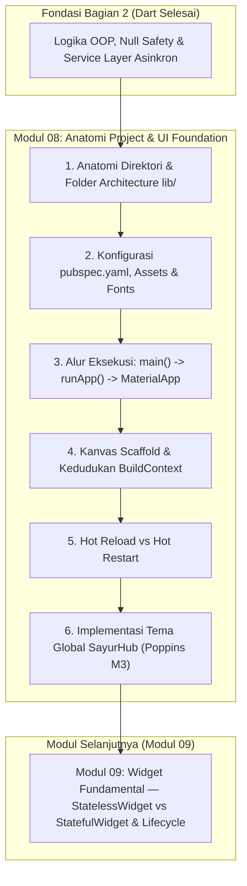
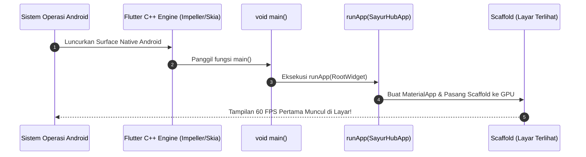
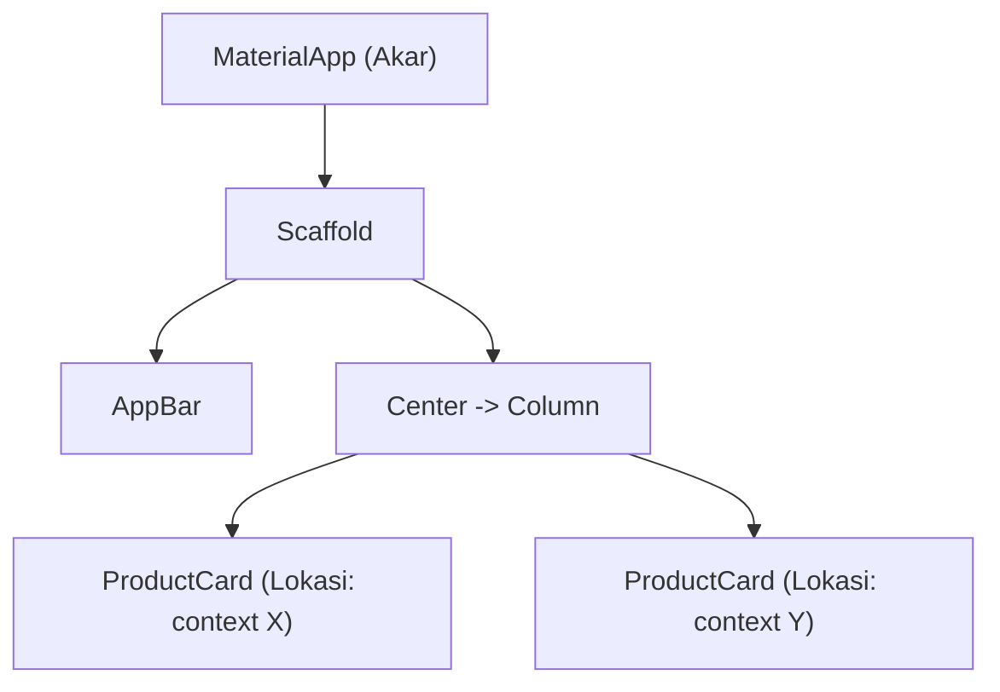

# MODUL 08: MENGENAL STRUKTUR PROJECT FLUTTER, PUBSPEC.YAML, MANAJEMEN ASET, DAN SIKLUS HIDUP EKSEKUSI
## PENGEMBANGAN APLIKASI MOBILE MULTIPLATFORM DARI DASAR HINGGA PRODUKSI
### KONSENTRASI KEAHLIAN REKAYASA PERANGKAT LUNAK (SMK RPL)

---

## A. IDENTITAS MODUL

- **Nomor Modul**: 08
- **Judul Modul**: Mengenal Struktur Project Flutter, pubspec.yaml, Manajemen Aset, dan Siklus Hidup Eksekusi
- **Tingkat Kesulitan**: Pemula ke Menengah (*Beginner to Intermediate*)
- **Estimasi Waktu**: 4 Jam Pelajaran (4 × 45 Menit = 180 Menit)
- **Prasyarat**: Modul 02 (Toolchain & Setup Lingkungan) dan Modul 06 (Pemodelan OOP pada Dart)
- **Tujuan Pembelajaran**:
  1. Siswa memahami struktur direktori project Flutter standar industri (`android/`, `ios/`, `assets/`, `lib/`, `test/`) dan pembagian lapisan arsitektur bersih di dalam folder `lib/`.
  2. Siswa menguasai konfigurasi metadata, dependensi package, aset gambar, dan font kustom pada file `pubspec.yaml` dengan mematuhi aturan indentasi YAML yang ketat.
  3. Siswa memahami peran titik masuk utama `void main()`, fungsi `runApp()`, widget pembungkus `MaterialApp`, serta kerangka kanvas layar `Scaffold`.
  4. Siswa menguasai konsep fundamental **`BuildContext`** sebagai penunjuk identitas dan lokasi widget di dalam pohon hierarki (*Widget Tree*).
  5. Siswa memahami perbedaan teknis di balik mekanisme **Hot Reload** (mempertahankan state) vs **Hot Restart** (mereset state).
  6. Siswa mampu mengintegrasikan tipografi modern **Google Fonts (Poppins)** dan tata letak `Scaffold` interaktif untuk aplikasi **SayurHub**.
- **Kompetensi yang Akan Dicapai**:
  - **Kognitif**: Pemahaman hierarki pohon widget (*Widget Tree*), arsitektur modular *Feature-First*, serta manajemen siklus eksekusi aplikasi mobile.
  - **Psikomotorik**: Keterampilan mengonfigurasi aset digital pada `pubspec.yaml`, merancang tema aplikasi global (`ThemeData`), dan menyusun struktur antarmuka dasar berbasis `Scaffold`.

---

## B. PETA KONSEP



- **Keterkaitan dengan Modul 02 & 06**: Lingkungan kerja dari Modul 02 dan model entitas objek dari Modul 06 kini mulai dihubungkan ke kanvas grafis antarmuka Flutter.
- **Keterkaitan dengan Modul 09**: Pemahaman `MaterialApp`, `Scaffold`, dan `BuildContext` pada modul ini adalah prasyarat mutlak sebelum siswa membedah perilaku `StatelessWidget` dan `StatefulWidget` pada Modul 09.

---

## C. MATERI TEORI

### 1. Selamat Datang di Dunia Visual Flutter!
Setelah menyelesaikan Modul 03 hingga 07 di layar terminal hitam-putih, kini kita resmi memasuki **Bagian 3: Dasar Pengembangan Flutter**.  
Di dunia Flutter, berlaku satu filosofi agung: **"Everything is a Widget"** (Segala sesuatu adalah Widget).  
Tombol adalah widget, teks adalah widget, gambar adalah widget, bahkan pengaturan jarak (*padding*) dan perataan tengah (*center*) juga merupakan widget.

---

### 2. Anatomi Struktur Direktori Project Flutter

Sebuah project Flutter profesional memiliki pemisahan folder yang sangat rapi:

```
sayur_hub/
├── android/            # Kode sumber native Android (Gradle, AndroidManifest.xml, icons)
├── ios/                # Kode sumber native iOS (Xcode workspace, Info.plist)
├── assets/             # Berkas statis non-kode: gambar banner, ikon SVG, file font
│   ├── icons/
│   └── images/
├── lib/                # RUMAH UTAMA: Seluruh kode Dart Flutter ditulis di sini
│   ├── core/           # Utilitas bersama, konfigurasi tema, model data, services
│   ├── features/       # Halaman-halaman fitur aplikasi (Home, Cart, Profile, dll)
│   └── main.dart       # Titik awal eksekusi program
├── test/               # Tempat penulisan berkas pengujian otomatis (Unit/Widget Test)
├── pubspec.yaml        # Manajer dependensi, aset, font, dan metadata aplikasi
└── analysis_options.yaml # Aturan linter penjamin Clean Code
```

> [!NOTE]
> **Mengapa ada folder `android/` dan `ios/`?**  
> Flutter bukanlah sistem operasi tersendiri. Agar aplikasi kita dapat dipasang di smartphone, Flutter membutuhkan "cangkang pelindung native" (*native runner*). Folder `android/` dan `ios/` adalah proyek native mini tempat mesin C++ Flutter disematkan. Kita jarang mengubah isi folder ini kecuali saat mengonfigurasi izin perangkat keras (*camera permission*) atau rilis produksi ke Play Store.

---

### 3. Membedah Konfigurasi `pubspec.yaml`

File `pubspec.yaml` adalah **jantung konfigurasi proyek Flutter**. Format YAML sangat bergantung pada **indentasi 2 spasi**.

```yaml
name: sayur_hub
description: "Aplikasi E-Commerce Sayur dan Buah Segar SMK RPL"
publish_to: "none"
version: 1.0.0+1

environment:
  sdk: ^3.0.0 # Mendukung Dart 3 dengan Sound Null Safety

dependencies:
  flutter:
    sdk: flutter
  cupertino_icons: ^1.0.8
  google_fonts: ^6.1.0 # Paket resmi tipografi Google Fonts

dev_dependencies:
  flutter_test:
    sdk: flutter
  flutter_lints: ^3.0.0

flutter:
  uses-material-design: true

  # Pendaftaran Aset Gambar Lokal
  assets:
    - assets/images/
    - assets/icons/
```

#### Aturan Wajib Mendaftarkan Aset:
Jika Anda memasukkan file gambar (contoh: `logo.png`) ke dalam folder `assets/images/`, Flutter **TIDAK AKAN BISA MEMBACANYA** sebelum direktori tersebut didaftarkan pada bagian `flutter: -> assets:` di `pubspec.yaml`.  
Setelah mengedit `pubspec.yaml`, selalu jalankan perintah:
```bash
flutter pub get
```

---

### 4. Siklus Hidup Eksekusi: Dari `main()` hingga Menjadi Tampilan Layar

Bagaimana sebuah baris kode bisa berubah menjadi grafis tombol di layar sentuh HP?



1. **`void main()`**: Gerbang pertama yang dipanggil oleh mesin Dart.
2. **`runApp(const SayurHubApp())`**: Fungsi sakti yang bertugas mengambil widget akar (*root widget*) dan menempelkannya ke seluruh permukaan jendela layar perangkat (*inflating the widget tree*).
3. **`MaterialApp`**: Widget pembungkus tingkat tertinggi yang mengaktifkan ekosistem **Material Design**, tema warna global, sistem routing navigasi, serta lokalisasi bahasa.
4. **`Scaffold`**: Struktur kanvas dasar standar aplikasi mobile. `Scaffold` menyediakan slot-slot siap pakai:
   - `appBar`: Bilah judul di bagian atas.
   - `body`: Area konten utama layar.
   - `floatingActionButton`: Tombol aksi melayang bulat di pojok kanan bawah.
   - `drawer`: Menu samping tersembunyi yang bisa digeser (*slide*).
   - `bottomNavigationBar`: Bilah menu navigasi di bagian bawah.

---

### 5. Memahami Konsep Krusial: `BuildContext`

Setiap kali Anda melihat method `Widget build(BuildContext context)`, Anda wajib memahami apa itu **`BuildContext`**.



> [!TIP]
> **Analogi Sederhana untuk Siswa SMK:**  
> Bayangkan `BuildContext` seperti **KTP atau Alamat Rumah** dari sebuah widget di dalam pohon silsilah keluarga widget (*Widget Tree*).  
> Saat sebuah widget ingin bertanya: *"Berapa lebar layar HP ini?"* (`MediaQuery.of(context).size.width`) atau *"Apa warna tema aplikasi ini?"* (`Theme.of(context).primaryColor`), widget tersebut menggunakan `context` miliknya untuk menengadah ke atas melihat konfigurasi dari widget induknya.

---

### 6. Hot Reload vs Hot Restart: Rahasia Kecepatan Developer Flutter

| Fitur | Pintasan Terminal | Waktu Eksekusi | Perlakuan Terhadap State Memori | Kapan Digunakan? |
|---|---|---|---|---|
| **Hot Reload** | Tekan tombol `r` | **< 1 Detik** (Instan) | **State Dipertahankan** (Keranjang belanja tidak hilang) | Mengubah warna, margin, teks UI, atau tata letak widget. |
| **Hot Restart** | Tekan tombol `R` | **1–3 Detik** | **State Direset Total** (Kembali ke kondisi awal `main()`) | Mengubah variabel global, struktur `pubspec.yaml`, atau method `initState`. |
| **Full Rebuild** | `flutter run` | **1–3 Menit** | **Aplikasi Dibangun Ulang dari Nol** | Menambah pustaka native Android, mengubah `AndroidManifest.xml`, atau mengganti ikon aplikasi. |

---

## D. PEMBAHASAN KODE PROGRAM: TEMA GLOBAL DAN STRUKTUR HOME SCAFFOLD

Mari kita bedah arsitektur kode antarmuka resmi SayurHub yang memisahkan konfigurasi tema global dari tampilan layar:

```dart
// Konfigurasi Tema Terpusat di lib/core/theme/app_theme.dart
class AppTheme {
  AppTheme._();

  static ThemeData get lightTheme {
    return ThemeData(
      useMaterial3: true,
      colorScheme: ColorScheme.fromSeed(
        seedColor: const Color(0xFF2E7D32), // Hijau Daun SayurHub
        primary: const Color(0xFF2E7D32),
        secondary: const Color(0xFFFF9800), // Oranye Segar
        surface: const Color(0xFFF8FAF8),
      ),
      // Menerapkan Tipografi Poppins Resmi
      textTheme: GoogleFonts.poppinsTextTheme(),
      appBarTheme: const AppBarTheme(
        backgroundColor: Color(0xFF2E7D32),
        foregroundColor: Colors.white,
        centerTitle: true,
        elevation: 0,
      ),
    );
  }
}
```

### Penjelasan Bagian Penting Kode:
- **`ColorScheme.fromSeed(...)`**: Standar Material Design 3 yang secara cerdas meracik harmoni 30+ warna turunan (warna teks tombol, warna kartu, warna border fokus) hanya dari satu warna acuan utama.
- **`GoogleFonts.poppinsTextTheme()`**: Mengganti font bawaan robot Android yang kaku dengan font modern **Poppins** untuk seluruh elemen teks secara seragam tanpa perlu menulis `style: TextStyle(fontFamily: ...)` di setiap widget.

---

## E. PERSIAPAN PRAKTIKUM

1. **Perangkat Lunak**:
   - Visual Studio Code dengan ekstensi Flutter aktif.
   - Perangkat pengujian: Smartphone Android fisik yang terhubung via kabel data USB (mode USB Debugging aktif).
2. **Kondisi Awal Proyek**:
   - Repositori `sayur_hub` dari Modul 07 berada dalam kondisi *clean*.
3. **Struktur Folder yang Akan Dibuat**:
   - `sayur_hub/assets/images/`
   - `sayur_hub/assets/icons/`
   - `sayur_hub/lib/core/theme/` (Pembaruan kelas `app_theme.dart`)
   - `sayur_hub/lib/features/home/` (Pembaruan layar `home_screen.dart`)

---

## F. LANGKAH PRAKTIKUM STEP-BY-STEP

### Langkah 1 — Menambahkan Dependensi Google Fonts pada `pubspec.yaml`

1. Buka file `pubspec.yaml` pada root project SayurHub.
2. Tambahkan pustaka `google_fonts: ^6.1.0` di bawah baris `dependencies:` dan daftarkan folder aset:

```yaml
dependencies:
  flutter:
    sdk: flutter
  cupertino_icons: ^1.0.8
  google_fonts: ^6.1.0 # Paket resmi Google Fonts

dev_dependencies:
  flutter_test:
    sdk: flutter
  flutter_lints: ^3.0.0

flutter:
  uses-material-design: true

  # Pendaftaran folder aset digital SayurHub
  assets:
    - assets/images/
    - assets/icons/
```

3. Simpan file (`Ctrl + S`), lalu buka terminal dan jalankan:
   ```bash
   flutter pub get
   ```
   *Hasil yang diharapkan*: Muncul pesan `Process finished with exit code 0`.

---

### Langkah 2 — Membuat Folder Aset dan Berkas README

1. Buka terminal di folder project `sayur_hub`.
2. Buat direktori aset fisik:
   ```bash
   mkdir -p assets/images
   mkdir -p assets/icons
   ```
3. Buat file panduan aset `assets/images/README.md` yang menjelaskan standar resolusi gambar komoditas sayur (disarankan format PNG/JPG dengan rasio 1:1, resolusi minimal 512 × 512 piksel).

---

### Langkah 3 — Membangun Konfigurasi Tema Resmi `AppTheme`

1. Buat file baru di `lib/core/theme/app_theme.dart`.
2. Tuliskan kode konfigurasi tema Material Design 3 terpadu:

```dart
// File: sayur_hub/lib/core/theme/app_theme.dart
import 'package:flutter/material.dart';
import 'package:google_fonts/google_fonts.dart';
import 'package:sayur_hub/core/theme/app_colors.dart';

/// Konfigurasi global tema tampilan antarmuka aplikasi SayurHub
/// Menstandarisasi palet warna, tipografi Poppins, dan bentuk komponen Material 3
class AppTheme {
  AppTheme._();

  static ThemeData get lightTheme {
    return ThemeData(
      useMaterial3: true,
      scaffoldBackgroundColor: AppColors.backgroundLight,
      colorScheme: ColorScheme.fromSeed(
        seedColor: AppColors.primaryGreen,
        primary: AppColors.primaryGreen,
        secondary: AppColors.accentOrange,
        surface: AppColors.backgroundLight,
      ),
      // Menerapkan Tipografi Poppins Resmi ke Seluruh Aplikasi
      textTheme: GoogleFonts.poppinsTextTheme().copyWith(
        titleLarge: const TextStyle(
          fontWeight: FontWeight.bold,
          color: AppColors.textDark,
        ),
        bodyMedium: const TextStyle(
          color: AppColors.textDark,
        ),
      ),
      appBarTheme: const AppBarTheme(
        backgroundColor: AppColors.primaryGreen,
        foregroundColor: Colors.white,
        centerTitle: true,
        elevation: 0,
      ),
      floatingActionButtonTheme: const FloatingActionButtonThemeData(
        backgroundColor: AppColors.accentOrange,
        foregroundColor: Colors.white,
      ),
    );
  }
}
```

---

### Langkah 4 — Membangun Halaman Beranda Interaktif (`HomeScreen`)

1. Buat file baru di `lib/features/home/home_screen.dart`.
2. Tuliskan kerangka layar berbasis `Scaffold` yang memamerkan `AppBar`, `Drawer`, `FloatingActionButton`, dan demonstrasi `BuildContext`:

```dart
// File: sayur_hub/lib/features/home/home_screen.dart
import 'package:flutter/material.dart';
import 'package:sayur_hub/core/theme/app_colors.dart';

/// Halaman Beranda Utama aplikasi SayurHub
/// Menggunakan kanvas Scaffold lengkap dengan AppBar, Drawer, dan FloatingActionButton
class HomeScreen extends StatelessWidget {
  const HomeScreen({super.key});

  @override
  Widget build(BuildContext context) {
    // Membaca informasi ukuran layar perangkat menggunakan BuildContext
    final double screenWidth = MediaQuery.of(context).size.width;

    return Scaffold(
      appBar: AppBar(
        title: const Text('SayurHub — Pasar Segar'),
        actions: [
          IconButton(
            icon: const Icon(Icons.notifications_none_rounded),
            tooltip: 'Notifikasi Panen',
            onPressed: () {
              // Menampilkan pesan snackbar memanfaatkan context
              ScaffoldMessenger.of(context).showSnackBar(
                const SnackBar(
                  content: Text('Belum ada notifikasi panen baru.'),
                  duration: Duration(seconds: 2),
                ),
              );
            },
          ),
        ],
      ),
      drawer: Drawer(
        child: ListView(
          padding: EdgeInsets.zero,
          children: [
            DrawerHeader(
              decoration: const BoxDecoration(
                color: AppColors.primaryGreen,
              ),
              child: Column(
                crossAxisAlignment: CrossAxisAlignment.start,
                mainAxisAlignment: MainAxisAlignment.end,
                children: const [
                  CircleAvatar(
                    radius: 28,
                    backgroundColor: Colors.white,
                    child: Icon(Icons.person_rounded, size: 36, color: AppColors.primaryGreen),
                  ),
                  SizedBox(height: 10),
                  Text(
                    'Siti Nurhaliza',
                    style: TextStyle(color: Colors.white, fontWeight: FontWeight.bold, fontSize: 16),
                  ),
                  Text(
                    'siti@smkrpl.sch.id',
                    style: TextStyle(color: Colors.white70, fontSize: 12),
                  ),
                ],
              ),
            ),
            ListTile(
              leading: const Icon(Icons.home_rounded, color: AppColors.primaryGreen),
              title: const Text('Beranda SayurHub'),
              onTap: () => Navigator.pop(context),
            ),
            ListTile(
              leading: const Icon(Icons.history_rounded),
              title: const Text('Riwayat Transaksi'),
              onTap: () => Navigator.pop(context),
            ),
            const Divider(),
            ListTile(
              leading: const Icon(Icons.settings_outlined),
              title: const Text('Pengaturan'),
              onTap: () => Navigator.pop(context),
            ),
          ],
        ),
      ),
      body: SingleChildScrollView(
        padding: const EdgeInsets.all(20.0),
        child: Column(
          crossAxisAlignment: CrossAxisAlignment.start,
          children: [
            // Banner Selamat Datang
            Container(
              width: double.infinity,
              padding: const EdgeInsets.all(20.0),
              decoration: BoxDecoration(
                color: AppColors.primaryGreen.withOpacity(0.08),
                borderRadius: BorderRadius.circular(16),
                border: Border.all(color: AppColors.primaryGreen.withOpacity(0.2)),
              ),
              child: Row(
                children: [
                  Expanded(
                    child: Column(
                      crossAxisAlignment: CrossAxisAlignment.start,
                      children: [
                        Text(
                          'Panen Pagi Hari Ini!',
                          style: Theme.of(context).textTheme.titleLarge?.copyWith(
                                color: AppColors.primaryGreen,
                              ),
                        ),
                        const SizedBox(height: 6),
                        const Text(
                          'Sayuran hijau organik dipetik pukul 05.00 WIB langsung dari kebun Lembang.',
                          style: TextStyle(fontSize: 13, color: AppColors.textMuted),
                        ),
                      ],
                    ),
                  ),
                  const SizedBox(width: 12),
                  const Icon(Icons.eco_rounded, size: 48, color: AppColors.primaryGreen),
                ],
              ),
            ),
            const SizedBox(height: 24),

            // Indikator Lebar Layar (Demo BuildContext MediaQuery)
            Text(
              'Informasi Layar:',
              style: Theme.of(context).textTheme.titleLarge,
            ),
            const SizedBox(height: 8),
            Container(
              padding: const EdgeInsets.symmetric(horizontal: 16, vertical: 12),
              decoration: BoxDecoration(
                color: Colors.white,
                borderRadius: BorderRadius.circular(12),
                border: Border.all(color: Colors.grey.shade300),
              ),
              child: Row(
                mainAxisAlignment: MainAxisAlignment.spaceBetween,
                children: [
                  const Text('Lebar Layar Smartphone:'),
                  Text(
                    '${screenWidth.toStringAsFixed(1)} dp',
                    style: const TextStyle(fontWeight: FontWeight.bold, color: AppColors.primaryGreen),
                  ),
                ],
              ),
            ),
            const SizedBox(height: 24),

            // Informasi Modul Selanjutnya
            Text(
              'Status Pengembangan:',
              style: Theme.of(context).textTheme.titleLarge,
            ),
            const SizedBox(height: 8),
            const Card(
              elevation: 0,
              color: Colors.white,
              child: ListTile(
                leading: Icon(Icons.check_circle_rounded, color: AppColors.primaryGreen),
                title: Text('Modul 08 Selesai: Arsitektur & Scaffold Siap'),
                subtitle: Text('Siap membangun kartu produk mandiri pada Modul 09.'),
              ),
            ),
          ],
        ),
      ),
      floatingActionButton: FloatingActionButton.extended(
        onPressed: () {
          ScaffoldMessenger.of(context).showSnackBar(
            const SnackBar(
              content: Text('Keranjang belanja siap diintegrasikan pada Modul 14!'),
            ),
          );
        },
        icon: const Icon(Icons.shopping_cart_rounded),
        label: const Text('Keranjang (0)'),
      ),
    );
  }
}
```

---

### Langkah 5 — Memperbarui `lib/main.dart`

1. Buka file `lib/main.dart`.
2. Perbarui kodenya agar menggunakan `AppTheme.lightTheme` dan menampilkan `HomeScreen`:

```dart
// File: sayur_hub/lib/main.dart
import 'package:flutter/material.dart';
import 'package:sayur_hub/core/theme/app_theme.dart';
import 'package:sayur_hub/features/home/home_screen.dart';

void main() {
  runApp(const SayurHubRootApp());
}

/// Root Widget aplikasi SayurHub
class SayurHubRootApp extends StatelessWidget {
  const SayurHubRootApp({super.key});

  @override
  Widget build(BuildContext context) {
    return MaterialApp(
      title: 'SayurHub',
      debugShowCheckedModeBanner: false,
      theme: AppTheme.lightTheme,
      home: const HomeScreen(),
    );
  }
}
```

---

## G. ANALISIS DAN PEMAHAMAN

Jawablah pertanyaan analisis berikut:

1. **Analisis Indentasi YAML**: Mengapa sintaks YAML pada file `pubspec.yaml` menolak tombol Tab dan mewajibkan spasi? Apa akibatnya bagi build Gradle jika nama aset ditulis sejajar dengan kata `flutter:` alih-alih menjorok 2 spasi ke dalam?
2. **Analisis BuildContext**: Di dalam `HomeScreen`, tombol FloatingActionButton memanggil `ScaffoldMessenger.of(context).showSnackBar(...)`. Jelaskan bagaimana Flutter menggunakan parameter `context` tersebut untuk mencari widget Scaffold terdekat di atasnya!
3. **Analisis Hot Reload vs Hot Restart**: Mengapa saat kita mengubah warna tema di `AppTheme.lightTheme` kita disarankan menekan **Hot Restart (`R`)** daripada Hot Reload biasa (`r`)?

---

## H. LATIHAN DAN TANTANGAN

### 1. Soal Teori
1. Widget tingkat tertinggi pada aplikasi Flutter yang mengaktifkan panduan desain Material, tema, dan navigasi adalah:
   - A. `Scaffold`
   - B. `MaterialApp`
   - C. `Container`
   - D. `BuildContext`
2. Slot properti pada widget `Scaffold` yang digunakan untuk menampilkan tombol aksi mengapung bulat di bagian bawah layar adalah:
   - A. `bottomNavigationBar`
   - B. `floatingActionButton`
   - C. `appBar`
   - D. `drawer`
3. Perintah CLI yang wajib dijalankan untuk menyinkronkan dependensi setelah kita menambahkan paket baru pada `pubspec.yaml` adalah:
   - A. `flutter clean`
   - B. `flutter pub get`
   - C. `flutter update`
   - D. `flutter refresh`
4. Objek pada Flutter yang mewakili lokasi sebuah widget di dalam hierarki pohon widget (*Widget Tree*) adalah:
   - A. `WidgetKey`
   - B. `RenderObject`
   - C. `BuildContext`
   - D. `ElementTree`
5. Jelaskan perbedaan mendasar antara perilaku Hot Reload dan Hot Restart saat sebuah aplikasi sedang berjalan di smartphone!

### 2. Soal Praktik
1. **Kustomisasi AppBar**: Pada `HomeScreen`, tambahkan properti `elevation: 2` dan ganti ikon notifikasi menjadi ikon pencarian `Icons.search_rounded`.
2. **Penambahan Item Drawer**: Tambahkan satu menu baru di dalam `Drawer` dengan judul *"Bantuan Petani"* dan ikon `Icons.help_outline_rounded`.
3. **Eksperimen Tipografi Google Fonts**: Ganti font tema aplikasi di `app_theme.dart` dari `GoogleFonts.poppinsTextTheme()` menjadi `GoogleFonts.plusJakartaSansTextTheme()`. Amati perubahan bentuk huruf di layar HP Anda secara instan dengan Hot Restart.

### 3. Tantangan Pemecahan Masalah (*Problem-Solving Challenges*)
- **Tantangan 1 (Penanganan Kasus ScaffoldMessenger Crash)**: Siswa pemula sering mencoba memanggil `ScaffoldMessenger.of(context).showSnackBar()` dari dalam method `initState()` sebelum widget selesai dirender, yang menghasilkan error crash *"ScaffoldMessenger.of() called with a context that does not contain a Scaffold"*. Rancanglah solusi pemanggilan yang aman menggunakan `WidgetsBinding.instance.addPostFrameCallback((_) { ... })`!
- **Tantangan 2 (Optimasi Resolusi Layar Aset 2.0x dan 3.0x)**: Layar smartphone memiliki kepadatan piksel yang berbeda-beda (*DPI*). Rancanglah struktur folder aset SayurHub menggunakan format varian rasio kepadatan (`assets/images/logo.png`, `assets/images/2.0x/logo.png`, `assets/images/3.0x/logo.png`) agar gambar tidak buram (*blurry*) saat dibuka di smartphone beresolusi tinggi!

### 4. Studi Kasus Industri
**Studi Kasus**: Dalam audit desain aplikasi SayurHub, desainer UI/UX menginginkan mode gelap (*Dark Mode Theme*) agar nyaman di mata konsumen yang berbelanja sayur pada malam hari.  
*Tugas Siswa*: Rancanglah properti `darkTheme: AppTheme.darkTheme` pada `MaterialApp` dengan palet warna latar belakang abu-abu gelap organik (`#121811`) dan teks putih bersih!

---

## I. TROUBLESHOOTING & FAQ

Berikut adalah tabel kendala umum konfigurasi project Flutter dan solusinya:

| Permasalahan | Penyebab Utama | Gejala / Cara Identifikasi | Solusi Langkah Demi Langkah |
|---|---|---|---|
| **Pesan Error "Asset does not exist: assets/images/logo.png"** | 1. Lupa mendaftarkan path di `pubspec.yaml`.<br>2. Salah ketik nama file atau ekstensi (misal: `.PNG` kapital bukan `.png`). | Gambar gagal muncul dan konsol menampilkan garis merah aset hilang. | 1. Periksa kesesuaian nama file di folder `assets/images/`.<br>2. Pastikan `assets/images/` terdaftar di `pubspec.yaml` dengan indentasi 2 spasi.<br>3. Jalankan `flutter pub get` dan lakukan Hot Restart. |
| **Error Sintaks YAML "mapping values are not allowed here"** | Penggunaan karakter Tab atau spasi yang tidak konsisten pada file `pubspec.yaml`. | Eksekusi `flutter pub get` gagal dengan pesan parse error line X. | Hapus seluruh spasi/tab di baris yang bermasalah, lalu ketik ulang menggunakan spasi manual (2 spasi per tingkatan anak). |
| **Peringatan "Don't use BuildContext across asynchronous gaps"** | Memanggil `context` (misal: navigasi atau menampilkan SnackBar) setelah jeda `await` tanpa memeriksa apakah widget masih terpasang. | Peringatan linter kuning pada kata kunci `context`. | Tambahkan pengaman sebelum baris tersebut: `if (!context.mounted) return;`. |

---

## J. PRAKTIKUM INTEGRASI ANTAR-MODUL: SCAFFOLD UTAMA SAYURHUB

Pada praktikum integrasi Modul 08, kita menyatukan seluruh fondasi yang telah dibangun pada modul-modul sebelumnya ke dalam antarmuka visual pertama aplikasi **SayurHub**.

### 1. Judul Praktikum Integrasi
**Pembangunan Antarmuka Beranda Terpadu dengan Tipografi Poppins dan Kerangka Scaffold Material 3**

### 2. Tujuan Praktikum Integrasi
- Mengonfigurasi dependensi `google_fonts: ^6.1.0` pada `pubspec.yaml`.
- Mengimplementasikan tema terpusat `AppTheme` di `lib/core/theme/app_theme.dart`.
- Menjadikan `HomeScreen` di `lib/features/home/home_screen.dart` sebagai antarmuka utama yang menampilkan identitas SayurHub.

### 3. Materi yang Diintegrasikan
- Identitas warna hijau organik (`#2E7D32`) dari Modul 01 & 02.
- Logika utilitas harga dan domain model dari Modul 03–07.
- Standar konfigurasi `pubspec.yaml`, font Poppins, dan `Scaffold` dari Modul 08.

### 4. Kondisi Awal Proyek (*Project State Before*)
Aplikasi masih menampilkan layar sementara `WelcomeScreen` sederhana tanpa tipografi Google Fonts dan tanpa Drawer/FloatingActionButton.

### 5. Instruksi Langkah Demi Langkah
1. Perbarui file `pubspec.yaml` untuk menyertakan `google_fonts: ^6.1.0` dan folder aset.
2. Buat folder `assets/images/` dan `assets/icons/`.
3. Buat file `lib/core/theme/app_theme.dart`.
4. Buat file `lib/features/home/home_screen.dart`.
5. Perbarui `lib/main.dart` untuk mengarahkan rute `home:` ke `HomeScreen`.
6. Lakukan analisis linter kualitas kode:
   ```bash
   flutter analyze
   ```
7. Jalankan aplikasi ke perangkat smartphone fisik atau emulator:
   ```bash
   flutter run
   ```
8. Simpan dan commit seluruh pekerjaan ke repositori Git:
   ```bash
   git add .
   git commit -m "feat(ui): implement AppTheme with Poppins fonts and interactive HomeScreen Scaffold"
   ```

---

### 6. Hasil yang Diharapkan
1. Layar smartphone menampilkan aplikasi **SayurHub** dengan AppBar hijau gelap elegan dan tulisan font Poppins modern.
2. Menu samping (*Drawer*) dapat ditarik keluar dengan animasi mulus saat tombol menu hamburger di pojok kiri atas ditekan.
3. Tombol melayang (*FloatingActionButton*) keranjang belanja oranye di pojok kanan bawah memunculkan pesan SnackBar saat diketuk.
4. Linter melaporkan `No issues found!`.

### 7. Kriteria Keberhasilan
- [x] Pustaka `google_fonts` terdaftar di `pubspec.yaml` dan lolos `flutter pub get`.
- [x] Folder `assets/images/` dan `assets/icons/` terdaftar.
- [x] Kelas `AppTheme` mengatur tipografi dan ColorScheme Material 3.
- [x] File `home_screen.dart` dan `main.dart` tersimpan rapi tanpa peringatan linter.

---

## K. EVALUASI MODUL 08

### 1. Rubrik Penilaian Konfigurasi dan Antarmuka Dasar
| Aspek Evaluasi | Skor Maksimal | Indikator Ketercapaian |
|---|---|---|
| **Ketepatan Konfigurasi pubspec.yaml** | 25 | Mampu menambahkan package eksternal dan mendaftarkan aset dengan indentasi YAML yang presisi tanpa error sintaks. |
| **Penerapan Tema Terpusat (ThemeData)** | 25 | Mampu memisahkan konfigurasi tema ke dalam file tersendiri (`AppTheme`) lengkap dengan integrasi Google Fonts. |
| **Penguasaan Struktur Kanvas Scaffold** | 30 | Mampu menyusun AppBar, Drawer, FloatingActionButton, dan body scrollable yang proporsional. |
| **Pemahaman Peran BuildContext** | 20 | Mampu memanfaatkan `context` untuk membaca MediaQuery dan menampilkan interaksi SnackBar. |
| **Total Skor** | **100** | **Kriteria Ketuntasan Minimal (KKM): 75** |

### 2. Soal Uji Debugging Antarmuka
*Seorang siswa menulis kode berikut:*
```dart
Widget build(BuildContext context) {
  return Column(
    children: [
      Text('Judul Halaman'),
      // Gambar komoditas sayur:
      Image.asset('assets/images/tomat.png'),
    ],
  );
}
```
- **Pertanyaan**: Ketika dijalankan, teks 'Judul Halaman' muncul dengan latar belakang hitam pekat dan garis bawah warna kuning kembar (*Yellow Underline*), serta tidak ada tombol kembali. Apa komponen penting yang lupa dibungkus oleh siswa tersebut?
- **Kunci Jawaban**:
  Siswa tersebut lupa membungkus widget di dalam kanvas **`Scaffold`** (dan `MaterialApp`). Garis bawah kuning ganda adalah penanda bahwa teks tersebut tidak memiliki induk `Material` widget yang menyediakan format teks dan tema dasar. Kode yang benar harus membungkusnya di dalam `Scaffold(body: Column(...))`.

---

## L. KESIMPULAN DAN JEMBATAN KE MODUL BERIKUTNYA

### Rangkuman Kompetensi:
Melalui Modul 08 ini, Anda telah menginjakkan kaki secara mantap di ranah pengembangan antarmuka mobile:
1. Memahami anatomi arsitektur folder project Flutter standar industri.
2. Menguasai manajemen konfigurasi, paket eksternal, dan pendaftaran aset digital pada `pubspec.yaml`.
3. Membedah peran alur eksekusi `main()` $\to$ `runApp()` $\to$ `MaterialApp` $\to$ `Scaffold`.
4. Menguasai fungsi **`BuildContext`** sebagai KTP lokasi widget di dalam pohon widget (*Widget Tree*).
5. Membangun kanvas beranda resmi SayurHub dengan tipografi **Google Fonts (Poppins)** dan tema Material Design 3.

### Penghubung Menuju Modul 09:
Kanvas layar `HomeScreen` SayurHub kita sekarang sudah berdiri kokoh dengan warna hijau yang segar. Namun, area kontennya masih berupa teks statis sederhana. Di mana kartu-kartu produk sayur yang cantik seperti yang biasa kita lihat di aplikasi e-commerce?

Untuk mewujudkannya, pada **Modul 09: Widget Fundamental — StatelessWidget vs StatefulWidget dan Siklus Hidup Widget**, kita akan membedah:
- Perbedaan filosofis antara widget statis (`StatelessWidget`) dan widget interaktif dinamis (`StatefulWidget`).
- Menguasai siklus hidup widget (`initState`, `build`, `didUpdateWidget`, `dispose`).
- Membangun komponen antarmuka mandiri (*reusable UI component*): **`ProductCard`** (kartu produk lengkap dengan gambar, badge harga, rating bintang) dan **`QuantityCounterWidget`** (tombol tambah/kurang kuantitas kg interaktif) untuk aplikasi **SayurHub**!
