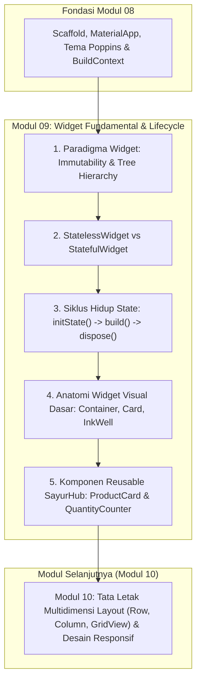
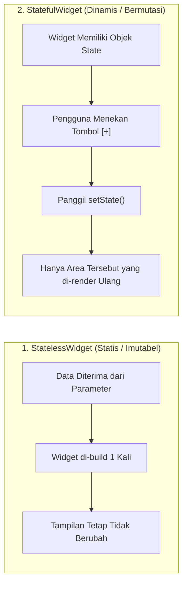
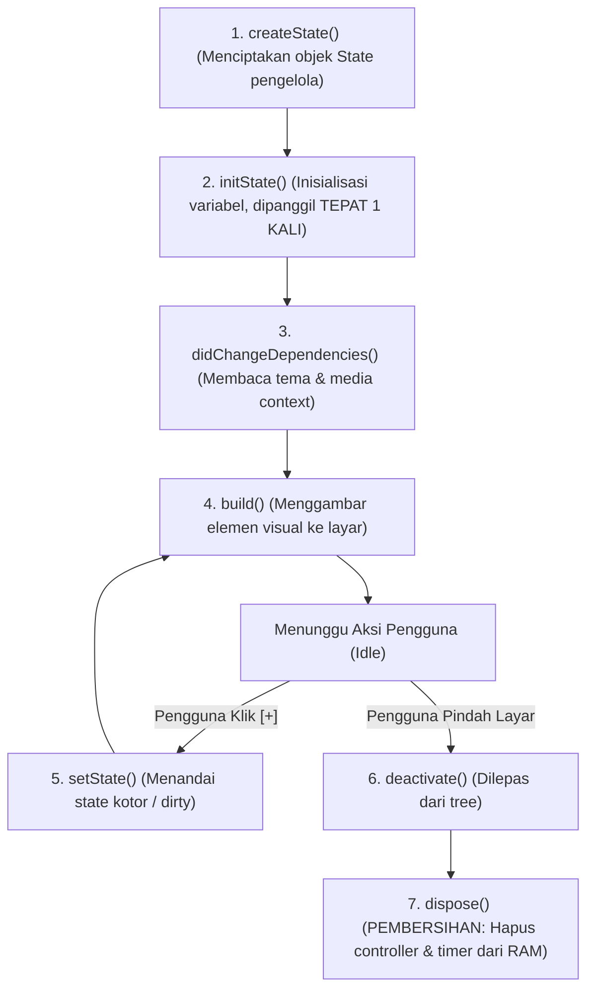

# MODUL 09: WIDGET FUNDAMENTAL FLUTTER — STATELESSWIDGET VS STATEFULWIDGET, SIKLUS HIDUP, DAN REUSABLE COMPONENTS
## PENGEMBANGAN APLIKASI MOBILE MULTIPLATFORM DARI DASAR HINGGA PRODUKSI
### KONSENTRASI KEAHLIAN REKAYASA PERANGKAT LUNAK (SMK RPL)

---

## A. IDENTITAS MODUL

- **Nomor Modul**: 09
- **Judul Modul**: Widget Fundamental Flutter — StatelessWidget vs StatefulWidget, Siklus Hidup Widget, dan Reusable Components
- **Tingkat Kesulitan**: Menengah (*Intermediate*)
- **Estimasi Waktu**: 6 Jam Pelajaran (6 × 45 Menit = 270 Menit)
- **Prasyarat**: Modul 08 (Mengenal Struktur Project Flutter, pubspec.yaml, Manajemen Aset, dan Siklus Hidup Eksekusi)
- **Tujuan Pembelajaran**:
  1. Siswa memahami konsep "Everything is a Widget" serta hierarki pohon widget (*Widget Tree*, *Element Tree*, dan *RenderObject Tree*).
  2. Siswa mampu membedakan karakteristik, batasan, dan use case penggunaan `StatelessWidget` vs `StatefulWidget`.
  3. Siswa menguasai siklus hidup (*Lifecycle*) dari `StatefulWidget` (`createState`, `initState`, `didChangeDependencies`, `build`, `setState`, dan `dispose`).
  4. Siswa terampil menyusun dan menata widget visual fundamental: `Text`, `Image`, `Icon`, `Container`, `SizedBox`, `Padding`, `Center`, `Card`, `Divider`, serta efek sentuhan `InkWell`.
  5. Siswa mampu merancang komponen antarmuka mandiri yang dapat digunakan kembali (*reusable UI components*): **`ProductCard`** dan **`QuantityCounterWidget`** untuk aplikasi **SayurHub**.
- **Kompetensi yang Akan Dicapai**:
  - **Kognitif**: Pemahaman manajemen status lokal (*ephemeral/local state*), mekanisme pemicu render ulang `setState()`, serta prinsip dekomposisi komponen antarmuka.
  - **Psikomotorik**: Keterampilan memisahkan kode UI menjadi modul-modul widget independen di folder `lib/shared/widgets/` dan merangkainya ke dalam halaman utama SayurHub.

---

## B. PETA KONSEP



- **Keterkaitan dengan Modul 08**: Kanvas `Scaffold` yang telah disiapkan pada Modul 08 kini mulai diisi oleh komponen-komponen visual fungsional yang dibangun di modul ini.
- **Keterkaitan dengan Modul 10**: Komponen `ProductCard` yang kita buat di sini akan disusun ke dalam tata letak multi-kolom (*2-Column Responsive GridView*) pada Modul 10.

---

## C. MATERI TEORI

### 1. Memahami Konsep "Everything is a Widget"
Dalam Flutter, sebuah antarmuka tidak dirancang menggunakan tag dokumen XML atau berkas CSS terpisah. Sebagai gantinya, antarmuka dibangun secara deklaratif murni menggunakan kode Dart melalui **komposisi widget**.

Tiga lapis pohon internal Flutter (*The Three Trees*):
1. **Widget Tree**: Pohon konfigurasi yang ditulis oleh programmer (ringan, dibuat dan dihancurkan secara instan di memori).
2. **Element Tree**: Pohon pengelola yang mengontrol siklus hidup dan menghubungkan Widget dengan tampilan fisik di layar.
3. **RenderObject Tree**: Pohon tingkat rendah yang bertugas menghitung ukuran (*constraints & sizing*), posisi koordinat piksel, serta menggambar grafik ke GPU perangkat.

---

### 2. StatelessWidget vs StatefulWidget: Kapan Menggunakan yang Mana?



> [!NOTE]
> **Analogi Sederhana untuk Siswa SMK:**
> - **`StatelessWidget`** seperti **Foto dalam Pigura Kaca**. Sekali foto dicetak dan dipajang di dinding, gambarnya tidak akan pernah berubah sendiri kecuali Anda mencopot pigura tersebut dan menggantinya dengan pigura baru. Contoh: Label nama sayur, icon centang, badge diskon.
> - **`StatefulWidget`** seperti **Papan Tulis Whiteboard atau Jam Digital**. Informasi di dalamnya dapat dihapus dan ditulis ulang berkali-kali tanpa perlu mengganti papannya. Contoh: Tombol counter penambah jumlah kg sayur, kolom centang keranjang belanja, formulir input teks.

| Kriteria Komparasi | StatelessWidget | StatefulWidget |
|---|---|---|
| **Memiliki Status yang Berubah?** | Tidak (Imutabel murni) | **Ya (Status disimpan di kelas `State<T>`)** |
| **Metode Render** | Method `build()` berada di dalam kelas widget | Method `build()` berada di dalam kelas pendamping `State` |
| **Konsumsi Memori** | Sangat Ringan | Sedikit lebih besar (karena menyimpan objek State) |
| **Contoh di SayurHub** | `ProductCard` statis, `AppBadge` | `QuantityCounterWidget`, `FavoriteButton` (love toggle) |

---

### 3. Siklus Hidup (Lifecycle) dari `StatefulWidget`

Sebuah `StatefulWidget` melewati tahapan kehidupan yang sangat teratur sejak pertama kali diciptakan hingga dihapus dari layar:



#### Tahapan Kunci yang Wajib Dipahami:
1. **`initState()`**: Tempat terbaik untuk menginisialisasi variabel awal, memulai timer, atau memanggil request data dari API. Method ini dijamin hanya dipanggil **satu kali** saat widget pertama kali lahir.
2. **`build()`**: Tempat kita menuliskan kode tampilan antarmuka. Method ini dapat dipanggil berkali-kali setiap kali ada perubahan status.  
   *Peringatan Keras*: Jangan pernah memanggil `setState()` di dalam method `build()`, karena akan memicu perulangan tak terbatas (*infinite render loop*).
3. **`setState((){ ... })`**: Memberi sinyal kepada framework Flutter: *"Variabel kuantitas belanja telah berubah dari 1 menjadi 2, tolong gambar ulang tampilan teks di layar!"*.
4. **`dispose()`**: Tempat pembersihan memori (*garbage collection preparation*). Di sinilah kita wajib mematikan animasi controller, text controller, atau koneksi stream agar smartphone pengguna tidak mengalami kebocoran memori (*Memory Leak*).

---

### 4. Menjelajahi Widget Visual Fundamental

1. **`Text`**: Menampilkan teks dengan berbagai gaya tipografi, ketebalan (*FontWeight*), warna, dan batas baris (*maxLines & overflow: TextOverflow.ellipsis*).
2. **`Container`**: Kotak serbaguna yang dapat diatur ukurannya (*width, height*), margin, padding, serta dekorasi visual (*BoxDecoration: borderRadius, border, boxShadow, gradient*).
3. **`SizedBox`**: Kotak transparan berdimensi tetap. Paling efisien digunakan sebagai **pemisah jarak kosong** antar widget daripada Container.
4. **`Padding`**: Memberikan ruang jarak ke dalam (*internal spacing*) di sekeliling widget anaknya.
5. **`Card`**: Komponen antarmuka berbentuk kartu persegi tumpul dengan bayangan elevasi (*elevation*) halus standar Material Design.
6. **`InkWell`**: Widget pembungkus yang memberikan respons interaksi sentuhan jari lengkap dengan **efek riak air (*ripple effect*)** yang elegan.

---

## D. PEMBAHASAN KODE PROGRAM: DUA KOMPONEN INTI SAYURHUB

### 1. Komponen Mandiri: `ProductCard` (StatelessWidget)
Komponen ini bertugas menampilkan kartu satu buah sayuran/buah secara bersih, konsisten, dan terenkapsulasi:

```dart
class ProductCard extends StatelessWidget {
  final Product product;
  final VoidCallback onAddToCart;

  const ProductCard({
    super.key,
    required this.product,
    required this.onAddToCart,
  });

  @override
  Widget build(BuildContext context) {
    return Card(
      elevation: 2,
      shape: RoundedRectangleBorder(borderRadius: BorderRadius.circular(16)),
      child: InkWell(
        borderRadius: BorderRadius.circular(16),
        onTap: () {
          // Navigasi ke halaman detail produk (Modul 12)
        },
        child: Padding(
          padding: const EdgeInsets.all(12.0),
          child: Column(
            crossAxisAlignment: CrossAxisAlignment.start,
            children: [
              // Placeholder Gambar Produk
              Container(
                height: 100,
                decoration: BoxDecoration(
                  color: AppColors.primaryGreen.withOpacity(0.08),
                  borderRadius: BorderRadius.circular(12),
                ),
                child: const Center(
                  child: Icon(Icons.eco_rounded, size: 48, color: AppColors.primaryGreen),
                ),
              ),
              const SizedBox(height: 8),
              Text(
                product.name,
                style: const TextStyle(fontWeight: FontWeight.bold, fontSize: 14),
                maxLines: 1,
                overflow: TextOverflow.ellipsis,
              ),
              Text(
                '${PriceCalculator.formatRupiah(product.pricePerKg)} / kg',
                style: const TextStyle(color: AppColors.primaryGreen, fontWeight: FontWeight.w600),
              ),
            ],
          ),
        ),
      ),
    );
  }
}
```

### 2. Komponen Mandiri: `QuantityCounterWidget` (StatefulWidget)
Komponen ini mengelola perubahan jumlah kilogram secara mandiri dengan tombol minus dan plus:

```dart
class QuantityCounterWidget extends StatefulWidget {
  final int maxStock;
  final ValueChanged<int> onQuantityChanged;

  const QuantityCounterWidget({
    super.key,
    required this.maxStock,
    required this.onQuantityChanged,
  });

  @override
  State<QuantityCounterWidget> createState() => _QuantityCounterWidgetState();
}

class _QuantityCounterWidgetState extends State<QuantityCounterWidget> {
  int _currentQuantity = 1;

  void _increment() {
    if (_currentQuantity < widget.maxStock) {
      setState(() {
        _currentQuantity++;
      });
      widget.onQuantityChanged(_currentQuantity);
    }
  }

  void _decrement() {
    if (_currentQuantity > 1) {
      setState(() {
        _currentQuantity--;
      });
      widget.onQuantityChanged(_currentQuantity);
    }
  }

  @override
  Widget build(BuildContext context) {
    return Row(
      mainAxisSize: MainAxisSize.min,
      children: [
        IconButton(icon: const Icon(Icons.remove_circle_outline), onPressed: _decrement),
        Text('$_currentQuantity kg', style: const TextStyle(fontWeight: FontWeight.bold)),
        IconButton(icon: const Icon(Icons.add_circle_outline), onPressed: _increment),
      ],
    );
  }
}
```

---

## E. PERSIAPAN PRAKTIKUM

1. **Perangkat Lunak**:
   - Visual Studio Code dengan emulator atau smartphone Android aktif.
2. **Kondisi Awal Proyek**:
   - Repositori `sayur_hub` dari Modul 08 berada dalam status Git bersih.
3. **Struktur Folder yang Akan Dibuat**:
   - `sayur_hub/lib/shared/`
   - `sayur_hub/lib/shared/widgets/` (Rumah bagi seluruh komponen reusable aplikasi).
4. **File yang Akan Dihasilkan**:
   - `lib/shared/widgets/product_card.dart` (Komponen kartu produk).
   - `lib/shared/widgets/quantity_counter_widget.dart` (Komponen pengubah jumlah kg).
   - Pembaruan layar `lib/features/home/home_screen.dart` untuk menampilkan daftar produk nyata.

---

## F. LANGKAH PRAKTIKUM STEP-BY-STEP

### Langkah 1 — Menyiapkan Folder Shared Widgets

1. Buka terminal di project `sayur_hub`.
2. Buat folder untuk komponen UI bersama:
   ```bash
   mkdir -p lib/shared/widgets
   ```

---

### Langkah 2 — Membuat Komponen `QuantityCounterWidget` (StatefulWidget)

1. Buat file baru di `lib/shared/widgets/quantity_counter_widget.dart`.
2. Tuliskan kode komponen penghitung kuantitas berikut:

```dart
// File: sayur_hub/lib/shared/widgets/quantity_counter_widget.dart
import 'package:flutter/material.dart';
import 'package:sayur_hub/core/theme/app_colors.dart';

/// Komponen penghitung jumlah belanjaan sayur (kg) berbasis StatefulWidget
/// Mengelola status mutasi kuantitas lokal secara aman sesuai ketersediaan stok
class QuantityCounterWidget extends StatefulWidget {
  final int initialQuantity;
  final int maxStock;
  final ValueChanged<int> onQuantityChanged;

  const QuantityCounterWidget({
    super.key,
    this.initialQuantity = 1,
    required this.maxStock,
    required this.onQuantityChanged,
  });

  @override
  State<QuantityCounterWidget> createState() => _QuantityCounterWidgetState();
}

class _QuantityCounterWidgetState extends State<QuantityCounterWidget> {
  late int _quantity;

  @override
  void initState() {
    super.initState();
    // 1. Inisialisasi status awal dari parameter widget
    _quantity = widget.initialQuantity;
  }

  void _increment() {
    if (_quantity < widget.maxStock) {
      setState(() {
        _quantity++;
      });
      widget.onQuantityChanged(_quantity);
    } else {
      ScaffoldMessenger.of(context).showSnackBar(
        SnackBar(
          content: Text('Batas maksimal stok tercapai (${widget.maxStock} kg)!'),
          duration: const Duration(seconds: 1),
        ),
      );
    }
  }

  void _decrement() {
    if (_quantity > 1) {
      setState(() {
        _quantity--;
      });
      widget.onQuantityChanged(_quantity);
    }
  }

  @override
  Widget build(BuildContext context) {
    return Container(
      decoration: BoxDecoration(
        color: Colors.white,
        borderRadius: BorderRadius.circular(24),
        border: Border.all(color: Colors.grey.shade300),
      ),
      child: Row(
        mainAxisSize: MainAxisSize.min,
        children: [
          // Tombol Kurang [-]
          IconButton(
            icon: const Icon(Icons.remove_rounded),
            color: _quantity > 1 ? AppColors.primaryGreen : Colors.grey.shade400,
            iconSize: 20,
            splashRadius: 20,
            onPressed: _quantity > 1 ? _decrement : null,
          ),

          // Teks Kuantitas Tengah
          Padding(
            padding: const EdgeInsets.symmetric(horizontal: 8.0),
            child: Text(
              '$_quantity kg',
              style: const TextStyle(
                fontWeight: FontWeight.bold,
                fontSize: 14,
                color: AppColors.textDark,
              ),
            ),
          ),

          // Tombol Tambah [+]
          IconButton(
            icon: const Icon(Icons.add_rounded),
            color: _quantity < widget.maxStock ? AppColors.primaryGreen : Colors.grey.shade400,
            iconSize: 20,
            splashRadius: 20,
            onPressed: _quantity < widget.maxStock ? _increment : null,
          ),
        ],
      ),
    );
  }
}
```

---

### Langkah 3 — Membuat Komponen `ProductCard` (StatelessWidget)

1. Buat file baru di `lib/shared/widgets/product_card.dart`.
2. Tuliskan kode kartu komoditas sayur/buah profesional dengan badge promo dan tombol belanja:

```dart
// File: sayur_hub/lib/shared/widgets/product_card.dart
import 'package:flutter/material.dart';
import 'package:sayur_hub/core/models/product.dart';
import 'package:sayur_hub/core/theme/app_colors.dart';
import 'package:sayur_hub/core/utils/price_calculator.dart';

/// Komponen kartu produk resmi aplikasi SayurHub
/// Menampilkan informasi visual komoditas secara ringkas dan modular
class ProductCard extends StatelessWidget {
  final Product product;
  final VoidCallback onAddToCart;

  const ProductCard({
    super.key,
    required this.product,
    required this.onAddToCart,
  });

  @override
  Widget build(BuildContext context) {
    return Card(
      elevation: 1.5,
      shape: RoundedRectangleBorder(
        borderRadius: BorderRadius.circular(16),
      ),
      clipBehavior: Clip.antiAlias,
      child: InkWell(
        onTap: () {
          ScaffoldMessenger.of(context).showSnackBar(
            SnackBar(
              content: Text('Membuka detail ${product.name}...'),
              duration: const Duration(seconds: 1),
            ),
          );
        },
        child: Padding(
          padding: const EdgeInsets.all(12.0),
          child: Column(
            crossAxisAlignment: CrossAxisAlignment.start,
            children: [
              // Area Gambar dan Badge
              Stack(
                children: [
                  Container(
                    height: 110,
                    width: double.infinity,
                    decoration: BoxDecoration(
                      color: AppColors.primaryGreen.withOpacity(0.08),
                      borderRadius: BorderRadius.circular(12),
                    ),
                    child: Center(
                      child: Icon(
                        product.category == 'Buah Segar'
                            ? Icons.apple_rounded
                            : Icons.eco_rounded,
                        size: 54,
                        color: AppColors.primaryGreen,
                      ),
                    ),
                  ),

                  // Badge Organik di Pojok Kiri Atas
                  if (product.isOrganic)
                    Positioned(
                      top: 8,
                      left: 8,
                      child: Container(
                        padding: const EdgeInsets.symmetric(horizontal: 8, vertical: 4),
                        decoration: BoxDecoration(
                          color: AppColors.primaryGreen,
                          borderRadius: BorderRadius.circular(8),
                        ),
                        child: const Text(
                          'ORGANIK',
                          style: TextStyle(
                            color: Colors.white,
                            fontSize: 10,
                            fontWeight: FontWeight.bold,
                          ),
                        ),
                      ),
                    ),

                  // Badge Rating di Pojok Kanan Atas
                  Positioned(
                    top: 8,
                    right: 8,
                    child: Container(
                      padding: const EdgeInsets.symmetric(horizontal: 6, vertical: 3),
                      decoration: BoxDecoration(
                        color: Colors.white.withOpacity(0.9),
                        borderRadius: BorderRadius.circular(8),
                      ),
                      child: Row(
                        mainAxisSize: MainAxisSize.min,
                        children: [
                          const Icon(Icons.star_rounded, size: 14, color: Colors.amber),
                          const SizedBox(width: 2),
                          Text(
                            product.rating.toString(),
                            style: const TextStyle(
                              fontSize: 10,
                              fontWeight: FontWeight.bold,
                              color: AppColors.textDark,
                            ),
                          ),
                        ],
                      ),
                    ),
                  ),
                ],
              ),
              const SizedBox(height: 10),

              // Kategori Sayur
              Text(
                product.category.toUpperCase(),
                style: const TextStyle(
                  fontSize: 10,
                  fontWeight: FontWeight.w600,
                  color: AppColors.textMuted,
                  letterSpacing: 0.5,
                ),
              ),
              const SizedBox(height: 4),

              // Nama Produk
              Text(
                product.name,
                style: const TextStyle(
                  fontSize: 14,
                  fontWeight: FontWeight.bold,
                  color: AppColors.textDark,
                ),
                maxLines: 1,
                overflow: TextOverflow.ellipsis,
              ),
              const SizedBox(height: 6),

              // Harga per Kilogram
              Text(
                '${PriceCalculator.formatRupiah(product.pricePerKg)} / kg',
                style: const TextStyle(
                  fontSize: 13,
                  fontWeight: FontWeight.bold,
                  color: AppColors.primaryGreen,
                ),
              ),
              const Spacer(),

              // Baris Status Stok dan Tombol Beli
              Row(
                mainAxisAlignment: MainAxisAlignment.spaceBetween,
                children: [
                  Text(
                    product.isAvailable ? 'Sisa: ${product.stock} kg' : 'Habis',
                    style: TextStyle(
                      fontSize: 11,
                      fontWeight: FontWeight.w500,
                      color: product.isAvailable ? AppColors.textMuted : Colors.red,
                    ),
                  ),
                  ElevatedButton(
                    onPressed: product.isAvailable ? onAddToCart : null,
                    style: ElevatedButton.styleFrom(
                      backgroundColor: AppColors.primaryGreen,
                      foregroundColor: Colors.white,
                      shape: RoundedRectangleBorder(
                        borderRadius: BorderRadius.circular(8),
                      ),
                      padding: const EdgeInsets.symmetric(horizontal: 10, vertical: 6),
                      minimumSize: Size.zero,
                      tapTargetSize: MaterialTapTargetSize.shrinkWrap,
                    ),
                    child: const Icon(Icons.add_shopping_cart_rounded, size: 16),
                  ),
                ],
              ),
            ],
          ),
        ),
      ),
    );
  }
}
```

---

### Langkah 4 — Memperbarui `HomeScreen` untuk Memamerkan Komponen

1. Buka file `lib/features/home/home_screen.dart`.
2. Perbarui kodenya agar mengimpor model produk dan menampilkan kartu produk nyata beserta interaksi kuantitas:

```dart
// File: sayur_hub/lib/features/home/home_screen.dart
import 'package:flutter/material.dart';
import 'package:sayur_hub/core/mock/mock_produce_data.dart';
import 'package:sayur_hub/core/models/product.dart';
import 'package:sayur_hub/core/theme/app_colors.dart';
import 'package:sayur_hub/shared/widgets/product_card.dart';
import 'package:sayur_hub/shared/widgets/quantity_counter_widget.dart';

class HomeScreen extends StatefulWidget {
  const HomeScreen({super.key});

  @override
  State<HomeScreen> createState() => _HomeScreenState();
}

class _HomeScreenState extends State<HomeScreen> {
  int _totalCartItems = 0;
  int _demoQuantity = 1;

  void _handleAddToCart(Product product) {
    setState(() {
      _totalCartItems++;
    });

    ScaffoldMessenger.of(context).hideCurrentSnackBar();
    ScaffoldMessenger.of(context).showSnackBar(
      SnackBar(
        content: Text('${product.name} berhasil ditambahkan ke keranjang!'),
        backgroundColor: AppColors.primaryGreen,
        duration: const Duration(seconds: 1),
      ),
    );
  }

  @override
  Widget build(BuildContext context) {
    final List<Product> sampleProducts = MockProduceData.products;

    return Scaffold(
      appBar: AppBar(
        title: const Text('SayurHub — Pasar Segar'),
        actions: [
          IconButton(
            icon: const Icon(Icons.notifications_none_rounded),
            onPressed: () {},
          ),
        ],
      ),
      drawer: Drawer(
        child: ListView(
          padding: EdgeInsets.zero,
          children: [
            DrawerHeader(
              decoration: const BoxDecoration(color: AppColors.primaryGreen),
              child: Column(
                crossAxisAlignment: CrossAxisAlignment.start,
                mainAxisAlignment: MainAxisAlignment.end,
                children: const [
                  CircleAvatar(
                    radius: 26,
                    backgroundColor: Colors.white,
                    child: Icon(Icons.person_rounded, size: 32, color: AppColors.primaryGreen),
                  ),
                  SizedBox(height: 8),
                  Text('Siti Nurhaliza', style: TextStyle(color: Colors.white, fontWeight: FontWeight.bold)),
                  Text('siti@smkrpl.sch.id', style: TextStyle(color: Colors.white70, fontSize: 12)),
                ],
              ),
            ),
            ListTile(
              leading: const Icon(Icons.home_rounded, color: AppColors.primaryGreen),
              title: const Text('Beranda'),
              onTap: () => Navigator.pop(context),
            ),
          ],
        ),
      ),
      body: SingleChildScrollView(
        padding: const EdgeInsets.all(16.0),
        child: Column(
          crossAxisAlignment: CrossAxisAlignment.start,
          children: [
            // Banner Sambutan
            Container(
              width: double.infinity,
              padding: const EdgeInsets.all(16.0),
              decoration: BoxDecoration(
                color: AppColors.primaryGreen.withOpacity(0.08),
                borderRadius: BorderRadius.circular(16),
                border: Border.all(color: AppColors.primaryGreen.withOpacity(0.2)),
              ),
              child: Row(
                children: [
                  Expanded(
                    child: Column(
                      crossAxisAlignment: CrossAxisAlignment.start,
                      children: const [
                        Text(
                          'Sayur Segar Panen Pagi!',
                          style: TextStyle(fontWeight: FontWeight.bold, fontSize: 16, color: AppColors.primaryGreen),
                        ),
                        SizedBox(height: 4),
                        Text(
                          'Dipetik langsung dari kebun hidroponik mitra Lembang.',
                          style: TextStyle(fontSize: 12, color: AppColors.textMuted),
                        ),
                      ],
                    ),
                  ),
                  const Icon(Icons.eco_rounded, size: 40, color: AppColors.primaryGreen),
                ],
              ),
            ),
            const SizedBox(height: 20),

            // Demo Interaksi StatefulWidget: QuantityCounterWidget
            Text(
              'Uji Coba Kontrol Kuantitas (StatefulWidget):',
              style: Theme.of(context).textTheme.titleLarge?.copyWith(fontSize: 15),
            ),
            const SizedBox(height: 8),
            Container(
              padding: const EdgeInsets.all(12),
              decoration: BoxDecoration(
                color: Colors.white,
                borderRadius: BorderRadius.circular(12),
                border: Border.all(color: Colors.grey.shade300),
              ),
              child: Row(
                mainAxisAlignment: MainAxisAlignment.spaceBetween,
                children: [
                  Text('Kuantitas Uji: $_demoQuantity kg', style: const TextStyle(fontWeight: FontWeight.bold)),
                  QuantityCounterWidget(
                    maxStock: 10,
                    initialQuantity: _demoQuantity,
                    onQuantityChanged: (newVal) {
                      setState(() {
                        _demoQuantity = newVal;
                      });
                    },
                  ),
                ],
              ),
            ),
            const SizedBox(height: 24),

            // Bagian Katalog Produk (Komponen Reusable ProductCard)
            Text(
              'Komoditas Pilihan Hari Ini:',
              style: Theme.of(context).textTheme.titleLarge?.copyWith(fontSize: 17),
            ),
            const SizedBox(height: 12),

            // Menampilkan Kartu Produk Berdampingan
            SizedBox(
              height: 240,
              child: ListView.separated(
                scrollDirection: Axis.horizontal,
                itemCount: sampleProducts.length,
                separatorBuilder: (context, index) => const SizedBox(width: 12),
                itemBuilder: (context, index) {
                  final product = sampleProducts[index];
                  return SizedBox(
                    width: 165,
                    child: ProductCard(
                      product: product,
                      onAddToCart: () => _handleAddToCart(product),
                    ),
                  );
                },
              ),
            ),
          ],
        ),
      ),
      floatingActionButton: FloatingActionButton.extended(
        onPressed: () {
          ScaffoldMessenger.of(context).showSnackBar(
            SnackBar(
              content: Text('Total belanjaan saat ini: $_totalCartItems item'),
            ),
          );
        },
        icon: const Icon(Icons.shopping_cart_rounded),
        label: Text('Keranjang ($_totalCartItems)'),
      ),
    );
  }
}
```

---

## G. ANALISIS DAN PEMAHAMAN

Jawablah pertanyaan analisis berikut:

1. **Analisis Dekomposisi Komponen**: Mengapa kode `ProductCard` dan `QuantityCounterWidget` dipisahkan ke dalam berkasnya masing-masing di folder `lib/shared/widgets/` alih-alih ditulis menumpuk di dalam `home_screen.dart`? Jelaskan dari sudut pandang *Code Reusability* dan kemudahan *Unit Testing*!
2. **Analisis State Lifecycle**: Apa yang akan terjadi jika kita meletakkan pemanggilan `widget.onQuantityChanged(_quantity)` sebelum pemanggilan `setState((){ _quantity++; })`? Mengapa perubahan variabel lokal wajib dibungkus di dalam callback `setState()`?
3. **Analisis Stack Widget**: Pada `ProductCard`, widget `Stack` digunakan untuk menumpuk badge "ORGANIK" di atas gambar sayur. Jelaskan bagaimana `Positioned` mengunci posisi badge pada koordinat pojok atas gambar!

---

## H. LATIHAN DAN TANTANGAN

### 1. Soal Teori
1. Method pada `StatefulWidget` yang dijamin dipanggil tepat satu kali saat widget pertama kali dimasukkan ke dalam widget tree adalah:
   - A. `build()`
   - B. `initState()`
   - C. `dispose()`
   - D. `setState()`
2. Method yang wajib dipanggil untuk membersihkan controller atau listener agar tidak terjadi kebocoran memori (*memory leak*) adalah:
   - A. `deactivate()`
   - B. `clean()`
   - C. `dispose()`
   - D. `close()`
3. Widget pembungkus yang memberikan respons animasi sentuhan jari riak air (*ripple effect*) pada Material Design adalah:
   - A. `GestureDetector`
   - B. `InkWell`
   - C. `TouchDetector`
   - D. `ButtonArea`
4. Di mana letak method `build()` didefinisikan pada sebuah `StatefulWidget`?
   - A. Di dalam kelas turunan `StatefulWidget`
   - B. Di dalam kelas pendamping turunan `State<T>`
   - C. Di dalam fungsi `main()`
   - D. Di dalam `pubspec.yaml`
5. Jelaskan mengapa kita dilarang keras memanggil `setState()` secara langsung di dalam method `build()`!

### 2. Soal Praktik
1. **Badge Promo Diskon**: Tambahkan badge oranye di pojok kiri bawah gambar pada `ProductCard` jika produk memiliki status promo panen raya ("PROMO 15%").
2. **Tombol Favorit Dinamis (StatefulWidget)**: Buat komponen mandiri baru bernama `FavoriteButton` berbasis StatefulWidget. Ketika diketuk, ikon hati berubah dari garis abu-abu `Icons.favorite_border` menjadi merah penuh `Icons.favorite` menggunakan `setState()`.
3. **Validasi Batas Bawah Counter**: Modifikasi `QuantityCounterWidget` agar tombol minus otomatis menjadi berwarna abu-abu redup dan tidak dapat diklik (`disabled`) saat kuantitas mencapai angka minimal `1`.

### 3. Tantangan Pemecahan Masalah (*Problem-Solving Challenges*)
- **Tantangan 1 (Mencegah setState setelah Widget Dispose)**: Seringkali saat proses asinkron selesai, pengguna sudah terlanjur menekan tombol kembali (*back*). Memanggil `setState()` saat widget sudah dilepas akan memicu error *"setState() called after dispose()"*. Rancanglah pengaman menggunakan kondisi `if (!mounted) return;` sebelum memanggil `setState()`!
- **Tantangan 2 (Optimasi Const Constructor pada Widget Tree)**: Periksa seluruh widget yang dibuat di `ProductCard`. Tentukan widget mana saja yang wajib diberi kata kunci `const` agar Flutter Engine tidak membuang waktu me-rebuild widget tersebut saat tombol keranjang belanja diklik!

### 4. Studi Kasus Industri
**Studi Kasus**: Dalam pengujian beban, aplikasi SayurHub terasa melambat ketika menampilkan 50 kartu produk sayur sekaligus. Setelah dianalisis, penyebabnya adalah setiap kartu produk mengalokasikan ulang fungsi anonymous baru pada callback `onPressed`.  
*Tugas Siswa*: Rancanglah arsitektur komponen kartu produk yang efisien menggunakan *tear-off callback* dan konstruktor `const` untuk menjamin performa tetap stabil pada kecepatan 60 FPS!

---

## I. TROUBLESHOOTING & FAQ

Berikut adalah tabel permasalahan umum pembuatan widget dan siklus hidupnya:

| Permasalahan | Penyebab Utama | Gejala / Cara Identifikasi | Solusi Langkah Demi Langkah |
|---|---|---|---|
| **Pesan Error "setState() called after dispose()"** | Operasi asinkron (Timer atau Future) baru selesai setelah pengguna menutup halaman tersebut. | Aplikasi crash di konsol debug dengan error *setState called on unmounted State*. | Selalu tambahkan pengaman sebelum `setState`: `if (mounted) { setState(() { ... }); }`. |
| **Nilai Variabel Berubah di Kode tetapi Layar Tidak Berubah** | Mengubah nilai variabel tanpa membungkusnya di dalam perintah `setState(() { ... })`. | Log mencetak nilai baru, tetapi teks angka di layar smartphone tetap menampilkan angka lama. | Bungkus baris pengubahan variabel di dalam `setState(() { _quantity = newValue; });`. |
| **Efek Riak Air (Ripple Effect) InkWell Tidak Terlihat** | Widget anak di dalam `InkWell` (seperti `Container`) memiliki dekorasi warna pekat (`color: Colors.white`) yang menutupi lapisan riak air. | Sentuhan jari berfungsi, tetapi tidak ada animasi gelombang air. | Pindahkan warna latar belakang ke widget `Material` atau gunakan `Ink` widget sebagai pengganti Container. |
| **Error "RenderBox was not laid out" / Layout Overflow** | Widget seperti `Expanded` atau `Spacer` digunakan di dalam widget scroll tanpa batasan tinggi yang jelas. | Muncul pola garis-garis kuning-hitam di konsol atau layar merah. | Bungkus ListView horizontal di dalam `SizedBox` yang memiliki batasan tinggi (`height: 240`). |

---

## J. PRAKTIKUM INTEGRASI ANTAR-MODUL: REUSABLE UI PRODUKSI

Pada praktikum integrasi Modul 09, kita menghubungkan seluruh model entitas data `Product` dari Modul 06 ke dalam komponen antarmuka mandiri `ProductCard` dan `QuantityCounterWidget` pada layar utama **SayurHub**.

### 1. Judul Praktikum Integrasi
**Pembangunan Komponen Mandiri `ProductCard` dan `QuantityCounterWidget` Terintegrasi di SayurHub**

### 2. Tujuan Praktikum Integrasi
- Menata folder komponen bersama di `lib/shared/widgets/`.
- Membangun `ProductCard` sebagai representasi visual data class `Product`.
- Membangun `QuantityCounterWidget` sebagai komponen pengubah kuantitas interaktif.
- Memperbarui `HomeScreen` sehingga tombol keranjang belanja pada `FloatingActionButton` bertambah secara reaktif setiap kali produk ditambahkan.

### 3. Materi yang Diintegrasikan
- Model entitas `Product` dari Modul 06.
- Data tiruan `MockProduceData.products` dari Modul 05 & 06.
- Utilitas `PriceCalculator.formatRupiah` dari Modul 03.
- Konfigurasi `AppTheme` dan `Scaffold` dari Modul 08.
- Konsep `StatelessWidget`, `StatefulWidget`, dan `setState()` dari Modul 09.

### 4. Kondisi Awal Proyek (*Project State Before*)
Layar `HomeScreen` SayurHub masih berupa teks statis dan belum memiliki komponen kartu produk atau kontrol kuantitas interaktif.

### 5. Instruksi Langkah Demi Langkah
1. Buat file `lib/shared/widgets/quantity_counter_widget.dart`.
2. Buat file `lib/shared/widgets/product_card.dart`.
3. Perbarui `lib/features/home/home_screen.dart` menjadi `StatefulWidget` yang mengelola jumlah keranjang belanja dan menampilkan horizontal carousel kartu produk.
4. Lakukan verifikasi linter static analysis:
   ```bash
   flutter analyze
   ```
5. Uji coba langsung di smartphone fisik atau emulator:
   - Ketuk tombol `[+]` pada uji kuantitas dan amati angka bertambah.
   - Ketuk tombol `[+ Keranjang]` pada kartu Bayam Hijau dan amati angka pada FloatingActionButton bertambah menjadi `(1)`.
6. Simpan dan commit seluruh pekerjaan ke repositori Git:
   ```bash
   git add .
   git commit -m "feat(ui): implement reusable ProductCard and QuantityCounterWidget on HomeScreen"
   ```

---

### 6. Hasil yang Diharapkan
1. Halaman Beranda SayurHub kini memamerkan kartu-kartu produk sayuran asli lengkap dengan foto icon, rating bintang, harga Rupiah terformat rapi, dan tombol belanja.
2. Komponen `QuantityCounterWidget` dapat diuji langsung dan menolak kuantitas melebihi stok.
3. Mengetuk tombol beli memunculkan SnackBar hijau konfirmasi dan memperbarui angka keranjang belanja secara instan.
4. Linter melaporkan `No issues found!`.

### 7. Kriteria Keberhasilan
- [x] File `quantity_counter_widget.dart` dan `product_card.dart` tersimpan di `lib/shared/widgets/`.
- [x] `ProductCard` berhasil menerima parameter bertipe `Product`.
- [x] Interaksi `setState` memperbarui UI secara akurat tanpa *lag*.
- [x] Analisis statis `flutter analyze` bersih (*0 errors, 0 warnings*).

---

## K. EVALUASI MODUL 09

### 1. Rubrik Penilaian Komponen dan Siklus Hidup Widget
| Aspek Evaluasi | Skor Maksimal | Indikator Ketercapaian |
|---|---|---|
| **Ketepatan Pemilihan Stateless vs Stateful** | 25 | Mampu membedakan kapan menggunakan StatelessWidget (kartu) dan StatefulWidget (counter kuantitas). |
| **Penguasaan Siklus Hidup (Lifecycle)** | 25 | Terampil menggunakan `initState()`, memanggil `setState()` secara tepat, dan memahami fungsi `dispose()`. |
| **Kualitas Dekomposisi UI (Modularitas)** | 25 | Komponen terpisah bersih di folder `lib/shared/widgets/` dengan parameter yang jelas dan fleksibel. |
| **Kerapian Antarmuka & Efek Sentuhan** | 25 | Tata letak rapi, radius sudut proporsional, serta memiliki respons interaksi sentuhan jari (`InkWell`). |
| **Total Skor** | **100** | **Kriteria Ketuntasan Minimal (KKM): 75** |

### 2. Soal Uji Debugging State
*Tinjau potongan kode berikut:*
```dart
class _CounterState extends State<Counter> {
  int count = 0;

  Widget build(BuildContext context) {
    return ElevatedButton(
      onPressed: () {
        count++; // Baris A
        print(count);
      },
      child: Text('Jumlah: $count'), // Baris B
    );
  }
}
```
- **Pertanyaan**: Ketika tombol ditekan, terminal mencetak angka 1, 2, 3, namun teks di layar smartphone tetap tertulis "Jumlah: 0". Mengapa hal ini terjadi dan bagaimana perbaikan baris kodenya?
- **Kunci Jawaban**:
  Hal ini terjadi karena variabel `count++` diubah di luar pemanggilan `setState()`. Framework Flutter tidak mengetahui bahwa data telah berubah, sehingga method `build()` tidak dijalankan ulang. Perbaikan:
  ```dart
  onPressed: () {
    setState(() {
      count++;
    });
  }
  ```

---

## L. KESIMPULAN DAN JEMBATAN KE MODUL BERIKUTNYA

### Rangkuman Kompetensi:
Melalui Modul 09 ini, Anda telah menguasai keterampilan inti seorang Flutter UI Engineer:
1. Memahami arsitektur tiga pohon internal Flutter (*Widget, Element, RenderObject Tree*).
2. Membedakan secara tajam penggunaan **StatelessWidget** (komponen statis) dan **StatefulWidget** (komponen interaktif dinamis).
3. Menguasai siklus hidup widget: mulai dari `initState()`, pemutakhiran via `setState()`, hingga pembersihan memori di `dispose()`.
4. Merancang komponen antarmuka tingkat industri: **`ProductCard`** dan **`QuantityCounterWidget`** yang modular dan terpasang di layar Beranda SayurHub.

### Penghubung Menuju Modul 10:
Saat ini kartu-kartu produk SayurHub kita baru ditampilkan dalam satu baris horizontal sederhana. Padahal pada aplikasi e-commerce modern, pengguna mengharapkan tampilan katalog dua kolom (*2-Column Grid*) yang memenuhi layar secara proporsional di smartphone layar kecil maupun tablet layar lebar.

Selain itu, jika kita menambahkan terlalu banyak widget ke bawah tanpa tata letak yang benar, aplikasi akan mengalami error legendaris: **"RenderFlex overflowed by X pixels" (Pita Kuning-Hitam)**!

Untuk mengatasi hal tersebut, pada **Modul 10: Tata Letak Multidimensi (Layout) dan Desain Responsif**, kita akan membedah:
- Menata elemen secara presisi menggunakan `Row`, `Column`, dan `Stack`.
- Mencegah render overflow menggunakan `SingleChildScrollView`, `Expanded`, dan `Flexible`.
- Membangun daftar katalog efisien performa tinggi menggunakan **`GridView.builder`** dan **`ListView.builder`**.
- Menyesuaikan tata letak untuk berbagai ukuran layar smartphone dan tablet menggunakan **`MediaQuery`** dan **`LayoutBuilder`**!
