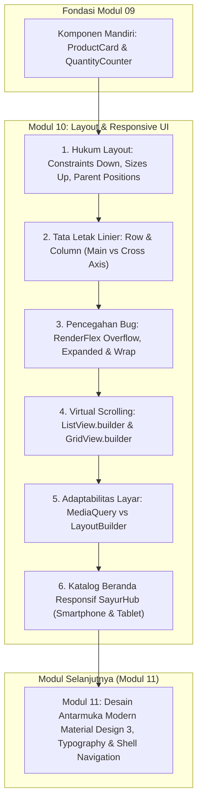
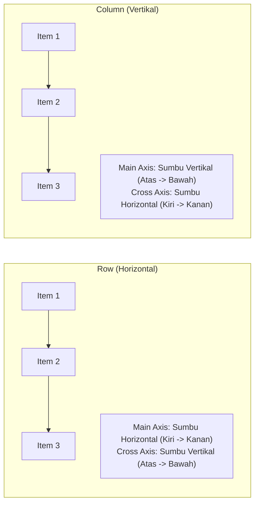
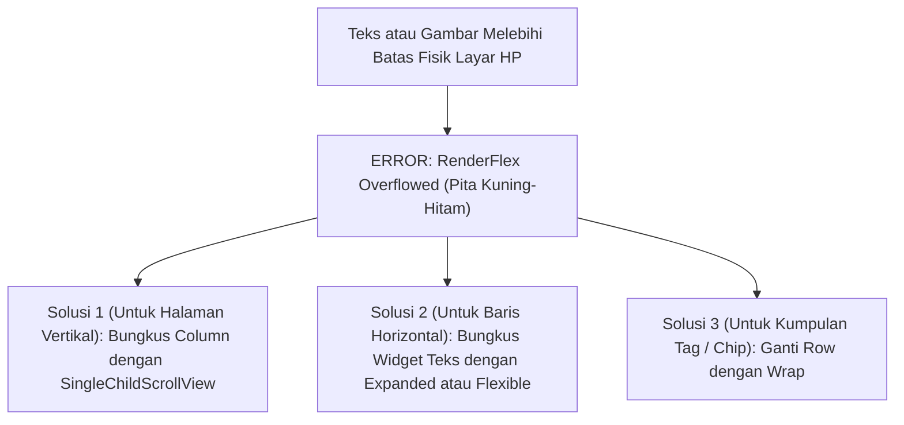

# MODUL 10: TATA LETAK MULTIDIMENSI (LAYOUT) DAN DESAIN ANTARMUKA RESPONSIF PADA FLUTTER
## PENGEMBANGAN APLIKASI MOBILE MULTIPLATFORM DARI DASAR HINGGA PRODUKSI
### KONSENTRASI KEAHLIAN REKAYASA PERANGKAT LUNAK (SMK RPL)

---

## A. IDENTITAS MODUL

- **Nomor Modul**: 10
- **Judul Modul**: Tata Letak Multidimensi (Layout) dan Desain Antarmuka Responsif pada Flutter
- **Tingkat Kesulitan**: Menengah (*Intermediate*)
- **Estimasi Waktu**: 6 Jam Pelajaran (6 × 45 Menit = 270 Menit)
- **Prasyarat**: Modul 09 (Widget Fundamental Flutter — StatelessWidget vs StatefulWidget dan Reusable Components)
- **Tujuan Pembelajaran**:
  1. Siswa memahami hukum layout dasar Flutter: *"Constraints go down, Sizes go up, Parent sets position"*.
  2. Siswa terampil menyusun tata letak linier menggunakan `Row` dan `Column` lengkap dengan pengaturan sumbu utama (*MainAxisAlignment*) dan sumbu silang (*CrossAxisAlignment*).
  3. Siswa mampu mengatasi dan mencegah error legendaris **"A RenderFlex overflowed by X pixels"** menggunakan `SingleChildScrollView`, `Expanded`, `Flexible`, dan `Wrap`.
  4. Siswa menguasai pembangunan daftar data scrollable performa tinggi menggunakan **`ListView.builder`** dan **`GridView.builder`** dengan mekanisme daur ulang sel memori (*view recycling*).
  5. Siswa mampu merancang antarmuka yang adaptif dan responsif terhadap variasi orientasi layar (Portrait vs Landscape) dan perbedaan perangkat (Smartphone vs Tablet) menggunakan **`MediaQuery`** dan **`LayoutBuilder`**.
  6. Siswa mampu merekonstruksi halaman beranda aplikasi **SayurHub** menjadi antarmuka katalog responsif dua kolom dengan banner promosi geser dan tombol pemilih kategori dinamis.
- **Kompetensi yang Akan Dicapai**:
  - **Kognitif**: Pemahaman algoritma perhitungan constraint layout, sistem koordinat grafis mobile, serta prinsip desain antarmuka adaptif.
  - **Psikomotorik**: Keterampilan mengonfigurasi `SliverGridDelegate`, membungkus widget di dalam `LayoutBuilder`, serta menguji elastisitas layout pada beragam resolusi layar.

---

## B. PETA KONSEP



- **Keterkaitan dengan Modul 09**: Komponen `ProductCard` yang telah diciptakan pada Modul 09 kini akan disusun ke dalam kisi tata letak multi-kolom (*Grid Layout*) yang dinamis dan efisien.
- **Keterkaitan dengan Modul 11**: Tata letak katalog responsif yang kokoh pada modul ini akan dipoles secara visual dengan palet warna Material 3 dan bilah navigasi bawah (*NavigationBar*) pada Modul 11.

---

## C. MATERI TEORI

### 1. Hukum Emas Tata Letak (Layout Rule) Flutter
Banyak pemula merasa bingung mengapa sebuah widget berukuran `Container(width: 100, height: 100)` tiba-tiba meregang memenuhi seluruh layar smartphone. Hal ini terjadi karena Flutter mematuhi tiga aturan tata letak yang sangat ketat:

> [!IMPORTANT]
> **Hukum Utama Layout Flutter:**
> 1. **Constraints go down**: Induk memberikan batasan ukuran (minimal dan maksimal lebar/tinggi) ke anaknya.
> 2. **Sizes go up**: Anak menentukan ukuran dirinya sendiri berdasarkan batasan yang diberikan induknya.
> 3. **Parent sets position**: Induk menentukan posisi koordinat (X dan Y) di mana anak tersebut diletakkan di layar.

Jika widget induk Anda adalah layar HP (yang memberikan batasan ketat: *lebar harus 360 px, tinggi harus 800 px*), maka Container anak dipaksa memenuhi batasan tersebut kecuali Anda membungkusnya di dalam widget pelonggar batasan seperti `Center` atau `Align`!

---

### 2. Tata Letak Linier: `Row` dan `Column`

Dua pilar utama penyusun antarmuka mobile adalah baris horizontal (`Row`) dan kolom vertikal (`Column`):



#### Pengaturan Alignment Kunci:
- **`MainAxisAlignment`**: Mengatur distribusi jarak antar anak pada sumbu utama:
  - `start`: Rapat ke awal sumbu.
  - `center`: Rapat ke tengah.
  - `end`: Rapat ke akhir sumbu.
  - `spaceBetween`: Jarak dibagi rata di antara anak (anak pertama dan terakhir menempel di tepi).
  - `spaceAround`: Jarak merata dengan setengah jarak di kedua tepi.
  - `spaceEvenly`: Jarak di antara anak dan tepi benar-benar sama rata.
- **`CrossAxisAlignment`**: Mengatur perataan anak pada sumbu silang:
  - `start`, `center`, `end`, `stretch` (memaksa seluruh anak melebar memenuhi sumbu silang).

---

### 3. Membasmi Musuh Bebuyutan Pemula: "RenderFlex Overflowed"

Pernahkah Anda melihat layar smartphone Anda memunculkan pita bergaris-garis kuning-hitam bertuliskan:  
`"A RenderFlex overflowed by 48 pixels on the right/bottom"`?



#### Cara Mengatasinya:
1. **Gunakan `Expanded` di dalam `Row`**:
   Memberitahu widget anak: *"Jangan meminta ukuran lebih dari sisa ruang yang tersedia di baris ini!"*. Teks panjang akan otomatis terpotong atau berpindah ke baris kedua jika dibungkus `Expanded`.
2. **Gunakan `SingleChildScrollView`**:
   Jika formulir atau konten halaman Anda lebih panjang dari tinggi layar smartphone, bungkus seluruh kolom tersebut di dalam `SingleChildScrollView` agar layar dapat digeser (*scroll*) ke bawah.
3. **Gunakan `Wrap`**:
   Jika Anda memiliki barisan tombol kategori (misal: 10 tag sayur), widget `Row` akan jebol ke samping kanan. Ganti `Row` dengan `Wrap` agar tombol-tombol yang tidak muat otomatis jatuh ke baris berikutnya layaknya teks di Microsoft Word!

---

### 4. Menampilkan Data Skala Besar: `ListView.builder` dan `GridView.builder`

Jika Anda memiliki 1.000 data sayur di katalog:
- Jika Anda memasukkannya ke dalam `Column` biasa, Flutter akan merender ke-1.000 widget tersebut sekaligus ke memori HP. Akibatnya: RAM jebol dan aplikasi langsung lag patah-patah!
- **Solusi Industri**: Gunakan **`ListView.builder`** atau **`GridView.builder`**.  
  Metode `.builder` menggunakan prinsip **Virtual Scrolling (Lazy Loading)**: Flutter hanya merender 6–8 kartu produk yang sedang terlihat di kaca layar smartphone. Saat pengguna menggulir ke bawah, kartu lama di atas dihancurkan dari memori dan slotnya digunakan kembali (*recycled*) untuk menggambar kartu baru di bawah!

```dart
GridView.builder(
  physics: const BouncingScrollPhysics(),
  gridDelegate: const SliverGridDelegateWithFixedCrossAxisCount(
    crossAxisCount: 2,          // 2 Kolom berdampingan
    childAspectRatio: 0.72,     // Rasio lebar terhadap tinggi kartu
    crossAxisSpacing: 12,       // Jarak horizontal antar kartu
    mainAxisSpacing: 12,        // Jarak vertikal antar kartu
  ),
  itemCount: products.length,
  itemBuilder: (context, index) {
    return ProductCard(product: products[index], onAddToCart: () {});
  },
)
```

---

### 5. Desain Responsif: `MediaQuery` vs `LayoutBuilder`

Siswa SMK RPL wajib memahami perbedaan antara responsif tingkat perangkat (*Device-level*) dan responsif tingkat komponen (*Widget-level*):

1. **`MediaQuery.of(context)`**:
   Membaca dimensi **seluruh layar smartphone** (lebar total, tinggi total, orientasi portrait/landscape, dan area notch status bar `padding.top`).
   ```dart
   final bool isTablet = MediaQuery.of(context).size.width >= 600;
   ```
2. **`LayoutBuilder`**:
   Membaca batasan ukuran yang diberikan oleh **widget induk langsungnya** (*BoxConstraints: constraints.maxWidth*).  
   Sangat berguna untuk membuat komponen kartu yang pintar: jika diletakkan di layar sempit ia menampilkan 1 kolom, namun jika diletakkan di layar lebar ia otomatis membelah diri menjadi 2 atau 3 kolom!

---

## D. PEMBAHASAN KODE PROGRAM: KATALOG RESPONSIVE SAYURHUB

Mari kita bedah arsitektur halaman Beranda SayurHub yang memadukan carousel banner promosi, horizontal category pill selector, dan 2-column gridview responsif:

```dart
// Menghitung jumlah kolom grid berdasarkan lebar layar secara cerdas
int hitungJumlahKolom(double lebarLayar) {
  if (lebarLayar >= 900) {
    return 4; // Layar Desktop / Tablet Besar Horizontal
  } else if (lebarLayar >= 600) {
    return 3; // Layar Tablet Portabel
  } else {
    return 2; // Layar Smartphone Standar
  }
}
```

### Penjelasan Bagian Penting:
- **`LayoutBuilder(builder: (context, constraints) { ... })`**: Membaca lebar riil area konten (`constraints.maxWidth`), lalu secara otomatis memanggil fungsi `hitungJumlahKolom`.
- **`physics: const NeverScrollableScrollPhysics()` dan `shrinkWrap: true`**: Kombinasi emas saat menyematkan `GridView` di dalam `SingleChildScrollView`. `shrinkWrap: true` memerintahkan GridView untuk menghitung tinggi kontennya sendiri, sementara `NeverScrollableScrollPhysics` mematikan scroll mandiri GridView agar tidak bentrok dengan scroll halaman utama.

---

## E. PERSIAPAN PRAKTIKUM

1. **Perangkat Lunak**:
   - Visual Studio Code dengan emulator atau HP Android fisik.
2. **Kondisi Awal Proyek**:
   - Repositori `sayur_hub` dari Modul 09 berada dalam status Git bersih.
3. **Struktur File yang Akan Dibuat**:
   - `sayur_hub/lib/shared/widgets/promo_banner.dart` (Komponen carousel promosi panen).
   - `sayur_hub/lib/shared/widgets/category_pill.dart` (Komponen tombol filter kategori lonjong).
   - Pembaruan menyeluruh pada `sayur_hub/lib/features/home/home_screen.dart`.

---

## F. LANGKAH PRAKTIKUM STEP-BY-STEP

### Langkah 1 — Membuat Komponen `PromoBanner`

1. Buat file baru di `lib/shared/widgets/promo_banner.dart`.
2. Tuliskan kode banner promosi diskon panen raya yang menarik dan tahan banting:

```dart
// File: sayur_hub/lib/shared/widgets/promo_banner.dart
import 'package:flutter/material.dart';
import 'package:sayur_hub/core/theme/app_colors.dart';

/// Komponen kartu banner promosi panen raya SayurHub
class PromoBanner extends StatelessWidget {
  final String title;
  final String subtitle;
  final String discountTag;
  final IconData iconData;

  const PromoBanner({
    super.key,
    required this.title,
    required this.subtitle,
    this.discountTag = 'PROMO SPESIAL',
    this.iconData = Icons.eco_rounded,
  });

  @override
  Widget build(BuildContext context) {
    return Container(
      width: double.infinity,
      padding: const EdgeInsets.all(18.0),
      decoration: BoxDecoration(
        gradient: LinearGradient(
          colors: [
            AppColors.primaryGreen,
            AppColors.primaryGreen.withOpacity(0.85),
          ],
          begin: Alignment.topLeft,
          end: Alignment.bottomRight,
        ),
        borderRadius: BorderRadius.circular(20),
        boxShadow: [
          BoxShadow(
            color: AppColors.primaryGreen.withOpacity(0.25),
            blurRadius: 10,
            offset: const Offset(0, 4),
          ),
        ],
      ),
      child: Row(
        children: [
          Expanded(
            child: Column(
              crossAxisAlignment: CrossAxisAlignment.start,
              mainAxisSize: MainAxisSize.min,
              children: [
                // Tag Diskon Oranye
                Container(
                  padding: const EdgeInsets.symmetric(horizontal: 10, vertical: 4),
                  decoration: BoxDecoration(
                    color: AppColors.accentOrange,
                    borderRadius: BorderRadius.circular(8),
                  ),
                  child: Text(
                    discountTag,
                    style: const TextStyle(
                      color: Colors.white,
                      fontSize: 11,
                      fontWeight: FontWeight.bold,
                      letterSpacing: 0.5,
                    ),
                  ),
                ),
                const SizedBox(height: 10),

                // Judul Banner
                Text(
                  title,
                  style: const TextStyle(
                    color: Colors.white,
                    fontSize: 18,
                    fontWeight: FontWeight.bold,
                  ),
                ),
                const SizedBox(height: 4),

                // Subtitle
                Text(
                  subtitle,
                  style: TextStyle(
                    color: Colors.white.withOpacity(0.9),
                    fontSize: 12,
                    height: 1.4,
                  ),
                ),
              ],
            ),
          ),
          const SizedBox(width: 12),

          // Ikon Visual Kanan
          Container(
            padding: const EdgeInsets.all(14),
            decoration: BoxDecoration(
              color: Colors.white.withOpacity(0.18),
              shape: BoxShape.circle,
            ),
            child: Icon(iconData, size: 42, color: Colors.white),
          ),
        ],
      ),
    );
  }
}
```

---

### Langkah 2 — Membuat Komponen `CategoryPill` (Filter Kategori)

1. Buat file baru di `lib/shared/widgets/category_pill.dart`.
2. Tuliskan kode tombol filter lonjong yang interaktif:

```dart
// File: sayur_hub/lib/shared/widgets/category_pill.dart
import 'package:flutter/material.dart';
import 'package:sayur_hub/core/theme/app_colors.dart';

/// Komponen tombol kategori lonjong (Pill) untuk menyaring komoditas katalog
class CategoryPill extends StatelessWidget {
  final String label;
  final bool isSelected;
  final VoidCallback onTap;

  const CategoryPill({
    super.key,
    String? label,
    String? categoryName,
    required this.isSelected,
    VoidCallback? onTap,
    VoidCallback? onSelected,
  })  : label = label ?? categoryName ?? '',
        onTap = onTap ?? onSelected ?? _defaultOnTap;

  static void _defaultOnTap() {}

  @override
  Widget build(BuildContext context) {
    return GestureDetector(
      onTap: onTap,
      child: AnimatedContainer(
        duration: const Duration(milliseconds: 250),
        curve: Curves.easeInOut,
        padding: const EdgeInsets.symmetric(horizontal: 18, vertical: 10),
        decoration: BoxDecoration(
          color: isSelected ? AppColors.primaryGreen : Colors.white,
          borderRadius: BorderRadius.circular(30),
          border: Border.all(
            color: isSelected ? AppColors.primaryGreen : Colors.grey.shade300,
            width: 1.2,
          ),
          boxShadow: isSelected
              ? [
                  BoxShadow(
                    color: AppColors.primaryGreen.withOpacity(0.3),
                    blurRadius: 6,
                    offset: const Offset(0, 2),
                  ),
                ]
              : null,
        ),
        child: Text(
          label,
          style: TextStyle(
            color: isSelected ? Colors.white : AppColors.textDark,
            fontSize: 13,
            fontWeight: isSelected ? FontWeight.bold : FontWeight.w500,
          ),
        ),
      ),
    );
  }
}
```

---

### Langkah 3 — Merekonstruksi `HomeScreen` dengan Grid Responsif

1. Buka file `lib/features/home/home_screen.dart`.
2. Gantikan seluruh kodenya dengan susunan tata letak modern yang memadukan `LayoutBuilder`, `SingleChildScrollView`, `CategoryPill`, dan `GridView.builder`:

```dart
// File: sayur_hub/lib/features/home/home_screen.dart
import 'package:flutter/material.dart';
import 'package:sayur_hub/core/mock/mock_produce_data.dart';
import 'package:sayur_hub/core/models/product.dart';
import 'package:sayur_hub/core/theme/app_colors.dart';
import 'package:sayur_hub/core/utils/catalog_processor.dart';
import 'package:sayur_hub/shared/widgets/category_pill.dart';
import 'package:sayur_hub/shared/widgets/product_card.dart';
import 'package:sayur_hub/shared/widgets/promo_banner.dart';

class HomeScreen extends StatefulWidget {
  const HomeScreen({super.key});

  @override
  State<HomeScreen> createState() => _HomeScreenState();
}

class _HomeScreenState extends State<HomeScreen> {
  int _totalCartItems = 0;
  String _selectedCategory = 'Semua';

  void _handleAddToCart(Product product) {
    setState(() {
      _totalCartItems++;
    });

    ScaffoldMessenger.of(context).hideCurrentSnackBar();
    ScaffoldMessenger.of(context).showSnackBar(
      SnackBar(
        content: Text('${product.name} dimasukkan ke keranjang belanja!'),
        backgroundColor: AppColors.primaryGreen,
        duration: const Duration(seconds: 1),
      ),
    );
  }

  @override
  Widget build(BuildContext context) {
    final List<Product> allProducts = MockProduceData.products;

    // Mengambil seluruh kategori unik dan menyematkan filter 'Semua' di awal
    final List<String> categories = [
      'Semua',
      ...CatalogProcessor.getProduceCategories(allProducts),
    ];

    // Menyaring daftar produk sesuai kategori yang sedang dipilih pengguna
    final List<Product> displayedProducts = CatalogProcessor.filterProductsByCategory(
      products: allProducts,
      categoryName: _selectedCategory,
    );

    return Scaffold(
      appBar: AppBar(
        title: const Text('SayurHub — Pasar Segar'),
        actions: [
          IconButton(
            icon: const Icon(Icons.search_rounded),
            tooltip: 'Cari Sayuran',
            onPressed: () {},
          ),
          IconButton(
            icon: const Icon(Icons.notifications_none_rounded),
            onPressed: () {},
          ),
        ],
      ),
      drawer: Drawer(
        child: ListView(
          padding: EdgeInsets.zero,
          children: [
            DrawerHeader(
              decoration: const BoxDecoration(color: AppColors.primaryGreen),
              child: Column(
                crossAxisAlignment: CrossAxisAlignment.start,
                mainAxisAlignment: MainAxisAlignment.end,
                children: const [
                  CircleAvatar(
                    radius: 26,
                    backgroundColor: Colors.white,
                    child: Icon(Icons.person_rounded, size: 32, color: AppColors.primaryGreen),
                  ),
                  SizedBox(height: 8),
                  Text('Siti Nurhaliza', style: TextStyle(color: Colors.white, fontWeight: FontWeight.bold)),
                  Text('siti@smkrpl.sch.id', style: TextStyle(color: Colors.white70, fontSize: 12)),
                ],
              ),
            ),
            ListTile(
              leading: const Icon(Icons.home_rounded, color: AppColors.primaryGreen),
              title: const Text('Katalog Beranda'),
              onTap: () => Navigator.pop(context),
            ),
          ],
        ),
      ),
      body: LayoutBuilder(
        builder: (context, constraints) {
          // Menentukan jumlah kolom secara dinamis sesuai lebar layar perangkat
          final double screenWidth = constraints.maxWidth;
          final int crossAxisCount = screenWidth >= 900
              ? 4
              : screenWidth >= 600
                  ? 3
                  : 2;

          return SingleChildScrollView(
            padding: const EdgeInsets.symmetric(horizontal: 16.0, vertical: 12.0),
            child: Column(
              crossAxisAlignment: CrossAxisAlignment.start,
              children: [
                // 1. Banner Promosi Panen Raya
                const PromoBanner(
                  discountTag: 'DISKON PANEN 25%',
                  title: 'Panen Sayur Segar Lembang',
                  subtitle: 'Sayuran organik bebas pestisida dipetik langsung pagi hari ini.',
                  iconData: Icons.eco_rounded,
                ),
                const SizedBox(height: 20),

                // 2. Baris Filter Kategori Horizontal
                Text(
                  'Kategori Pilihan:',
                  style: Theme.of(context).textTheme.titleLarge?.copyWith(fontSize: 16),
                ),
                const SizedBox(height: 10),
                SizedBox(
                  height: 42,
                  child: ListView.separated(
                    scrollDirection: Axis.horizontal,
                    itemCount: categories.length,
                    separatorBuilder: (context, index) => const SizedBox(width: 8),
                    itemBuilder: (context, index) {
                      final category = categories[index];
                      return CategoryPill(
                        label: category,
                        isSelected: _selectedCategory == category,
                        onTap: () {
                          setState(() {
                            _selectedCategory = category;
                          });
                        },
                      );
                    },
                  ),
                ),
                const SizedBox(height: 20),

                // 3. Header Informasi Jumlah Komoditas
                Row(
                  mainAxisAlignment: MainAxisAlignment.spaceBetween,
                  children: [
                    Text(
                      'Katalog Komoditas (${displayedProducts.length}):',
                      style: Theme.of(context).textTheme.titleLarge?.copyWith(fontSize: 16),
                    ),
                    Text(
                      'Grid: $crossAxisCount Kolom',
                      style: const TextStyle(fontSize: 12, color: AppColors.textMuted),
                    ),
                  ],
                ),
                const SizedBox(height: 12),

                // 4. GridView Katalog Responsif
                if (displayedProducts.isEmpty)
                  Container(
                    height: 200,
                    width: double.infinity,
                    alignment: Alignment.center,
                    child: const Text('Tidak ada produk pada kategori ini.'),
                  )
                else
                  GridView.builder(
                    shrinkWrap: true,
                    physics: const NeverScrollableScrollPhysics(),
                    itemCount: displayedProducts.length,
                    gridDelegate: SliverGridDelegateWithFixedCrossAxisCount(
                      crossAxisCount: crossAxisCount,
                      childAspectRatio: 0.68,
                      crossAxisSpacing: 12,
                      mainAxisSpacing: 12,
                    ),
                    itemBuilder: (context, index) {
                      final product = displayedProducts[index];
                      return ProductCard(
                        product: product,
                        onAddToCart: () => _handleAddToCart(product),
                      );
                    },
                  ),
                const SizedBox(height: 32),
              ],
            ),
          );
        },
      ),
      floatingActionButton: FloatingActionButton.extended(
        onPressed: () {
          ScaffoldMessenger.of(context).showSnackBar(
            SnackBar(
              content: Text('Total belanjaan saat ini: $_totalCartItems item'),
            ),
          );
        },
        icon: const Icon(Icons.shopping_cart_rounded),
        label: Text('Keranjang ($_totalCartItems)'),
      ),
    );
  }
}
```

---

## G. ANALISIS DAN PEMAHAMAN

Jawablah pertanyaan analisis berikut:

1. **Analisis Algoritma Tata Letak**: Mengapa kita menggunakan `SliverGridDelegateWithFixedCrossAxisCount` dan bukan `SliverGridDelegateWithMaxCrossAxisExtent`? Dalam situasi apa `WithMaxCrossAxisExtent` lebih menguntungkan untuk aplikasi e-commerce yang dibuka di monitor layar ultra lebar (*Ultra-wide Monitor*)?
2. **Analisis Scroll Conflict**: Mengapa `GridView.builder` yang diletakkan di dalam `SingleChildScrollView` wajib disetel dengan parameter `shrinkWrap: true` dan `physics: const NeverScrollableScrollPhysics()`? Apa yang akan terjadi jika kedua parameter tersebut dihilangkan?
3. **Analisis Adaptabilitas Layar**: Jelaskan bagaimana `LayoutBuilder` memungkinkan aplikasi SayurHub secara otomatis merender 2 kolom di smartphone Android dan 3 atau 4 kolom saat aplikasi dibuka di tablet atau layar desktop!

---

## H. LATIHAN DAN TANTANGAN

### 1. Soal Teori
1. Tiga aturan emas tata letak (layout rules) pada framework Flutter adalah:
   - A. Constraints go up, Sizes go down, Parent positions
   - B. Constraints go down, Sizes go up, Parent sets position
   - C. Sizes go down, Constraints go up, Child sets position
   - D. Widgets go down, Elements go up, Render sets frame
2. Widget yang digunakan untuk menyusun elemen anak secara bertumpuk (*layering*) dari belakang ke depan pada koordinat Z adalah:
   - A. `Column`
   - B. `Row`
   - C. `Stack`
   - D. `Wrap`
3. Parameter pada `GridView` yang menentukan perbandingan rasio antara lebar terhadap tinggi dari setiap kartu adalah:
   - A. `crossAxisCount`
   - B. `childAspectRatio`
   - C. `mainAxisSpacing`
   - D. `crossAxisSpacing`
4. Widget yang digunakan untuk menggantikan `Row` agar widget-widget anak yang melebihi lebar layar otomatis berpindah ke baris baru di bawahnya adalah:
   - A. `Flow`
   - B. `Wrap`
   - C. `Flex`
   - D. `Align`
5. Apa penyebab utama munculnya pesan error visual garis-garis kuning-hitam bertuliskan *"A RenderFlex overflowed"* di layar aplikasi?

### 2. Soal Praktik
1. **Banner Promo Carousel Multi-Slide**: Buat `PageView` horizontal sederhana di area banner promosi yang memuat 3 slide promosi berbeda (Promo Diskon Panen, Promo Gratis Ongkir, dan Promo Sayur Organik) yang dapat digeser ke kiri dan kanan.
2. **Penyaring Kategori Reset Otomatis**: Tambahkan tombol ikon silang `Icons.clear` di samping teks "Kategori Pilihan:" yang ketika diketuk akan mengembalikan filter kategori ke pilihan `'Semua'`.
3. **Eksperimen Orientasi Layar (Landscape Mode)**: Putar posisi emulator atau smartphone Anda ke mode menyamping (*Landscape*). Amati bagaimana `LayoutBuilder` secara cerdas memperluas katalog SayurHub menjadi 3 atau 4 kolom tanpa ada teks yang terpotong!

### 3. Tantangan Pemecahan Masalah (*Problem-Solving Challenges*)
- **Tantangan 1 (Penanganan Aspek Rasio Dinamis pada Layar Kecil)**: Pada smartphone dengan layar sangat sempit (lebar < 340 dp), teks nama sayur atau tombol belanja di dalam `ProductCard` berisiko tertekan ke bawah. Rancanglah nilai `childAspectRatio` yang dinamis:
  `childAspectRatio: screenWidth < 360 ? 0.62 : 0.68` untuk menjaga kartu tetap proporsional tanpa overflow!
- **Tantangan 2 (Optimasi Cache Extent pada GridView)**: Tambahkan parameter `cacheExtent: 500` pada `GridView.builder`. Jelaskan bagaimana cacheExtent memuat kartu produk yang berada 500 piksel di luar layar sehingga saat pengguna menggulir secara cepat, gambar produk sudah siap tanpa *blank frame*!

### 4. Studi Kasus Industri
**Studi Kasus**: Riset pengguna menunjukkan 40% pembeli SayurHub adalah pemilik restoran yang berbelanja menggunakan komputer tablet Android di dapur mereka dengan posisi horizontal (*Landscape*).  
*Tugas Siswa*: Rancanglah *Adaptive Layout*: Jika layar mendeteksi lebar $\ge$ 600 dp (Tablet), tampilkan Drawer samping secara permanen di sebelah kiri (*Permanent Navigation Rail/Sidebar*) dan katalog produk di sebelah kanan!

---

## I. TROUBLESHOOTING & FAQ

Berikut adalah tabel permasalahan tata letak layout dan solusinya:

| Permasalahan Teknis | Penyebab Utama | Gejala / Cara Identifikasi | Solusi Tepat |
|---|---|---|---|
| **Pita Kuning-Hitam "RenderFlex overflowed by X pixels"** | Konten di dalam `Row` atau `Column` melebihi luas piksel fisik layar. | Muncul garis zebra kuning-hitam di tepi kanan atau bawah layar. | 1. Jika di dalam `Row`, bungkus teks dengan `Expanded`.<br>2. Jika kumpulan tag, ganti `Row` dengan `Wrap`.<br>3. Jika halaman vertikal, bungkus `Column` dengan `SingleChildScrollView`. |
| **Error Crash "Vertical viewport was given unbounded height"** | Memasukkan `ListView` atau `GridView` ke dalam `Column` tanpa memberikan batasan tinggi. | Layar menjadi merah pekat dengan pesan error *unbounded height*. | 1. Beri parameter `shrinkWrap: true` dan `physics: const NeverScrollableScrollPhysics()`.<br>2. ATAU bungkus Grid/List tersebut dengan widget `Expanded` jika Column berada di dalam Scaffold berukuran pasti. |
| **Kartu Produk Terlihat Gepeng atau Terlalu Tinggi di Grid** | Nilai `childAspectRatio` pada `SliverGridDelegate` tidak sesuai dengan proporsi isi kartu. | Kartu produk gepeng horizontal (jika nilai > 1.0) atau terlalu panjang vertikal (jika nilai < 0.5). | Sesuaikan `childAspectRatio` secara proporsional. Untuk kartu vertikal standar e-commerce dengan gambar dan teks, rasio ideal berkisar antara `0.65` hingga `0.75`. |
| **Scroll Halaman Terasa Patah-patah (Jank Frame)** | Menggunakan perulangan list biasa `children: list.map(...).toList()` di dalam `SingleChildScrollView` untuk data yang berjumlah ratusan. | FPS drop di bawah 30 saat layar digulir cepat. | Beralihlah ke `ListView.builder` atau `GridView.builder` agar memori hanya me-render elemen yang terlihat di layar. |

---

## J. PRAKTIKUM INTEGRASI ANTAR-MODUL: KATALOG BERANDA RESPONSIF

Pada praktikum integrasi Modul 10, kita mentransformasikan seluruh komponen yang telah kita kembangkan pada modul-modul sebelumnya menjadi satu halaman katalog e-commerce produksi utuh.

### 1. Judul Praktikum Integrasi
**Pembangunan Tata Letak Katalog Responsif Multi-Kolom SayurHub dengan Selector Kategori dan GridView Adaptif**

### 2. Tujuan Praktikum Integrasi
- Membangun komponen `PromoBanner` gradien hijau dengan bayangan elevasi.
- Membangun komponen interaktif `CategoryPill` yang memicu pemfilteran data real-time.
- Menyusun katalog `GridView.builder` adaptif yang otomatis menyesuaikan jumlah kolom di berbagai resolusi layar.

### 3. Materi yang Diintegrasikan
- Model data `Product` dari Modul 06.
- Logika filtering `CatalogProcessor.filterProductsByCategory` dari Modul 05 & 06.
- Komponen `ProductCard` dari Modul 09.
- Tata letak `LayoutBuilder`, `SingleChildScrollView`, dan `GridView.builder` dari Modul 10.

### 4. Kondisi Awal Proyek (*Project State Before*)
Halaman Beranda hanya menampilkan daftar kartu produk horizontal sederhana di dalam `SizedBox` berketinggian tetap.

### 5. Instruksi Langkah Demi Langkah
1. Buat file `lib/shared/widgets/promo_banner.dart`.
2. Buat file `lib/shared/widgets/category_pill.dart`.
3. Perbarui `lib/features/home/home_screen.dart` dengan arsitektur `LayoutBuilder` dan `GridView.builder` responsif.
4. Lakukan verifikasi linter static analysis:
   ```bash
   flutter analyze
   ```
5. Uji coba langsung di smartphone fisik atau emulator:
   - Ketuk pill kategori `'Buah Segar'` dan amati katalog hanya menampilkan buah alpukat dan pisang.
   - Ketuk pill kategori `'Sayuran Daun'` dan amati katalog menampilkan bayam dan kangkung.
   - Ketuk tombol `[+ Keranjang]` pada salah satu kartu dan amati angka belanja bertambah.
6. Simpan dan commit seluruh pekerjaan ke repositori Git:
   ```bash
   git add .
   git commit -m "feat(ui): implement responsive 2-column GridView catalog, PromoBanner, and CategoryPills"
   ```

---

### 6. Hasil yang Diharapkan
1. Halaman Beranda SayurHub kini memiliki tata letak e-commerce standar profesional kelas dunia: Banner promosi di atas, baris kategori geser yang dapat diketuk, dan katalog produk 2 kolom vertikal yang tertata rapi.
2. Tidak ada error garis kuning-hitam *RenderFlex overflowed*.
3. Pemfilteran kategori bekerja seketika (*instant reaction*) berkat integrasi `CatalogProcessor`.
4. Analisis statis `flutter analyze` melaporkan `No issues found!`.

### 7. Kriteria Keberhasilan
- [x] File `promo_banner.dart` dan `category_pill.dart` terimplementasi di `lib/shared/widgets/`.
- [x] `GridView.builder` responsif terpasang dengan batasan `NeverScrollableScrollPhysics` dan `shrinkWrap: true`.
- [x] Filter kategori terhubung langsung dengan fungsi mutasi state `setState()`.
- [x] Kode bebas dari kesalahan linter (*0 errors, 0 warnings*).

---

## K. EVALUASI MODUL 10

### 1. Rubrik Penilaian Tata Letak dan Desain Responsif
| Aspek Evaluasi | Skor Maksimal | Indikator Ketercapaian |
|---|---|---|
| **Penguasaan Row, Column & Alignment** | 25 | Mampu mengatur distribusi sumbu utama dan sumbu silang secara harmonis dan presisi. |
| **Pencegahan RenderFlex Overflow** | 25 | Mampu mencegah error overflow menggunakan `Expanded`, `SingleChildScrollView`, atau `Wrap`. |
| **Kualitas Implementasi GridView Virtual Scrolling** | 25 | Menggunakan `GridView.builder` dengan `childAspectRatio` yang proporsional tanpa kartu gepeng. |
| **Penerapan Desain Responsif (LayoutBuilder)** | 25 | Halaman mampu beradaptasi otomatis memecah jumlah kolom saat dibuka di tablet atau orientasi landscape. |
| **Total Skor** | **100** | **Kriteria Ketuntasan Minimal (KKM): 75** |

### 2. Soal Uji Debugging Layout
*Tinjau susunan layout kartu berikut:*
```dart
Row(
  children: [
    Icon(Icons.eco),
    Text('Bayam Hijau Organik Petik Pagi Langsung Dari Petani Mitra Lembang Bandung'),
    IconButton(icon: Icon(Icons.add), onPressed: () {}),
  ],
)
```
- **Pertanyaan**: Ketika dijalankan di smartphone, muncul garis-garis kuning-hitam di tepi kanan baris. Jelaskan mengapa error ini terjadi dan perbaiki kodenya!
- **Kunci Jawaban**:
  1. *Penyebab*: Teks deskripsi sangat panjang dan `Row` secara default memberikan kebebasan lebar tak terbatas (*unbounded width*) kepada teks tersebut sehingga melewati batas piksel kanan layar HP.
  2. *Perbaikan*: Bungkus widget `Text` di dalam widget **`Expanded`** agar teks dibatasi hanya mengisi sisa ruang antara ikon kiri dan tombol kanan:
     ```dart
     Row(
       children: [
         const Icon(Icons.eco),
         const SizedBox(width: 8),
         const Expanded(
           child: Text(
             'Bayam Hijau Organik Petik Pagi Langsung Dari Petani Mitra Lembang Bandung',
             maxLines: 1,
             overflow: TextOverflow.ellipsis,
           ),
         ),
         const SizedBox(width: 8),
         IconButton(icon: const Icon(Icons.add), onPressed: () {}),
       ],
     )
     ```

---

## L. KESIMPULAN DAN JEMBATAN KE MODUL BERIKUTNYA

### Rangkuman Kompetensi:
Melalui Modul 10 ini, Anda telah menguasai seni menata antarmuka mobile yang tangguh dan adaptif:
1. Memahami hukum mutlak tata letak Flutter (*Constraints Down, Sizes Up, Parent Positions*).
2. Menghilangkan momok error pita kuning-hitam **RenderFlex overflowed** dengan teknik `Expanded`, `Wrap`, dan `SingleChildScrollView`.
3. Menguasai pembuatan katalog skala besar performa tinggi menggunakan virtual scrolling **`GridView.builder`** dan **`ListView.builder`**.
4. Menerapkan arsitektur desain responsif multi-kolom berbasis **`LayoutBuilder`** yang otomatis menyesuaikan diri pada smartphone dan tablet.

### Penghubung Menuju Modul 11:
Halaman Beranda SayurHub kita sekarang sudah tertata sangat rapi dan responsif. Namun, aplikasi e-commerce modern tidak hanya terdiri dari satu layar saja. Pengguna membutuhkan menu navigasi terpadu untuk berpindah antara halaman Beranda, Kategori, Riwayat Pesanan, dan Profil Akun.

Pada **Modul 11: Desain Antarmuka Modern dengan Material Design 3 dan Reusable Theme**, kita akan membedah:
- Panduan resmi standar desain antarmuka **Material Design 3 (M3)** dari Google.
- Membangun kerangka navigasi utama **`NavigationBar`** (Bottom Navigation Bar M3) 4 tab.
- Membangun komponen UI modular yang konsisten: `CustomButton`, `CustomAppBar`, dan `SectionHeader`.
- Merapikan seluruh tipografi dan palet warna SayurHub agar berstandar aplikasi rilis komersial!
