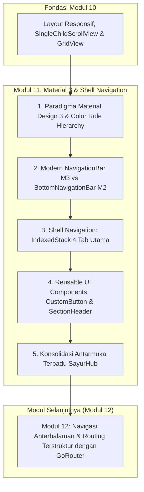
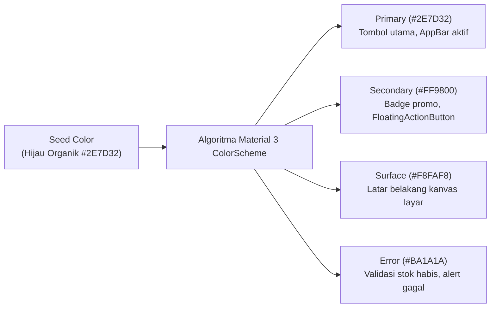
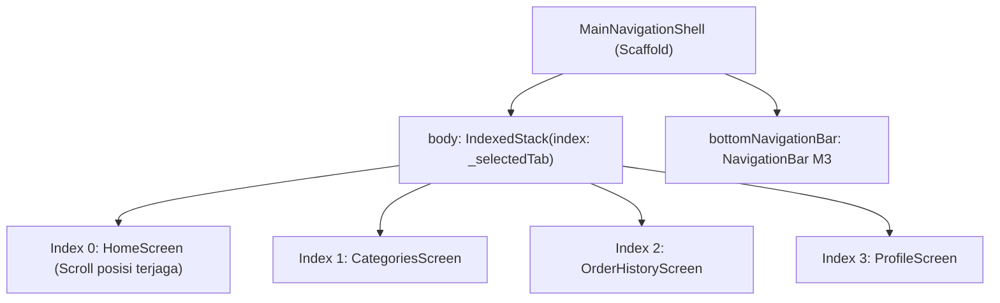

# MODUL 11: DESAIN ANTARMUKA MODERN DENGAN MATERIAL DESIGN 3, REUSABLE COMPONENTS, DAN SHELL NAVIGATION
## PENGEMBANGAN APLIKASI MOBILE MULTIPLATFORM DARI DASAR HINGGA PRODUKSI
### KONSENTRASI KEAHLIAN REKAYASA PERANGKAT LUNAK (SMK RPL)

---

## A. IDENTITAS MODUL

- **Nomor Modul**: 11
- **Judul Modul**: Desain Antarmuka Modern dengan Material Design 3, Reusable Components, dan Shell Navigation
- **Tingkat Kesulitan**: Menengah (*Intermediate*)
- **Estimasi Waktu**: 6 Jam Pelajaran (6 × 45 Menit = 270 Menit)
- **Prasyarat**: Modul 10 (Tata Letak Multidimensi Layout dan Desain Antarmuka Responsif pada Flutter)
- **Tujuan Pembelajaran**:
  1. Siswa memahami filosofi dan panduan desain resmi **Material Design 3 (M3)** dari Google serta peran peran warna (*Color Roles: Primary, Secondary, Tertiary, Surface, Error*).
  2. Siswa mampu membedakan komponen navigasi usang (*Legacy M2 BottomNavigationBar*) dengan komponen navigasi modern M3 (**`NavigationBar`** dan **`NavigationDestination`**).
  3. Siswa terampil menyusun kerangka navigasi bersarang (*Shell Navigation Architecture*) 4 menu utama: Beranda, Kategori, Riwayat, dan Profil.
  4. Siswa mampu menciptakan komponen antarmuka mandiri yang dapat digunakan kembali (*Reusable Components*): **`CustomButton`** (tombol rounded dengan indikator loading) dan **`SectionHeader`** (judul bagian dengan tombol aksi).
  5. Siswa mampu menerapkan prinsip *Design System* terpadu agar seluruh tampilan aplikasi **SayurHub** memiliki konsistensi visual, keterbacaan tinggi, dan ramah jangkauan jempol tangan (*thumb-friendly UI*).
- **Kompetensi yang Akan Dicapai**:
  - **Kognitif**: Pemahaman hierarki warna Material 3, arsitektur Shell Navigation berbasis *IndexedStack*, serta standarisasi *Design System*.
  - **Psikomotorik**: Keterampilan merancang komponen UI modular, mengonfigurasi interaksi tab bawah, dan memprogram indikator status tombol dinamis.

---

## B. PETA KONSEP



- **Keterkaitan dengan Modul 10**: Halaman `HomeScreen` responsif yang telah selesai di Modul 10 kini ditempatkan sebagai Tab pertama di dalam kerangka navigasi utama aplikasi.
- **Keterkaitan dengan Modul 12**: Kerangka 4 tab yang dibangun pada modul ini akan dihubungkan dengan sistem routing deklaratif *GoRouter* pada Modul 12 untuk mendukung pengiriman parameter dan navigasi URL bersih.

---

## C. MATERI TEORI

### 1. Mengenal Material Design 3 (Material You)
**Material Design 3 (M3)** adalah standar panduan desain antarmuka terbaru yang dirilis oleh Google. M3 menitikberatkan pada tiga pilar utama:
- **Personal & Dinamis**: Warna antarmuka beradaptasi secara harmonis melalui palet warna matematis (*Tonal Palette*).
- **Bentuk Geometris Ekspresif**: Sudut-sudut komponen dibuat lebih tumpul melengkung (*rounded corners* yang lebih besar) memberikan kesan ramah dan modern.
- **Hierarki Jelas & Aksesibilitas**: Kontras teks dan ikon dioptimasi agar mudah dibaca oleh semua orang dalam berbagai kondisi pencahayaan.



---

### 2. Mengapa Beralih dari `BottomNavigationBar` ke `NavigationBar` M3?

Siswa SMK RPL sering melihat tutorial lama di internet yang masih menggunakan widget `BottomNavigationBar`.  
Di standar Flutter 3+ modern, widget tersebut telah digantikan oleh **`NavigationBar`**:

| Aspek Komparasi | BottomNavigationBar (Material 2 Lama) | NavigationBar (Material 3 Modern) |
|---|---|---|
| **Indikator Tab Aktif** | Hanya mengubah warna ikon | **Memiliki pil kapsul melayang (*Pill Indicator*) di belakang ikon** |
| **Bentuk & Ergonomi** | Kaku dan tinggi sempit | **Tinggi 80 dp ideal untuk jangkauan jempol tangan (*Thumb-friendly*)** |
| **Animasi Transisi** | Sederhana / Tanpa transisi halus | **Animasi perpindahan pil kapsul dan skala ikon yang sangat halus** |
| **Standar Industri 2024–2026**| Ditinggalkan (*Legacy*) | **Rekomendasi Wajib Google & Flutter Team** |

```dart
// Sintaks Modern Material 3:
NavigationBar(
  selectedIndex: currentIndex,
  onDestinationSelected: (index) => setState(() => currentIndex = index),
  destinations: const [
    NavigationDestination(icon: Icon(Icons.home_outlined), selectedIcon: Icon(Icons.home), label: 'Beranda'),
    NavigationDestination(icon: Icon(Icons.category_outlined), selectedIcon: Icon(Icons.category), label: 'Kategori'),
    NavigationDestination(icon: Icon(Icons.receipt_long_outlined), selectedIcon: Icon(Icons.receipt_long), label: 'Pesanan'),
    NavigationDestination(icon: Icon(Icons.person_outline), selectedIcon: Icon(Icons.person), label: 'Profil'),
  ],
)
```

---

### 3. Arsitektur Shell Navigation dengan `IndexedStack`

Ketika pengguna berpindah tab dari **Beranda** ke **Profil**, lalu kembali lagi ke **Beranda**:
- Jika kita menghancurkan halaman Beranda dan membangunnya kembali dari nol, maka **posisi scroll halaman dan produk yang sedang dilihat pembeli akan hilang kembali ke atas**! Ini merusak kenyamanan pengguna (*Poor User Experience*).
- **Solusi Industri**: Gunakan widget **`IndexedStack`**.  
  `IndexedStack` menjaga seluruh 4 halaman tetap hidup di memori RAM dan hanya menampilkan satu halaman yang aktif di permukaan layar. Hasilnya: posisi scroll dan status filter sayur tetap terjaga sempurna saat pengguna berpindah-pindah tab!



---

### 4. Membangun Reusable Components yang Konsisten

Dalam tim pengembangan software profesional, tombol dan judul bagian tidak boleh dibuat dengan gaya (*styling*) yang berbeda-beda di setiap halaman. Kita menerapkan prinsip **DRY (Don't Repeat Yourself)** dengan membuat komponen antarmuka mandiri:

1. **`CustomButton`**:
   Tombol utama dengan sudut melengkung 14 dp, mendukung teks tebal, ikon opsional, dan yang paling penting: **Status Loading Terpadu**.  
   Saat tombol diklik dan sedang memproses transaksi (`isLoading: true`), tombol secara otomatis menonaktifkan klik dan menampilkan animasi spinner melingkar (*CircularProgressIndicator*) putih untuk mencegah pengguna melakukan klik ganda (*double tapping*).
2. **`SectionHeader`**:
   Baris judul bagian yang memuat teks tebal di sebelah kiri dan tombol aksi "Lihat Semua" berwarna hijau di sebelah kanan.

---

## D. PEMBAHASAN KODE PROGRAM: DUA KOMPONEN REUSABLE SAYURHUB

### 1. Komponen: `CustomButton`
```dart
class CustomButton extends StatelessWidget {
  final String text;
  final VoidCallback? onPressed;
  final bool isLoading;
  final IconData? icon;

  const CustomButton({
    super.key,
    required this.text,
    required this.onPressed,
    this.isLoading = false,
    this.icon,
  });

  @override
  Widget build(BuildContext context) {
    return SizedBox(
      width: double.infinity,
      height: 50,
      child: ElevatedButton(
        onPressed: isLoading ? null : onPressed,
        style: ElevatedButton.styleFrom(
          backgroundColor: AppColors.primaryGreen,
          foregroundColor: Colors.white,
          shape: RoundedRectangleBorder(borderRadius: BorderRadius.circular(14)),
          elevation: 0,
        ),
        child: isLoading
            ? const SizedBox(
                width: 22,
                height: 22,
                child: CircularProgressIndicator(strokeWidth: 2.5, color: Colors.white),
              )
            : Row(
                mainAxisAlignment: MainAxisAlignment.center,
                children: [
                  if (icon != null) ...[Icon(icon, size: 20), const SizedBox(width: 8)],
                  Text(text, style: const TextStyle(fontWeight: FontWeight.bold, fontSize: 15)),
                ],
              ),
      ),
    );
  }
}
```

### Penjelasan Bagian Penting:
- **`onPressed: isLoading ? null : onPressed`**: Memberikan nilai `null` pada parameter `onPressed` otomatis mengubah tombol menjadi berstatus *Disabled* (mati). Ini adalah standar keamanan industri untuk mencegah duplikasi pesanan saat jaringan lambat.
- **`if (icon != null) ...[...]`**: Menggunakan fitur *Collection-if* dan *Spread Operator* dari Modul 05 untuk menyisipkan ikon hanya jika pengembang mengisi parameter `icon`.

---

## E. PERSIAPAN PRAKTIKUM

1. **Perangkat Lunak**:
   - Visual Studio Code dengan ekstensi Flutter aktif.
2. **Kondisi Awal Proyek**:
   - Repositori `sayur_hub` dari Modul 10 berada dalam status Git bersih.
3. **Struktur File yang Akan Dibuat**:
   - `sayur_hub/lib/shared/widgets/custom_button.dart`
   - `sayur_hub/lib/shared/widgets/section_header.dart`
   - `sayur_hub/lib/features/main_navigation_shell.dart` (Kerangka navigasi utama 4 tab).
   - `sayur_hub/lib/features/category/categories_screen.dart` (Layar Tab Kategori).
   - `sayur_hub/lib/features/orders/order_history_screen.dart` (Layar Tab Riwayat Transaksi).
   - `sayur_hub/lib/features/profile/profile_screen.dart` (Layar Tab Profil Pengguna).
   - Pembaruan `sayur_hub/lib/main.dart` untuk menjadikan `MainNavigationShell` sebagai root home.

---

## F. LANGKAH PRAKTIKUM STEP-BY-STEP

### Langkah 1 — Membuat Komponen `CustomButton`

1. Buat file baru di `lib/shared/widgets/custom_button.dart`.
2. Tuliskan kode tombol terpadu lengkap dengan indikator loading:

```dart
// File: sayur_hub/lib/shared/widgets/custom_button.dart
import 'package:flutter/material.dart';
import 'package:sayur_hub/core/theme/app_colors.dart';

/// Tombol aksi standar produksi aplikasi SayurHub
/// Mendukung ikon opsional, penonaktifan otomatis saat loading, dan sudut tumpul M3
class CustomButton extends StatelessWidget {
  final String text;
  final VoidCallback? onPressed;
  final bool isLoading;
  final IconData? icon;
  final Color? backgroundColor;

  const CustomButton({
    super.key,
    required this.text,
    required this.onPressed,
    this.isLoading = false,
    this.icon,
    this.backgroundColor,
  });

  @override
  Widget build(BuildContext context) {
    final Color buttonColor = backgroundColor ?? AppColors.primaryGreen;

    return SizedBox(
      width: double.infinity,
      height: 50,
      child: ElevatedButton(
        onPressed: isLoading ? null : onPressed,
        style: ElevatedButton.styleFrom(
          backgroundColor: buttonColor,
          foregroundColor: Colors.white,
          disabledBackgroundColor: buttonColor.withOpacity(0.6),
          shape: RoundedRectangleBorder(
            borderRadius: BorderRadius.circular(14),
          ),
          elevation: 0,
        ),
        child: isLoading
            ? const SizedBox(
                width: 22,
                height: 22,
                child: CircularProgressIndicator(
                  strokeWidth: 2.5,
                  valueColor: AlwaysStoppedAnimation<Color>(Colors.white),
                ),
              )
            : Row(
                mainAxisAlignment: MainAxisAlignment.center,
                mainAxisSize: MainAxisSize.min,
                children: [
                  if (icon != null) ...[
                    Icon(icon, size: 20),
                    const SizedBox(width: 8),
                  ],
                  Text(
                    text,
                    style: const TextStyle(
                      fontSize: 15,
                      fontWeight: FontWeight.bold,
                      letterSpacing: 0.3,
                    ),
                  ),
                ],
              ),
      ),
    );
  }
}
```

---

### Langkah 2 — Membuat Komponen `SectionHeader`

1. Buat file baru di `lib/shared/widgets/section_header.dart`.
2. Tuliskan kode baris judul bagian:

```dart
// File: sayur_hub/lib/shared/widgets/section_header.dart
import 'package:flutter/material.dart';
import 'package:sayur_hub/core/theme/app_colors.dart';

/// Komponen judul bagian dengan tombol aksi sekunder di sisi kanan
class SectionHeader extends StatelessWidget {
  final String title;
  final String? actionText;
  final VoidCallback? onActionTap;

  const SectionHeader({
    super.key,
    required this.title,
    this.actionText,
    this.onActionTap,
  });

  @override
  Widget build(BuildContext context) {
    return Row(
      mainAxisAlignment: MainAxisAlignment.spaceBetween,
      children: [
        Text(
          title,
          style: Theme.of(context).textTheme.titleLarge?.copyWith(
                fontSize: 17,
                fontWeight: FontWeight.bold,
                color: AppColors.textDark,
              ),
        ),
        if (actionText != null && onActionTap != null)
          InkWell(
            onTap: onActionTap,
            borderRadius: BorderRadius.circular(6),
            child: Padding(
              padding: const EdgeInsets.symmetric(horizontal: 4.0, vertical: 2.0),
              child: Text(
                actionText!,
                style: const TextStyle(
                  color: AppColors.primaryGreen,
                  fontSize: 13,
                  fontWeight: FontWeight.w600,
                ),
              ),
            ),
          ),
      ],
    );
  }
}
```

---

### Langkah 3 — Menyiapkan Tiga Layar Tab Pendamping

1. Buat direktori dan file untuk Tab Kategori di `lib/features/category/categories_screen.dart`:
```dart
// File: sayur_hub/lib/features/category/categories_screen.dart
import 'package:flutter/material.dart';
import 'package:sayur_hub/core/mock/mock_produce_data.dart';
import 'package:sayur_hub/core/theme/app_colors.dart';
import 'package:sayur_hub/core/utils/catalog_processor.dart';

class CategoriesScreen extends StatelessWidget {
  const CategoriesScreen({super.key});

  @override
  Widget build(BuildContext context) {
    final categories = CatalogProcessor.getProduceCategories(MockProduceData.products).toList();

    return Scaffold(
      appBar: AppBar(title: const Text('Kategori Sayur & Buah')),
      body: ListView.separated(
        padding: const EdgeInsets.all(16),
        itemCount: categories.length,
        separatorBuilder: (_, __) => const SizedBox(height: 10),
        itemBuilder: (context, index) {
          final cat = categories[index];
          return Card(
            elevation: 0,
            shape: RoundedRectangleBorder(
              borderRadius: BorderRadius.circular(14),
              side: BorderSide(color: Colors.grey.shade200),
            ),
            child: ListTile(
              leading: Container(
                padding: const EdgeInsets.all(10),
                decoration: BoxDecoration(
                  color: AppColors.primaryGreen.withOpacity(0.1),
                  shape: BoxShape.circle,
                ),
                child: const Icon(Icons.eco_rounded, color: AppColors.primaryGreen),
              ),
              title: Text(cat, style: const TextStyle(fontWeight: FontWeight.bold)),
              trailing: const Icon(Icons.arrow_forward_ios_rounded, size: 16),
              onTap: () {},
            ),
          );
        },
      ),
    );
  }
}
```

2. Buat direktori dan file untuk Tab Riwayat Pesanan di `lib/features/orders/order_history_screen.dart`:
```dart
// File: sayur_hub/lib/features/orders/order_history_screen.dart
import 'package:flutter/material.dart';
import 'package:sayur_hub/core/models/order_status.dart';
import 'package:sayur_hub/core/theme/app_colors.dart';

class OrderHistoryScreen extends StatelessWidget {
  const OrderHistoryScreen({super.key});

  @override
  Widget build(BuildContext context) {
    return Scaffold(
      appBar: AppBar(title: const Text('Riwayat Belanja')),
      body: Center(
        child: Padding(
          padding: const EdgeInsets.all(24.0),
          child: Column(
            mainAxisAlignment: MainAxisAlignment.center,
            children: [
              Container(
                padding: const EdgeInsets.all(20),
                decoration: BoxDecoration(
                  color: AppColors.accentOrange.withOpacity(0.12),
                  shape: BoxShape.circle,
                ),
                child: const Icon(Icons.receipt_long_rounded, size: 54, color: AppColors.accentOrange),
              ),
              const SizedBox(height: 16),
              const Text(
                'Belum Ada Pesanan Aktif',
                style: TextStyle(fontSize: 18, fontWeight: FontWeight.bold),
              ),
              const SizedBox(height: 8),
              const Text(
                'Sayuran segar Anda yang sedang dipetik atau dikirim kurir akan muncul di sini.',
                style: TextStyle(color: AppColors.textMuted, fontSize: 13),
                textAlign: TextAlign.center,
              ),
            ],
          ),
        ),
      ),
    );
  }
}
```

3. Buat direktori dan file untuk Tab Profil di `lib/features/profile/profile_screen.dart`:
```dart
// File: sayur_hub/lib/features/profile/profile_screen.dart
import 'package:flutter/material.dart';
import 'package:sayur_hub/core/theme/app_colors.dart';
import 'package:sayur_hub/shared/widgets/custom_button.dart';

class ProfileScreen extends StatelessWidget {
  const ProfileScreen({super.key});

  @override
  Widget build(BuildContext context) {
    return Scaffold(
      appBar: AppBar(title: const Text('Profil Pengguna')),
      body: SingleChildScrollView(
        padding: const EdgeInsets.all(20),
        child: Column(
          children: [
            const Center(
              child: CircleAvatar(
                radius: 46,
                backgroundColor: AppColors.primaryGreen,
                child: Icon(Icons.person_rounded, size: 54, color: Colors.white),
              ),
            ),
            const SizedBox(height: 14),
            const Text(
              'Siti Nurhaliza',
              style: TextStyle(fontSize: 20, fontWeight: FontWeight.bold),
            ),
            const Text(
              'siti@smkrpl.sch.id | +62 812-3456-7890',
              style: TextStyle(color: AppColors.textMuted, fontSize: 13),
            ),
            const SizedBox(height: 28),
            ListTile(
              leading: const Icon(Icons.location_on_outlined, color: AppColors.primaryGreen),
              title: const Text('Alamat Rumah Terdaftar'),
              subtitle: const Text('Jl. Merdeka No. 45, Bandung Barat'),
              trailing: const Icon(Icons.edit_outlined, size: 18),
              onTap: () {},
            ),
            const Divider(),
            ListTile(
              leading: const Icon(Icons.lock_outline_rounded, color: AppColors.primaryGreen),
              title: const Text('Keamanan & Kata Sandi'),
              trailing: const Icon(Icons.arrow_forward_ios_rounded, size: 16),
              onTap: () {},
            ),
            const Divider(),
            ListTile(
              leading: const Icon(Icons.help_outline_rounded, color: AppColors.primaryGreen),
              title: const Text('Pusat Bantuan & Petani Mitra'),
              trailing: const Icon(Icons.arrow_forward_ios_rounded, size: 16),
              onTap: () {},
            ),
            const SizedBox(height: 32),
            CustomButton(
              text: 'Keluar dari Akun',
              icon: Icons.logout_rounded,
              backgroundColor: Colors.red.shade700,
              onPressed: () {
                ScaffoldMessenger.of(context).showSnackBar(
                  const SnackBar(content: Text('Sesi logout akan diaktifkan di Modul 17!')),
                );
              },
            ),
          ],
        ),
      ),
    );
  }
}
```

---

### Langkah 4 — Membangun `MainNavigationShell` (Material 3 Shell)

1. Buat file baru di `lib/features/main_navigation_shell.dart`.
2. Tuliskan arsitektur navigasi tab bawah berbasis M3:

```dart
// File: sayur_hub/lib/features/main_navigation_shell.dart
import 'package:flutter/material.dart';
import 'package:sayur_hub/core/theme/app_colors.dart';
import 'package:sayur_hub/features/category/categories_screen.dart';
import 'package:sayur_hub/features/home/home_screen.dart';
import 'package:sayur_hub/features/orders/order_history_screen.dart';
import 'package:sayur_hub/features/profile/profile_screen.dart';

/// Kerangka navigasi utama aplikasi SayurHub (Shell Navigation)
/// Memadukan IndexedStack untuk preservasi state halaman dan NavigationBar M3
class MainNavigationShell extends StatefulWidget {
  const MainNavigationShell({super.key});

  @override
  State<MainNavigationShell> createState() => _MainNavigationShellState();
}

class _MainNavigationShellState extends State<MainNavigationShell> {
  int _activeTabIndex = 0;

  // Daftar 4 halaman utama yang dikelola dalam memori
  final List<Widget> _screens = const [
    HomeScreen(),
    CategoriesScreen(),
    OrderHistoryScreen(),
    ProfileScreen(),
  ];

  @override
  Widget build(BuildContext context) {
    return Scaffold(
      // IndexedStack menjaga posisi scroll dan status memori pada setiap tab
      body: IndexedStack(
        index: _activeTabIndex,
        children: _screens,
      ),
      bottomNavigationBar: NavigationBar(
        selectedIndex: _activeTabIndex,
        onDestinationSelected: (int selectedIndex) {
          setState(() {
            _activeTabIndex = selectedIndex;
          });
        },
        elevation: 3,
        backgroundColor: Colors.white,
        indicatorColor: AppColors.primaryGreen.withOpacity(0.18),
        destinations: const [
          NavigationDestination(
            icon: Icon(Icons.home_outlined),
            selectedIcon: Icon(Icons.home_rounded, color: AppColors.primaryGreen),
            label: 'Beranda',
          ),
          NavigationDestination(
            icon: Icon(Icons.grid_view_rounded),
            selectedIcon: Icon(Icons.grid_view_sharp, color: AppColors.primaryGreen),
            label: 'Kategori',
          ),
          NavigationDestination(
            icon: Icon(Icons.receipt_long_outlined),
            selectedIcon: Icon(Icons.receipt_long_rounded, color: AppColors.primaryGreen),
            label: 'Pesanan',
          ),
          NavigationDestination(
            icon: Icon(Icons.person_outline_rounded),
            selectedIcon: Icon(Icons.person_rounded, color: AppColors.primaryGreen),
            label: 'Profil',
          ),
        ],
      ),
    );
  }
}
```

---

### Langkah 5 — Memperbarui `lib/main.dart`

1. Buka file `lib/main.dart`.
2. Arahkan properti `home:` ke `MainNavigationShell`:

```dart
// File: sayur_hub/lib/main.dart
import 'package:flutter/material.dart';
import 'package:sayur_hub/core/theme/app_theme.dart';
import 'package:sayur_hub/features/main_navigation_shell.dart';

void main() {
  runApp(const SayurHubRootApp());
}

/// Root Widget aplikasi SayurHub
class SayurHubRootApp extends StatelessWidget {
  const SayurHubRootApp({super.key});

  @override
  Widget build(BuildContext context) {
    return MaterialApp(
      title: 'SayurHub',
      debugShowCheckedModeBanner: false,
      theme: AppTheme.lightTheme,
      home: const MainNavigationShell(),
    );
  }
}
```

---

## G. ANALISIS DAN PEMAHAMAN

Jawablah pertanyaan analisis berikut:

1. **Analisis Memori IndexedStack**: Jelaskan kelebihan dan kekurangan menggunakan `IndexedStack` dibandingkan jika kita merender halaman dengan `_screens[_activeTabIndex]` biasa! Mengapa `IndexedStack` menjadi pilihan nomor satu untuk aplikasi e-commerce?
2. **Analisis Material 3 Color Roles**: Di `AppTheme`, warna utama SayurHub disetel ke `seedColor: AppColors.primaryGreen`. Jelaskan bagaimana Material 3 secara otomatis menghasilkan warna `indicatorColor` pada pil kapsul tab aktif tanpa kita harus mendefinisikan kodenya secara manual!
3. **Analisis UX (Preventing Double Tap)**: Pada komponen `CustomButton`, mengapa saat `isLoading` bernilai `true`, tombol langsung mematikan callback `onPressed: null`? Sebutkan kerugian finansial yang bisa terjadi di aplikasi SayurHub jika tombol "Bayar Pesanan" tidak dinonaktifkan saat sedang memproses transaksi!

---

## H. LATIHAN DAN TANTANGAN

### 1. Soal Teori
1. Widget bilah navigasi bawah resmi pada Material Design 3 yang menggantikan widget `BottomNavigationBar` lama adalah:
   - A. `TabBarView`
   - B. `CupertinoTabBar`
   - C. `NavigationBar`
   - D. `BottomAppBar`
2. Widget yang digunakan untuk membungkus beberapa halaman di mana seluruh halaman tetap tersimpan di memori dan hanya satu indeks yang ditampilkan ke layar adalah:
   - A. `Stack`
   - B. `IndexedStack`
   - C. `PageView`
   - D. `ViewFlipper`
3. Komponen destinasi item di dalam widget `NavigationBar` didefinisikan menggunakan widget:
   - A. `BottomNavigationBarItem`
   - B. `NavigationDestination`
   - C. `TabItem`
   - D. `BarItem`
4. Bagaimana cara mengubah sebuah tombol `ElevatedButton` agar menjadi berstatus mati (*disabled*) di Flutter?
5. Jelaskan mengapa konsistensi desain antarmuka (*Design System*) sangat mempengaruhi tingkat kepercayaan konsumen saat berbelanja online!

### 2. Soal Praktik
1. **Badge Notifikasi pada Tab Pesanan**: Tambahkan widget `Badge(label: Text('2'), child: Icon(Icons.receipt_long_outlined))` pada item tab Pesanan di `MainNavigationShell` untuk menyimulasikan adanya 2 pesanan sayur yang sedang diantar kurir.
2. **Animasi Loading Tombol**: Pada halaman `ProfileScreen`, buat tombol "Keluar dari Akun" menyimulasikan proses logout selama 2 detik dengan menyetel `isLoading: true` saat tombol diklik.
3. **Penyempurnaan SectionHeader Beranda**: Ganti teks judul "Katalog Komoditas" di `HomeScreen` menggunakan komponen `SectionHeader(title: 'Katalog Sayur & Buah', actionText: 'Lihat Semua', onActionTap: () {})`.

### 3. Tantangan Pemecahan Masalah (*Problem-Solving Challenges*)
- **Tantangan 1 (Double Back to Exit)**: Di smartphone Android, jika pengguna berada di Tab selain Beranda (misal: di Tab Profil) lalu menekan tombol kembali (*Back button* fisik HP), aplikasi idealnya berpindah kembali ke Tab Beranda, bukan langsung menutup aplikasi. Rancanglah solusi menggunakan widget `PopScope` (pengganti `WillPopScope`) pada `MainNavigationShell`!
- **Tantangan 2 (Dynamic Badge Clear)**: Rancanglah alur di mana angka badge notifikasi pada tab Pesanan otomatis hilang (*cleared*) ketika pengguna mengklik tab Pesanan tersebut!

### 4. Studi Kasus Industri
**Studi Kasus**: Uji coba pengguna menunjukkan beberapa lansia kesulitan membaca teks label di bawah ikon tab navigasi karena ukurannya terlalu kecil.  
*Tugas Siswa*: Rancanglah penyesuaian gaya teks navigasi di `AppTheme` dengan menambahkan `navigationBarTheme: NavigationBarThemeData(labelTextStyle: ...)` untuk menaikkan ukuran font label tab menjadi 13 dp dengan ketebalan `FontWeight.w600`!

---

## I. TROUBLESHOOTING & FAQ

Berikut adalah tabel permasalahan umum desain M3 dan Shell Navigation beserta solusinya:

| Permasalahan Teknis | Penyebab Utama | Cara Identifikasi | Solusi Tepat |
|---|---|---|---|
| **Pesan Error "IndexedStack index out of range"** | Nilai `selectedIndex` lebih besar dari jumlah anak di dalam list `children: _screens`. | Layar crash merah saat tab diklik dengan error *RangeError (index)*. | Pastikan jumlah `NavigationDestination` sama persis dengan jumlah widget di dalam list `_screens` (ada 4 destinasi dan 4 layar). |
| **Ikon Tab NavigationBar Terpotong / Hilang** | Menggunakan widget `BottomNavigationBarItem` di dalam `NavigationBar` M3. | Error tipe kompilasi: *The argument type 'BottomNavigationBarItem' can't be assigned*. | Ganti seluruh item menggunakan widget resmi M3: **`NavigationDestination`**. |
| **Warna Tombol Tidak Mengikuti Tema Hijau SayurHub** | Menggunakan widget tombol kustom lama yang tidak membaca `Theme.of(context).colorScheme`. | Tombol tampil dengan warna biru standar Flutter bawaan. | Gunakan `AppColors.primaryGreen` atau `Theme.of(context).colorScheme.primary` sebagai warna latar tombol. |
| **Posisi Scroll Reset Tiap Pindah Tab** | Menggunakan percabangan `body: _screens[_activeTabIndex]` langsung di Scaffold alih-alih `IndexedStack`. | Pengguna membaca produk di posisi scroll bawah, saat pindah tab profil lalu balik ke beranda posisi scroll kembali ke paling atas. | Bungkus list layar dengan widget **`IndexedStack(index: _activeTabIndex, children: _screens)`**. |

---

## J. PRAKTIKUM INTEGRASI ANTAR-MODUL: SHELL NAVIGATION SAYURHUB

Pada praktikum integrasi Modul 11, kita menyatukan seluruh halaman dan komponen SayurHub ke dalam satu kesatuan sistem antarmuka modern yang siap diedarkan ke pengguna.

### 1. Judul Praktikum Integrasi
**Pembangunan Kerangka Navigasi Shell 4 Tab dan Komponen Antarmuka Mandiri Standar Material 3 SayurHub**

### 2. Tujuan Praktikum Integrasi
- Membangun komponen reusable `CustomButton` dan `SectionHeader` di `lib/shared/widgets/`.
- Membangun 3 halaman pendamping: `CategoriesScreen`, `OrderHistoryScreen`, dan `ProfileScreen`.
- Membangun `MainNavigationShell` dengan 4 destinasi tab M3 terpadu (`NavigationBar`).
- Mengintegrasikan seluruh tab ke `lib/main.dart` tanpa error linter.

### 3. Materi yang Diintegrasikan
- Model entitas `Product` & `OrderStatus` dari Modul 06.
- Katalog responsif `HomeScreen` dari Modul 10.
- Desain sistem Material Design 3 dan Shell Navigation dari Modul 11.

### 4. Kondisi Awal Proyek (*Project State Before*)
Aplikasi hanya menampilkan `HomeScreen` tunggal tanpa menu navigasi bawah untuk mengakses kategori, riwayat pesanan, atau profil akun.

### 5. Instruksi Langkah Demi Langkah
1. Buat file `lib/shared/widgets/custom_button.dart`.
2. Buat file `lib/shared/widgets/section_header.dart`.
3. Buat folder dan file `lib/features/category/categories_screen.dart`.
4. Buat folder dan file `lib/features/orders/order_history_screen.dart`.
5. Buat folder dan file `lib/features/profile/profile_screen.dart`.
6. Buat file `lib/features/main_navigation_shell.dart`.
7. Perbarui `lib/main.dart` untuk mengarahkan `home:` ke `MainNavigationShell`.
8. Lakukan uji coba static analysis:
   ```bash
   flutter analyze
   ```
9. Uji coba langsung di smartphone fisik atau emulator:
   - Ketuk tab **Kategori** $\to$ Layar berpindah ke daftar kategori sayur.
   - Ketuk tab **Pesanan** $\to$ Layar berpindah ke riwayat pesanan kosong.
   - Ketuk tab **Profil** $\to$ Layar berpindah ke profil Siti Nurhaliza.
   - Ketuk kembali tab **Beranda** $\to$ Perhatikan posisi filter kategori dan produk tetap berada di posisi terakhir tanpa reload!
10. Simpan dan commit seluruh pekerjaan ke repositori Git:
    ```bash
    git add .
    git commit -m "feat(ui): implement M3 NavigationBar shell with 4 tabs and reusable CustomButton"
    ```

---

### 6. Hasil yang Diharapkan
1. Aplikasi SayurHub kini memiliki bilah navigasi bawah modern standar Material Design 3 dengan 4 tab interaktif lengkap dengan indikator pil hijau kapsul.
2. Posisi scroll dan status filter pada halaman Beranda tidak pernah hilang saat pengguna menjelajahi tab lain.
3. Seluruh tombol di halaman profil dan beranda memiliki konsistensi bentuk sudut tumpul dan tipografi yang harmonis.
4. Linter melaporkan `No issues found!`.

### 7. Kriteria Keberhasilan
- [x] File `custom_button.dart` dan `section_header.dart` terimplementasi di `lib/shared/widgets/`.
- [x] Tiga layar pendamping (`categories_screen.dart`, `order_history_screen.dart`, `profile_screen.dart`) terhubung.
- [x] `MainNavigationShell` menggunakan `NavigationBar` M3 dan `IndexedStack`.
- [x] Perintah `flutter analyze` menghasilkan `0 issues / 0 warnings`.

---

## K. EVALUASI MODUL 11

### 1. Rubrik Penilaian Desain Sistem dan Navigasi Shell
| Aspek Evaluasi | Skor Maksimal | Indikator Ketercapaian |
|---|---|---|
| **Penerapan Standar Material Design 3** | 25 | Menggunakan komponen resmi M3 (`NavigationBar`, `NavigationDestination`, sudut rounded tumpul) secara konsisten. |
| **Kualitas Arsitektur Shell Navigation** | 25 | Menggunakan `IndexedStack` untuk menjaga status memori dan posisi scroll tiap tab dengan presisi. |
| **Kualitas Reusable Components** | 25 | Komponen `CustomButton` dan `SectionHeader` terenkapsulasi baik dengan penanganan status loading aman. |
| **Kerapian Antarmuka & Kepatuhan Brand SayurHub** | 25 | Mengikuti palet warna hijau daun (`#2E7D32`), tipografi Poppins seragam, dan tata letak thumb-friendly. |
| **Total Skor** | **100** | **Kriteria Ketuntasan Minimal (KKM): 75** |

### 2. Soal Uji Debugging Navigasi
*Seorang siswa menulis kode navigasi tab berikut:*
```dart
int currentIndex = 0;

Widget build(BuildContext context) {
  return Scaffold(
    body: _screens[currentIndex],
    bottomNavigationBar: NavigationBar(
      selectedIndex: currentIndex,
      onDestinationSelected: (idx) {
        currentIndex = idx; // Baris X
      },
      destinations: [...],
    ),
  );
}
```
- **Pertanyaan**: Ketika tab diklik, indikator pil kapsul tidak berpindah dan layar tidak berganti. Mengapa hal ini terjadi dan bagaimana memperbaikinya?
- **Kunci Jawaban**:
  1. *Penyebab*: Variabel `currentIndex` diubah tanpa dibungkus di dalam pemanggilan method `setState()`. Framework Flutter tidak mengetahui bahwa indeks telah berubah, sehingga method `build()` tidak dijalankan ulang.
  2. *Perbaikan*:
     ```dart
     onDestinationSelected: (idx) {
       setState(() {
         currentIndex = idx;
       });
     }
     ```

---

## L. KESIMPULAN DAN JEMBATAN KE MODUL BERIKUTNYA

### Rangkuman Kompetensi:
Melalui Modul 11 ini, Anda telah berhasil membangun fondasi antarmuka berstandar industri:
1. Memahami panduan resmi **Material Design 3 (M3)** dan pembagian peran warna *ColorScheme*.
2. Membedah keunggulan **`NavigationBar`** M3 dibandingkan komponen navigasi lawas.
3. Menguasai arsitektur **Shell Navigation** berbasis `IndexedStack` untuk mengelola 4 tab utama tanpa kehilangan state memori.
4. Menciptakan komponen reusable mandiri: **`CustomButton`** (dengan indikator loading) dan **`SectionHeader`**.

### Penghubung Menuju Modul 12:
Aplikasi SayurHub kita sekarang sudah memiliki 4 tab utama yang kokoh. Namun, bagaimana jika pengguna mengetuk salah satu kartu sayur di katalog dan ingin membuka **Halaman Detail Produk (`/product/PROD-001`)** secara terpisah, atau membuka **Halaman Keranjang Belanja (`/cart`)**?

Kita tidak bisa lagi hanya mengandalkan tab bawah; kita memerlukan sistem routing antarhalaman yang terstruktur!

Pada **Modul 12: Navigasi Antarhalaman dan Routing Terstruktur dengan GoRouter**, kita akan mempelajari:
- Konsep Navigasi Tumpukan Kartu (*Navigator Stack Push & Pop*).
- Mengimplementasikan routing deklaratif modern rekomendasi resmi Flutter: **`go_router`**.
- Mengirimkan parameter ID produk dan mengoper objek entitas data antarhalaman secara aman (*Type-Safe Object Passing*).
- Merancang halaman penanganan rute tidak ditemukan (*Custom 404 Page*)!
