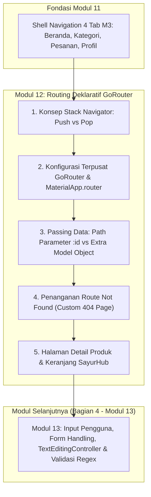
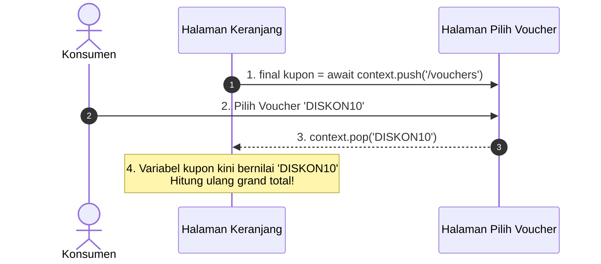

# MODUL 12: NAVIGASI ANTARHALAMAN, DEEP LINKING, DAN ROUTING DEKLARATIF DENGAN GOROUTER
## PENGEMBANGAN APLIKASI MOBILE MULTIPLATFORM DARI DASAR HINGGA PRODUKSI
### KONSENTRASI KEAHLIAN REKAYASA PERANGKAT LUNAK (SMK RPL)

---

## A. IDENTITAS MODUL

- **Nomor Modul**: 12
- **Judul Modul**: Navigasi Antarhalaman, Deep Linking, dan Routing Deklaratif dengan GoRouter
- **Tingkat Kesulitan**: Menengah (*Intermediate*)
- **Estimasi Waktu**: 6 Jam Pelajaran (6 × 45 Menit = 270 Menit)
- **Prasyarat**: Modul 11 (Desain Antarmuka Modern dengan Material Design 3, Reusable Components, dan Shell Navigation)
- **Tujuan Pembelajaran**:
  1. Siswa memahami konsep tumpukan navigasi (*Navigator Stack*) dengan operasi dorong (*Push*) dan lepas (*Pop*).
  2. Siswa memahami kelemahan Navigasi Imperatif (Navigator 1.0) dan keunggulan Navigasi Deklaratif modern (Navigator 2.0) berbasis paket resmi **`go_router`**.
  3. Siswa terampil mengonfigurasi `GoRouter`, mendefinisikan rute utama, sub-rute (*nested routes*), serta menghubungkannya ke `MaterialApp.router`.
  4. Siswa mampu mengirim dan membaca data antarhalaman menggunakan dua mekanisme: **Path Parameters** (`/product/:id`) dan **Extra Objects** (mengoper instance kelas model `Product`).
  5. Siswa terampil mengembalikan data hasil (*return value*) dari halaman tujuan ke halaman asal menggunakan `context.pop(result)`.
  6. Siswa mampu merancang halaman penanganan rute tidak ditemukan (*Custom 404 Route Not Found Page*).
  7. Siswa mampu mengaktifkan navigasi lengkap dari Beranda menuju **Halaman Detail Produk (`ProductDetailScreen`)** dan **Halaman Keranjang Belanja (`CartScreen`)** untuk aplikasi **SayurHub**.
- **Kompetensi yang Akan Dicapai**:
  - **Kognitif**: Pemahaman arsitektur *URL-based routing*, *Deep Linking*, dan manajemen tumpukan halaman mobile.
  - **Psikomotorik**: Keterampilan mengonfigurasi berkas router terpusat, mengurai parameter URL secara aman, serta memprogram interaksi tombol *Back* sistemik.

---

## B. PETA KONSEP



- **Keterkaitan dengan Modul 11**: Kerangka `MainNavigationShell` dari Modul 11 kini dijadikan rute akar (`/`) di dalam konfigurasi GoRouter, dan kartu produk dihubungkan untuk membuka layar detail mandiri.
- **Keterkaitan dengan Modul 13**: Kemampuan berpindah halaman ini menjadi pintu pembuka Bagian 4, di mana halaman Checkout dan Registrasi yang memuat formulir input teks akan dibangun pada Modul 13.

---

## C. MATERI TEORI

### 1. Memahami Konsep Tumpukan Navigasi (Navigator Stack)
Navigasi pada aplikasi mobile dianalogikan seperti **Tumpukan Piring di Meja Makan** (Struktur data LIFO — *Last In, First Out*):

```mermaid
flowchart TD
    subgraph StackPush["Operasi Push (Buka Layar Baru)"]
        P1["Layar 1: Beranda"] -->|context.push('/product/PROD-001')| P2["Layar 2: Detail Sayur Bayam\n(Ditumpuk di atas Beranda)"]
    end

    subgraph StackPop["Operasi Pop (Kembali / Back)"]
        P2 -->|context.pop()| P3["Layar 2 Dibuang dari Memori\nLayar 1 (Beranda) Terlihat Kembali"]
    end
```

- **`Push`**: Meletakkan piring (layar) baru di atas tumpukan. Layar baru menjadi aktif dan terlihat di mata pengguna.
- **`Pop`**: Mengambil dan membuang piring teratas dari tumpukan (misalnya saat tombol panah kiri di AppBar ditekan). Layar di bawahnya seketika terlihat kembali.

---

### 2. Mengapa Industri Beralih dari Navigator 1.0 ke `go_router`?

Pada masa awal Flutter, pengembang menggunakan Navigasi Imperatif (Navigator 1.0):
```dart
// Cara Lama (Navigator 1.0 Imperatif):
Navigator.push(context, MaterialPageRoute(builder: (context) => DetailScreen(product: p)));
```
Kelemahan fatal cara lama ini di industri modern:
1. **Tidak Mendukung Deep Linking & Web URL**: Jika aplikasi dibuka di browser web atau pengguna mengklik tautan WhatsApp `https://sayurhub.com/product/PROD-001`, cara lama tidak bisa mengenali URL tersebut secara otomatis.
2. **Sulit Dikelola di Proyek Skala Besar**: Kode navigasi tersebar secara acak di puluhan file widget (*spaghetti routing*).
3. **Ketiadaan Proteksi Rute Terpusat (*Route Guards*)**: Sangat sulit memblokir pengguna yang belum login agar tidak membuka halaman keranjang belanja.

**Solusi Resmi**: Tim Google Flutter kini secara resmi merekomendasikan paket **`go_router`** yang menghadirkan routing deklaratif berbasis URI layaknya aplikasi web modern namun berjalan 100% native di Android dan iOS!

---

### 3. Perbedaan Vital: `context.go()` vs `context.push()`

Salah satu kebingungan terbesar bagi programmer Flutter pemula adalah membedakan dua perintah ini:

| Perintah | Cara Kerja di Tumpukan Layar (*Stack*) | Tombol Back AppBar Muncul? | Use Case di SayurHub |
|---|---|---|---|
| **`context.push('/path')`** | Menumpuk layar baru **di atas layar saat ini**. Layar lama tetap ada di bawahnya. | **Ya (Muncul panah kiri `<-` otomatis)** | Dari Beranda membuka **Detail Produk** atau **Keranjang**. |
| **`context.go('/path')`** | Mengganti **seluruh silsilah tumpukan layar** dengan rute baru dari akar. | **Tidak (Layar lama dibuang)** | Setelah sukses **Login**, pengguna diarahkan ke **Beranda** (tidak boleh ada tombol back ke login!). |

---

### 4. Dua Cara Mengirimkan Data Antarhalaman (Passing Data)

#### A. Menggunakan Path Parameter (`/product/:id`)
Digunakan untuk mengirimkan data pengenal tunggal (*Identifier / ID*):
```dart
GoRoute(
  path: 'product/:id',
  name: 'product-detail',
  builder: (context, state) {
    // Membaca parameter ID dari URL:
    final String productId = state.pathParameters['id']!;
    return ProductDetailScreen(productId: productId);
  },
)
```

#### B. Menggunakan Objek Ekstra (`extra: myProductObject`)
Digunakan ketika kita ingin mengoper seluruh objek data yang kompleks (seperti instance `Product` lengkap dengan nama, harga, dan stok) tanpa harus mengambil ulang (*fetch*) dari internet:
```dart
// Mengirimkan objek dari ProductCard:
context.pushNamed(
  'product-detail',
  pathParameters: {'id': product.id},
  extra: product, // Mengoper objek Product utuh!
);

// Menerima di builder router:
final product = state.extra as Product?;
```

---

### 5. Mengembalikan Data dari Halaman Tujuan (`context.pop(result)`)

Kadang-kadang sebuah halaman dibuka untuk meminta keputusan pengguna (misalnya: membuka halaman pemilih kupon diskon). Saat kupon dipilih, kupon tersebut dikembalikan ke halaman kasir:



---

## D. PEMBAHASAN KODE PROGRAM: ROUTER TERPUSAT SAYURHUB

Mari kita bedah arsitektur berkas router terpadu `app_router.dart`:

```dart
final GoRouter appRouter = GoRouter(
  initialLocation: '/',
  debugLogDiagnostics: true, // Mencetak log navigasi transparan di debug console
  errorBuilder: (context, state) => NotFoundScreen(uri: state.uri.toString()),
  routes: [
    // Rute Akar: Menampilkan Shell Navigation 4 Tab
    GoRoute(
      path: '/',
      name: 'home',
      builder: (context, state) => const MainNavigationShell(),
      routes: [
        // Sub-Rute Detail Produk: /product/:id
        GoRoute(
          path: 'product/:id',
          name: 'product-detail',
          builder: (context, state) {
            final String id = state.pathParameters['id'] ?? '';
            final Product? product = state.extra as Product?;
            return ProductDetailScreen(productId: id, initialProduct: product);
          },
        ),
        // Sub-Rute Keranjang Belanja: /cart
        GoRoute(
          path: 'cart',
          name: 'cart',
          builder: (context, state) => const CartScreen(),
        ),
      ],
    ),
  ],
);
```

### Penjelasan Bagian Penting:
- **`errorBuilder`**: Jika ada salah ketik URL rute (contoh: mencoba membuka `/promoooo`), Flutter tidak akan crash layar merah, melainkan secara anggun menampilkan **`NotFoundScreen` (Halaman 404)**.
- **`routes: [ ... routes: [ ... ] ]`**: Struktur rute bersarang (*hierarchical routing*) yang mencerminkan hubungan induk-anak antarhalaman.

---

## E. PERSIAPAN PRAKTIKUM

1. **Perangkat Lunak**:
   - Visual Studio Code dengan integrasi Flutter.
2. **Kondisi Awal Proyek**:
   - Repositori `sayur_hub` dari Modul 11 berada dalam status Git bersih.
3. **Struktur Folder yang Akan Dibuat**:
   - `sayur_hub/lib/core/routes/` (Rumah bagi konfigurasi navigasi terpusat).
   - `sayur_hub/lib/features/catalog/` (Layar detail produk).
   - `sayur_hub/lib/features/cart/` (Layar keranjang belanja).
4. **File yang Akan Dihasilkan**:
   - `lib/core/routes/app_router.dart`
   - `lib/features/catalog/product_detail_screen.dart`
   - `lib/features/cart/cart_screen.dart`
   - `lib/shared/widgets/not_found_screen.dart`
   - Pembaruan `lib/shared/widgets/product_card.dart`
   - Pembaruan `lib/main.dart` untuk menggunakan `MaterialApp.router`.

---

## F. LANGKAH PRAKTIKUM STEP-BY-STEP

### Langkah 1 — Menambahkan Dependensi `go_router` pada `pubspec.yaml`

1. Buka file `pubspec.yaml`.
2. Tambahkan pustaka `go_router: ^14.0.0` pada bagian `dependencies:`:
   ```yaml
   dependencies:
     flutter:
       sdk: flutter
     cupertino_icons: ^1.0.8
     google_fonts: ^6.1.0
     go_router: ^14.0.0 # Routing deklaratif resmi
   ```
3. Buka terminal dan sinkronkan pustaka:
   ```bash
   flutter pub get
   ```

---

### Langkah 2 — Membuat Halaman Penanganan 404 (`NotFoundScreen`)

1. Buat file baru di `lib/shared/widgets/not_found_screen.dart`.
2. Tuliskan kode tampilan saat halaman tidak ditemukan:

```dart
// File: sayur_hub/lib/shared/widgets/not_found_screen.dart
import 'package:flutter/material.dart';
import 'package:go_router/go_router.dart';
import 'package:sayur_hub/core/theme/app_colors.dart';
import 'package:sayur_hub/shared/widgets/custom_button.dart';

/// Halaman ramah penanganan rute tidak terdaftar (404 Not Found)
class NotFoundScreen extends StatelessWidget {
  final String uri;

  const NotFoundScreen({super.key, required this.uri});

  @override
  Widget build(BuildContext context) {
    return Scaffold(
      appBar: AppBar(title: const Text('Halaman Tidak Ditemukan')),
      body: Center(
        child: Padding(
          padding: const EdgeInsets.all(24.0),
          child: Column(
            mainAxisAlignment: MainAxisAlignment.center,
            children: [
              const Icon(Icons.search_off_rounded, size: 72, color: Colors.grey),
              const SizedBox(height: 16),
              const Text(
                'Oops! Rute Tersesat (404)',
                style: TextStyle(fontSize: 20, fontWeight: FontWeight.bold),
              ),
              const SizedBox(height: 8),
              Text(
                'Alamat navigasi "$uri" tidak terdaftar di sistem SayurHub.',
                style: const TextStyle(color: AppColors.textMuted, fontSize: 13),
                textAlign: TextAlign.center,
              ),
              const SizedBox(height: 28),
              CustomButton(
                text: 'Kembali ke Beranda',
                icon: Icons.home_rounded,
                onPressed: () => context.go('/'),
              ),
            ],
          ),
        ),
      ),
    );
  }
}
```

---

### Langkah 3 — Membuat Halaman Detail Produk (`ProductDetailScreen`)

1. Buat folder dan file baru di `lib/features/catalog/product_detail_screen.dart`.
2. Tuliskan kode halaman detail komoditas lengkap dengan informasi nutrisi dan tombol beli:

```dart
// File: sayur_hub/lib/features/catalog/product_detail_screen.dart
import 'package:flutter/material.dart';
import 'package:go_router/go_router.dart';
import 'package:sayur_hub/core/mock/mock_produce_data.dart';
import 'package:sayur_hub/core/models/product.dart';
import 'package:sayur_hub/core/theme/app_colors.dart';
import 'package:sayur_hub/core/utils/price_calculator.dart';
import 'package:sayur_hub/shared/widgets/custom_button.dart';
import 'package:sayur_hub/shared/widgets/quantity_counter_widget.dart';

class ProductDetailScreen extends StatefulWidget {
  final String productId;
  final Product? initialProduct;

  const ProductDetailScreen({
    super.key,
    required this.productId,
    this.initialProduct,
  });

  @override
  State<ProductDetailScreen> createState() => _ProductDetailScreenState();
}

class _ProductDetailScreenState extends State<ProductDetailScreen> {
  late Product _product;
  int _selectedQuantity = 1;
  bool _isFavorite = false;

  @override
  void initState() {
    super.initState();
    // Jika objek dioper via extra, gunakan langsung; jika tidak, cari dari dataset mock
    if (widget.initialProduct != null) {
      _product = widget.initialProduct!;
    } else {
      _product = MockProduceData.products.firstWhere(
        (p) => p.id == widget.productId,
        orElse: () => const Product(
          id: 'UNKNOWN',
          name: 'Produk Tidak Ditemukan',
          category: 'Umum',
          pricePerKg: 0,
        ),
      );
    }
  }

  @override
  Widget build(BuildContext context) {
    return Scaffold(
      appBar: AppBar(
        title: Text(_product.name),
        actions: [
          IconButton(
            icon: Icon(
              _isFavorite ? Icons.favorite_rounded : Icons.favorite_border_rounded,
              color: _isFavorite ? Colors.red : Colors.white,
            ),
            onPressed: () {
              setState(() {
                _isFavorite = !_isFavorite;
              });
              ScaffoldMessenger.of(context).showSnackBar(
                SnackBar(
                  content: Text(_isFavorite ? 'Ditambahkan ke favorit!' : 'Dihapus dari favorit.'),
                  duration: const Duration(seconds: 1),
                ),
              );
            },
          ),
        ],
      ),
      body: SingleChildScrollView(
        child: Column(
          crossAxisAlignment: CrossAxisAlignment.start,
          children: [
            // Area Banner Foto Sayur Besar
            Container(
              height: 220,
              width: double.infinity,
              color: AppColors.primaryGreen.withOpacity(0.08),
              child: Center(
                child: Icon(
                  _product.category == 'Buah Segar' ? Icons.apple_rounded : Icons.eco_rounded,
                  size: 96,
                  color: AppColors.primaryGreen,
                ),
              ),
            ),

            Padding(
              padding: const EdgeInsets.all(20.0),
              child: Column(
                crossAxisAlignment: CrossAxisAlignment.start,
                children: [
                  // Badge Kategori & Status Organik
                  Row(
                    children: [
                      Container(
                        padding: const EdgeInsets.symmetric(horizontal: 10, vertical: 4),
                        decoration: BoxDecoration(
                          color: AppColors.primaryGreen.withOpacity(0.12),
                          borderRadius: BorderRadius.circular(8),
                        ),
                        child: Text(
                          _product.category.toUpperCase(),
                          style: const TextStyle(color: AppColors.primaryGreen, fontWeight: FontWeight.bold, fontSize: 11),
                        ),
                      ),
                      const SizedBox(width: 8),
                      if (_product.isOrganic)
                        Container(
                          padding: const EdgeInsets.symmetric(horizontal: 10, vertical: 4),
                          decoration: BoxDecoration(
                            color: AppColors.accentOrange.withOpacity(0.15),
                            borderRadius: BorderRadius.circular(8),
                          ),
                          child: const Text(
                            '100% ORGANIK',
                            style: TextStyle(color: AppColors.accentOrange, fontWeight: FontWeight.bold, fontSize: 11),
                          ),
                        ),
                    ],
                  ),
                  const SizedBox(height: 12),

                  // Nama Komoditas
                  Text(
                    _product.name,
                    style: const TextStyle(fontSize: 22, fontWeight: FontWeight.bold, color: AppColors.textDark),
                  ),
                  const SizedBox(height: 8),

                  // Harga dan Rating Bintang
                  Row(
                    mainAxisAlignment: MainAxisAlignment.spaceBetween,
                    children: [
                      Text(
                        '${PriceCalculator.formatRupiah(_product.pricePerKg)} / kg',
                        style: const TextStyle(fontSize: 18, fontWeight: FontWeight.bold, color: AppColors.primaryGreen),
                      ),
                      Row(
                        children: [
                          const Icon(Icons.star_rounded, color: Colors.amber, size: 20),
                          const SizedBox(width: 4),
                          Text(
                            '${_product.rating} (Rating Panen)',
                            style: const TextStyle(fontWeight: FontWeight.bold, fontSize: 13),
                          ),
                        ],
                      ),
                    ],
                  ),
                  const SizedBox(height: 20),
                  const Divider(),
                  const SizedBox(height: 12),

                  // Deskripsi Nutrisi & Manfaat
                  const Text('Deskripsi Komoditas:', style: TextStyle(fontWeight: FontWeight.bold, fontSize: 15)),
                  const SizedBox(height: 6),
                  Text(
                    _product.description ?? 'Sayuran segar berkualitas prima dipetik pagi hari dari kebun mitra hidroponik lokal.',
                    style: const TextStyle(color: AppColors.textMuted, height: 1.5, fontSize: 14),
                  ),
                  const SizedBox(height: 24),

                  // Kontrol Jumlah Pembelian
                  Row(
                    mainAxisAlignment: MainAxisAlignment.spaceBetween,
                    children: [
                      const Text('Jumlah Pesanan:', style: TextStyle(fontWeight: FontWeight.bold, fontSize: 15)),
                      QuantityCounterWidget(
                        maxStock: _product.stock > 0 ? _product.stock : 1,
                        initialQuantity: _selectedQuantity,
                        onQuantityChanged: (val) {
                          setState(() {
                            _selectedQuantity = val;
                          });
                        },
                      ),
                    ],
                  ),
                ],
              ),
            ),
          ],
        ),
      ),
      bottomNavigationBar: Container(
        padding: const EdgeInsets.all(16),
        decoration: BoxDecoration(
          color: Colors.white,
          boxShadow: [
            BoxShadow(color: Colors.black.withOpacity(0.06), blurRadius: 10, offset: const Offset(0, -3)),
          ],
        ),
        child: SafeArea(
          child: Row(
            children: [
              Expanded(
                child: Column(
                  mainAxisSize: MainAxisSize.min,
                  crossAxisAlignment: CrossAxisAlignment.start,
                  children: [
                    const Text('Total Pembelian:', style: TextStyle(fontSize: 12, color: AppColors.textMuted)),
                    Text(
                      PriceCalculator.formatRupiah(_product.pricePerKg * _selectedQuantity),
                      style: const TextStyle(fontSize: 17, fontWeight: FontWeight.bold, color: AppColors.primaryGreen),
                    ),
                  ],
                ),
              ),
              const SizedBox(width: 16),
              Expanded(
                child: CustomButton(
                  text: '+ Keranjang',
                  icon: Icons.shopping_cart_checkout_rounded,
                  onPressed: () {
                    // Kembalikan hasil kuantitas belanja ke halaman pemanggil
                    context.pop(_selectedQuantity);
                  },
                ),
              ),
            ],
          ),
        ),
      ),
    );
  }
}
```

---

### Langkah 4 — Membuat Halaman Keranjang Belanja (`CartScreen`)

1. Buat folder dan file baru di `lib/features/cart/cart_screen.dart`.
2. Tuliskan kode layar keranjang belanja:

```dart
// File: sayur_hub/lib/features/cart/cart_screen.dart
import 'package:flutter/material.dart';
import 'package:go_router/go_router.dart';
import 'package:sayur_hub/core/theme/app_colors.dart';
import 'package:sayur_hub/core/utils/price_calculator.dart';
import 'package:sayur_hub/shared/widgets/custom_button.dart';

class CartScreen extends StatelessWidget {
  const CartScreen({super.key});

  @override
  Widget build(BuildContext context) {
    return Scaffold(
      appBar: AppBar(title: const Text('Keranjang Belanja')),
      body: SingleChildScrollView(
        padding: const EdgeInsets.all(16.0),
        child: Column(
          children: [
            // Kartu Ringkasan Keranjang
            Card(
              elevation: 0,
              shape: RoundedRectangleBorder(
                borderRadius: BorderRadius.circular(16),
                side: BorderSide(color: Colors.grey.shade200),
              ),
              child: Padding(
                padding: const EdgeInsets.all(16.0),
                child: Column(
                  children: [
                    ListTile(
                      leading: Container(
                        padding: const EdgeInsets.all(8),
                        decoration: BoxDecoration(
                          color: AppColors.primaryGreen.withOpacity(0.1),
                          borderRadius: BorderRadius.circular(10),
                        ),
                        child: const Icon(Icons.eco_rounded, color: AppColors.primaryGreen),
                      ),
                      title: const Text('Bayam Hijau Hidroponik', style: TextStyle(fontWeight: FontWeight.bold)),
                      subtitle: const Text('2 kg x Rp 14.000'),
                      trailing: Text(
                        PriceCalculator.formatRupiah(28000),
                        style: const TextStyle(fontWeight: FontWeight.bold, color: AppColors.primaryGreen),
                      ),
                    ),
                    const Divider(),
                    ListTile(
                      leading: Container(
                        padding: const EdgeInsets.all(8),
                        decoration: BoxDecoration(
                          color: AppColors.accentOrange.withOpacity(0.1),
                          borderRadius: BorderRadius.circular(10),
                        ),
                        child: const Icon(Icons.apple_rounded, color: AppColors.accentOrange),
                      ),
                      title: const Text('Alpukat Mentega Super', style: TextStyle(fontWeight: FontWeight.bold)),
                      subtitle: const Text('1 kg x Rp 32.000'),
                      trailing: Text(
                        PriceCalculator.formatRupiah(32000),
                        style: const TextStyle(fontWeight: FontWeight.bold, color: AppColors.primaryGreen),
                      ),
                    ),
                  ],
                ),
              ),
            ),
            const SizedBox(height: 24),

            // Rincian Tagihan Biaya
            Container(
              padding: const EdgeInsets.all(16),
              decoration: BoxDecoration(
                color: Colors.white,
                borderRadius: BorderRadius.circular(16),
                border: Border.all(color: Colors.grey.shade200),
              ),
              child: Column(
                children: [
                  _buildCostRow('Subtotal Belanja', PriceCalculator.formatRupiah(60000)),
                  const SizedBox(height: 8),
                  _buildCostRow('Estimasi Ongkos Kirim', PriceCalculator.formatRupiah(10000)),
                  const SizedBox(height: 8),
                  _buildCostRow('Diskon Voucher Panen', '-${PriceCalculator.formatRupiah(5000)}', isDiscount: true),
                  const Divider(height: 24),
                  _buildCostRow('TOTAL PEMBAYARAN', PriceCalculator.formatRupiah(65000), isTotal: true),
                ],
              ),
            ),
            const SizedBox(height: 32),

            // Tombol Lanjutkan ke Form Checkout (Modul 13)
            CustomButton(
              text: 'Lanjutkan ke Checkout Alamat',
              icon: Icons.arrow_forward_rounded,
              onPressed: () {
                ScaffoldMessenger.of(context).showSnackBar(
                  const SnackBar(content: Text('Formulir Checkout akan diimplementasikan pada Modul 13!')),
                );
              },
            ),
          ],
        ),
      ),
    );
  }

  Widget _buildCostRow(String label, String value, {bool isDiscount = false, bool isTotal = false}) {
    return Row(
      mainAxisAlignment: MainAxisAlignment.spaceBetween,
      children: [
        Text(
          label,
          style: TextStyle(
            fontSize: isTotal ? 15 : 13,
            fontWeight: isTotal ? FontWeight.bold : FontWeight.w500,
            color: isTotal ? AppColors.textDark : AppColors.textMuted,
          ),
        ),
        Text(
          value,
          style: TextStyle(
            fontSize: isTotal ? 16 : 13,
            fontWeight: isTotal ? FontWeight.bold : FontWeight.w600,
            color: isDiscount ? Colors.red : (isTotal ? AppColors.primaryGreen : AppColors.textDark),
          ),
        ),
      ],
    );
  }
}
```

---

### Langkah 5 — Mengonfigurasi Router Terpusat (`AppRouter`)

1. Buat folder dan file baru di `lib/core/routes/app_router.dart`.
2. Tuliskan arsitektur `GoRouter` resmi:

```dart
// File: sayur_hub/lib/core/routes/app_router.dart
import 'package:go_router/go_router.dart';
import 'package:sayur_hub/core/models/product.dart';
import 'package:sayur_hub/features/cart/cart_screen.dart';
import 'package:sayur_hub/features/catalog/product_detail_screen.dart';
import 'package:sayur_hub/features/main_navigation_shell.dart';
import 'package:sayur_hub/shared/widgets/not_found_screen.dart';

/// Konfigurasi routing deklaratif resmi aplikasi SayurHub menggunakan GoRouter
class AppRouter {
  AppRouter._();

  static final GoRouter router = GoRouter(
    initialLocation: '/',
    debugLogDiagnostics: true,
    errorBuilder: (context, state) => NotFoundScreen(uri: state.uri.toString()),
    routes: [
      // Rute Utama: Shell Navigation 4 Tab
      GoRoute(
        path: '/',
        name: 'home',
        builder: (context, state) => const MainNavigationShell(),
        routes: [
          // Rute Detail Produk Dinamis: /product/:id
          GoRoute(
            path: 'product/:id',
            name: 'product-detail',
            builder: (context, state) {
              final String id = state.pathParameters['id'] ?? '';
              final Product? product = state.extra as Product?;
              return ProductDetailScreen(
                productId: id,
                initialProduct: product,
              );
            },
          ),
          // Rute Keranjang Belanja: /cart
          GoRoute(
            path: 'cart',
            name: 'cart',
            builder: (context, state) => const CartScreen(),
          ),
        ],
      ),
    ],
  );
}
```

---

### Langkah 6 — Mengaktifkan Interaksi Navigasi pada `ProductCard` dan `main.dart`

1. Buka file `lib/shared/widgets/product_card.dart`.
2. Perbarui callback `onTap` kartu agar memanggil navigasi `context.pushNamed`:
   ```dart
   onTap: () {
     context.pushNamed(
       'product-detail',
       pathParameters: {'id': product.id},
       extra: product,
     );
   },
   ```
3. Buka file `lib/features/home/home_screen.dart` dan perbarui tombol `FloatingActionButton` keranjang:
   ```dart
   floatingActionButton: FloatingActionButton.extended(
     onPressed: () => context.pushNamed('cart'),
     icon: const Icon(Icons.shopping_cart_rounded),
     label: Text('Keranjang ($_totalCartItems)'),
   ),
   ```
4. Buka file `lib/main.dart` dan ubah `MaterialApp` menjadi **`MaterialApp.router`**:

```dart
// File: sayur_hub/lib/main.dart
import 'package:flutter/material.dart';
import 'package:sayur_hub/core/routes/app_router.dart';
import 'package:sayur_hub/core/theme/app_theme.dart';

void main() {
  runApp(const SayurHubRootApp());
}

/// Root Widget aplikasi SayurHub
class SayurHubRootApp extends StatelessWidget {
  const SayurHubRootApp({super.key});

  @override
  Widget build(BuildContext context) {
    return MaterialApp.router(
      title: 'SayurHub',
      debugShowCheckedModeBanner: false,
      theme: AppTheme.lightTheme,
      routerConfig: AppRouter.router, // Menghubungkan konfigurasi GoRouter resmi
    );
  }
}
```

---

## G. ANALISIS DAN PEMAHAMAN

Jawablah pertanyaan analisis berikut:

1. **Analisis Deklaratif vs Imperatif**: Mengapa pendekatan `MaterialApp.router` dengan `GoRouter` jauh lebih unggul dalam mencegah error navigasi dibandingkan jika kita menulis `Navigator.pushNamed('/cart')` manual tanpa deklarasi rute terpusat?
2. **Analisis Passing Object (Extra Parameter)**: Pada `ProductCard`, kita mengoper data produk melalui parameter `extra: product`. Jelaskan keuntungan metode ini terhadap kecepatan loading halaman detail produk dibandingkan jika kita hanya mengoper ID lalu aplikasi dipaksa melakukan request ulang ke internet!
3. **Analisis Returning Data**: Perhatikan tombol `+ Keranjang` di halaman detail produk yang mengeksekusi `context.pop(_selectedQuantity)`. Bagaimana halaman pemanggil dapat menangkap nilai angka kuantitas yang dikembalikan tersebut? Tuliskan potongan kodenya!

---

## H. LATIHAN DAN TANTANGAN

### 1. Soal Teori
1. Konstruktor pada `MaterialApp` yang digunakan untuk mengaktifkan sistem routing deklaratif modern berbasis GoRouter adalah:
   - A. `MaterialApp.custom`
   - B. `MaterialApp.builder`
   - C. `MaterialApp.router`
   - D. `MaterialApp.modular`
2. Perintah GoRouter yang digunakan untuk menumpuk halaman baru di atas tumpukan layar saat ini tanpa menghancurkan halaman sebelumnya adalah:
   - A. `context.go()`
   - B. `context.push()`
   - C. `context.replace()`
   - D. `context.jump()`
3. Parameter pada objek `GoRouterState` yang digunakan untuk membaca variabel URL bersarang seperti `/product/:id` adalah:
   - A. `state.extra`
   - B. `state.pathParameters`
   - C. `state.queryParams`
   - D. `state.uri`
4. Properti pada `GoRouter` yang bertugas menangani tampilan ketika pengguna mencoba membuka URL rute yang tidak terdaftar adalah:
   - A. `onUnknownRoute`
   - B. `errorBuilder`
   - C. `fallbackBuilder`
   - D. `catchRoute`
5. Jelaskan perbedaan mendasar antara `context.go('/')` dan `context.pop()`!

### 2. Soal Praktik
1. **Navigasi Rute Bernama (*Named Navigation*)**: Uji coba pemanggilan rute keranjang belanja menggunakan nama rute: `context.pushNamed('cart')`. Amati apakah halaman terbuka dengan sukses.
2. **Simulasi Rute 404**: Buat sebuah tombol uji coba sementara yang memanggil URL ngawur: `context.push('/sayur-alien-tidak-ada')`. Pastikan `NotFoundScreen` muncul di layar dengan pesan ramah.
3. **Pengembalian Hasil dari Detail Produk**: Tangkap nilai kuantitas belanja dari `ProductDetailScreen` di dalam `ProductCard`:
   ```dart
   final jumlahBeli = await context.pushNamed<int>(...);
   if (jumlahBeli != null) { ... }
   ```

### 3. Tantangan Pemecahan Masalah (*Problem-Solving Challenges*)
- **Tantangan 1 (Penanganan Fallback String ID yang Hilang)**: Jika pengguna mengetikkan URL web `/product/` tanpa menyertakan ID di belakangnya, GoRouter akan melempar rute error. Rancanglah aturan regex atau *redirect* otomatis agar URL yang tidak lengkap dialihkan kembali ke katalog `/`!
- **Tantangan 2 (Deep Linking Test via Terminal ADB)**: Uji kemampuan deep link Android menggunakan perintah ADB terminal:
  `adb shell am start -a android.intent.action.VIEW -d "sayurhub://app/product/PROD-001"` untuk membuktikan bahwa aplikasi SayurHub dapat terbuka seketika langsung ke halaman detail Bayam Hijau dari luar aplikasi!

### 4. Studi Kasus Industri
**Studi Kasus**: Di aplikasi SayurHub, saat pengguna menekan tombol "Lanjutkan ke Checkout" di halaman keranjang, sistem harus memeriksa apakah pengguna sudah login atau belum (*Authentication Route Guard*).  
*Tugas Siswa*: Rancanglah logika fungsi `redirect: (context, state)` pada `GoRouter` yang secara otomatis mengalihkan pengguna ke `/login` jika status `isLoggedIn == false` saat mencoba membuka rute `/cart/checkout`!

---

## I. TROUBLESHOOTING & FAQ

Berikut adalah tabel permasalahan umum navigasi GoRouter dan solusinya:

| Permasalahan Teknis | Penyebab Utama | Gejala / Cara Identifikasi | Solusi Tepat |
|---|---|---|---|
| **Pesan Error "GoRouter error: no routes for location /xyz"** | Rute `/xyz` belum didaftarkan di dalam list `routes:` pada konfigurasi `AppRouter`. | Aplikasi menampilkan layar merah atau konsol melempar *GoException: no routes*. | Daftarkan rute tersebut di `app_router.dart` atau sediakan `errorBuilder` penanganan 404. |
| **Crash "type 'Null' is not a subtype of type 'String' in type cast"** | Mencoba membaca `state.pathParameters['id']!` dengan tanda seru tanpa fallback pada URL yang tidak memiliki ID. | Error runtime saat rute dibuka. | Berikan fallback pengaman: `final String id = state.pathParameters['id'] ?? '';`. |
| **Layar Hitam Pekat Saat context.pop() Dipanggil** | Memanggil `context.pop()` pada saat tumpukan navigasi hanya memiliki 1 layar (tumpukan kosong). | Layar smartphone menjadi hitam atau aplikasi keluar. | Periksa terlebih dahulu apakah bisa di-pop: `if (context.canPop()) { context.pop(); }`. |
| **Peringatan "The method 'pushNamed' isn't defined for the type 'BuildContext'"** | Lupa mengimpor paket `import 'package:go_router/go_router.dart';` pada file widget. | Garis merah di bawah kata kunci `.pushNamed` atau `.go`. | Tambahkan impor pustaka resmi: `import 'package:go_router/go_router.dart';` di baris teratas file. |

---

## J. PRAKTIKUM INTEGRASI ANTAR-MODUL: COMPLETE NAVIGATION FLOW

Pada praktikum integrasi Modul 12, kita meresmikan penyelesaian seluruh kurikulum **Bagian 3 (Dasar Pengembangan Flutter)** dengan menghadirkan sistem navigasi antarhalaman yang dinamis, terstruktur, dan siap pakai.

### 1. Judul Praktikum Integrasi
**Pembangunan Arsitektur Routing GoRouter, Layar Detail Produk Dinamis, dan Layar Keranjang Belanja SayurHub**

### 2. Tujuan Praktikum Integrasi
- Mengonfigurasi dependensi `go_router: ^14.0.0` pada `pubspec.yaml`.
- Membangun konfigurasi terpusat `AppRouter` di `lib/core/routes/app_router.dart`.
- Menghubungkan `ProductCard` dengan `ProductDetailScreen` melalui passing parameter.
- Menghubungkan `FloatingActionButton` Beranda dengan `CartScreen`.
- Mengonfigurasi `NotFoundScreen` untuk penanganan rute tidak dikenal.

### 3. Materi yang Diintegrasikan
- Model entitas `Product` dari Modul 06.
- Tema Material 3 dan tipografi Poppins dari Modul 08 & 11.
- Komponen `ProductCard` dan `QuantityCounterWidget` dari Modul 09.
- Shell Navigation 4 tab dari Modul 11.
- Sistem routing GoRouter dari Modul 12.

### 4. Kondisi Awal Proyek (*Project State Before*)
Aplikasi belum memiliki sistem routing URL deklaratif, kartu produk belum bisa membuka detail produk, dan keranjang belanja belum memiliki halaman fisik mandiri.

### 5. Instruksi Langkah Demi Langkah
1. Tambahkan `go_router: ^14.0.0` ke `pubspec.yaml` dan jalankan `flutter pub get`.
2. Buat file `lib/shared/widgets/not_found_screen.dart`.
3. Buat file `lib/features/catalog/product_detail_screen.dart`.
4. Buat file `lib/features/cart/cart_screen.dart`.
5. Buat file `lib/core/routes/app_router.dart`.
6. Perbarui `lib/shared/widgets/product_card.dart` dan `lib/features/home/home_screen.dart`.
7. Perbarui `lib/main.dart` untuk menggunakan `MaterialApp.router`.
8. Lakukan analisis kualitas statis:
   ```bash
   flutter analyze
   ```
9. Uji coba langsung di smartphone fisik atau emulator:
   - Ketuk kartu **Bayam Hijau Hidroponik** $\to$ Halaman detail produk terbuka seketika dengan foto besar dan rating.
   - Ubah kuantitas menjadi 3 kg $\to$ Total harga terhitung otomatis Rp 42.000.
   - Ketuk tombol **+ Keranjang** $\to$ Halaman detail menutup dan kembali ke Beranda.
   - Ketuk tombol melayang **Keranjang** di pojok kanan bawah $\to$ Halaman Keranjang Belanja terbuka menampilkan rincian tagihan.
   - Ketuk tombol panah kiri $\to$ Kembali ke Beranda secara mulus.
10. Simpan dan commit seluruh pekerjaan ke repositori Git:
    ```bash
    git add .
    git commit -m "feat(routing): implement GoRouter with ProductDetailScreen, CartScreen, and NotFoundScreen"
    ```

---

### 6. Hasil yang Diharapkan
1. Alur navigasi e-commerce SayurHub berfungsi penuh: Beranda $\to$ Detail Produk $\to$ Keranjang Belanja.
2. Perpindahan halaman memiliki animasi transisi native yang sangat mulus.
3. Objek `Product` terkirim secara utuh dan aman tanpa error *type cast*.
4. Analisis statis `flutter analyze` melaporkan `No issues found!`.

### 7. Kriteria Keberhasilan
- [x] Pustaka `go_router` terpasang di `pubspec.yaml`.
- [x] Rute `/product/:id` dan `/cart` terdaftar di `AppRouter`.
- [x] Halaman `ProductDetailScreen` dan `CartScreen` terimplementasi penuh.
- [x] `MaterialApp.router` berhasil menjalankan aplikasi bebas bug (*0 errors, 0 warnings*).

---

## K. EVALUASI MODUL 12

### 1. Rubrik Penilaian Navigasi dan Routing Deklaratif
| Aspek Evaluasi | Skor Maksimal | Indikator Ketercapaian |
|---|---|---|
| **Konfigurasi Terpusat GoRouter** | 25 | Mampu menyusun deklarasi rute terpusat pada `AppRouter` lengkap dengan penanganan rute 404. |
| **Keterampilan Passing Parameter Data** | 30 | Menguasai pengiriman data via Path Parameter (`:id`) dan Extra Object (`extra: product`) secara aman. |
| **Implementasi Alur Tumpukan (Push & Pop)** | 25 | Mampu membedakan penggunaan `context.push`, `context.go`, dan `context.pop(result)`. |
| **Kerapian Antarmuka Layar Detail & Keranjang** | 20 | Tampilan detail produk dan keranjang belanja tertata rapi, informatif, dan mematuhi tema SayurHub. |
| **Total Skor** | **100** | **Kriteria Ketuntasan Minimal (KKM): 75** |

### 2. Soal Uji Debugging Routing
*Tinjau deklarasi rute berikut:*
```dart
GoRoute(
  path: '/product/:id',
  builder: (context, state) {
    return ProductDetailScreen(productId: state.pathParameters['productId']!);
  },
)
```
- **Pertanyaan**: Ketika pengguna membuka rute `/product/PROD-001`, aplikasi crash seketika dengan error `Null check operator used on a null value`. Di mana letak kesalahan kodenya dan bagaimana cara memperbaikinya?
- **Kunci Jawaban**:
  1. *Penyebab*: Nama variabel pada deklarasi path adalah `:id`, namun saat membaca di builder siswa menulis `state.pathParameters['productId']`. Karena nama kuncinya tidak cocok, Map mengembalikan `null`, dan tanda seru `!` memicu crash.
  2. *Perbaikan*: Sesuaikan nama kunci parameter:
     ```dart
     return ProductDetailScreen(productId: state.pathParameters['id'] ?? '');
     ```

---

## L. KESIMPULAN DAN JEMBATAN KE BAGIAN 4 (INTERAKSI & DATA)

### Rangkuman Kompetensi Bagian 3 (Dasar Pengembangan Flutter Selesai):
Selamat atas pencapaian luar biasa Anda! Dengan menyelesaikan Modul 12 ini, Anda telah **menuntaskan seluruh Bagian 3 (Dasar Pengembangan Flutter)**:
1. Memahami anatomi project, file konfigurasi `pubspec.yaml`, aset gambar, serta alur eksekusi aplikasi (Modul 08).
2. Membedakan `StatelessWidget` vs `StatefulWidget`, siklus hidup state, dan membangun komponen reusable `ProductCard` (Modul 09).
3. Menguasai tata letak responsif `Row`, `Column`, `SingleChildScrollView`, serta virtual scrolling `GridView.builder` (Modul 10).
4. Menerapkan standar desain **Material Design 3**, theming terpusat, dan kerangka navigasi **Shell 4 Tab** (Modul 11).
5. Menguasai arsitektur routing deklaratif modern **GoRouter**, passing data antarhalaman, serta penanganan 404 (Modul 12).

### Memasuki Bagian 4: Interaksi Pengguna dan Pengelolaan Data
Sekarang aplikasi SayurHub kita sudah memiliki antarmuka yang sangat indah, interaktif, dan navigasi yang mengalir mulus. Namun, ada satu hal penting yang masih kurang: **Interaksi Pengguna Nyata dan Penyimpanan Data**:
- *Bagaimana pembeli mengisi formulir nama, email, nomor HP, dan alamat pengiriman dengan validasi otomatis?*
- *Bagaimana kita mengelola keranjang belanja secara global di seluruh aplikasi menggunakan State Management Provider?*
- *Bagaimana menyimpan data belanjaan ke database SQLite lokal dan mengambil data produk dari server REST API backend Laravel?*

Seluruh misteri tersebut akan kita bedah tuntas pada **Bagian 4: Interaksi dan Pengelolaan Data**, yang diawali dengan **Modul 13: Input Pengguna, Form Handling, TextEditingController, dan Validasi Terpadu**!
