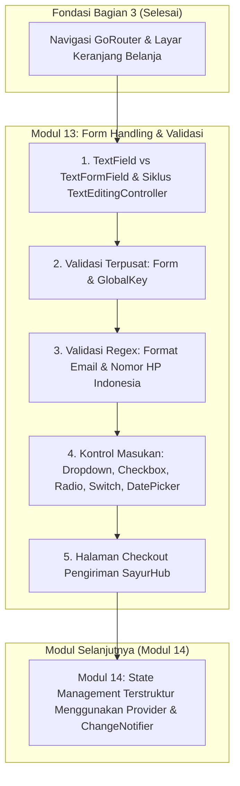
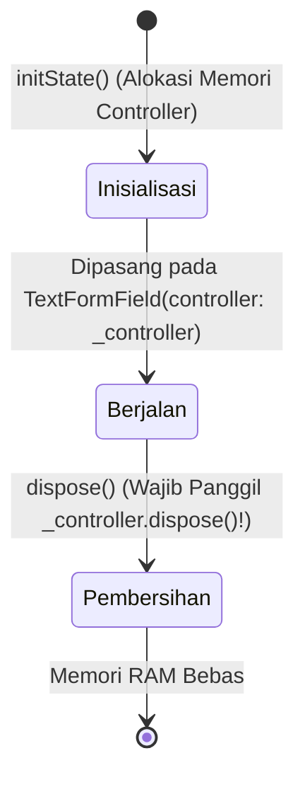
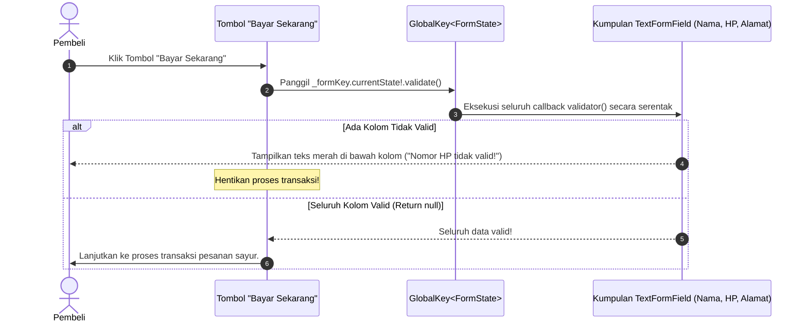

# MODUL 13: INPUT PENGGUNA, FORM HANDLING, TEXTEDITINGCONTROLLER, DAN VALIDASI TERPADU
## PENGEMBANGAN APLIKASI MOBILE MULTIPLATFORM DARI DASAR HINGGA PRODUKSI
### KONSENTRASI KEAHLIAN REKAYASA PERANGKAT LUNAK (SMK RPL)

---

## A. IDENTITAS MODUL

- **Nomor Modul**: 13
- **Judul Modul**: Input Pengguna, Form Handling, TextEditingController, dan Validasi Terpadu
- **Tingkat Kesulitan**: Menengah (*Intermediate*)
- **Estimasi Waktu**: 6 Jam Pelajaran (6 × 45 Menit = 270 Menit)
- **Prasyarat**: Modul 12 (Navigasi Antarhalaman, Deep Linking, dan Routing Deklaratif dengan GoRouter)
- **Tujuan Pembelajaran**:
  1. Siswa memahami perbedaan fundamental antara widget masukan teks biasa (`TextField`) dengan widget masukan terpadu formulir (`TextFormField`).
  2. Siswa menguasai siklus hidup manajemen memori **`TextEditingController`** dan **`FocusNode`** (inisialisasi di `initState` dan kewajiban pelepasan di `dispose`).
  3. Siswa terampil mengimplementasikan widget pembungkus **`Form`** dan menggunakan **`GlobalKey<FormState>`** untuk memvalidasi seluruh kolom input secara serentak.
  4. Siswa menguasai teknik penulisan logika validasi ekspresi reguler (*Regular Expressions / RegEx*) untuk memvalidasi format email, nomor WhatsApp Indonesia (`08...` / `+62...`), dan batas minimal password.
  5. Siswa terampil memanfaatkan variasi kontrol masukan interaktif: **`DropdownButtonFormField`**, **`CheckboxListTile`**, **`RadioListTile`**, **`SwitchListTile`**, serta dialog pemilih tanggal **`showDatePicker()`**.
  6. Siswa mampu membangun formulir transaksi nyata: **Halaman Checkout Alamat Pengiriman (`CheckoutScreen`)** yang terhubung langsung dari keranjang belanja untuk aplikasi **SayurHub**.
- **Kompetensi yang Akan Dicapai**:
  - **Kognitif**: Pemahaman arsitektur verifikasi data sisi klien (*Client-Side Input Validation*), pencegahan kebocoran memori controller, serta UX formulir mobile.
  - **Psikomotorik**: Keterampilan merancang formulir multi-input, menyusun pesan kesalahan visual (*errorText*), dan mengonfigurasi tipe papan ketik keyboard virtual (*TextInputType*).

---

## B. PETA KONSEP



- **Keterkaitan dengan Modul 12**: Tombol *"Lanjutkan ke Checkout"* pada halaman keranjang belanja Modul 12 kini diarahkan langsung ke rute `/checkout` yang berisi formulir input Modul 13.
- **Keterkaitan dengan Modul 14**: Nilai-nilai formulir yang lolos validasi pada modul ini nantinya akan disimpan dan dikelola oleh `CartProvider` dan `OrderProvider` secara terpusat pada Modul 14.

---

## C. MATERI TEORI

### 1. `TextField` vs `TextFormField`: Kapan Menggunakan yang Mana?

Meskipun keduanya sama-sama menampilkan kotak masukan teks, di industri perangkat lunak keduanya memiliki peran yang sangat berbeda:

| Aspek Komparasi | `TextField` | `TextFormField` |
|---|---|---|
| **Kebutuhan Induk** | Berdiri mandiri tanpa perlu widget `Form` | **Wajib berada di dalam naungan widget `Form`** |
| **Dukungan Validasi Otomatis** | Tidak ada (Harus menulis logika manual) | **Memiliki parameter bawaan `validator: (value) { ... }`** |
| **Integrasi Reset Form** | Tidak ada | **Mendukung method `onSaved` dan reset otomatis** |
| **Use Case di SayurHub** | Kolom pencarian cepat di AppBar (*Search bar*) | **Formulir Pendaftaran Akun & Form Alamat Checkout** |

---

### 2. Siklus Hidup `TextEditingController`: Waspada Kebocoran Memori!

`TextEditingController` adalah pengendali yang menyadap setiap karakter yang diketikkan pengguna ke dalam kotak teks.  
Karena controller ini mendaftarkan pendengar (*listener*) ke sistem operasi, **ia TIDAK BISA dibersihkan oleh Garbage Collector secara otomatis**.



> [!CAUTION]
> **Dosa Terbesar Pemula: Lupa Memanggil `controller.dispose()`**  
> Jika Anda mengalokasikan controller di sebuah `StatefulWidget` namun lupa memanggil `_controller.dispose()` di dalam method `dispose()`, maka setiap kali pengguna membuka dan menutup halaman checkout, memori controller lama akan tertinggal dan menumpuk di RAM smartphone hingga akhirnya aplikasi crash karena kehabisan memori (*Out Of Memory - OOM*)!

---

### 3. Cara Kerja Validasi Terpadu: `Form` dan `GlobalKey<FormState>`

Alih-alih memeriksa kolom nama, nomor HP, dan alamat satu per satu dengan puluhan baris `if-else` manual, Flutter menyediakan mekanisme sakti **`GlobalKey<FormState>`**:



```dart
// 1. Buat GlobalKey di State
final _formKey = GlobalKey<FormState>();

// 2. Bungkus kolom-kolom input dengan Form
Form(
  key: _formKey,
  child: Column(
    children: [
      TextFormField(
        validator: (value) {
          if (value == null || value.trim().isEmpty) {
            return 'Nama penerima wajib diisi!';
          }
          return null; // Nilai null menandakan data VALID!
        },
      ),
      ElevatedButton(
        onPressed: () {
          // 3. Picu validasi seluruh kolom sekaligus
          if (_formKey.currentState!.validate()) {
            // Seluruh data aman, kirim ke server!
          }
        },
        child: const Text('Simpan'),
      ),
    ],
  ),
);
```

---

### 4. Validasi Pola Teks Menggunakan Regular Expression (RegEx)

Data e-commerce tidak boleh diisi secara sembarangan. Kita menggunakan ekspresi reguler untuk mengunci format data baku:

1. **Format Nomor WhatsApp / HP Indonesia**:
   - Harus diawali `08` atau `+628` atau `628`, diikuti 8 hingga 11 digit angka:
   ```dart
   final RegExp phoneRegex = RegExp(r'^(?:\+62|62|0)8[1-9][0-9]{7,10}$');
   ```
2. **Format Email Standar**:
   - Harus memiliki karakter nama, simbol `@`, domain, dan ekstensi (contoh: `budi@gmail.com`):
   ```dart
   final RegExp emailRegex = RegExp(r'^[\w-\.]+@([\w-]+\.)+[\w-]{2,4}$');
   ```

---

### 5. Ragam Kontrol Input Interaktif Modern

1. **`DropdownButtonFormField<T>`**:
   Menu pilihan tarik-turun yang terintegrasi dengan validasi Form. Sangat ideal untuk memilih opsi kurir pengiriman (Instant Sayur 1 Jam, Same Day Pagi, atau Kurir Reguler).
2. **`SwitchListTile`**:
   Sakelar on/off elegan. Sangat ideal untuk opsi biner seperti *"Aktifkan Asuransi Kesegaran Sayur (+Rp 2.000)"*.
3. **`RadioListTile<T>`**:
   Pilihan tunggal dari beberapa opsi eksklusif. Sangat ideal untuk memilih slot waktu pengiriman (*Slot Pagi 06.00–09.00 WIB* vs *Slot Sore 15.00–18.00 WIB*).
4. **`showDatePicker()`**:
   Dialog kalender grafis bawaan Material Design untuk memilih tanggal pengiriman sayur yang fleksibel.

---

## D. PEMBAHASAN KODE PROGRAM: VALIDASI CHECKOUT SAYURHUB

Mari kita bedah arsitektur kode validasi pada form checkout yang menerapkan dekorasi input Material 3:

```dart
TextFormField(
  controller: _phoneController,
  keyboardType: TextInputType.phone, // Menampilkan keyboard angka di layar HP
  decoration: InputDecoration(
    labelText: 'Nomor WhatsApp Penerima',
    hintText: 'Contoh: 081234567890',
    prefixIcon: const Icon(Icons.phone_rounded, color: AppColors.primaryGreen),
    border: OutlineInputBorder(borderRadius: BorderRadius.circular(12)),
    filled: true,
    fillColor: Colors.white,
  ),
  validator: (value) {
    if (value == null || value.trim().isEmpty) {
      return 'Nomor WhatsApp wajib diisi untuk konfirmasi kurir!';
    }
    final RegExp phoneRegex = RegExp(r'^(?:\+62|62|0)8[1-9][0-9]{7,10}$');
    if (!phoneRegex.hasMatch(value.trim())) {
      return 'Format nomor tidak valid (Gunakan format 08... atau +628...)';
    }
    return null;
  },
)
```

### Penjelasan Bagian Penting:
- **`keyboardType: TextInputType.phone`**: Memberikan kenyamanan pengguna (*User Ergonomics*) dengan langsung membuka keypad angka saat kolom disentuh jari.
- **`return null;`**: Aturan emas fungsi validator Flutter. Jika fungsi mengembalikan `null`, artinya data valid dan tidak ada pesan error yang ditampilkan.

---

## E. PERSIAPAN PRAKTIKUM

1. **Perangkat Lunak**:
   - Visual Studio Code dengan emulator atau smartphone Android fisik.
2. **Kondisi Awal Proyek**:
   - Repositori `sayur_hub` dari Modul 12 berada dalam status Git bersih.
3. **Struktur File yang Akan Dibuat**:
   - `sayur_hub/lib/features/checkout/checkout_screen.dart` (Halaman formulir checkout lengkap).
   - Pembaruan `sayur_hub/lib/core/routes/app_router.dart` (Mendaftarkan rute `/checkout`).
   - Pembaruan `sayur_hub/lib/features/cart/cart_screen.dart` (Menghubungkan tombol ke rute `/checkout`).

---

## F. LANGKAH PRAKTIKUM STEP-BY-STEP

### Langkah 1 — Menyiapkan Folder Checkout

1. Buka terminal pada root project `sayur_hub`.
2. Buat folder fitur checkout:
   ```bash
   mkdir -p lib/features/checkout
   ```

---

### Langkah 2 — Membangun Halaman Formulir Checkout Lengkap (`CheckoutScreen`)

1. Buat file baru di `lib/features/checkout/checkout_screen.dart`.
2. Tuliskan kode formulir checkout interaktif berikut yang menggabungkan seluruh kontrol masukan (Text, Dropdown, DatePicker, Switch, Radio):

```dart
// File: sayur_hub/lib/features/checkout/checkout_screen.dart
import 'package:flutter/material.dart';
import 'package:go_router/go_router.dart';
import 'package:sayur_hub/core/theme/app_colors.dart';
import 'package:sayur_hub/core/utils/price_calculator.dart';
import 'package:sayur_hub/shared/widgets/custom_button.dart';

/// Halaman formulir pengisian alamat pengiriman dan opsi logistik SayurHub
class CheckoutScreen extends StatefulWidget {
  const CheckoutScreen({super.key});

  @override
  State<CheckoutScreen> createState() => _CheckoutScreenState();
}

class _CheckoutScreenState extends State<CheckoutScreen> {
  // 1. Kunci Global Pengendali Validasi Form
  final GlobalKey<FormState> _formKey = GlobalKey<FormState>();

  // 2. Kontroler Teks (Wajib di-dispose di akhir)
  late final TextEditingController _nameController;
  late final TextEditingController _phoneController;
  late final TextEditingController _addressController;
  late final TextEditingController _notesController;

  // 3. State Opsi Input Pilihan
  String? _selectedCourier = 'INSTANT'; // Pilihan Kurir
  DateTime _deliveryDate = DateTime.now().add(const Duration(days: 1)); // Jadwal Besok
  bool _useFreshGuarantee = true; // Asuransi Kesegaran (+Rp 2.000)
  String _deliveryTimeSlot = 'PAGI'; // Slot Pagi vs Sore
  bool _isSubmitting = false;

  @override
  void initState() {
    super.initState();
    _nameController = TextEditingController(text: 'Siti Nurhaliza');
    _phoneController = TextEditingController(text: '081234567890');
    _addressController = TextEditingController(text: 'Jl. Merdeka No. 45, Bandung Barat');
    _notesController = TextEditingController();
  }

  @override
  void dispose() {
    // Membersihkan seluruh controller dari memori RAM
    _nameController.dispose();
    _phoneController.dispose();
    _addressController.dispose();
    _notesController.dispose();
    super.dispose();
  }

  // Fungsi pemilih tanggal kalender
  Future<void> _pickDeliveryDate() async {
    final DateTime? picked = await showDatePicker(
      context: context,
      initialDate: _deliveryDate,
      firstDate: DateTime.now(),
      lastDate: DateTime.now().add(const Duration(days: 7)),
      helpText: 'PILIH TANGGAL PENGIRIMAN SAYUR',
    );
    if (picked != null && picked != _deliveryDate) {
      setState(() {
        _deliveryDate = picked;
      });
    }
  }

  void _handleSubmitOrder() async {
    // Validasi seluruh input secara serentak
    if (!_formKey.currentState!.validate()) {
      ScaffoldMessenger.of(context).showSnackBar(
        const SnackBar(
          content: Text('Mohon perbaiki kolom formulir yang bertanda merah!'),
          backgroundColor: Colors.red,
        ),
      );
      return;
    }

    setState(() {
      _isSubmitting = true;
    });

    // Simulasi pengiriman order ke backend selama 2 detik
    await Future.delayed(const Duration(seconds: 2));

    if (!mounted) return;

    setState(() {
      _isSubmitting = false;
    });

    // Tampilkan dialog sukses pesanan
    showDialog(
      context: context,
      barrierDismissible: false,
      builder: (ctx) => AlertDialog(
        shape: RoundedRectangleBorder(borderRadius: BorderRadius.circular(20)),
        title: Row(
          children: const [
            Icon(Icons.check_circle_rounded, color: AppColors.primaryGreen, size: 28),
            SizedBox(width: 8),
            Text('Pesanan Berhasil!'),
          ],
        ),
        content: Text(
          'Terima kasih ${_nameController.text.trim()}. Pesanan sayur segar Anda dijadwalkan tiba pada ${_deliveryDate.day}/${_deliveryDate.month}/${_deliveryDate.year} (Slot $_deliveryTimeSlot).',
          style: const TextStyle(fontSize: 14, height: 1.4),
        ),
        actions: [
          ElevatedButton(
            style: ElevatedButton.styleFrom(backgroundColor: AppColors.primaryGreen, foregroundColor: Colors.white),
            onPressed: () {
              ctx.pop(); // Tutup dialog
              context.go('/'); // Kembali ke Beranda
            },
            child: const Text('Kembali ke Beranda'),
          ),
        ],
      ),
    );
  }

  @override
  Widget build(BuildContext context) {
    // Perhitungan ongkir dinamis sesuai kurir yang dipilih
    final double courierFee = _selectedCourier == 'INSTANT'
        ? 15000.0
        : _selectedCourier == 'SAMEDAY'
            ? 10000.0
            : 7000.0;
    final double insuranceFee = _useFreshGuarantee ? 2000.0 : 0.0;
    const double subtotalProduk = 60000.0;
    final double grandTotal = subtotalProduk + courierFee + insuranceFee;

    return Scaffold(
      appBar: AppBar(title: const Text('Alamat & Pengiriman')),
      body: SingleChildScrollView(
        padding: const EdgeInsets.all(16.0),
        child: Form(
          key: _formKey,
          child: Column(
            crossAxisAlignment: CrossAxisAlignment.start,
            children: [
              // Bagian 1: Data Penerima
              _buildSectionTitle('1. Data Penerima Sayur'),
              const SizedBox(height: 10),
              TextFormField(
                controller: _nameController,
                textCapitalization: TextCapitalization.words,
                decoration: _buildInputDecoration(
                  label: 'Nama Lengkap Penerima',
                  hint: 'Masukkan nama Anda',
                  icon: Icons.person_rounded,
                ),
                validator: (val) {
                  if (val == null || val.trim().length < 3) {
                    return 'Nama minimal harus memuat 3 huruf!';
                  }
                  return null;
                },
              ),
              const SizedBox(height: 12),
              TextFormField(
                controller: _phoneController,
                keyboardType: TextInputType.phone,
                decoration: _buildInputDecoration(
                  label: 'Nomor WhatsApp Aktif',
                  hint: 'Contoh: 081234567890',
                  icon: Icons.phone_rounded,
                ),
                validator: (val) {
                  if (val == null || val.trim().isEmpty) {
                    return 'Nomor WhatsApp wajib diisi untuk konfirmasi kurir!';
                  }
                  final RegExp phoneRegex = RegExp(r'^(?:\+62|62|0)8[1-9][0-9]{7,10}$');
                  if (!phoneRegex.hasMatch(val.trim())) {
                    return 'Format nomor tidak valid (Contoh: 081234567890)';
                  }
                  return null;
                },
              ),
              const SizedBox(height: 20),

              // Bagian 2: Alamat Pengiriman
              _buildSectionTitle('2. Alamat Lengkap Rumah'),
              const SizedBox(height: 10),
              TextFormField(
                controller: _addressController,
                maxLines: 2,
                decoration: _buildInputDecoration(
                  label: 'Alamat Rumah / Kantor',
                  hint: 'Nama jalan, nomor rumah, RT/RW, kelurahan',
                  icon: Icons.location_on_rounded,
                ),
                validator: (val) {
                  if (val == null || val.trim().length < 10) {
                    return 'Alamat terlalu pendek! Masukkan alamat lengkap (minimal 10 karakter).';
                  }
                  return null;
                },
              ),
              const SizedBox(height: 12),
              TextFormField(
                controller: _notesController,
                decoration: _buildInputDecoration(
                  label: 'Catatan Patokan (Opsional)',
                  hint: 'Contoh: Rumah pagar hitam samping masjid',
                  icon: Icons.note_alt_rounded,
                ),
              ),
              const SizedBox(height: 20),

              // Bagian 3: Opsi Kurir & Logistik
              _buildSectionTitle('3. Kurir Pengiriman'),
              const SizedBox(height: 10),
              DropdownButtonFormField<String>(
                value: _selectedCourier,
                decoration: _buildInputDecoration(
                  label: 'Pilih Metode Ekspedisi',
                  hint: 'Pilih kurir',
                  icon: Icons.local_shipping_rounded,
                ),
                items: const [
                  DropdownMenuItem(
                    value: 'INSTANT',
                    child: Text('Instant Sayur (1 Jam Tiba) — Rp 15.000'),
                  ),
                  DropdownMenuItem(
                    value: 'SAMEDAY',
                    child: Text('Same Day Sayur Pagi — Rp 10.000'),
                  ),
                  DropdownMenuItem(
                    value: 'REGULAR',
                    child: Text('Pengiriman Reguler Esok Hari — Rp 7.000'),
                  ),
                ],
                onChanged: (val) {
                  setState(() {
                    _selectedCourier = val;
                  });
                },
              ),
              const SizedBox(height: 16),

              // Bagian 4: Jadwal Tanggal & Slot Waktu
              _buildSectionTitle('4. Jadwal Pengantaran Sayur'),
              const SizedBox(height: 10),
              InkWell(
                onTap: _pickDeliveryDate,
                borderRadius: BorderRadius.circular(12),
                child: Container(
                  padding: const EdgeInsets.symmetric(horizontal: 16, vertical: 14),
                  decoration: BoxDecoration(
                    color: Colors.white,
                    borderRadius: BorderRadius.circular(12),
                    border: Border.all(color: Colors.grey.shade400),
                  ),
                  child: Row(
                    mainAxisAlignment: MainAxisAlignment.spaceBetween,
                    children: [
                      Row(
                        children: [
                          const Icon(Icons.calendar_month_rounded, color: AppColors.primaryGreen),
                          const SizedBox(width: 10),
                          Text(
                            'Tanggal: ${_deliveryDate.day}/${_deliveryDate.month}/${_deliveryDate.year}',
                            style: const TextStyle(fontWeight: FontWeight.bold, fontSize: 14),
                          ),
                        ],
                      ),
                      const Text('Ganti', style: TextStyle(color: AppColors.primaryGreen, fontWeight: FontWeight.bold)),
                    ],
                  ),
                ),
              ),
              const SizedBox(height: 12),

              // Pilihan Slot Pagi / Sore (Radio Button)
              Row(
                children: [
                  Expanded(
                    child: RadioListTile<String>(
                      title: const Text('Pagi\n06.00-09.00', style: TextStyle(fontSize: 12, fontWeight: FontWeight.w600)),
                      value: 'PAGI',
                      groupValue: _deliveryTimeSlot,
                      activeColor: AppColors.primaryGreen,
                      contentPadding: EdgeInsets.zero,
                      onChanged: (val) => setState(() => _deliveryTimeSlot = val!),
                    ),
                  ),
                  Expanded(
                    child: RadioListTile<String>(
                      title: const Text('Sore\n15.00-18.00', style: TextStyle(fontSize: 12, fontWeight: FontWeight.w600)),
                      value: 'SORE',
                      groupValue: _deliveryTimeSlot,
                      activeColor: AppColors.primaryGreen,
                      contentPadding: EdgeInsets.zero,
                      onChanged: (val) => setState(() => _deliveryTimeSlot = val!),
                    ),
                  ),
                ],
              ),
              const SizedBox(height: 12),

              // Switch Asuransi Garansi Kesegaran
              SwitchListTile(
                contentPadding: EdgeInsets.zero,
                activeColor: AppColors.primaryGreen,
                title: const Text('Garansi Kesegaran 100% (+Rp 2.000)', style: TextStyle(fontWeight: FontWeight.bold, fontSize: 13)),
                subtitle: const Text('Ganti baru gratis jika ada sayur layu/busuk saat tiba.', style: TextStyle(fontSize: 11)),
                value: _useFreshGuarantee,
                onChanged: (val) => setState(() => _useFreshGuarantee = val),
              ),
              const Divider(height: 32),

              // Ringkasan Tagihan Terkini
              Row(
                mainAxisAlignment: MainAxisAlignment.spaceBetween,
                children: [
                  const Text('Total Pembayaran Akhir:', style: TextStyle(fontWeight: FontWeight.bold, fontSize: 15)),
                  Text(
                    PriceCalculator.formatRupiah(grandTotal),
                    style: const TextStyle(fontSize: 18, fontWeight: FontWeight.bold, color: AppColors.primaryGreen),
                  ),
                ],
              ),
              const SizedBox(height: 24),

              // Tombol Submit Pesanan Terpadu
              CustomButton(
                text: 'Konfirmasi Pesanan Sayur',
                icon: Icons.lock_outline_rounded,
                isLoading: _isSubmitting,
                onPressed: _handleSubmitOrder,
              ),
              const SizedBox(height: 20),
            ],
          ),
        ),
      ),
    );
  }

  Widget _buildSectionTitle(String title) {
    return Text(
      title,
      style: const TextStyle(fontSize: 15, fontWeight: FontWeight.bold, color: AppColors.textDark),
    );
  }

  InputDecoration _buildInputDecoration({
    required String label,
    required String hint,
    required IconData icon,
  }) {
    return InputDecoration(
      labelText: label,
      hintText: hint,
      prefixIcon: Icon(icon, color: AppColors.primaryGreen),
      filled: true,
      fillColor: Colors.white,
      border: OutlineInputBorder(borderRadius: BorderRadius.circular(12)),
      enabledBorder: OutlineInputBorder(
        borderRadius: BorderRadius.circular(12),
        borderSide: BorderSide(color: Colors.grey.shade300),
      ),
      focusedBorder: OutlineInputBorder(
        borderRadius: BorderRadius.circular(12),
        borderSide: const BorderSide(color: AppColors.primaryGreen, width: 1.5),
      ),
    );
  }
}
```

---

### Langkah 3 — Mendaftarkan Rute `/checkout` pada `AppRouter`

1. Buka file `lib/core/routes/app_router.dart`.
2. Tambahkan sub-rute `checkout` di dalam konfigurasi GoRouter:

```dart
// Di dalam routes pada lib/core/routes/app_router.dart:
          // Sub-Rute Checkout Alamat: /checkout
          GoRoute(
            path: 'checkout',
            name: 'checkout',
            builder: (context, state) => const CheckoutScreen(),
          ),
```

---

### Langkah 4 — Menghubungkan Tombol Keranjang ke Halaman Checkout

1. Buka file `lib/features/cart/cart_screen.dart`.
2. Perbarui tombol "Lanjutkan ke Checkout Alamat" agar memanggil:
   ```dart
   onPressed: () => context.pushNamed('checkout'),
   ```

---

## G. ANALISIS DAN PEMAHAMAN

Jawablah pertanyaan analisis berikut:

1. **Analisis GlobalKey**: Mengapa `_formKey` wajib dideklarasikan dengan tipe `GlobalKey<FormState>()` dan tidak boleh dideklarasikan sebagai variabel biasa? Apa fungsi metode `_formKey.currentState!.validate()` dalam memicu evaluasi seluruh kolom input?
2. **Analisis Pembersihan Memori**: Jelaskan apa bahaya teknis yang mengancam smartphone jika programmer membuka 5 controller teks di halaman checkout namun tidak menulis method `dispose()`!
3. **Analisis Pola Regex**: Bedah pola regex berikut: `r'^(?:\+62|62|0)8[1-9][0-9]{7,10}$'`. Jelaskan maksud dari setiap segmen:
   - `^(?:\+62|62|0)`
   - `8[1-9]`
   - `[0-9]{7,10}$`

---

## H. LATIHAN DAN TANTANGAN

### 1. Soal Teori
1. Widget pembungkus yang bertugas mengoordinasikan pengelompokan dan validasi serentak pada widget-widget input adalah:
   - A. `Column`
   - B. `Form`
   - C. `InputGroup`
   - D. `Validator`
2. Nilai kembalian (*return value*) yang wajib dihasilkan oleh fungsi `validator` pada `TextFormField` jika data yang diinput oleh pengguna telah memenuhi syarat valid adalah:
   - A. `true`
   - B. `false`
   - C. `null`
   - D. `""` (String kosong)
3. Method pada `StatefulWidget` di mana pengembang wajib memanggil `_controller.dispose()` untuk melepaskan memori controller adalah:
   - A. `deactivate()`
   - B. `stop()`
   - C. `dispose()`
   - D. `clean()`
4. Properti pada `TextFormField` yang digunakan untuk menyamarkan karakter teks menjadi bintang atau titik bulat (sangat penting untuk kolom kata sandi) adalah:
   - A. `isPassword`
   - B. `obscureText`
   - C. `maskInput`
   - D. `hideCharacters`
5. Fungsi bawaan Flutter yang digunakan untuk menampilkan jendela dialog kalender pemilih tanggal adalah:
   - A. `showCalendarDialog()`
   - B. `showDatePicker()`
   - C. `openDateModal()`
   - D. `createCalendar()`

### 2. Soal Praktik
1. **Toggle Mata Password (ObscureText Toggle)**: Buat `TextFormField` untuk password dengan ikon mata `Icons.visibility` di sebelah kanan (*suffixIcon*). Ketika ikon mata diklik, ubah nilai boolean `_obscurePassword = !_obscurePassword` menggunakan `setState()`.
2. **Input Angka Kode Pos dengan Batas Karakter**: Buat `TextFormField` untuk kode pos Indonesia. Setel `keyboardType: TextInputType.number`, pasang `maxLength: 5`, dan validasi agar wajib berisi tepat 5 digit angka numerik.
3. **Validasi Tanggal Minimal**: Modifikasi pemanggilan `showDatePicker` pada `CheckoutScreen` agar pengguna tidak bisa memilih tanggal kemarin (*past date*) dengan menyetel `firstDate: DateTime.now()`.

### 3. Tantangan Pemecahan Masalah (*Problem-Solving Challenges*)
- **Tantangan 1 (Auto-Formatting Nomor HP Indonesia)**: Pengguna sering mengetik nomor HP secara acak dengan spasi atau tanda hubung: `0812-3456-7890`. Gunakan paket `input_formatters: [FilteringTextInputFormatter.digitsOnly]` agar kolom telepon hanya menerima angka dan otomatis menolak huruf atau spasi!
- **Tantangan 2 (Konfirmasi Password Matching Validator)**: Pada form registrasi akun, buat dua kolom: *Password* dan *Ulangi Password*. Rancang logika validator pada kolom kedua yang mencocokkan nilainya secara real-time dengan isi `_passwordController.text` dan menampilkan error *"Kata sandi tidak cocok!"* jika berbeda!

### 4. Studi Kasus Industri
**Studi Kasus**: Di aplikasi SayurHub, banyak kurir mengeluh sering tersesat karena pembeli hanya menuliskan nama jalan tanpa nomor rumah atau patokan yang jelas.  
*Tugas Siswa*: Rancanglah validasi cerdas pada kolom alamat: Jika teks alamat yang dimasukkan pengguna tidak mengandung kata kunci penting (seperti *"No"* atau *"Nomor"* atau *"RT"* atau *"RW"* atau *"Blok"*), tampilkan pesan peringatan ramah: *"Mohon sertakan nomor rumah atau nomor blok agar kurir tidak tersesat!"*.

---

## I. TROUBLESHOOTING & FAQ

Berikut adalah tabel permasalahan umum penanganan formulir input dan solusinya:

| Permasalahan Teknis | Penyebab Utama | Cara Identifikasi | Solusi Tepat |
|---|---|---|---|
| **Crash "A TextEditingController was used after being disposed"** | Controller teks sudah di-dispose namun masih diakses oleh listener atau widget lain yang masih aktif. | Konsol melempar error *used after being disposed*. | Pastikan controller hanya di-dispose satu kali di dalam method `dispose()`, dan hapus seluruh listener sebelum memanggil `dispose()`. |
| **Pesan Error Validasi Tidak Muncul Saat Tombol Diklik** | Menggunakan `TextField` biasa alih-alih `TextFormField`, atau lupa membungkusnya di dalam widget `Form(key: _formKey)`. | Tombol diklik tetapi tidak ada teks merah yang muncul di bawah input yang salah. | Pastikan menggunakan **`TextFormField`** dan jalankan pemicu validasi: `_formKey.currentState!.validate()`. |
| **Keyboard Virtual Menutupi Tombol Submit di Bawah Layar** | Layar formulir tidak dibungkus dengan widget yang dapat digulir (*scrollable*). | Saat keyboard HP muncul, bagian bawah form tertutup dan muncul garis-garis kuning-hitam. | Bungkus seluruh isi form di dalam widget **`SingleChildScrollView`**. |
| **Nilai Input Terhapus Tiap Kali Mengetik Satu Karakter** | Mendeklarasikan dan menginstansiasi `TextEditingController` di dalam method `build()`. | Setiap kali mengetik, method build berjalan dan membuat controller baru yang kosong. | **Pindahkan deklarasi controller ke State kelas (`initState`)**, jangan pernah menginstansiasi controller di dalam method `build()`. |

---

## J. PRAKTIKUM INTEGRASI ANTAR-MODUL: CHECKOUT FLOW SAYURHUB

Pada praktikum integrasi Modul 13, kita mengintegrasikan alur belanja dari Keranjang (`CartScreen`) menuju Halaman Checkout Alamat (`CheckoutScreen`) lengkap dengan validasi menyeluruh dan dialog konfirmasi sukses.

### 1. Judul Praktikum Integrasi
**Pembangunan Halaman Form Checkout Pengiriman SayurHub Lengkap dengan Validasi Regex, Kurir Dropdown, dan DatePicker**

### 2. Tujuan Praktikum Integrasi
- Membangun `CheckoutScreen` di `lib/features/checkout/checkout_screen.dart`.
- Mengimplementasikan `GlobalKey<FormState>` dan validator Regex nomor telepon Indonesia.
- Mendaftarkan rute `/checkout` pada `AppRouter`.
- Menghubungkan navigasi dari `CartScreen` menuju `CheckoutScreen`.

### 3. Materi yang Diintegrasikan
- Utilitas `PriceCalculator.formatRupiah` dari Modul 03.
- Komponen `CustomButton` dari Modul 11.
- Sistem routing `GoRouter` dari Modul 12.
- Form handling dan kontrol input dari Modul 13.

### 4. Kondisi Awal Proyek (*Project State Before*)
Tombol "Lanjutkan ke Checkout Alamat" di Keranjang Belanja hanya menampilkan SnackBar sementara dan belum membuka halaman formulir fisik.

### 5. Instruksi Langkah Demi Langkah
1. Buat file `lib/features/checkout/checkout_screen.dart`.
2. Perbarui `lib/core/routes/app_router.dart` untuk menambahkan rute `checkout`.
3. Perbarui `lib/features/cart/cart_screen.dart` agar tombol navigasi memanggil `context.pushNamed('checkout')`.
4. Lakukan verifikasi linter static analysis:
   ```bash
   flutter analyze
   ```
5. Uji coba langsung di smartphone fisik atau emulator:
   - Dari Beranda, ketuk tombol keranjang $\to$ Halaman Keranjang Belanja terbuka.
   - Ketuk tombol **Lanjutkan ke Checkout Alamat** $\to$ Layar formulir checkout terbuka.
   - Kosongkan nomor WhatsApp atau ketik nomor ngawur `12345` $\to$ Ketuk tombol konfirmasi $\to$ Kolom nomor telepon seketika memunculkan teks peringatan merah.
   - Perbaiki nomor menjadi `081234567890` $\to$ Ketuk kembali $\to$ Tombol menampilkan loading spinner selama 2 detik $\to$ Muncul dialog sukses: *"Pesanan Berhasil!"*.
   - Ketuk "Kembali ke Beranda" $\to$ Aplikasi kembali ke katalog utama.
6. Simpan dan commit seluruh pekerjaan ke repositori Git:
   ```bash
   git add .
   git commit -m "feat(checkout): implement CheckoutScreen with Form validation, regex, dropdown, and datepicker"
   ```

---

### 6. Hasil yang Diharapkan
1. Alur transaksi e-commerce SayurHub kini memiliki formulir pemesanan alamat yang aman dari data sampah.
2. Seluruh masukan (Nama, Nomor HP, Alamat, Kurir, Tanggal Pengiriman, Asuransi, Slot Waktu) tervalidasi secara presisi.
3. Dialog sukses mengonfirmasi rincian pengiriman sayur kepada pembeli.
4. Linter melaporkan `No issues found!`.

### 7. Kriteria Keberhasilan
- [x] File `checkout_screen.dart` terimplementasi di `lib/features/checkout/`.
- [x] Rute `/checkout` terdaftar di `AppRouter`.
- [x] Validasi Regex nomor HP Indonesia berfungsi akurat.
- [x] Seluruh controller teks di-dispose secara bersih di method `dispose()`.
- [x] Perintah `flutter analyze` melaporkan `0 issues / 0 warnings`.

---

## K. EVALUASI MODUL 13

### 1. Rubrik Penilaian Formulir dan Validasi Data
| Aspek Evaluasi | Skor Maksimal | Indikator Ketercapaian |
|---|---|---|
| **Penerapan Form & GlobalKey** | 25 | Mampu mengonfigurasi `GlobalKey<FormState>` dan memicu validasi serentak dengan tepat. |
| **Ketepatan Validasi Regex** | 25 | Mampu menyusun pola regex yang akurat untuk nomor WhatsApp Indonesia dan email. |
| **Penguasaan Kontrol Input Komprehensif** | 25 | Terampil mengoperasikan `DropdownButtonFormField`, `showDatePicker`, `SwitchListTile`, dan `RadioListTile`. |
| **Manajemen Memori Controller (dispose)** | 25 | Seluruh `TextEditingController` diinisialisasi di `initState` dan dilepaskan di `dispose` tanpa kebocoran memori. |
| **Total Skor** | **100** | **Kriteria Ketuntasan Minimal (KKM): 75** |

### 2. Soal Uji Debugging Form
*Tinjau fungsi validasi berikut:*
```dart
validator: (value) {
  if (value.isEmpty) { // Baris X
    return 'Wajib diisi';
  }
  return null;
}
```
- **Pertanyaan**: Mengapa baris X sangat berbahaya dan dapat memicu crash aplikasi mendadak saat formulir dibuka pertama kali, dan bagaimana perbaikannya?
- **Kunci Jawaban**:
  1. *Penyebab*: Parameter `value` bertipe nullable (`String?`). Jika pengguna belum menyentuh kolom tersebut, nilai `value` adalah `null`. Memanggil properti `.isEmpty` pada nilai `null` akan memicu crash fatal *NoSuchMethodError / NullPointerException*.
  2. *Perbaikan*: Periksa null terlebih dahulu atau gunakan null-aware operator:
     ```dart
     validator: (value) {
       if (value == null || value.trim().isEmpty) {
         return 'Kolom ini wajib diisi!';
       }
       return null;
     }
     ```

---

## L. KESIMPULAN DAN JEMBATAN KE MODUL BERIKUTNYA

### Rangkuman Kompetensi:
Melalui Modul 13 ini, Anda telah menguasai pintu masuk interaksi pengguna pada aplikasi mobile:
1. Memahami perbedaan mendasar `TextField` vs `TextFormField`.
2. Menguasai siklus hidup dan pencegahan kebocoran memori pada **`TextEditingController`**.
3. Menguasai validasi terpusat menggunakan **`Form`** dan **`GlobalKey<FormState>`**.
4. Menerapkan pola verifikasi data kuat menggunakan **Regular Expression (RegEx)** untuk nomor HP Indonesia.
5. Membangun halaman transaksi terpadu: **`CheckoutScreen`** lengkap dengan kalkulasi biaya kurir dinamis.

### Penghubung Menuju Modul 14:
Di halaman Checkout tadi, total belanja sayur masih kita tulis manual (`const double subtotalProduk = 60000.0`). Mengapa? Karena status belanjaan keranjang kita masih tersebar dan terkunci di dalam *local state* halaman Beranda!

Jika pengguna menambah sayur di Beranda, bagaimana halaman Keranjang dan Checkout bisa mengetahui perubahan data tersebut secara otomatis tanpa mengoper-oper parameter yang rumit (*prop drilling*)?

Jawabannya adalah **State Management Terpusat**!

Pada **Modul 14: State Management Terstruktur Menggunakan Provider dan ChangeNotifier**, kita akan mempelajari:
- Masalah pelik *Prop Drilling* dan keterbatasan `setState()`.
- Arsitektur Observer Pattern dengan **`ChangeNotifier`**.
- Membangun **`CartProvider`** (menambah, mengurangi, menghitung grand total keranjang belanja otomatis di seluruh aplikasi).
- Memisahkan logika bisnis sepenuhnya dari tampilan antarmuka (*Separation of Concerns*)!
