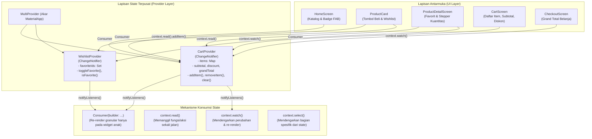

# MODUL 14: PENGELOLAAN STATE (STATE MANAGEMENT) DENGAN PROVIDER & CHANGENOTIFIER

---

## A. IDENTITAS MODUL
* **Mata Pelajaran**: Pemrograman Perangkat Bergerak (*Mobile Application Development*)
* **Kelas / Semester**: XI / XII SMK Kompetensi Keahlian Rekayasa Perangkat Lunak (RPL)
* **Alokasi Waktu**: 8 Jam Pelajaran (@ 45 Menit) / 2 Pertemuan Praktikum Terbimbing
* **Judul Modul**: Manajemen State Global dan Reaktivitas Aplikasi Menggunakan Arsitektur Provider pada Proyek SayurHub
* **Model Pembelajaran**: *Project-Based Learning* (PjBL), *Pair Programming*, dan *Guided Exploration*
* **Prasyarat**: 
  - [Modul 06: Object-Oriented Programming & Data Modeling](file:///home/arif/flutter-1/docs/modul/06_OBJECT_ORIENTED_PROGRAMMING_DART.md)
  - [Modul 09: Widget Fundamental — StatelessWidget & StatefulWidget](file:///home/arif/flutter-1/docs/modul/09_WIDGET_FUNDAMENTAL_DAN_LIFECYCLE.md)
  - [Modul 11: Desain Antarmuka Material Design 3 & Navigation Shell](file:///home/arif/flutter-1/docs/modul/11_DESAIN_ANTARMUKA_MATERIAL3_DAN_THEMING.md)
  - [Modul 12: Navigasi Antarhalaman & GoRouter](file:///home/arif/flutter-1/docs/modul/12_NAVIGASI_ANTARHALAMAN_DAN_GOROUTER.md)
  - [Modul 13: Formulir Input, Kontroler, & Validasi](file:///home/arif/flutter-1/docs/modul/13_INPUT_FORM_DAN_VALIDASI.md)

---

## B. PETA KONSEP & CAPAIAN PEMBELAJARAN

### B.1 Peta Konsep Arsitektur State Management



### B.2 Capaian Pembelajaran Elemen (CP)
Pada akhir modul ini, peserta didik kompetensi keahlian RPL mampu:
1. Menjelaskan secara komprehensif dikotomi antara *Ephemeral State* (lokal) dan *App State* (global/terpusat) dalam ekosistem aplikasi Flutter.
2. Mengidentifikasi kelemahan mendasar dari pola *prop drilling* dan batasan `setState()` ketika membangun aplikasi skala produksi yang kompleks.
3. Menerapkan pola *Observer Design Pattern* dan *Reactive Programming* menggunakan pustaka resmi `provider` dan kelas `ChangeNotifier`.
4. Merancang dan mengimplementasikan `CartProvider` dan `WishlistProvider` yang aman (*thread-safe*, *sound null safety*, *immutable exposure*).
5. Memilih secara tepat antara `Consumer<T>`, `context.watch<T>()`, `context.read<T>()`, dan `context.select<T, R>()` untuk meminimalkan rendering berlebih (*unnecessary rebuilds*).
6. Mengintegrasikan seluruh siklus hidup belanja produk pada aplikasi SayurHub mulai dari beranda, kartu produk, detail komoditas, keranjang belanja interaktif, hingga proses *checkout*.

### B.3 Tujuan Pembelajaran Khusus (TP)
* **Kognitif**:
  - Siswa mampu membedakan karakteristik data lokal (misal: posisi scroll, state visibilitas password) dengan data global (keranjang belanja, wishlist, sesi autentikasi).
  - Siswa memahami bagaimana `notifyListeners()` mengirimkan sinyal kepada seluruh listener di dalam *Widget Tree*.
* **Psikomotorik**:
  - Siswa mampu menyematkan `MultiProvider` pada akar pohon widget di [main.dart](file:///home/arif/flutter-1/sayur_hub/lib/main.dart).
  - Siswa mampu membangun antarmuka dinamis pada [cart_screen.dart](file:///home/arif/flutter-1/sayur_hub/lib/features/cart/cart_screen.dart) yang secara otomatis memperbarui subtotal dan diskon saat item ditambah atau dikurangi.
* **Afektif**:
  - Menumbuhkan kebiasaan menulis kode yang rapi (*clean architecture*), memisahkan logika bisnis (*business logic*) dari tampilan visual (*presentation logic*), serta berorientasi pada efisiensi performa memori perangkat mobile.

---

## C. MATERI TEORI KOMPREHENSIF

### C.1 Konsep Fundamental State: Ephemeral State vs App State
Dalam arsitektur Flutter, setiap kali layar mengalami perubahan tampilan (misal teks berubah, warna tombol berganti, angka counter bertambah), perubahan tersebut selalu digerakkan oleh **State** (keadaan data pada satu titik waktu tertentu).

Flutter membagi State menjadi dua kategori utama:

| Aspek Pembanding | Ephemeral State (Local State) | App State (Shared / Global State) |
| :--- | :--- | :--- |
| **Definisi** | Keadaan data yang hanya dibutuhkan oleh sebuah widget tunggal dan tidak mempengaruhi widget lain di luar subtree-nya. | Keadaan data yang dibutuhkan secara bersamaan oleh banyak widget di cabang pohon widget yang berbeda. |
| **Contoh Kasus** | - Indeks tab aktif pada `BottomNavigationBar`<br>- Nilai checkbox "Ingat Saya"<br>- Input sementara pada `TextEditingController`<br>- Status animasi buka-tutup drawer | - Daftar belanjaan dalam keranjang (*Cart Items*)<br>- Daftar produk favorit (*Wishlist*)<br>- Data profil pengguna yang sedang login (*Auth User*)<br>- Tema aplikasi (*Dark Mode / Light Mode*) |
| **Mekanisme Pengelolaan** | Cukup menggunakan `StatefulWidget` bawaan dengan fungsi `setState()`. | Membutuhkan arsitektur *State Management* terpusat seperti **Provider**, BLoC, Riverpod, atau GetX. |
| **Dampak Perubahan** | Hanya memicu pemanggilan ulang `build()` pada widget lokal yang bersangkutan. | Memicu pembaruan reaktif pada seluruh widget yang mendengarkan (*listen*) data tersebut di seluruh halaman aplikasi. |

---

### C.2 Masalah "Prop Drilling" dan Keterbatasan `setState()`
Bagi seorang programmer pemula, pendekatan yang paling mudah dipikirkan saat ingin berbagi data antar-halaman adalah mempassing parameter lewat *constructor* widget anak (*Prop Drilling*).

#### Mengapa *Prop Drilling* Berbahaya di Skala Industri?
Bayangkan skenario belanja pada aplikasi SayurHub:
1. Pengguna berada di `ProductDetailScreen` dan menekan tombol "+ Keranjang".
2. Angka total belanjaan harus bertambah di ikon keranjang pada `AppBar` di `HomeScreen`.
3. Di saat yang sama, item tersebut harus langsung muncul di halaman `CartScreen`.
4. Jika menggunakan *Prop Drilling*, pengembang harus:
   - Melemparkan data produk naik ke atas pohon widget melalui callback berantai (`parent(callback(callback()))`).
   - Meneruskan data tersebut turun kembali ke ratusan tingkat widget anak yang sebenarnya tidak membutuhkan data tersebut selain sekadar menjadi perantara.
5. **Akibat Buruk**:
   - Kode menjadi sangat rapuh (*spaghetti code*).
   - Menghambat refaktor UI: memindahkan satu tombol mengharuskan pengubahan seluruh constructor widget perantara.
   - Performa anjlok karena pemanggilan `setState()` di tingkat atas (misal pada `Scaffold` utama) akan memaksa seluruh halaman di-render ulang dari awal (*unnecessary full widget rebuild*).

---

### C.3 Paradigma Reactive Programming dan Design Pattern Observer
Untuk mengatasi keterbatasan di atas, industri software modern mengadopsi **Pola Desain Observer (Observer Pattern)**:

1. **Subject (Penerbit / Publisher)**:
   Objek pusat yang menyimpan data utama dan memegang daftar pengamat (*listeners*). Pada Flutter, kelas ini mengimplementasikan `ChangeNotifier`. Ketika data berubah, objek ini memanggil metode `notifyListeners()`.
2. **Observer (Pelanggan / Subscriber)**:
   Widget yang tertarik pada perubahan data tersebut. Widget mendaftarkan dirinya secara otomatis untuk mendengarkan sinyal dari *Subject*.
3. **Mekanisme Reaktif**:
   Begitu `notifyListeners()` dipanggil, seluruh widget *Observer* yang terhubung akan secara otomatis dan simultan memanggil metode `build()` mereka sendiri untuk menampilkan tampilan terbaru, tanpa perlu menyentuh widget tetangga yang tidak berkepentingan.

---

### C.4 Arsitektur Pustaka Provider di Flutter
Pustaka `provider` adalah pembungkus resmi (*wrapper*) di atas kelas bawaan Flutter `InheritedWidget`. Provider memudahkan injeksi dependensi dan manajemen siklus hidup objek data. Tiga komponen utamanya adalah:

1. **`ChangeNotifier`**:
   Kelas dasar dalam SDK Flutter (`flutter/foundation.dart`) yang menyediakan API untuk menambahkan dan menghapus listener, serta memancarkan sinyal pemberitahuan perubahan melalui `notifyListeners()`.
2. **`ChangeNotifierProvider<T>`**:
   Widget penyedia (*provider*) yang bertanggung jawab membuat instansi dari sebuah kelas `ChangeNotifier`, menyediakannya ke seluruh pohon widget anak di bawahnya, dan secara otomatis membersihkan (*dispose*) objek tersebut saat tidak lagi digunakan untuk mencegah kebocoran memori (*memory leaks*).
3. **`MultiProvider`**:
   Widget penampung yang merapikan sintaks ketika aplikasi memiliki lebih dari satu provider global. Mencegah terciptanya piramida bersarang (*callback hell / nesting pyramid*).

```dart
// Contoh Penggunaan MultiProvider yang Rapi dan Bersih
MultiProvider(
  providers: [
    ChangeNotifierProvider(create: (_) => CartProvider()),
    ChangeNotifierProvider(create: (_) => WishlistProvider()),
  ],
  child: const SayurHubApp(),
);
```

---

### C.5 4 Strategi Konsumsi State di Widget Tree

Sangat penting bagi siswa SMK RPL untuk memahami perbedaan waktu dan tujuan penggunaan 4 teknik konsumsi state berikut:

```
┌─────────────────────────────────────────────────────────────────────────────────┐
│                           STRATEGI KONSUMSI STATE                               │
├───────────────────────┬──────────────────────┬──────────────────────────────────┤
│ METODE                │ MEMICU REBUILD UI?   │ REKOMENDASI PENGGUNAAN UTAMA     │
├───────────────────────┼──────────────────────┼──────────────────────────────────┤
│ Consumer<T>           │ YA (Hanya Subtree)   │ Membungkus blok UI tertentu agar │
│                       │                      │ tidak me-rebuild seluruh layar.  │
├───────────────────────┼──────────────────────┼──────────────────────────────────┤
│ context.watch<T>()    │ YA (Seluruh Widget)  │ Dipanggil di dalam method        │
│                       │                      │ build() jika hampir seluruh      │
│                       │                      │ widget tergantung pada state T.  │
├───────────────────────┼──────────────────────┼──────────────────────────────────┤
│ context.read<T>()     │ TIDAK SAMA SEKALI    │ Dipanggil di dalam event handler │
│                       │                      │ (onPressed, onTap, onSubmit).    │
│                       │                      │ TIDAK BOLEH di dalam build()!    │
├───────────────────────┼──────────────────────┼──────────────────────────────────┤
│ context.select<T, R>()│ YA (Kondisional)     │ Hanya me-rebuild widget jika     │
│                       │                      │ properti spesifik R yang berubah │
└───────────────────────┴──────────────────────┴──────────────────────────────────┘
```

> [!CAUTION]
> **ATURAN EMAS (GOLDEN RULE) PROVIDER:**
> Jangan pernah memanggil `context.read<T>()` di dalam method `build()`. Hal ini akan menyebabkan widget Anda **tidak bereaksi** terhadap perubahan data. Sebaliknya, jangan pernah memanggil `context.watch<T>()` di dalam event handler seperti `onPressed: () { ... }`, karena akan menimbulkan galat runtime `AssertionError: Do not use BuildContext across async gaps / watch called outside build`.

---

## D. PEMBAHASAN KODE MENDALAM (CODE WALKTHROUGH)

### D.1 State Terpusat Keranjang: `CartProvider`
Mari bedah berkas [cart_provider.dart](file:///home/arif/flutter-1/sayur_hub/lib/core/providers/cart_provider.dart):

```dart
import 'package:flutter/foundation.dart';
import 'package:sayur_hub/core/models/cart_item.dart';
import 'package:sayur_hub/core/models/product.dart';
import 'package:sayur_hub/core/utils/price_calculator.dart';

class CartProvider extends ChangeNotifier {
  // 1. Data internal privat berstruktur Map dengan kunci ProductId
  final Map<String, CartItem> _items = {};

  // 2. Getter aman: mengembalikan List salinan agar data internal tidak dimutasi dari luar
  List<CartItem> get items => _items.values.toList();

  // 3. Menghitung total seluruh kuantitas kilogram sayur yang dipesan
  int get totalQuantity =>
      _items.values.fold(0, (sum, item) => sum + item.quantity.toInt());

  int get uniqueItemCount => _items.length;
  bool get isEmpty => _items.isEmpty;

  // 4. Kalkulasi finansial terpusat
  double get subtotal =>
      _items.values.fold(0.0, (sum, item) => sum + item.subtotal);

  double get discountAmount {
    // Kebijakan Bisnis: Diskon 10% jika pesanan mencapai minimal Rp 50.000
    if (subtotal >= 50000.0) {
      return PriceCalculator.calculateDiscountAmount(
        subtotal: subtotal,
        discountPercentage: 10.0,
      );
    }
    return 0.0;
  }

  double get grandTotal => subtotal - discountAmount;

  // 5. Mutasi Data: Menambahkan item & memancarkan sinyal reaktif
  void addItem(Product product, [double quantity = 1.0]) {
    if (_items.containsKey(product.id)) {
      final CartItem current = _items[product.id]!;
      _items[product.id] = current.copyWith(
        quantity: current.quantity + quantity,
      );
    } else {
      _items[product.id] = CartItem(
        product: product,
        quantity: quantity,
      );
    }
    // WAJIB: Mengirimkan sinyal pembaruan ke seluruh widget pendengar
    notifyListeners();
  }

  // 6. Mengurangi kuantitas secara bertahap atau menghapus jika mencapai 0
  void removeSingleItem(String productId) {
    if (!_items.containsKey(productId)) return;

    final CartItem current = _items[productId]!;
    if (current.quantity > 1.0) {
      _items[productId] = current.copyWith(
        quantity: current.quantity - 1.0,
      );
    } else {
      _items.remove(productId);
    }
    notifyListeners();
  }

  void removeItem(String productId) {
    if (_items.remove(productId) != null) {
      notifyListeners();
    }
  }

  void clearCart() {
    _items.clear();
    notifyListeners();
  }
}
```

*Analisis Kunci*:
- **Enkapsulasi Ketat**: Properti `_items` bersifat `private` (`final Map<String, CartItem> _items = {};`). Widget UI tidak dapat langsung melakukan `cart._items.add(...)`, melainkan wajib melalui metode yang telah divalidasi seperti `addItem()`.
- **Integritas Bisnis**: Seluruh kalkulasi diskon otomatis dan subtotal dilakukan di dalam Provider. Jika aturan bisnis diskon berubah di kemudian hari, pengembang hanya perlu mengubah satu baris di Provider tanpa harus menyentuh puluhan halaman antarmuka.

---

### D.2 State Terpusat Wishlist: `WishlistProvider`
Mari amati berkas [wishlist_provider.dart](file:///home/arif/flutter-1/sayur_hub/lib/core/providers/wishlist_provider.dart):

```dart
import 'package:flutter/foundation.dart';

class WishlistProvider extends ChangeNotifier {
  // Menggunakan tipe Set untuk mencegah duplikasi ID produk secara otomatis
  final Set<String> _favoriteProductIds = {};

  // Memaparkan Set yang bersifat unmodifiable (hanya-baca)
  Set<String> get favoriteProductIds => Set.unmodifiable(_favoriteProductIds);

  int get count => _favoriteProductIds.length;

  bool isFavorite(String productId) => _favoriteProductIds.contains(productId);

  void toggleFavorite(String productId) {
    if (_favoriteProductIds.contains(productId)) {
      _favoriteProductIds.remove(productId);
    } else {
      _favoriteProductIds.add(productId);
    }
    notifyListeners();
  }
}
```

*Analisis Kunci*:
- Mengapa menggunakan `Set<String>` dan bukan `List<String>`? Karena operasi `contains()` pada `Set` memiliki kompleksitas waktu $\mathcal{O}(1)$ (sangat instan berkat *hash table*), sedangkan pada `List` bernilai $\mathcal{O}(n)$. Ini menjamin performa pencarian tetap kilat meskipun ada ribuan produk di katalog SayurHub.

---

### D.3 Registrasi Global di `main.dart`
Perhatikan bagaimana [main.dart](file:///home/arif/flutter-1/sayur_hub/lib/main.dart) membungkus aplikasi:

```dart
import 'package:flutter/material.dart';
import 'package:provider/provider.dart';
import 'package:sayur_hub/core/providers/cart_provider.dart';
import 'package:sayur_hub/core/providers/wishlist_provider.dart';
import 'package:sayur_hub/core/routes/app_router.dart';
import 'package:sayur_hub/core/theme/app_theme.dart';

void main() {
  runApp(const SayurHubRootApp());
}

class SayurHubRootApp extends StatelessWidget {
  const SayurHubRootApp({super.key});

  @override
  Widget build(BuildContext context) {
    return MultiProvider(
      providers: [
        ChangeNotifierProvider(create: (_) => CartProvider()),
        ChangeNotifierProvider(create: (_) => WishlistProvider()),
      ],
      child: MaterialApp.router(
        title: 'SayurHub',
        debugShowCheckedModeBanner: false,
        theme: AppTheme.lightTheme,
        routerConfig: AppRouter.router,
      ),
    );
  }
}
```

*Analisis Kunci*:
- Karena `MultiProvider` diletakkan **di atas** `MaterialApp.router`, maka setiap rute dan modal dialog yang dibuka oleh `GoRouter` memiliki akses langsung ke `CartProvider` dan `WishlistProvider` melalui `BuildContext`.

---

## E. PERSIAPAN PRAKTIKUM & SETUP DEPENDENSI

### E.1 Dependensi `pubspec.yaml`
Pastikan paket `provider: ^6.1.2` telah terdaftar pada seksi `dependencies` di berkas [pubspec.yaml](file:///home/arif/flutter-1/sayur_hub/pubspec.yaml):

```yaml
dependencies:
  flutter:
    sdk: flutter
  cupertino_icons: ^1.0.8
  google_fonts: ^6.1.0
  go_router: ^14.0.0
  provider: ^6.1.2
```

Jalankan sinkronisasi paket melalui terminal:
```bash
flutter pub get
```

### E.2 Struktur Folder Baru
Modul 14 memperkenalkan folder khusus penyimpan logika state management:
```text
sayur_hub/
├── lib/
│   ├── core/
│   │   ├── models/
│   │   │   ├── cart_item.dart
│   │   │   └── product.dart
│   │   ├── providers/                 <-- FOLDER BARU MODUL 14
│   │   │   ├── cart_provider.dart     <-- State Keranjang Belanja Terpusat
│   │   │   └── wishlist_provider.dart <-- State Favorit Terpusat
│   │   └── routes/
│   │       └── app_router.dart
│   ├── features/
│   │   ├── cart/
│   │   │   └── cart_screen.dart       <-- Halaman Dinamis Reaktif
│   │   ├── catalog/
│   │   │   └── product_detail_screen.dart
│   │   ├── checkout/
│   │   │   └── checkout_screen.dart
│   │   └── home/
│   │       └── home_screen.dart
│   └── shared/
│       └── widgets/
│           └── product_card.dart
```

---

## F. LANGKAH DEMI LANGKAH PRAKTIKUM (STEP-BY-STEP TUTORIAL)

### Langkah 1: Membangun `CartProvider`
1. Buat berkas baru di `lib/core/providers/cart_provider.dart`.
2. Implementasikan logika Map data item, getter kuantitas total, perhitungan diskon 10%, fungsi penambahan kuantitas (`addItem`), pengurangan bertahap (`removeSingleItem`), penghapusan total (`removeItem`), dan pengosongan (`clearCart`).
3. Pastikan setiap metode pemutasi data diakhiri dengan pemanggilan `notifyListeners()`.

### Langkah 2: Membangun `WishlistProvider`
1. Buat berkas baru di `lib/core/providers/wishlist_provider.dart`.
2. Gunakan koleksi `Set<String>` untuk menyimpan sekumpulan ID produk unik yang disukai pengguna.
3. Buat metode `toggleFavorite(String productId)` yang menyisipkan ID jika belum ada, atau menghapusnya jika sudah ada.

### Langkah 3: Injeksi Dependensi di `main.dart`
1. Buka [main.dart](file:///home/arif/flutter-1/sayur_hub/lib/main.dart).
2. Bungkus `MaterialApp.router` menggunakan widget `MultiProvider`.
3. Inisialisasi kedua provider tersebut pada parameter `providers: [...]`.

### Langkah 4: Memasang Reaktivitas Wishlist di `ProductCard`
1. Buka [product_card.dart](file:///home/arif/flutter-1/sayur_hub/lib/shared/widgets/product_card.dart).
2. Tambahkan tombol ikon hati di pojok kanan atas gambar produk.
3. Bungkus tombol tersebut dengan widget `Consumer<WishlistProvider>`:
   ```dart
   Consumer<WishlistProvider>(
     builder: (context, wishlist, child) {
       final bool isFav = wishlist.isFavorite(product.id);
       return IconButton(
         icon: Icon(
           isFav ? Icons.favorite_rounded : Icons.favorite_border_rounded,
           color: isFav ? Colors.red : AppColors.textMuted,
         ),
         onPressed: () {
           wishlist.toggleFavorite(product.id);
         },
       );
     },
   )
   ```

### Langkah 5: Memasang Badge Keranjang di `HomeScreen`
1. Buka [home_screen.dart](file:///home/arif/flutter-1/sayur_hub/lib/features/home/home_screen.dart).
2. Ganti angka statis keranjang di AppBar menggunakan widget `Badge` dari Material 3 yang dibungkus `Consumer<CartProvider>`:
   ```dart
   Consumer<CartProvider>(
     builder: (context, cart, child) {
       return Badge(
         isLabelVisible: cart.totalQuantity > 0,
         label: Text('${cart.totalQuantity}'),
         backgroundColor: AppColors.accentOrange,
         child: IconButton(
           icon: const Icon(Icons.shopping_cart_outlined),
           onPressed: () => context.pushNamed('cart'),
         ),
       );
     },
   )
   ```
3. Pasang reaktivitas pada `FloatingActionButton.extended` agar menampilkan total item dan rupiah subtotal secara real-time saat produk dimasukkan ke keranjang.

### Langkah 6: Mengubah `CartScreen` Menjadi Layar Interaktif Nyata
1. Buka [cart_screen.dart](file:///home/arif/flutter-1/sayur_hub/lib/features/cart/cart_screen.dart).
2. Hapus seluruh data tiruan statis (*hardcoded*).
3. Bungkus badan halaman (`body`) dengan `Consumer<CartProvider>`.
4. Tambahkan kondisi `if (cart.isEmpty)` untuk menampilkan antarmuka keranjang kosong (*empty state view*) yang mengajak pengguna mulai berbelanja.
5. Pada setiap baris item, pasang tombol minus (`cart.removeSingleItem()`), kuantitas teks, tombol plus (`cart.addItem()`), dan tombol hapus (`cart.removeItem()`).
6. Sambungkan tombol "Lanjutkan ke Checkout Alamat" ke rute `'checkout'`.

### Langkah 7: Sinkronisasi Terakhir di `CheckoutScreen`
1. Buka [checkout_screen.dart](file:///home/arif/flutter-1/sayur_hub/lib/features/checkout/checkout_screen.dart).
2. Ambil nilai subtotal belanja langsung dari `context.watch<CartProvider>().grandTotal`.
3. Saat pesanan berhasil dikonfirmasi dan pengguna menekan "Kembali ke Beranda", panggil aksi pembersihan keranjang:
   ```dart
   context.read<CartProvider>().clearCart();
   ```

---

## G. ANALISIS & PEMAHAMAN MENDALAM

### G.1 Mengapa `notifyListeners()` Tidak Boleh Dipanggil Saat Build Berlangsung?
Jika Anda mencoba memanggil fungsi pemutasi state di dalam method `build()`, Flutter akan melempar galat berbahaya:
```text
FlutterError: setState() or markNeedsBuild() called during build.
The widget on which setState() or markNeedsBuild() was called is: ...
```
*Penjelasan*:
Siklus render Flutter terdiri atas dua fase terpisah: **Fase Pembangunan (Build Phase)** dan **Fase Tata Letak/Lukis (Layout & Paint Phase)**. Saat Flutter sedang sibuk menyusun pohon widget (*build*), Anda tidak boleh mengabarkan bahwa pohon widget harus dirombak lagi saat itu juga. Mutasi state dan pemanggilan `notifyListeners()` hanya boleh dipicu dari:
1. Respon interaksi pengguna (*event handlers* seperti `onPressed`, `onChanged`).
2. Selesainya proses asinkron (*Future.then*, *await*, *Timer*).
3. Siklus *post-frame callback* menggunakan `WidgetsBinding.instance.addPostFrameCallback((_) { ... })`.

---

### G.2 Mengapa `Consumer` Lebih Disukai Dibanding `context.watch()` di Dalam Widget Besar?
Perhatikan perbandingan performa berikut:

```dart
// PENDEKATAN A: context.watch() di level atas build()
@override
Widget build(BuildContext context) {
  final cart = context.watch<CartProvider>(); // <-- BERBAHAYA JIKA WIDGET SANGAT BESAR
  return Scaffold(
    appBar: AppBar(title: Text('Katalog Sayur')),
    body: Column(
      children: [
        HugeHeaderWidget(), // IKUT TER-REBUILD PADAHAL TIDAK BUTUH CART!
        ComplexFilterChips(), // IKUT TER-REBUILD PADAHAL TIDAK BUTUH CART!
        Text('Total Item: ${cart.totalQuantity}'), // HANYA INI YANG BUTUH DATA
        HeavyProductList(), // IKUT TER-REBUILD PADAHAL TIDAK BUTUH CART!
      ],
    ),
  );
}
```

```dart
// PENDEKATAN B: Penggunaan Consumer<T> Granular
@override
Widget build(BuildContext context) {
  return Scaffold(
    appBar: AppBar(title: Text('Katalog Sayur')),
    body: Column(
      children: [
        HugeHeaderWidget(), // AMAN (TIDAK TER-REBUILD)
        ComplexFilterChips(), // AMAN (TIDAK TER-REBUILD)
        Consumer<CartProvider>(
          builder: (context, cart, child) {
            // HANYA BLOK KECIL INI YANG DILUKIS ULANG KETIKA JUMLAH ITEM BERUBAH!
            return Text('Total Item: ${cart.totalQuantity}');
          },
        ),
        HeavyProductList(), // AMAN (TIDAK TER-REBUILD)
      ],
    ),
  );
}
```
*Kesimpulan*: `Consumer<T>` mengisolasi cakupan re-render (*rebuild boundary*) sekecil mungkin. Hal ini sangat krusial pada perangkat Android kelas *low-end* agar aplikasi e-commerce tidak mengalami *frame drop* atau patah-patah (*stuttering*).

---

## H. LATIHAN MANDIRI & TANTANGAN TERSTRUKTUR

### H.1 Latihan Teori (5 Soal Pilihan Ganda & Analisis)

1. **Soal**: Manakah dari kondisi berikut yang paling tepat dikategorikan sebagai *Ephemeral State* dan BUKAN *App State*?
   - A. Riwayat daftar belanjaan dalam keranjang.
   - B. Token autentikasi JWT dari pengguna yang login.
   - C. Status centang (*checked*) pada checkbox syarat dan ketentuan di formulir pendaftaran.
   - D. Saldo dompet digital pengguna SayurPay.
   *Kunci Jawaban*: **C**. Status centang checkbox pada formulir hanya relevan untuk halaman pendaftaran itu sendiri dan tidak perlu diketahui oleh halaman katalog atau profil.

2. **Soal**: Apa akibat teknis jika seorang siswa menulis `context.watch<CartProvider>()` di dalam fungsi callback tombol `onPressed`?
   - A. Aplikasi berjalan normal tanpa kendala.
   - B. Terjadi galat kompilasi atau runtime exception karena `watch` mencoba mendaftarkan listener di luar fase `build`.
   - C. Keranjang belanja otomatis terhapus.
   - D. Memori HP langsung penuh seketika.
   *Kunci Jawaban*: **B**. `context.watch()` hanya legal dipanggil di dalam fase `build()` widget. Di dalam event callback, kita wajib menggunakan `context.read()`.

3. **Soal**: Perhatikan potongan kode berikut:
   ```dart
   void kurangiStok(Product p) {
     p.stock--;
     // Baris X
   }
   ```
   Agar widget yang mendengarkan `ProductProvider` mengetahui bahwa stok produk berkurang, baris X harus diisi dengan:
   - A. `setState();`
   - B. `notifyListeners();`
   - C. `Navigator.pop(context);`
   - D. `Provider.of(context);`
   *Kunci Jawaban*: **B**. `notifyListeners()` adalah fungsi pemancar sinyal pada kelas yang mewarisi `ChangeNotifier`.

4. **Soal**: Apa fungsi utama parameter `child` yang disediakan oleh widget `Consumer<T>(builder: (context, value, child) => ...)`?
   - A. Menampung widget anak yang bersifat statis agar TIDAK ikut di-rebuild saat data `value` berubah.
   - B. Memaksa widget anak menjadi transparan.
   - C. Mengirimkan parameter ke database backend.
   - D. Menghubungkan widget dengan GoRouter.
   *Kunci Jawaban*: **A**. Parameter `child` adalah fitur optimasi performa tinggi. Widget yang di-pass ke parameter `child` tidak akan dibuat ulang ketika builder dieksekusi.

5. **Soal**: Mengapa kita menggunakan `MultiProvider` pada akar aplikasi?
   - A. Agar aplikasi bisa berjalan tanpa koneksi internet.
   - B. Menghindari struktur kode bertingkat yang buruk (*pyramid of doom*) akibat nesting banyak `ChangeNotifierProvider`.
   - C. Menggantikan peran fungsi `runApp()`.
   - D. Mempercepat proses kompilasi APK.
   *Kunci Jawaban*: **B**. `MultiProvider` meningkatkan keterbacaan (*readability*) kode ketika ada banyak penyedia state global.

---

### H.2 Latihan Praktik (3 Soal Coding Hands-On)

1. **Praktik 1: Fitur Batalkan Item Terhapus (Undo Delete Snack-bar)**
   - *Tugas*: Pada berkas `cart_screen.dart`, modifikasi aksi tombol hapus (`cart.removeItem(item.product.id)`) agar memunculkan `SnackBar` yang memiliki tombol `SnackBarAction(label: 'BATALKAN')`. Jika tombol "BATALKAN" ditekan dalam waktu 3 detik, produk dan kuantitas yang baru saja dihapus harus dikembalikan lagi ke dalam `CartProvider`.
2. **Praktik 2: Proteksi Stok Maksimum di Keranjang**
   - *Tugas*: Modifikasi fungsi `addItem` pada `CartProvider` agar memeriksa ketersediaan stok fisik komoditas (`product.stock`). Jika kuantitas yang diminta melebihi sisa stok yang ada di gudang, sistem tidak boleh menambah kuantitas dan harus melempar pengecualian atau mengembalikan nilai boolean `false`.
3. **Praktik 3: Pembuatan `NotificationProvider` Ringan**
   - *Tugas*: Buat provider baru bernama `NotificationProvider` yang memiliki properti `int unreadCount`. Hubungkan dengan ikon lonceng di AppBar `HomeScreen` sehingga dapat menampilkan badge angka notifikasi secara dinamis.

---

### H.3 Tantangan Pemrograman (2 Tantangan Studi Kasus Lanjutan)

1. **Tantangan 1: Selektivitas Render Tingkat Tinggi dengan `context.select`**
   - *Skenario*: Pada kartu ringkasan belanja di `CartScreen`, Anda hanya ingin menampilkan tulisan promo jika nilai diskon berubah, tanpa me-rebuild judul card.
   - *Instruksi*: Tulis ulang widget ringkasan belanja tersebut dengan memanfaatkan metode `context.select<CartProvider, double>((cart) => cart.discountAmount)`. Berikan komentar penjelasan mengapa teknik ini menghemat siklus clock CPU.
2. **Tantangan 2: Sinkronisasi Tab Profil dengan Wishlist dan Keranjang**
   - *Skenario*: Pengguna membuka tab Profil di shell navigasi.
   - *Instruksi*: Tampilkan dua kartu ringkasan di halaman Profil: "Total Komoditas di Keranjang: X kg" dan "Total Komoditas Difavoritkan: Y produk". Pastikan kedua kartu tersebut langsung berubah angkanya ketika pengguna menambah/menghapus produk di halaman lain tanpa perlu merestart aplikasi.

---

### H.4 Studi Kasus Riil Industri (1 Kasus Nyata)
* **Kasus**: Implementasi Sistem Voucher Diskon Spesial SayurHub (*Coupon Code Engine*).
* **Kebutuhan Bisnis**:
  Tim marketing SayurHub ingin meluncurkan kode promo kupon **"SAYURSMK"** yang memberikan potongan harga flat Rp 15.000 dengan syarat minimal belanja Rp 40.000, dan kupon **"GRATISONGKIR"** yang memotong biaya kirim kurir menjadi Rp 0.
* **Tugas Siswa**:
  1. Tambahkan properti `String? _appliedCouponCode` dan `double _couponDiscount` pada `CartProvider`.
  2. Buat fungsi `bool applyCoupon(String code)` yang memvalidasi keabsahan kode kupon, memeriksa batas minimal belanja, dan memanggil `notifyListeners()`.
  3. Buat input `TextFormField` kecil pada `CartScreen` di mana pengguna dapat mengetik kode kupon dan menekan tombol "Gunakan". Tampilkan pesan peringatan jika kode salah atau syarat belanja belum terpenuhi.

---

## I. TROUBLESHOOTING & SOLUSI PRAKTIS

### Error 1: `ProviderNotFoundException: Could not find the correct Provider<T> above this Widget`
* **Gejala**: Aplikasi langsung crash dengan layar merah saat mencoba memanggil `context.watch<CartProvider>()`.
* **Penyebab**: Widget pemanggil berada di luar atau di atas tingkat hierarki `ChangeNotifierProvider` di pohon widget.
* **Solusi**: Pindahkan `ChangeNotifierProvider` atau `MultiProvider` ke tingkat yang lebih tinggi, idealnya membungkus langsung `MaterialApp` pada `main.dart`.

### Error 2: `setState() or markNeedsBuild() called during build`
* **Gejala**: Muncul pesan galat saat membuka halaman yang langsung memicu mutasi state di `initState()`.
* **Penyebab**: Memanggil fungsi provider yang mengeksekusi `notifyListeners()` saat widget sedang digambar pertama kali.
* **Solusi**: Bungkus pemanggilan tersebut dengan *post-frame callback*:
  ```dart
  @override
  void initState() {
    super.initState();
    WidgetsBinding.instance.addPostFrameCallback((_) {
      context.read<CartProvider>().refreshCart();
    });
  }
  ```

### Error 3: Perubahan Data di Provider Tidak Mengubah Tampilan Layar
* **Gejala**: Nilai variabel di dalam provider sudah berubah, namun angka di layar tidak kunjung berganti sampai halaman di-refresh manual.
* **Penyebab**: 
  1. Anda lupa menulis baris `notifyListeners();` di akhir metode mutasi di Provider.
  2. Atau pada widget tampilan, Anda keliru memanggil `context.read<T>()` alih-alih `context.watch<T>()` atau `Consumer<T>`.
* **Solusi**: Pastikan `notifyListeners()` dipanggil dan gunakan `Consumer` atau `watch` di method `build()`.

### Error 4: Tombol Beli Terasa Berat / Lag Saat Ditekan
* **Gejala**: Animasi ripple pada tombol *add to cart* terasa tersendat (*jank*).
* **Penyebab**: Keseluruhan layar `HomeScreen` (termasuk ratusan kartu produk lain) ikut di-render ulang setiap kali sebuah produk dimasukkan ke keranjang.
* **Solusi**: Isolasi badge keranjang dan tombol beli ke dalam widget mandiri dan bungkus hanya bagian tersebut dengan `Consumer`.

---

## J. PRAKTIKUM INTEGRASI ANTAR-MODUL

Pada tahap ini, mari kita uji bagaimana `CartProvider` yang baru saja kita bangun berkolaborasi secara harmonis dengan modul-modul sebelumnya:

```text
[Modul 03/04: PriceCalculator] ──> Menghitung diskon 10% & pemformatan Rupiah
              │
              ▼
[Modul 06: Product & CartItem] ──> Struktur entitas data yang kuat (Sound Null Safety)
              │
              ▼
[Modul 14: CartProvider]       ──> Otak sentral yang mengelola Map keranjang belanja
              │
   ┌──────────┴───────────────┐
   ▼                          ▼
[Modul 12: GoRouter]     [Modul 13: CheckoutScreen]
Pindah antar layar       Membaca grandTotal riil dari CartProvider
tanpa kehilangan state   dan membersihkan keranjang via clearCart()
```

### Pengujian CLI Tanpa Emulator (`modul_14_provider_demo.dart`)
Untuk menguji seluruh alur logika state management secara instan, siswa dapat menjalankan berkas pengujian otomatis:
```bash
dart run bin/modul_14_provider_demo.dart
```

*Keluaran Pengujian yang Diharapkan*:
```text
================================================================
       SAYURHUB MODUL 14: STATE MANAGEMENT PROVIDER TEST         
================================================================

[1] PENGUJIAN CART PROVIDER (REAKTIF)
Kondisi awal cart empty: true
Total kuantitas awal: 0 kg

--> Menambahkan 2 kg Bayam (Rp 14000.0/kg)...
Item unik: 1
Total kuantitas: 2 kg
Subtotal: Rp 28.000

--> Menambahkan lagi 1 kg Bayam (Reaktif: kuantitas terakumulasi)...
Total kuantitas Bayam: 3.0 kg
Subtotal: Rp 42.000

--> Menambahkan 1 kg Alpukat (Rp 32000.0/kg)...
Item unik: 2
Subtotal sebelum diskon: Rp 74.000
Diskon Otomatis Panen (10% jika >= Rp 50.000): Rp 7.400
Grand Total: Rp 66.600

--> Mengurangi 1 kg Bayam (removeSingleItem)...
Total kuantitas Bayam tersisa: 2.0 kg

--> Menghapus Alpukat dari keranjang (removeItem)...
Item unik tersisa: 1
Total kuantitas tersisa: 2 kg

[2] PENGUJIAN WISHLIST PROVIDER (SET DATA STRUCTURE)
Produk favorit awal: 0
Apakah Bayam favorit? false

--> Toggle Bayam ke Favorit...
Apakah Bayam favorit sekarang? true
Total wishlist: 1

--> Toggle Bayam lagi (menghapus dari favorit)...
Apakah Bayam favorit sekarang? false
Total wishlist: 0

[3] AUDIT REAKTIVITAS NOTIFYLISTENERS()
Total trigger CartProvider notifyListeners: 6
Total trigger WishlistProvider notifyListeners: 2

--> Mengosongkan keranjang (clearCart)...
Kondisi akhir cart empty: true

================================================================
  SEMUA PENGUJIAN STATE MANAGEMENT (MODUL 14) BERHASIL 100%!    
================================================================
```

---

## K. EVALUASI MODUL & RUBRIK PENILAIAN

### K.1 Rubrik Penilaian Portofolio Siswa (Skala 1 - 4)

| Kriteria Penilaian | Skor 1 (Perlu Bimbingan) | Skor 2 (Cukup) | Skor 3 (Baik) | Skor 4 (Sangat Memuaskan / Profesional) |
| :--- | :--- | :--- | :--- | :--- |
| **Arsitektur Provider & Pemisahan Logika** | Logika bisnis masih tercampur aduk di dalam file tampilan UI (`StatefulWidget`). | Menggunakan Provider namun properti data masih bersifat public dan dapat dimutasi sembarangan dari luar. | Memisahkan model, provider, dan UI secara teratur; seluruh mutasi data memanggil `notifyListeners()`. | Struktur sangat rapi, data internal privat dengan getter unmodifiable, menerapkan enkapsulasi penuh sesuai best practice industri. |
| **Penggunaan Consumer & Strategi Reaktivitas** | Menggunakan `context.watch` di seluruh tempat termasuk di dalam callback tombol `onPressed`. | Mampu menjalankan aplikasi namun widget sering mengalami rebuild berlebih di area yang tidak perlu. | Menggunakan `Consumer` dan `context.read` pada tempat yang tepat sesuai peruntukannya. | Menguasai penggunaan `Consumer`, `context.read`, dan `context.select` untuk membatasi rebuild boundary hingga ke tingkat komponen terkecil. |
| **Kelengkapan Fitur Keranjang & Wishlist** | Item hanya bisa ditambah, belum bisa dikurangi atau dihapus dari keranjang. | Fitur tambah dan hapus berjalan, namun perhitungan diskon atau total harga masih salah. | Fitur keranjang, wishlist, counter kuantitas, dan sinkronisasi badge berjalan mulus 100%. | Semua fitur berjalan sempurna disertai fitur lanjutan (empty state ilustratif, dialog konfirmasi hapus, dan integrasi penuh ke checkout). |
| **Kemandirian & Kemampuan Debugging** | Tidak mampu mengatasi galat `ProviderNotFoundException` tanpa intervensi guru. | Mampu memperbaiki galat dengan membaca dokumentasi setelah diberi petunjuk awal. | Mampu menemukan dan mengatasi galat siklus hidup provider secara mandiri. | Mampu menganalisis masalah performa dan menjelaskan solusi teknis secara logis dan terstruktur kepada rekan sekelas. |

---

### K.2 Lembar Refleksi Diri Siswa
Jawablah pertanyaan refleksi berikut pada buku jurnal pemrograman Anda:
1. Konsep manakah yang menurut Anda paling menantang: memahami cara kerja `notifyListeners()`, atau menentukan kapan harus memakai `Consumer` vs `context.read()`?
2. Bagaimana pengalaman Anda saat melihat angka badge keranjang dan subtotal harga berubah secara otomatis di berbagai layar tanpa perlu me-reload aplikasi?
3. Sebutkan satu skenario di aplikasi e-commerce lain yang menurut Anda mutlak membutuhkan *App State* terpusat seperti Provider!

---

## L. KESIMPULAN & JEMBATAN KE MODUL BERIKUTNYA

### L.1 Rangkuman Modul 14
Selamat! Anda telah menguasai salah satu pilar paling krusial dalam dunia rekayasa aplikasi mobile profesional: **State Management Terpusat**. Aplikasi SayurHub Anda kini telah berubah dari kumpulan halaman statis yang terisolasi menjadi sebuah sistem e-commerce modern yang hidup, reaktif, dan saling terhubung.

Beberapa poin kunci yang telah kita pelajari bersama:
1. **Pemisahan Peran**: Logika bisnis dan data kini bermukim rapi di dalam `CartProvider` dan `WishlistProvider`, sedangkan widget hanya bertugas menampilkan data dan menangkap interaksi pengguna.
2. **Efisiensi Reaktif**: Melalui `Consumer<T>`, kita hanya me-rebuild widget yang benar-benar membutuhkan data baru, menjaga performa aplikasi tetap berada pada 60 FPS mulus.
3. **Integritas Transaksi**: Mulai dari memilih komoditas sayur, meninjau keranjang belanja, hingga proses finalisasi di form checkout, seluruh data belanja terjaga konsistensinya.

### L.2 Menuju Modul 15: Penyimpanan Data Lokal (*Local Persistence*)
Meskipun aplikasi SayurHub kini sangat reaktif, cobalah melakukan hal ini:
> *Tutup aplikasi SayurHub Anda secara paksa (Force Close / Restart), lalu buka kembali.*

Apa yang terjadi? Seluruh isi keranjang belanja dan produk favorit Anda **hilang seketika**! Mengapa? Karena saat ini seluruh data di dalam `CartProvider` dan `WishlistProvider` hanya tersimpan di dalam memori kerja sementara (**RAM** perangkat). Ketika aplikasi dimatikan oleh sistem operasi Android/iOS, memori RAM tersebut dikosongkan.

Agar data keranjang belanja dan preferensi pengguna tetap awet tersimpan meskipun smartphone dimatikan, kita membutuhkan **Penyimpanan Data Lokal Persisten**. 

Pada **Modul 15: Penyimpanan Data Lokal (Local Persistence) dengan SharedPreferences & SQLite (sqflite)**, kita akan belajar:
- Menyimpan preferensi pengguna dan token login menggunakan `shared_preferences`.
- Membangun database relasional lokal menggunakan pustaka `sqflite` untuk menyimpan item keranjang secara offline.
- Melakukan sinkronisasi otomatis antara `CartProvider` dengan database lokal saat aplikasi pertama kali dinyalakan.

Persiapkan diri Anda untuk membawa SayurHub ke tingkat keandalan tingkat tinggi berikutnya!
