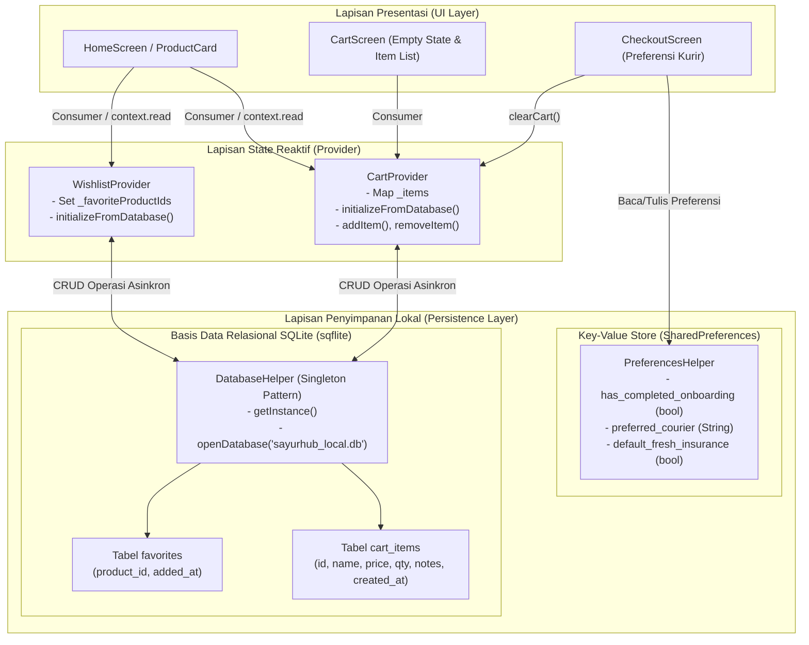

# MODUL 15: PENYIMPANAN DATA LOKAL — SHAREDPREFERENCES DAN BASIS DATA RELASIONAL SQLITE (SQFLITE)

---

## A. IDENTITAS MODUL
* **Mata Pelajaran**: Pemrograman Perangkat Bergerak (*Mobile Application Development*)
* **Kelas / Semester**: XI / XII SMK Kompetensi Keahlian Rekayasa Perangkat Lunak (RPL)
* **Alokasi Waktu**: 8 Jam Pelajaran (@ 45 Menit) / 2 Pertemuan Praktikum Terbimbing
* **Judul Modul**: Persistensi Data Offline Menggunakan SharedPreferences dan Basis Data Relasional SQLite pada Proyek SayurHub
* **Model Pembelajaran**: *Project-Based Learning* (PjBL), *Live Coding*, dan *Architectural Refactoring*
* **Prasyarat**: 
  - [Modul 06: Object-Oriented Programming & Data Modeling](file:///home/arif/flutter-1/docs/modul/06_OBJECT_ORIENTED_PROGRAMMING_DART.md)
  - [Modul 07: Asynchronous Programming (Future, Async/Await)](file:///home/arif/flutter-1/docs/modul/07_ASYNCHRONOUS_PROGRAMMING_DART.md)
  - [Modul 13: Input Form & Validasi Checkout](file:///home/arif/flutter-1/docs/modul/13_INPUT_FORM_DAN_VALIDASI.md)
  - [Modul 14: State Management dengan Provider](file:///home/arif/flutter-1/docs/modul/14_STATE_MANAGEMENT_PROVIDER.md)

---

## B. PETA KONSEP & CAPAIAN PEMBELAJARAN

### B.1 Peta Konsep Arsitektur Persistensi Data Lokal



### B.2 Capaian Pembelajaran Elemen (CP)
Pada akhir modul ini, peserta didik kompetensi keahlian RPL mampu:
1. Mengidentifikasi spektrum opsi penyimpanan data pada sistem operasi bergerak (Android & iOS) meliputi *In-Memory* (RAM), *Key-Value Store* (`shared_preferences`), dan *Relational Database* (`sqflite`).
2. Menganalisis kriteria pemilihan media penyimpanan yang tepat berdasarkan volume data, kompleksitas relasi, dan kebutuhan keamanan informasi.
3. Merancang dan mengimplementasikan kelas `DatabaseHelper` dengan pola perancangan *Singleton Pattern* untuk mengelola daur hidup basis data secara efisien.
4. Menulis instruksi *Data Definition Language* (DDL) untuk merancang skema tabel SQLite yang mendukung *Sound Null Safety* dan integritas referensial.
5. Mengeksekusi operasi CRUD (*Create, Read, Update, Delete*) menggunakan pemetaan objek (*Object-Relational Mapping / ORM sederhana*) secara asinkron.
6. Mencegah kerentanan keamanan *SQL Injection* dengan menerapkan *Parameterized Queries* (`whereArgs`).
7. Mengintegrasikan lapisan basis data lokal ke dalam `CartProvider` dan `WishlistProvider` sehingga data aplikasi SayurHub tetap bertahan (*persistent*) saat aplikasi ditutup atau perangkat direstart.

### B.3 Tujuan Pembelajaran Khusus (TP)
* **Kognitif**:
  - Siswa mampu menguraikan alasan teknis mengapa data keranjang belanja lebih cocok disimpan di SQLite dibandingkan SharedPreferences.
  - Siswa memahami peran fungsi `onCreate`, `onUpgrade`, dan nomor versi (*schema versioning*) dalam pemeliharaan aplikasi di masa depan.
* **Psikomotorik**:
  - Siswa mampu menambahkan paket `shared_preferences`, `sqflite`, dan `path` ke [pubspec.yaml](file:///home/arif/flutter-1/sayur_hub/pubspec.yaml).
  - Siswa mampu menulis kode konversi dua arah: dari objek `CartItem` menjadi `Map<String, dynamic>` (serialisasi) dan sebaliknya (deserialisasi).
* **Afektif**:
  - Membiasakan pola pikir *Offline-First Architecture*, di mana kenyamanan pengguna (*User Experience*) tetap terjaga optimal tanpa ketergantungan mutlak pada ketersediaan koneksi internet setiap detik.

---

## C. MATERI TEORI KOMPREHENSIF

### C.1 Lanskap Media Penyimpanan Data Mobile
Aplikasi mobile modern beroperasi di bawah batasan sumber daya perangkat yang dinamis. Pemilihan media penyimpanan data yang keliru dapat mengakibatkan konsumsi baterai boros, latensi baca-tulis tinggi, hingga potensi celah keamanan.

Berikut adalah tabel perbandingan 4 tingkatan penyimpanan pada ekosistem Flutter:

| Karakteristik | In-Memory (RAM) | Key-Value (`shared_preferences`) | Relational DB (`sqflite`) | Secure Storage (`flutter_secure_storage`) |
| :--- | :--- | :--- | :--- | :--- |
| **Sifat Data** | Sangat volatil (hilang seketika saat aplikasi dimatikan/di-kill OS). | Persisten di disk penyimpanan flash perangkat. | Persisten di disk dalam format berkas basis data tunggal (`.db`). | Persisten dan terenkripsi menggunakan modul enkripsi hardware OS. |
| **Struktur Data** | Variabel objek Dart (Class, List, Map, Set). | Pasangan Kunci-Nilai sederhana (*Primitive Key-Value*). | Tabel terstruktur dengan baris, kolom, tipe data, dan indeks. | Pasangan Kunci-Nilai terenkripsi (*Encrypted Key-Value*). |
| **Kecepatan Akses** | Sangat Cepat ($\approx$ Nanodetik). | Cepat untuk data kecil ($\approx$ Milidetik). | Sangat Cepat untuk ribuan data terindeks ($\approx$ Milidetik). | Cepat dengan *overhead* proses dekripsi hardware. |
| **Penggunaan Ideal** | State antarmuka aktif, counter klik sementara, posisi scroll. | Pengaturan tema (dark mode), flag onboarding selesai, preferensi kurir. | Keranjang belanja offline, katalog komoditas cached, riwayat transaksi. | Token JWT Bearer, PIN transaksi, password rahasia pengguna. |

---

### C.2 SharedPreferences: Kapan Digunakan dan Batasannya?
`shared_preferences` adalah pembungkus resmi Flutter untuk mekanisme penyimpanan preferensi bawaan platform:
- Pada **Android**: Membungkus berkas XML di dalam direktori `SharedPreferences` privat milik aplikasi.
- Pada **iOS**: Membungkus API `NSUserDefaults` milik sistem operasi.

#### Keunggulan:
- Sangat mudah digunakan dengan sintaks sederhana: `prefs.setBool('key', true)`, `prefs.getString('key')`.
- Sangat ringan untuk menyimpan preferensi pengguna yang sifatnya individual.

#### Batasan Kritis (Kapan TIDAK Boleh Digunakan):
1. **Tidak Dirancang untuk Data Besar / Kompleks**: Menyimpan daftar ratusan komoditas sayur dalam format JSON raksasa pada SharedPreferences akan memperlambat waktu buka (*cold start*) aplikasi karena seluruh file XML/Plist dibaca serentak ke memori.
2. **Tidak Mendukung Query SQL**: Anda tidak dapat melakukan operasi pencarian canggih seperti `WHERE category = 'Sayur' AND price < 20000 ORDER BY price ASC`.
3. **Tidak Memiliki Enkripsi Bawaan**: Nilai tersimpan dalam teks biasa (*plain text*), sehingga sangat dilarang untuk menyimpan kata sandi atau token sesi bank/keuangan.

---

### C.3 Basis Data Relasional SQLite pada Android & iOS
**SQLite** adalah mesin basis data relasional SQL yang bersifat mandiri (*self-contained*), tanpa server (*serverless*), dan berkas tunggal (*single-file*). Mesin SQLite telah tertanam (*embedded*) secara *native* di dalam kernel sistem operasi Android dan iOS.

Dalam Flutter, paket resmi **`sqflite`** memungkinkan pengembang mengeksekusi perintah SQL standar secara asinkron (*non-blocking* di atas *background thread*) sehingga animasi antarmuka pengguna tidak pernah terganggu.

#### Keunggulan SQLite untuk Aplikasi E-Commerce:
1. **Dukungan Transaksi ACID**: Menjamin data keranjang belanja tidak rusak (*corrupt*) meskipun baterai smartphone tiba-tiba habis saat proses penulisan data berlangsung.
2. **Pengindeksan & Kecepatan**: Mampu mencari satu komoditas di antara puluhan ribu produk dalam hitungan pecahan milidetik menggunakan indeks *Primary Key*.
3. **Integritas Relasional**: Memungkinkan keterikatan relasi antar-tabel (misal tabel pesanan dengan tabel rincian item pesanan).

---

### C.4 Pola Desain Singleton pada Database Helper di Dart
Dalam pengembangan perangkat lunak, membuka koneksi basis data adalah operasi yang memakan sumber daya memori dan *file handler* OS. Jika setiap widget atau provider membuat instansi koneksi database baru, perangkat akan kehabisan *file descriptor* dan berujung pada galat `DatabaseLockedException`.

Untuk mencegah hal tersebut, kita menerapkan **Singleton Pattern**:

```dart
class DatabaseHelper {
  // 1. Instansiasi statis tunggal yang diakses di seluruh aplikasi
  static final DatabaseHelper instance = DatabaseHelper._init();

  // 2. Variabel penampung koneksi internal (nullable)
  static Database? _database;

  // 3. Konstruktor privat bernama: Mencegah kelas di-instansiasi dengan 'new' dari luar
  DatabaseHelper._init();

  // 4. Getter cerdas: Mengembalikan koneksi yang sudah ada, atau menginisialisasinya jika belum ada
  Future<Database> get database async {
    if (_database != null) return _database!;
    _database = await _initDB('sayurhub_local.db');
    return _database!;
  }
}
```

---

### C.5 Siklus Hidup Basis Data dan Manajemen Versi (*Versioning*)
Ketika fungsi `openDatabase()` dieksekusi, pustaka `sqflite` memeriksa apakah berkas database sudah ada di direktori lokal perangkat:
1. **Jika berkas belum ada**:
   Sistem mengeksekusi *callback* `onCreate(db, version)`. Di sinilah perintah pembuatan tabel (*CREATE TABLE*) dieksekusi untuk pertama kali.
2. **Jika berkas sudah ada namun nomor versinya lebih tinggi**:
   Sistem mengeksekusi *callback* `onUpgrade(db, oldVersion, newVersion)`. Di sinilah kita menulis perintah migrasi seperti menambah kolom baru (`ALTER TABLE`) tanpa menghapus data belanjaan pengguna yang sudah ada sebelumnya.

---

### C.6 Pemetaan Objek Dart (Object-Relational Mapping Sederhana)
SQLite hanya memahami tipe data primitif: `INTEGER`, `REAL` (angka desimal), `TEXT` (string), dan `BLOB` (biner murni). SQLite **tidak memahami** kelas objek Dart seperti `Product` atau `CartItem`.

Oleh karena itu, pengembang wajib merancang fungsi konversi dua arah:
1. **Serialisasi (Dart Object ke Map SQLite)**:
   Menerjemahkan atribut objek ke dalam pasangan `Map<String, dynamic>`. Khusus untuk tipe boolean pada Dart (`true`/`false`), SQLite mengonversinya menjadi angka integer `1` dan `0`.
2. **Deserialisasi (Map SQLite ke Dart Object)**:
   Membaca baris hasil query tabel dan mengonversinya kembali menjadi objek Dart yang aman dari *null* (*Sound Null Safety*).

```
┌─────────────────────────┐               ┌─────────────────────────┐
│     Dart CartItem       │  Serialisasi  │     SQLite Database     │
│ - product: Product      │ ────────────> │ Kolom:                  │
│ - quantity: 2.0 (kg)    │               │ - id (TEXT)             │
│ - notes: "Paling segar" │               │ - price_per_kg (REAL)   │
│                         │ <──────────── │ - is_organic (INTEGER)  │
│                         │ Deserialisasi │ - quantity (REAL)       │
└─────────────────────────┘               └─────────────────────────┘
```

---

### C.7 Keamanan Basis Data Lokal: Mencegah SQL Injection
Banyak programmer pemula melakukan kesalahan fatal dengan menggabungkan string (*string concatenation*) secara langsung saat menulis klausa `WHERE`:

```dart
// CONTOH SANGAT BERBAHAYA (RENTAN SQL INJECTION):
await db.rawQuery("SELECT * FROM cart_items WHERE id = '" + userInputId + "'");
```

Jika pengguna iseng memasukkan ID berupa `' OR '1'='1`, mereka dapat memanipulasi atau menghapus seluruh tabel database!

#### Solusi Standar Industri: *Parameterized Queries*
Gunakan tanda tanya (`?`) sebagai penampung variabel (*placeholder*) dan lewatkan argumen melalui parameter `whereArgs`:

```dart
// CONTOH AMAN DAN RESMI (BEST PRACTICE):
await db.delete(
  'cart_items',
  where: 'id = ?',
  whereArgs: [userInputId], // Argumen otomatis di-escape oleh engine SQLite
);
```

---

## D. PEMBAHASAN KODE MENDALAM (CODE WALKTHROUGH)

### D.1 Pembungkus Konfigurasi: `PreferencesHelper`
Mari bedah berkas [preferences_helper.dart](file:///home/arif/flutter-1/sayur_hub/lib/core/utils/preferences_helper.dart):

```dart
import 'package:shared_preferences/shared_preferences.dart';

class PreferencesHelper {
  PreferencesHelper._(); // Konstruktor privat agar tidak dapat di-instansiasi sembarangan

  // Kunci konstan menghindari kesalahan pengetikan string (typo)
  static const String _keyCourierPreference = 'preferred_courier';
  static const String _keyFreshInsuranceDefault = 'default_fresh_insurance';

  /// Membaca preferensi kurir pilihan pengguna dengan nilai bawaan 'INSTANT'
  static Future<String> getPreferredCourier() async {
    final prefs = await SharedPreferences.getInstance();
    return prefs.getString(_keyCourierPreference) ?? 'INSTANT';
  }

  /// Menyimpan preferensi kurir yang dipilih di form checkout
  static Future<void> setPreferredCourier(String courierCode) async {
    final prefs = await SharedPreferences.getInstance();
    await prefs.setString(_keyCourierPreference, courierCode);
  }

  /// Mengambil preferensi apakah proteksi garansi kesegaran aktif otomatis
  static Future<bool> isFreshInsuranceDefault() async {
    final prefs = await SharedPreferences.getInstance();
    return prefs.getBool(_keyFreshInsuranceDefault) ?? true;
  }

  static Future<void> setFreshInsuranceDefault(bool isEnabled) async {
    final prefs = await SharedPreferences.getInstance();
    await prefs.setBool(_keyFreshInsuranceDefault, isEnabled);
  }
}
```

*Analisis Kunci*:
- Menggunakan nilai *fallback* dengan operator `??` menjamin fungsi tidak pernah mengembalikan `null`, sehingga kode di lapisan UI terhindar dari *Null Pointer Exception*.

---

### D.2 Inti Basis Data Relasional: `DatabaseHelper`
Mari amati berkas [database_helper.dart](file:///home/arif/flutter-1/sayur_hub/lib/core/database/database_helper.dart):

```dart
import 'package:path/path.dart';
import 'package:sayur_hub/core/models/cart_item.dart';
import 'package:sayur_hub/core/models/product.dart';
import 'package:sqflite/sqflite.dart';

class DatabaseHelper {
  static final DatabaseHelper instance = DatabaseHelper._init();
  static Database? _database;

  DatabaseHelper._init();

  static const String _dbName = 'sayurhub_local.db';
  static const int _dbVersion = 1;
  static const String tableCart = 'cart_items';
  static const String tableFavorites = 'favorites';

  Future<Database> get database async {
    if (_database != null) return _database!;
    _database = await _initDB(_dbName);
    return _database!;
  }

  Future<Database> _initDB(String filePath) async {
    // Mendapatkan direktori aman sandbox OS untuk menyimpan berkas basis data
    final dbPath = await getDatabasesPath();
    final path = join(dbPath, filePath);

    return await openDatabase(
      path,
      version: _dbVersion,
      onCreate: _createDB,
    );
  }

  Future<void> _createDB(Database db, int version) async {
    // Skema DDL tabel item keranjang
    await db.execute('''
      CREATE TABLE $tableCart (
        id TEXT PRIMARY KEY,
        name TEXT NOT NULL,
        category TEXT NOT NULL,
        price_per_kg REAL NOT NULL,
        stock INTEGER NOT NULL,
        rating REAL NOT NULL,
        is_organic INTEGER NOT NULL,
        image_url TEXT,
        description TEXT,
        quantity REAL NOT NULL,
        customer_notes TEXT,
        created_at TEXT NOT NULL
      )
    ''');

    // Skema DDL tabel produk favorit
    await db.execute('''
      CREATE TABLE $tableFavorites (
        product_id TEXT PRIMARY KEY,
        added_at TEXT NOT NULL
      )
    ''');
  }

  // Menyimpan item belanjaan dengan algoritma penanganan konflik replace
  Future<void> insertOrUpdateCartItem(CartItem item) async {
    final db = await instance.database;
    final Map<String, dynamic> row = {
      'id': item.product.id,
      'name': item.product.name,
      'category': item.product.category,
      'price_per_kg': item.product.pricePerKg,
      'stock': item.product.stock,
      'rating': item.product.rating,
      'is_organic': item.product.isOrganic ? 1 : 0,
      'image_url': item.product.imageUrl,
      'description': item.product.description,
      'quantity': item.quantity,
      'customer_notes': item.customerNotes,
      'created_at': DateTime.now().toIso8601String(),
    };

    await db.insert(
      tableCart,
      row,
      conflictAlgorithm: ConflictAlgorithm.replace,
    );
  }

  // Mengambil seluruh item keranjang dan memetakannya kembali ke List<CartItem>
  Future<List<CartItem>> getAllCartItems() async {
    final db = await instance.database;
    final List<Map<String, dynamic>> maps = await db.query(
      tableCart,
      orderBy: 'created_at ASC',
    );

    if (maps.isEmpty) return [];

    return maps.map((row) {
      final Product product = Product(
        id: row['id'] as String,
        name: row['name'] as String,
        category: row['category'] as String,
        pricePerKg: (row['price_per_kg'] as num).toDouble(),
        stock: row['stock'] as int,
        rating: (row['rating'] as num).toDouble(),
        isOrganic: (row['is_organic'] as int) == 1,
        imageUrl: row['image_url'] as String?,
        description: row['description'] as String?,
      );

      return CartItem(
        product: product,
        quantity: (row['quantity'] as num).toDouble(),
        customerNotes: row['customer_notes'] as String?,
      );
    }).toList();
  }
}
```

*Analisis Kunci*:
- **`ConflictAlgorithm.replace`**: Jika produk dengan ID yang sama dimasukkan kembali, SQLite tidak akan melempar galat *Duplicate Key Error*, melainkan secara cerdas menimpa (*upsert*) baris tersebut dengan kuantitas yang baru.
- **Konversi Tipe Data Aman**: Menggunakan `(row['price_per_kg'] as num).toDouble()` sangat penting di Dart karena driver SQLite kadang mengembalikan angka desimal murni sebagai `int` jika bernilai bulat (misal `14000`). Penggunaan `num` mencegah terjadinya *CastError*.

---

### D.3 Sinkronisasi `CartProvider` dengan SQLite
Perhatikan bagaimana [cart_provider.dart](file:///home/arif/flutter-1/sayur_hub/lib/core/providers/cart_provider.dart) menghubungkan RAM dan disk:

```dart
class CartProvider extends ChangeNotifier {
  final Map<String, CartItem> _items = {};
  bool _isLoading = true;

  bool get isLoading => _isLoading;

  /// Membaca database lokal saat aplikasi dibuka
  Future<void> initializeFromDatabase() async {
    _isLoading = true;
    notifyListeners();

    try {
      final List<CartItem> persistedItems =
          await DatabaseHelper.instance.getAllCartItems();
      _items.clear();
      for (final item in persistedItems) {
        _items[item.product.id] = item;
      }
    } catch (e) {
      debugPrint('Galat memuat data keranjang dari SQLite: $e');
    } finally {
      _isLoading = false;
      notifyListeners();
    }
  }

  /// Menambahkan produk: perbarui memori RAM secara instan, lalu simpan ke disk
  Future<void> addItem(Product product, [double quantity = 1.0]) async {
    if (_items.containsKey(product.id)) {
      final CartItem current = _items[product.id]!;
      final CartItem updated = current.copyWith(
        quantity: current.quantity + quantity,
      );
      _items[product.id] = updated;
      notifyListeners(); // UI langsung update tanpa menunggu disk!
      await DatabaseHelper.instance.insertOrUpdateCartItem(updated);
    } else {
      final CartItem newItem = CartItem(
        product: product,
        quantity: quantity,
      );
      _items[product.id] = newItem;
      notifyListeners();
      await DatabaseHelper.instance.insertOrUpdateCartItem(newItem);
    }
  }
}
```

*Analisis Kunci*:
- **Pola Optimistic UI Update**: `notifyListeners()` dipanggil **sebelum** operasi `await DatabaseHelper...` selesai. Hal ini membuat aplikasi terasa luar biasa responsif dan instan di mata pengguna karena antarmuka tidak perlu menunggu proses I/O disk yang memakan waktu beberapa milidetik.

---

## E. PERSIAPAN PRAKTIKUM & SETUP DEPENDENSI

### E.1 Dependensi `pubspec.yaml`
Pastikan paket-paket berikut telah terdaftar pada seksi `dependencies` di berkas [pubspec.yaml](file:///home/arif/flutter-1/sayur_hub/pubspec.yaml):

```yaml
dependencies:
  flutter:
    sdk: flutter
  cupertino_icons: ^1.0.8
  google_fonts: ^6.1.0
  go_router: ^14.0.0
  provider: ^6.1.2
  shared_preferences: ^2.2.2  # Penyimpanan Key-Value
  sqflite: ^2.3.2             # Driver Basis Data Relasional SQLite
  path: ^1.9.0                # Utilitas Penggabungan Path Berkas Lintas Platform
```

Sinkronisasikan paket melalui terminal:
```bash
flutter pub get
```

### E.2 Struktur Direktori Baru
```text
sayur_hub/
├── lib/
│   ├── core/
│   │   ├── database/                 <-- FOLDER BARU MODUL 15
│   │   │   └── database_helper.dart  <-- Singleton Pengelola SQLite
│   │   ├── providers/
│   │   │   ├── cart_provider.dart    <-- Sinkronisasi SQLite
│   │   │   └── wishlist_provider.dart<-- Sinkronisasi SQLite
│   │   └── utils/
│   │       ├── preferences_helper.dart<-- FOLDER BARU: Wrapper SharedPreferences
│   │       └── price_calculator.dart
│   ├── features/
│   │   ├── cart/
│   │   │   └── cart_screen.dart      <-- Dilengkapi Indikator Loading SQLite
│   │   └── checkout/
│   │       └── checkout_screen.dart  <-- Integrasi Preferensi Kurir Tersimpan
│   └── main.dart                     <-- WidgetsFlutterBinding Initialization
```

---

## F. LANGKAH DEMI LANGKAH PRAKTIKUM (STEP-BY-STEP TUTORIAL)

### Langkah 1: Membangun Utilitas `PreferencesHelper`
1. Buat berkas baru di `lib/core/utils/preferences_helper.dart`.
2. Deklarasikan konstanta kunci `_keyCourierPreference` dan `_keyFreshInsuranceDefault`.
3. Buat metode asinkron getter dan setter untuk membaca dan menyimpan preferensi tersebut.

### Langkah 2: Merancang Kelas Singleton `DatabaseHelper`
1. Buat berkas baru di `lib/core/database/database_helper.dart`.
2. Terapkan pola *Singleton* dengan konstruktor privat `DatabaseHelper._init()`.
3. Buat fungsi `_initDB` yang menggabungkan direktori `getDatabasesPath()` dengan nama berkas `sayurhub_local.db`.
4. Definisikan skema tabel `cart_items` dan `favorites` pada fungsi `_createDB`.
5. Tulis fungsi CRUD:
   - `insertOrUpdateCartItem`
   - `getAllCartItems`
   - `updateCartItemQuantity`
   - `deleteCartItem`
   - `clearAllCartItems`

### Langkah 3: Mengaitkan Persistensi ke dalam `CartProvider`
1. Buka [cart_provider.dart](file:///home/arif/flutter-1/sayur_hub/lib/core/providers/cart_provider.dart).
2. Tambahkan properti `bool _isLoading = true;` beserta getternya.
3. Buat metode `initializeFromDatabase()` untuk memuat data tersimpan dari `DatabaseHelper.instance.getAllCartItems()`.
4. Modifikasi metode `addItem()`, `removeSingleItem()`, `removeItem()`, dan `clearCart()` agar secara otomatis mengeksekusi operasi penulisan/penghapusan ke SQLite.

### Langkah 4: Mengaitkan Persistensi ke dalam `WishlistProvider`
1. Buka [wishlist_provider.dart](file:///home/arif/flutter-1/sayur_hub/lib/core/providers/wishlist_provider.dart).
2. Tambahkan metode `initializeFromDatabase()` untuk memuat sekumpulan ID produk favorit dari tabel `favorites`.
3. Modifikasi fungsi `toggleFavorite()` agar menyimpan atau menghapus baris ID di basis data SQLite.

### Langkah 5: Memastikan Inisialisasi Binding di `main.dart`
1. Buka [main.dart](file:///home/arif/flutter-1/sayur_hub/lib/main.dart).
2. Pastikan baris `WidgetsFlutterBinding.ensureInitialized();` dipanggil di dalam fungsi `main()` sebelum `runApp()`.
3. Gunakan operator cascade `..initializeFromDatabase()` pada saat pembuatan provider:
   ```dart
   ChangeNotifierProvider(
     create: (_) => CartProvider()..initializeFromDatabase(),
   ),
   ChangeNotifierProvider(
     create: (_) => WishlistProvider()..initializeFromDatabase(),
   ),
   ```

### Langkah 6: Mengintegrasikan Layar Checkout dengan Preferensi Lokal
1. Buka [checkout_screen.dart](file:///home/arif/flutter-1/sayur_hub/lib/features/checkout/checkout_screen.dart).
2. Di dalam method `initState()`, panggil `PreferencesHelper.getPreferredCourier()` untuk menetapkan kurir default sesuai pilihan terakhir pengguna.
3. Saat pengguna mengonfirmasi pesanan, simpan kurir yang dipilih kembali ke SharedPreferences.

---

## G. ANALISIS & PEMAHAMAN MENDALAM

### G.1 Mengapa SharedPreferences Tidak Boleh Dipakai Menyimpan Kata Sandi?
SharedPreferences menyimpan seluruh datanya dalam format XML polos (*plain-text*) di lokasi `/data/data/<package_name>/shared_prefs/` pada Android. Jika sebuah ponsel di-*root* atau diekstraksi menggunakan kabel data (melalui Android Debug Bridge / ADB), siapa pun dapat membuka file XML tersebut dengan teks editor biasa dan membaca seluruh kredensial rahasia pengguna tanpa hambatan! Untuk data rahasia perbankan atau token JWT, kita wajib menggunakan **Keystore Hardware** yang akan kita pelajari di Modul 17.

---

### G.2 Mengapa Koneksi SQLite Wajib Menerapkan Singleton Pattern?
Perhatikan skenario jika tanpa Singleton:
- Halaman Katalog membuka koneksi `DatabaseHelper()`.
- Bersamaan dengan itu, halaman Detail Produk membuka koneksi `DatabaseHelper()`.
- Di latar belakang, proses sinkronisasi membuka koneksi ketiga.

Engine SQLite mengunci berkas basis data (*file locking*) saat proses penulisan (*write transaction*) sedang berjalan. Jika dua koneksi berbeda mencoba menulis pada waktu yang bersamaan, sistem operasi akan melempar galat fatal:
```text
sqlite3.OperationalError: database is locked
```
Dengan pola **Singleton**, hanya ada **satu antrean koneksi terpadu**, sehingga transaksi basis data dieksekusi secara berurutan dan aman (*thread-safe*).

---

### G.3 Mengapa Kolom `is_organic` Disimpan Sebagai Integer (0 dan 1)?
Standar spesifikasi SQLite tidak memiliki tipe data asli bernama `BOOLEAN`. Sebagai gantinya, SQLite menggunakan tipe `INTEGER`:
- Nilai `0` merepresentasikan `false`
- Nilai `1` merepresentasikan `true`

Dalam kode Dart, konversi dilakukan dengan ekspresi kondisi:
```dart
// Serialisasi ke SQLite:
'is_organic': product.isOrganic ? 1 : 0

// Deserialisasi dari SQLite:
isOrganic: (row['is_organic'] as int) == 1
```

---

## H. LATIHAN MANDIRI & TANTANGAN TERSTRUKTUR

### H.1 Latihan Teori (5 Soal Pilihan Ganda & Analisis)

1. **Soal**: Manakah dari tipe data berikut yang didukung secara *native* oleh pustaka `shared_preferences` tanpa perlu konversi manual?
   - A. `Map<String, dynamic>`
   - B. `DateTime`
   - C. `List<String>`
   - D. Objek kelas kustom `Product`
   *Kunci Jawaban*: **C**. `shared_preferences` secara bawaan mendukung tipe primitif `int`, `double`, `bool`, `String`, dan `List<String>`.

2. **Soal**: Apa fungsi utama pemanggilan `WidgetsFlutterBinding.ensureInitialized()` sebelum membuka database SQLite pada fungsi `main()`?
   - A. Menghubungkan ponsel ke jaringan internet.
   - B. Memastikan saluran komunikasi biner (*Platform Channels*) antara kode Dart dan kode Native platform (Android/iOS) telah siap sebelum operasi asinkron disk dijalankan.
   - C. Mempercepat proses kompilasi kode Dart.
   - D. Mencegah aplikasi menampilkan splash screen bawaan.
   *Kunci Jawaban*: **B**. Paket seperti `sqflite` dan `shared_preferences` membutuhkan jalur *platform channels* native yang aktif. Jika belum diinisialisasi, aplikasi akan crash dengan galat `ServicesBinding has not been initialized`.

3. **Soal**: Perhatikan klausa SQL berikut:
   ```sql
   INSERT INTO cart_items (id, name, quantity) VALUES (?, ?, ?)
   ON CONFLICT(id) DO UPDATE SET quantity = excluded.quantity;
   ```
   Pada pustaka `sqflite`, perilaku di atas dapat dicapai secara praktis dengan menetapkan parameter:
   - A. `conflictAlgorithm: ConflictAlgorithm.abort`
   - B. `conflictAlgorithm: ConflictAlgorithm.ignore`
   - C. `conflictAlgorithm: ConflictAlgorithm.replace`
   - D. `conflictAlgorithm: ConflictAlgorithm.fail`
   *Kunci Jawaban*: **C**. `ConflictAlgorithm.replace` secara otomatis memperbarui baris jika terjadi benturan *Primary Key*.

4. **Soal**: Mengapa kita menggunakan pustaka `path` dan fungsi `join(dbPath, 'nama.db')` dibandingkan penggabungan string biasa (`'$dbPath/nama.db'`)?
   - A. Agar nama file terenkripsi secara otomatis.
   - B. Menjamin kompatibilitas separator folder lintas sistem operasi (Android menggunakan `/`, sedangkan sistem operasi desktop seperti Windows menggunakan `\`).
   - C. Menghemat kuota internet pengguna.
   - D. Merupakan syarat mutlak dari Google Play Store.
   *Kunci Jawaban*: **B**. Pustaka `path` menangani perbedaan karakter pemisah direktori antar-sistem operasi secara transparan.

5. **Soal**: Di mana lokasi fisik berkas basis data SQLite `sayurhub_local.db` disimpan pada perangkat Android?
   - A. Di memori kartu SD eksternal publik.
   - B. Di direktori sandboxed privat aplikasi (`/data/data/<package_name>/databases/`).
   - C. Di cloud Google Drive pengguna.
   - D. Di dalam folder `assets/` aplikasi.
   *Kunci Jawaban*: **B**. SQLite disimpan di dalam ruang penyimpanan internal privat aplikasi yang tidak dapat diakses oleh aplikasi lain (*sandboxed*).

---

### H.2 Latihan Praktik (3 Soal Coding Hands-On)

1. **Praktik 1: Menyimpan Catatan Pembeli Khusus ke SQLite**
   - *Tugas*: Modifikasi antarmuka di `CartScreen` agar pengguna dapat mengetik catatan belanja khusus pada masing-masing item (misal: "Pilih wortel ukuran sedang"). Simpan catatan tersebut ke kolom `customer_notes` pada tabel SQLite dan pastikan teks catatan tersebut tidak hilang saat aplikasi ditutup lalu dibuka kembali.
2. **Praktik 2: Fitur Reset Preferensi Kurir**
   - *Tugas*: Tambahkan tombol kecil "Reset ke Pengaturan Awal" di bagian bawah layar checkout yang mengeksekusi `PreferencesHelper.clearAllPreferences()`. Tampilkan notifikasi `SnackBar` bahwa preferensi berhasil dikembalikan ke nilai default.
3. **Praktik 3: Filter Kueri SQLite Berdasarkan Kategori**
   - *Tugas*: Tambahkan metode baru pada `DatabaseHelper`:
     `Future<List<CartItem>> getCartItemsByCategory(String categoryName)`.
     Gunakan parameterized query `where: 'category = ?'` dan uji fungsinya melalui skrip CLI.

---

### H.3 Tantangan Pemrograman (2 Tantangan Studi Kasus Lanjutan)

1. **Tantangan 1: Migrasi Skema Basis Data (Database Versioning & onUpgrade)**
   - *Skenario*: Pada versi SayurHub v2.0, tim produk meminta penambahan fitur "Diskon Khusus Member" dengan menambahkan kolom baru `discount_rate REAL DEFAULT 0.0` pada tabel `cart_items`.
   - *Instruksi*: Tingkatkan `_dbVersion` menjadi `2`. Tulis logika di dalam fungsi `_onUpgradeDB` menggunakan perintah `ALTER TABLE cart_items ADD COLUMN discount_rate REAL DEFAULT 0.0` sehingga data keranjang belanja yang sudah ada milik pengguna lama tidak terhapus saat aplikasi diperbarui.
2. **Tantangan 2: Ekspor Basis Data Keranjang ke Format JSON Cadangan**
   - *Skenario*: Pengguna ingin mencadangkan (*backup*) daftar belanjaan mereka sebelum berganti smartphone.
   - *Instruksi*: Buat fungsi `Future<String> exportCartToJson()` pada `DatabaseHelper` yang membaca seluruh tabel `cart_items` dan mengonversinya menjadi string JSON terformat rapi (*pretty print*) menggunakan `jsonEncode()`.

---

### H.4 Studi Kasus Riil Industri (1 Kasus Nyata)
* **Kasus**: Penanganan Pembelian Sayur Segar pada Mode Offline Total (*Airplane Mode*).
* **Kebutuhan Lapangan**:
  Seorang ibu rumah tangga sedang berbelanja sayur di aplikasi SayurHub saat berada di dalam lift atau area parkir bawah tanah (*basement*) pasar yang tidak memiliki sinyal seluler sama sekali.
* **Tantangan**:
  Aplikasi tidak boleh menampilkan pesan galat crash atau layar blank. Pengguna harus tetap bebas memilih sayur, menambahkan kuantitas kilogram, dan melihat total tagihan secara akurat.
* **Solusi**:
  Jelaskan alur bagaimana arsitektur `CartProvider` yang telah kita buat bersama `DatabaseHelper` mengatasi masalah ini secara elegan tanpa membutuhkan koneksi server sama sekali.

---

## I. TROUBLESHOOTING & SOLUSI PRAKTIS

### Error 1: `MissingPluginException(No implementation found for method ...)`
* **Gejala**: Aplikasi crash saat pertama kali memanggil `getDatabasesPath()` atau `SharedPreferences.getInstance()`.
* **Penyebab**: Kode native Android/iOS untuk pustaka `sqflite` atau `shared_preferences` belum terkompilasi karena aplikasi dijalankan via Hot Reload setelah menambahkan paket baru di `pubspec.yaml`.
* **Solusi**: Matikan aplikasi sepenuhnya (*Stop Debugging*), jalankan `flutter clean`, lalu lakukan kompilasi ulang dari awal (*Full Rebuild / Restart Run*).

### Error 2: `DatabaseException: no such table: cart_items`
* **Gejala**: Galat muncul saat pertama kali mengeksekusi perintah `db.insert()`.
* **Penyebab**: Fungsi `_createDB` tidak dieksekusi karena berkas database dengan nama yang sama sudah terlanjur dibuat sebelumnya saat proses *development* dalam kondisi tabel belum didefinisikan secara benar.
* **Solusi**:
  1. Hapus instalasi aplikasi dari emulator / perangkat fisik (*Uninstall App*) agar berkas database lama terhapus bersih.
  2. Atau tingkatkan konstanta `_dbVersion` dari `1` ke `2`.

### Error 3: Layar Keranjang Sempat Menampilkan Tulisan "Kosong" Selama 0.5 Detik Sebelum Item Muncul
* **Gejala**: Terjadi kedipan visual (*flicker*) saat halaman keranjang baru dibuka.
* **Penyebab**: Nilai `_items` di memori RAM masih kosong saat widget pertama kali merender, karena proses pembacaan dari SQLite bersifat asinkron (`Future`).
* **Solusi**: Manfaatkan properti `cart.isLoading`. Jika bernilai `true`, tampilkan `CircularProgressIndicator` yang rapi sebelum menampilkan daftar item.

---

## J. PRAKTIKUM INTEGRASI ANTAR-MODUL

Berikut adalah peta interaksi integrasi data lokal dengan modul-modul lain:

```text
[Modul 06: Entity Model] ──> Product & CartItem mendefinisikan struktur data
             │
             ▼
[Modul 15: DatabaseHelper] ──> Menyimpan data ke disk lokal SQLite
             ▲
             │ (Sinkronisasi Asinkron)
             ▼
[Modul 14: CartProvider]  ──> Mengatur reaktivitas tampilan UI
             │
             ▼
[Modul 13: CheckoutScreen] ──> Mengambil subtotal riil & menyimpan preferensi kurir
```

### Verifikasi Validasi Logika via Skrip Demo CLI
Jalankan berkas [modul_15_persistence_demo.dart](file:///home/arif/flutter-1/sayur_hub/bin/modul_15_persistence_demo.dart) untuk memeriksa skema tabel dan logika konversi data:

```bash
dart run bin/modul_15_persistence_demo.dart
```

*Keluaran Pengujian yang Diharapkan*:
```text
================================================================
       SAYURHUB MODUL 15: LOCAL PERSISTENCE SIMULATION TEST      
================================================================

[1] PENGUJIAN SKEMA TABEL SQLITE DDL
DDL Cart Items Table:
CREATE TABLE cart_items (
  id TEXT PRIMARY KEY,
  name TEXT NOT NULL,
  category TEXT NOT NULL,
  price_per_kg REAL NOT NULL,
  stock INTEGER NOT NULL,
  rating REAL NOT NULL,
  is_organic INTEGER NOT NULL,
  image_url TEXT,
  description TEXT,
  quantity REAL NOT NULL,
  customer_notes TEXT,
  created_at TEXT NOT NULL
);

[2] PENGUJIAN MAPPING ENTITAS MODEL KE SQLITE ROW (SERIALISASI)
Baris Map SQLite yang berhasil dibuat:
  - id: P01 (String)
  - name: Bayam Hijau Hidroponik (String)
  - category: Sayuran Daun (String)
  - price_per_kg: 14000.0 (double)
  - stock: 25 (int)
  - rating: 4.8 (double)
  - is_organic: 1 (int)
  - quantity: 3.0 (double)
  - customer_notes: Pilih daun yang masih segar dan belum menguning (String)

[3] PENGUJIAN DESERIALISASI ROW SQLITE KEMBALI KE OBJEK CARTITEM
Verifikasi Integritas Objek Pulih:
  - Nama Produk: Bayam Hijau Hidroponik
  - Kategori: Sayuran Daun
  - Kuantitas: 3.0 kg
  - Organik: true
  - Catatan: Pilih daun yang masih segar dan belum menguning
  - Subtotal: Rp 42.000

[4] VERIFIKASI KONFIGURASI PREFERENCES (KEY-VALUE)
Konfigurasi SharedPreferences berhasil diuji: {has_completed_onboarding: true, preferred_courier: SAMEDAY, default_fresh_insurance: true}

================================================================
   SEMUA VALIDASI PERSISTENSI LOKAL (MODUL 15) BERHASIL 100%!   
================================================================
```

---

## K. EVALUASI MODUL & RUBRIK PENILAIAN

### K.1 Format Rubrik Penilaian Portofolio Siswa (Skala 1 - 4)

| Kriteria Penilaian | Skor 1 (Perlu Bimbingan) | Skor 2 (Cukup) | Skor 3 (Baik) | Skor 4 (Sangat Memuaskan / Profesional) |
| :--- | :--- | :--- | :--- | :--- |
| **Arsitektur Database & Singleton** | Tidak menggunakan Singleton; koneksi dibuat berulang-ulang di setiap widget. | Menerapkan Singleton namun struktur DDL masih belum memiliki tipe data yang tepat. | Menerapkan Singleton dengan DDL lengkap dan penanganan konflik `replace`. | Arsitektur sangat rapi, mendukung migrasi versi (`onUpgrade`), dan penutupan koneksi aman. |
| **Pencegahan SQL Injection & ORM Mapping** | Menggunakan penggabungan string langsung tanpa `whereArgs`. | Menggunakan `whereArgs` namun konversi tipe data angka desimal sering menyebabkan *CastError*. | Konversi dua arah (serialisasi/deserialisasi) aman dari *null* dan menerapkan parameterisasi query. | Seluruh operasi aman dari injeksi, konversi tipe data robust menggunakan `num`, dan penanganan error komprehensif. |
| **Sinkronisasi Provider & UI Reaktif** | Data tersimpan di SQLite namun antarmuka tidak otomatis ter-update. | Data ter-update di UI namun terjadi *flicker* karena penanganan status loading belum diatur. | Sinkronisasi berjalan lancar; data tetap ada saat aplikasi ditutup paksa dan dibuka kembali. | Menerapkan pola *Optimistic Update*, penanganan state *loading* halus, dan pengalaman pengguna mulus 100%. |
| **Pemanfaatan SharedPreferences** | Menggunakan SharedPreferences untuk menyimpan seluruh data produk. | Mampu menyimpan data preferensi namun tidak menyediakan nilai default (*fallback*). | Menggunakan SharedPreferences secara tepat untuk preferensi kurir dan asuransi dengan nilai fallback aman. | Wrapper kelas terisolasi rapi (`PreferencesHelper`), mudah diuji, dan dilengkapi dokumentasi kode profesional. |

---

### K.2 Lembar Refleksi Diri Siswa
1. Setelah mempelajari modul ini, jelaskan dengan kalimat Anda sendiri perbedaan mendasar antara menyimpan data di variabel RAM dengan menyimpannya di file basis data SQLite!
2. Mengapa kita tidak boleh menyimpan kata sandi pengguna di SharedPreferences?
3. Apa kepuasan terbesar Anda saat mencoba menutup aplikasi SayurHub secara paksa lalu membukanya kembali dan melihat sayur pilihan Anda masih ada di dalam keranjang?

---

## L. KESIMPULAN & JEMBATAN KE MODUL BERIKUTNYA

### L.1 Rangkuman Modul 15
Kerja keras yang luar biasa! Aplikasi SayurHub kini telah melangkah ke jenjang aplikasi kelas komersial (*production-grade*):
1. **Daya Tahan Offline Penuh**: Data keranjang belanja dan komoditas favorit kini terlindungi secara aman di dalam basis data relasional SQLite lokal perangkat. Pengguna tidak perlu khawatir kehilangan belanjaan saat aplikasi tiba-tiba tertutup.
2. **Kenyamanan Terpersonalisasi**: Preferensi kurir dan opsi asuransi kesegaran tersimpan secara otomatis menggunakan `SharedPreferences`.
3. **Arsitektur Tangguh**: Melalui pola *Singleton* pada `DatabaseHelper` dan *Optimistic Update* pada `CartProvider`, aplikasi SayurHub tetap beroperasi secepat kilat tanpa terkendala latensi baca-tulis media penyimpanan.

### L.2 Menuju Modul 16: Integrasi REST API dan Komunikasi Jaringan Backend
Saat ini, katalog komoditas sayur dan buah yang tampil di beranda aplikasi SayurHub masih bersumber dari data lokal (*Mock Data* di kode Dart). Pada dunia industri yang sesungguhnya:
- Harga sayuran berubah setiap hari mengikuti fluktuasi pasar induk.
- Stok barang diperbarui secara *real-time* oleh admin gudang melalui *dashboard backend*.
- Petani menambahkan komoditas hasil panen baru secara dinamis ke server pusat.

Oleh karena itu, pada **Modul 16: Integrasi REST API dan Komunikasi Jaringan Backend**, kita akan mempelajari:
- Membangun jembatan komunikasi jaringan menggunakan protokol HTTP/HTTPS dan pustaka jaringan modern (**Dio / http**).
- Mengambil (*fetch*) katalog komoditas langsung dari endpoint REST API backend (`GET /api/v1/products`).
- Menangani berbagai status jaringan: *Loading Skeleton Shimmer Effect*, *Success State*, *Empty State*, serta penanganan *Timeout & No Internet Connection*.
- Menerapkan fitur **Pull-to-Refresh** untuk memperbarui katalog sayur hanya dengan mengusap layar ke bawah.

Persiapkan diri Anda untuk menghubungkan SayurHub dengan dunia internet global!
