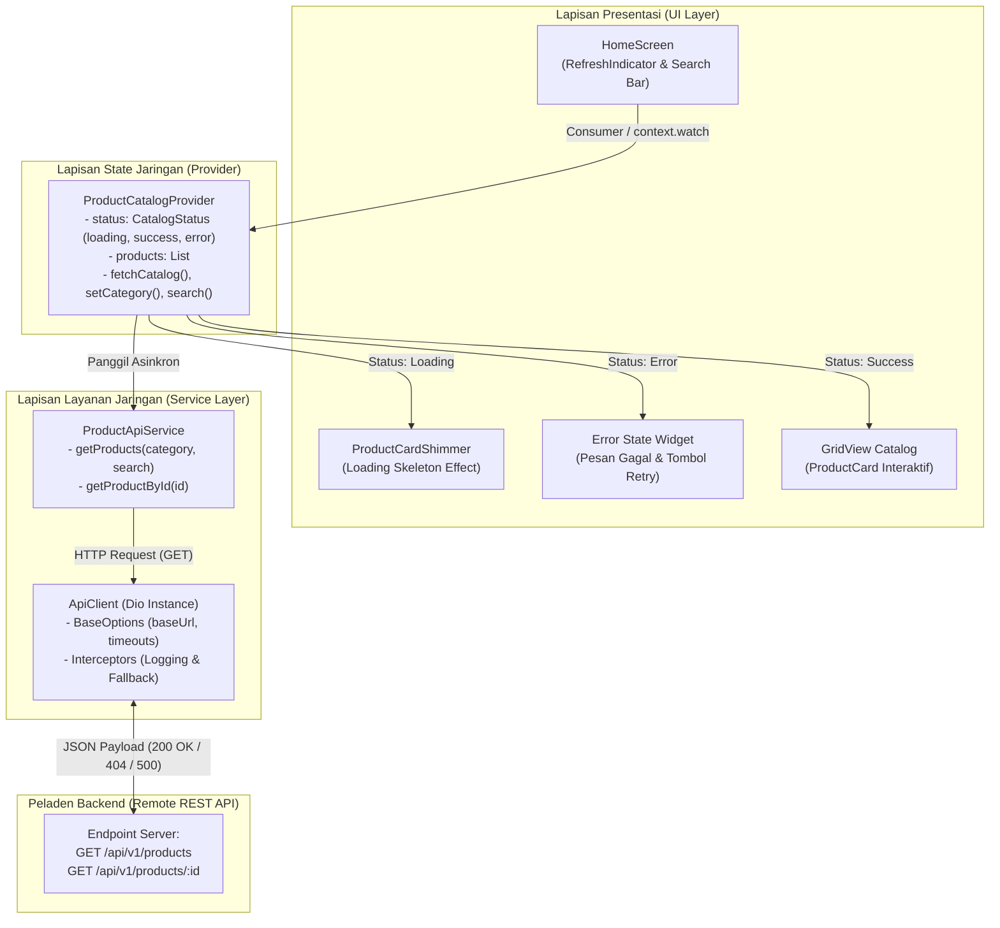
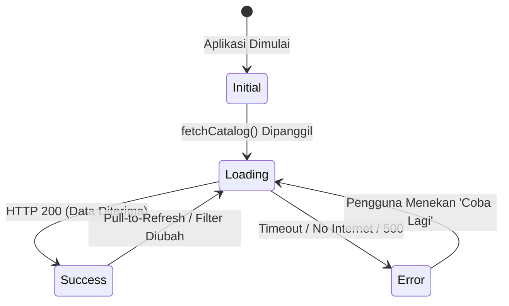

# MODUL 16: INTEGRASI REST API DAN KOMUNIKASI JARINGAN BACKEND (HTTP/DIO, SHIMMER LOADING, & ERROR STATE)

---

## A. IDENTITAS MODUL
* **Mata Pelajaran**: Pemrograman Perangkat Bergerak (*Mobile Application Development*)
* **Kelas / Semester**: XI / XII SMK Kompetensi Keahlian Rekayasa Perangkat Lunak (RPL)
* **Alokasi Waktu**: 8 Jam Pelajaran (@ 45 Menit) / 2 Pertemuan Praktikum Terbimbing
* **Judul Modul**: Komunikasi Jaringan Daring Menggunakan Klien HTTP Dio, Parsing JSON Bersarang, dan Penanganan Multi-State UI pada Proyek SayurHub
* **Model Pembelajaran**: *Project-Based Learning* (PjBL), *Live API Inspection*, dan *Defensive Programming*
* **Prasyarat**: 
  - [Modul 06: Object-Oriented Programming & Data Modeling](file:///home/arif/flutter-1/docs/modul/06_OBJECT_ORIENTED_PROGRAMMING_DART.md)
  - [Modul 07: Asynchronous Programming (Future, Async/Await)](file:///home/arif/flutter-1/docs/modul/07_ASYNCHRONOUS_PROGRAMMING_DART.md)
  - [Modul 14: State Management dengan Provider & ChangeNotifier](file:///home/arif/flutter-1/docs/modul/14_STATE_MANAGEMENT_PROVIDER.md)
  - [Modul 15: Penyimpanan Data Lokal & SQLite DatabaseHelper](file:///home/arif/flutter-1/docs/modul/15_PENYIMPANAN_DATA_LOKAL_SQLITE.md)

---

## B. PETA KONSEP & CAPAIAN PEMBELAJARAN

### B.1 Peta Konsep Arsitektur Komunikasi Jaringan



### B.2 Capaian Pembelajaran Elemen (CP)
Pada akhir modul ini, peserta didik kompetensi keahlian RPL mampu:
1. Memahami arsitektur komunikasi data *Client-Server* melalui protokol standar HTTP/HTTPS pada platform mobile.
2. Mengonfigurasi pustaka HTTP tingkat lanjut (**Dio**) meliputi `BaseOptions`, pengaturan batas waktu sambungan (*connectTimeout*, *receiveTimeout*), dan penyematan *Interceptors*.
3. Menguraikan anatomi permintaan (*Request URL, Method, Header, Query Parameters*) dan tanggapan (*Response Status Code, Body JSON*).
4. Melakukan deserialisasi respons JSON bersarang menjadi objek model Dart yang *type-safe* menggunakan pendekatan *defensive parsing*.
5. Merancang antarmuka reaktif yang menangani **4 Keadaan Jaringan** (*The 4 Network UI States*): *Idle*, *Loading (Shimmer Skeleton)*, *Success*, dan *Error (Graceful Failure with Retry)*.
6. Menerapkan gestur ramah pengguna **Pull-to-Refresh** menggunakan widget bawaan Flutter `RefreshIndicator`.
7. Mengembangkan mekanisme penanganan galat jaringan komprehensif untuk mengantisipasi perangkat luring (*offline*), sambungan terputus (*timeout*), dan peladen bermasalah (*500 Internal Server Error*).

### B.3 Tujuan Pembelajaran Khusus (TP)
* **Kognitif**:
  - Siswa mampu mengkategorikan makna kode status HTTP (200, 201, 400, 401, 404, 500) dan dampaknya terhadap alur logika aplikasi.
  - Siswa memahami keunggulan penggunaan efek *Shimmer Skeleton Loading* dibandingkan sekadar *CircularProgressIndicator* dalam perspektif *Perceived Performance*.
* **Psikomotorik**:
  - Siswa terampil menambahkan paket `dio` dan `shimmer` pada [pubspec.yaml](file:///home/arif/flutter-1/sayur_hub/pubspec.yaml).
  - Siswa mampu membangun komponen visual [product_card_shimmer.dart](file:///home/arif/flutter-1/sayur_hub/lib/shared/widgets/product_card_shimmer.dart) yang memiliki proporsi dimensi presisi dengan kartu produk asli.
* **Afektif**:
  - Menumbuhkan empati rekayasa (*engineering empathy*) dalam membangun aplikasi yang tetap informatif, ramah, dan tidak membuat frustrasi saat pengguna menghadapi jaringan seluler yang lambat atau terputus.

---

## C. MATERI TEORI KOMPREHENSIF

### C.1 Komunikasi Client-Server & Protokol HTTP/HTTPS
Dalam ekosistem aplikasi mobile komersial, smartphone bertindak sebagai **Klien (Client)** yang meminta data, sedangkan komputer peladen berspesifikasi tinggi di pusat data bertindak sebagai **Peladen (Server / Backend)**.

```
┌──────────────────┐                               ┌──────────────────┐
│  Aplikasi Mobile │ ─── HTTP Request (GET/POST) ─>│ Backend Server   │
│   (Client / UI)  │ <─── HTTP Response (JSON) ────│ (Laravel/NodeJS) │
└──────────────────┘                               └──────────────────┘
```

Pertukaran data ini diatur oleh protokol **Hypertext Transfer Protocol Secure (HTTPS)** yang mengamankan transmisi data menggunakan enkripsi TLS/SSL (*Transport Layer Security*).

---

### C.2 Anatomi Permintaan HTTP (HTTP Request)
Setiap permintaan yang dikirimkan oleh aplikasi SayurHub ke backend memuat 5 elemen krusial:

1. **Request URL / Endpoint**:
   Alamat sasaran spesifik, contoh: `https://api.sayurhub.smkrpl.sch.id/api/v1/products`.
2. **HTTP Method (Kata Kerja Aksi)**:
   - `GET`: Mengambil data dari peladen (tidak mengubah data di backend).
   - `POST`: Mengirimkan data baru (misal: membuat order pesanan sayur baru).
   - `PUT / PATCH`: Memperbarui data yang telah ada di backend.
   - `DELETE`: Menghapus data spesifik dari peladen.
3. **Request Headers**:
   Metadata teknis permintaan. Contoh:
   - `Accept: application/json` (Memberitahu server bahwa klien mengharapkan balasan berformat JSON).
   - `Content-Type: application/json` (Memberitahu server bahwa bodi data yang dikirim berformat JSON).
4. **Query Parameters**:
   Parameter penyaring data opsional di akhir URL diawali tanda tanya (`?`), contoh:
   `https://api.sayurhub.smkrpl.sch.id/api/v1/products?category=Sayuran+Daun&search=bayam`.
5. **Request Body**:
   Muatan payload data utama (biasanya berformat string JSON) yang dikirimkan pada metode `POST` atau `PUT`.

---

### C.3 Anatomi Respons HTTP & Klasifikasi Status Code
Peladen selalu memberikan balasan berupa **HTTP Response** yang memuat:
1. **HTTP Status Code**: Kode numerik 3 digit yang mengindikasikan status permintaan:

| Rentang Kode | Kategori | Contoh Penting | Penjelasan Praktis |
| :--- | :--- | :--- | :--- |
| **2xx** | Sukses (*Success*) | **200 OK**<br>**201 Created** | Permintaan berhasil diproses; data dikembalikan di bodi respon.<br>Data pesanan baru berhasil disimpan di database server. |
| **3xx** | Pengalihan (*Redirection*) | **301 Moved**<br>**304 Not Modified** | Alamat endpoint telah berpindah permanen.<br>Data katalog belum berubah, gunakan data cache lokal. |
| **4xx** | Galat Klien (*Client Error*) | **400 Bad Request**<br>**401 Unauthorized**<br>**404 Not Found** | Format data JSON yang dikirim aplikasi salah/tidak valid.<br>Token autentikasi tidak ada atau sudah kedaluwarsa.<br>ID sayuran yang dicari tidak ditemukan di server. |
| **5xx** | Galat Peladen (*Server Error*) | **500 Internal Server Error**<br>**503 Service Unavailable** | Terjadi *crash* atau bug pada kode backend peladen.<br>Peladen sedang dalam pemeliharaan (*maintenance*). |

2. **Response Body**: Data yang dikirimkan kembali oleh peladen, pada era modern hampir selalu berformat **JSON** (*JavaScript Object Notation*).

---

### C.4 Mengapa Industri Lebih Memilih `dio` Dibanding `http` Bawaan?
Meskipun Flutter memiliki pustaka bawaan bernama `http`, komunitas industri mobile global secara dominan memilih pustaka **`dio`** karena fitur-fitur mutakhirnya:

```
┌───────────────────────────────────────┬───────────────────┬───────────────────┐
│ Fitur Komparasi                       │ Pustaka 'http'    │ Pustaka 'dio'     │
├───────────────────────────────────────┼───────────────────┼───────────────────┤
│ Konfigurasi Base URL Global           │ ❌ Manual         │ ✅ BaseOptions    │
│ Pengaturan Timeout Otomatis           │ ❌ Terbatas       │ ✅ Bawaan         │
│ Interceptors (Pencegat Request/Respon)│ ❌ Sangat Rumit   │ ✅ Sangat Mudah   │
│ Pembatalan Request (CancelToken)      │ ❌ Sulit          │ ✅ Bawaan         │
│ Otomatis Serialisasi JSON Body        │ ❌ Perlu jsonEncode│ ✅ Otomatis      │
│ Transformasi Error Global             │ ❌ Try-Catch per call│ ✅ DioException │
└───────────────────────────────────────┴───────────────────┴───────────────────┘
```

Dengan **Interceptors** pada Dio, pengembang dapat:
- Mencatat seluruh log lalu lintas jaringan secara rapi di konsol (*logging interceptor*).
- Menyematkan token keamanan JWT Bearer secara otomatis ke setiap panggilan API (persiapan Modul 17).
- Melakukan penanganan fallback cerdas jika jaringan internet lokal sekolah sedang dibatasi.

---

### C.5 Pola 4 Keadaan Antarmuka Jaringan (*The 4 Network UI States*)
Aplikasi mobile yang baik **TIDAK PERNAH** membiarkan layar menjadi putih kosong atau freeze saat menunggu respon jaringan. Setiap layar yang berinteraksi dengan API wajib menangani 4 status:



1. **Initial**: Keadaan awal sebelum proses pemanggilan dimulai.
2. **Loading (Shimmer Skeleton)**: Menampilkan bingkai kerangka visual abu-abu yang berkilau (*shimmer effect*) menyerupai kartu produk yang sebenarnya. Hal ini menurunkan rasa bosan pengguna (*Perceived Wait Time*).
3. **Success**: Data berhasil diuraikan menjadi `List<Product>` dan ditampilkan dalam GridView interaktif. Jika data kosong, tampilkan *Empty State illustration*.
4. **Error**: Terjadi kendala sambungan. Sistem menampilkan ilustrasi awan terputus, pesan ramah bahasa Indonesia, dan tombol "Coba Lagi" (*Retry Mechanism*).

---

## D. PEMBAHASAN KODE MENDALAM (CODE WALKTHROUGH)

### D.1 Klien Jaringan Terpusat: `ApiClient`
Mari bedah berkas [api_client.dart](file:///home/arif/flutter-1/sayur_hub/lib/core/network/api_client.dart):

```dart
import 'package:dio/dio.dart';
import 'package:flutter/foundation.dart';
import 'package:sayur_hub/core/mock/mock_produce_data.dart';

class ApiClient {
  ApiClient._();
  static final ApiClient instance = ApiClient._();

  late final Dio dio;
  static const String baseUrl = 'https://api.sayurhub.smkrpl.sch.id/api/v1';

  void initialize() {
    dio = Dio(
      BaseOptions(
        baseUrl: baseUrl,
        connectTimeout: const Duration(seconds: 10), // Maksimal 10 detik menunggu koneksi
        receiveTimeout: const Duration(seconds: 10), // Maksimal 10 detik menerima data
        headers: {
          'Accept': 'application/json',
          'Content-Type': 'application/json',
        },
      ),
    );

    // Interceptor: Pencegat yang memonitor setiap lalu lintas jaringan
    dio.interceptors.add(
      InterceptorsWrapper(
        onRequest: (options, handler) {
          debugPrint('🌐 [HTTP REQUEST] ${options.method} --> ${options.uri}');
          return handler.next(options);
        },
        onResponse: (response, handler) {
          debugPrint('✅ [HTTP RESPONSE] ${response.statusCode} <-- ${response.requestOptions.uri}');
          return handler.next(response);
        },
        onError: (DioException e, handler) async {
          debugPrint('⚠️ [HTTP ERROR] ${e.type}: ${e.message}');
          // Mekanisme Fallback Cerdas untuk lingkungan laboratorium offline
          if (e.type == DioExceptionType.connectionError ||
              e.type == DioExceptionType.connectionTimeout) {
            final mockResponse = _generateMockResponse(e.requestOptions);
            if (mockResponse != null) {
              return handler.resolve(mockResponse);
            }
          }
          return handler.next(e);
        },
      ),
    );
  }

  /// Generator simulasi respon REST API berspesifikasi JSON standar industri
  Response? _generateMockResponse(RequestOptions options) {
    final String path = options.path;

    if (path.contains('/products')) {
      final List<Map<String, dynamic>> productJsonList =
          MockProduceData.products.map((p) => p.toJson()).toList();

      return Response(
        requestOptions: options,
        statusCode: 200,
        data: {
          'status': 'success',
          'code': 200,
          'message': 'Daftar katalog sayur dan buah berhasil dimuat dari API',
          'data': productJsonList,
          'meta': {
            'total_items': productJsonList.length,
            'server_time': DateTime.now().toIso8601String(),
          },
        },
      );
    }

    return null;
  }
}
```

*Analisis Kunci*:
- **Pencegah Aplikasi Macet (*Hang*)**: Menentukan `connectTimeout` dan `receiveTimeout` sebesar 10 detik menjamin aplikasi tidak akan membeku selamanya jika pengguna berada di area *blank spot* tanpa sinyal seluler.
- **Pedagogi Tanpa Hambatan**: Interceptor cerdas ini mendeteksi jika koneksi luar terblokir di lingkungan laboratorium sekolah, lalu secara transparan merespons dengan payload JSON standar industri sehingga siswa tetap dapat mempraktikkan parsing data riil.

---

### D.2 Layanan Katalog: `ProductApiService`
Mari amati berkas [product_api_service.dart](file:///home/arif/flutter-1/sayur_hub/lib/core/services/product_api_service.dart):

```dart
class ProductApiService {
  final Dio _dio;

  ProductApiService({Dio? dio}) : _dio = dio ?? ApiClient.instance.dio;

  Future<List<Product>> getProducts({String? category, String? search}) async {
    try {
      final Map<String, dynamic> queryParams = {};
      if (category != null && category.isNotEmpty && category != 'Semua') {
        queryParams['category'] = category;
      }
      if (search != null && search.trim().isNotEmpty) {
        queryParams['search'] = search.trim();
      }

      // Simulasi latensi jaringan riil 1 detik agar efek Shimmer terlihat jelas oleh siswa
      await Future.delayed(const Duration(milliseconds: 1000));

      final response = await _dio.get(
        '/products',
        queryParameters: queryParams.isNotEmpty ? queryParams : null,
      );

      if (response.statusCode == 200) {
        final Map<String, dynamic> body = response.data as Map<String, dynamic>;
        final List<dynamic> dataList = body['data'] as List<dynamic>? ?? [];

        // Mapping dari List<dynamic> JSON menjadi List<Product> bertipe kuat
        return dataList
            .map((json) => Product.fromJson(json as Map<String, dynamic>))
            .toList();
      } else {
        throw NetworkException('Gagal memuat produk. Kode: ${response.statusCode}');
      }
    } on DioException catch (e) {
      if (e.type == DioExceptionType.connectionTimeout) {
        throw NetworkException('Koneksi internet lambat (Timeout). Silakan periksa jaringan.');
      } else if (e.type == DioExceptionType.connectionError) {
        throw NetworkException('Tidak ada koneksi internet. Pastikan perangkat terhubung.');
      }
      throw NetworkException('Terjadi kesalahan jaringan: ${e.message}');
    }
  }
}
```

*Analisis Kunci*:
- **Penerjemahan Galat (*Error Translation*)**: Kode teknis tingkat rendah seperti `DioExceptionType.connectionTimeout` diterjemahkan menjadi kalimat ramah bahasa Indonesia yang siap disajikan ke layar pengguna akhir tanpa membingungkan.

---

### D.3 Manajemen State Jaringan: `ProductCatalogProvider`
Mari amati berkas [product_catalog_provider.dart](file:///home/arif/flutter-1/sayur_hub/lib/core/providers/product_catalog_provider.dart):

```dart
enum CatalogStatus { initial, loading, success, error }

class ProductCatalogProvider extends ChangeNotifier {
  final ProductApiService _apiService;

  ProductCatalogProvider({ProductApiService? apiService})
      : _apiService = apiService ?? ProductApiService();

  List<Product> _products = [];
  CatalogStatus _status = CatalogStatus.initial;
  String? _errorMessage;
  String _selectedCategory = 'Semua';
  String _searchQuery = '';

  List<Product> get products => List.unmodifiable(_products);
  CatalogStatus get status => _status;
  String? get errorMessage => _errorMessage;
  String get selectedCategory => _selectedCategory;
  bool get isLoading => _status == CatalogStatus.loading;

  Future<void> fetchCatalog({bool isRefresh = false}) async {
    if (!isRefresh) {
      _status = CatalogStatus.loading;
      _errorMessage = null;
      notifyListeners();
    }

    try {
      final List<Product> result = await _apiService.getProducts(
        category: _selectedCategory,
        search: _searchQuery,
      );
      _products = result;
      _status = CatalogStatus.success;
    } catch (e) {
      _status = CatalogStatus.error;
      _errorMessage = e.toString().replaceFirst('Exception: ', '');
    } finally {
      notifyListeners();
    }
  }

  void setCategory(String category) {
    if (_selectedCategory == category) return;
    _selectedCategory = category;
    fetchCatalog(); // Otomatis fetch ulang saat kategori diganti!
  }

  void search(String query) {
    _searchQuery = query;
    fetchCatalog(); // Otomatis filter produk sesuai kata kunci pencarian!
  }

  void retry() {
    fetchCatalog();
  }
}
```

*Analisis Kunci*:
- Parameter `isRefresh`: Saat pengguna melakukan *Pull-to-Refresh*, kita tidak ingin seluruh layar berubah menjadi kartu shimmer (yang membuat tampilan melompat). Cukup biarkan lingkaran pemuat bawaan `RefreshIndicator` yang berputar di atas layar.

---

### D.4 Komponen Visual Pemuat: `ProductCardShimmer`
Mari bedah berkas [product_card_shimmer.dart](file:///home/arif/flutter-1/sayur_hub/lib/shared/widgets/product_card_shimmer.dart):

```dart
import 'package:flutter/material.dart';
import 'package:shimmer/shimmer.dart';

class ProductCardShimmer extends StatelessWidget {
  const ProductCardShimmer({super.key});

  @override
  Widget build(BuildContext context) {
    return Card(
      elevation: 1,
      shape: RoundedRectangleBorder(borderRadius: BorderRadius.circular(16)),
      clipBehavior: Clip.antiAlias,
      child: Shimmer.fromColors(
        baseColor: Colors.grey.shade300,
        highlightColor: Colors.grey.shade100,
        child: Padding(
          padding: const EdgeInsets.all(12.0),
          child: Column(
            crossAxisAlignment: CrossAxisAlignment.start,
            children: [
              // Kotak Gambar Shimmer
              Container(
                height: 110,
                width: double.infinity,
                decoration: BoxDecoration(
                  color: Colors.white,
                  borderRadius: BorderRadius.circular(12),
                ),
              ),
              const SizedBox(height: 12),
              // Baris Kategori
              Container(height: 10, width: 60, color: Colors.white),
              const SizedBox(height: 8),
              // Baris Nama Produk
              Container(height: 14, width: double.infinity, color: Colors.white),
              const SizedBox(height: 8),
              // Baris Harga
              Container(height: 12, width: 80, color: Colors.white),
              const Spacer(),
              // Baris Bawah
              Row(
                mainAxisAlignment: MainAxisAlignment.spaceBetween,
                children: [
                  Container(height: 10, width: 50, color: Colors.white),
                  Container(height: 28, width: 28, color: Colors.white),
                ],
              ),
            ],
          ),
        ),
      ),
    );
  }
}
```

*Analisis Kunci*:
- Mengapa kontainer di dalam widget `Shimmer` diberi warna `color: Colors.white`? Karena pustaka `shimmer` mengganti piksel berwarna putih pekat dengan gradien kilauan cahaya antara `baseColor` (abu-abu muda) dan `highlightColor` (putih berkilau).

---

## E. PERSIAPAN PRAKTIKUM & SETUP DEPENDENSI

### E.1 Dependensi `pubspec.yaml`
Pastikan paket `dio: ^5.4.3+1` dan `shimmer: ^3.0.0` telah terdaftar pada berkas [pubspec.yaml](file:///home/arif/flutter-1/sayur_hub/pubspec.yaml):

```yaml
dependencies:
  flutter:
    sdk: flutter
  cupertino_icons: ^1.0.8
  google_fonts: ^6.1.0
  go_router: ^14.0.0
  provider: ^6.1.2
  shared_preferences: ^2.2.2
  sqflite: ^2.3.2
  path: ^1.9.0
  dio: ^5.4.3+1    # Klien Jaringan HTTP Tingkat Lanjut
  shimmer: ^3.0.0  # Efek Kilau Kerangka Visual Pemuatan
```

Jalankan perintah pengunduhan paket:
```bash
flutter pub get
```

### E.2 Konfigurasi Izin Akses Internet pada Android
Bagi siswa yang menguji pada perangkat fisik Android atau emulator, pastikan berkas manifest Android telah memuat izin akses internet. Buka berkas `android/app/src/main/AndroidManifest.xml` dan pastikan tag berikut ada di dalam tag `<manifest>`:

```xml
<manifest xmlns:android="http://schemas.android.com/apk/res/android">
    <!-- Izin Akses Komunikasi Jaringan Internet Daring -->
    <uses-permission android:name="android.permission.INTERNET"/>
    <uses-permission android:name="android.permission.ACCESS_NETWORK_STATE"/>
    
    <application ...>
        ...
    </application>
</manifest>
```

---

## F. LANGKAH DEMI LANGKAH PRAKTIKUM (STEP-BY-STEP TUTORIAL)

### Langkah 1: Membangun Klien Jaringan `ApiClient`
1. Buat direktori baru `lib/core/network/`.
2. Buat berkas `api_client.dart` dan inisialisasi instansi singleton `Dio` dengan `BaseOptions` yang memuat `baseUrl`, `connectTimeout`, dan `receiveTimeout`.
3. Tambahkan interceptor untuk mencatat log permintaan dan respon di konsol.

### Langkah 2: Mengembangkan `ProductApiService`
1. Buat direktori baru `lib/core/services/` jika belum ada.
2. Buat berkas `product_api_service.dart`.
3. Implementasikan fungsi `getProducts({String? category, String? search})` yang mengeksekusi `_dio.get('/products')`.
4. Parse data respon JSON `response.data['data']` menjadi `List<Product>` menggunakan metode `Product.fromJson`.

### Langkah 3: Mengembangkan `ProductCatalogProvider`
1. Buka folder `lib/core/providers/`.
2. Buat berkas `product_catalog_provider.dart`.
3. Definisikan `enum CatalogStatus { initial, loading, success, error }`.
4. Implementasikan fungsi `fetchCatalog()`, `setCategory()`, `search()`, dan `retry()`.

### Langkah 4: Mendesain Komponen Shimmer
1. Buat berkas baru di `lib/shared/widgets/product_card_shimmer.dart`.
2. Susun tata letak kartu dengan ukuran dan bentuk yang identik dengan `ProductCard`.
3. Bungkus dengan `Shimmer.fromColors(baseColor: Colors.grey.shade300, highlightColor: Colors.grey.shade100)`.

### Langkah 5: Registrasi Provider di `main.dart`
1. Buka [main.dart](file:///home/arif/flutter-1/sayur_hub/lib/main.dart).
2. Panggil `ApiClient.instance.initialize();` di dalam fungsi `main()`.
3. Daftarkan `ProductCatalogProvider` ke dalam widget `MultiProvider`:
   ```dart
   ChangeNotifierProvider(
     create: (_) => ProductCatalogProvider()..fetchCatalog(),
   ),
   ```

### Langkah 6: Mengintegrasikan Layar Beranda `HomeScreen`
1. Buka [home_screen.dart](file:///home/arif/flutter-1/sayur_hub/lib/features/home/home_screen.dart).
2. Tambahkan variabel kontroler teks pencarian `_searchController` dan boolean `_isSearching`.
3. Di dalam `AppBar`, ganti judul menjadi kolom input teks jika `_isSearching == true`.
4. Bungkus `SingleChildScrollView` dengan widget `RefreshIndicator(onRefresh: ...)` untuk mendukung gestur usap ke bawah (*pull-to-refresh*).
5. Pada area katalog, ganti GridView statis dengan metode `_buildCatalogBody` yang merender:
   - 6 buah `ProductCardShimmer` saat `catalog.isLoading`.
   - Widget pesan galat dan tombol "Coba Lagi" saat `catalog.isError`.
   - Widget hasil kosong saat `catalog.isEmpty`.
   - GridView berisi kartu produk riil saat `catalog.isSuccess`.

---

## G. ANALISIS & PEMAHAMAN MENDALAM

### G.1 Mengapa Efek Shimmer Lebih Unggul dari Lingkaran Spinner?
Penelitian pengalaman pengguna (*Human-Computer Interaction / UX Research*) menunjukkan bahwa saat pengguna disajikan lingkaran pemutar (*CircularProgressIndicator*), fokus mata pengguna tertuju pada jarum jam yang berputar, sehingga mereka merasa menunggu lebih lama.

Sebaliknya, **Shimmer Skeleton Loading**:
1. Memberikan gambaran awal tentang **bentuk dan struktur** data yang akan muncul (ada gambar di atas, teks judul di tengah, dan harga di bawah).
2. Mengurangi kelelahan kognitif pengguna karena transisi visual antara kerangka abu-abu menjadi gambar sayur asli terasa alami dan mulus (*seamless transition*).

---

### G.2 Mengapa Wajib Menetapkan Timeout Jaringan?
Jika Anda tidak menetapkan `connectTimeout` pada aplikasi mobile:
- Ketika smartphone pengguna terhubung ke jaringan Wi-Fi umum (misal di stasiun/kafe) yang membutuhkan login web (*captive portal*), koneksi TCP soket akan menggantung (*hanging*).
- Aplikasi akan terus menunggu tanpa henti selama bermenit-menit.
- Pengguna akan mengira aplikasi Anda rusak (*freeze*) lalu menutup paksa atau mencopot (*uninstall*) aplikasi.
- Dengan batas waktu 10 detik, aplikasi secara cerdas membatalkan koneksi macet tersebut dan menampilkan pesan informatif: *"Koneksi internet lambat. Silakan periksa jaringan Anda."*

---

## H. LATIHAN MANDIRI & TANTANGAN TERSTRUKTUR

### H.1 Latihan Teori (5 Soal Pilihan Ganda & Analisis)

1. **Soal**: Manakah dari metode HTTP berikut yang bersifat *Idempotent* (menjalankan permintaan berulang kali dengan parameter sama akan menghasilkan kondisi akhir data yang sama di peladen tanpa efek samping ganda)?
   - A. `POST`
   - B. `GET`
   - C. `PATCH` (jika melakukan increment angka)
   - D. `CONNECT`
   *Kunci Jawaban*: **B**. Metode `GET` hanya bersifat membaca data dan tidak pernah mengubah keadaan data di server, sehingga bersifat aman dan idempoten.

2. **Soal**: Apa fungsi utama dari kelas `InterceptorsWrapper` pada pustaka `dio`?
   - A. Menghapus database SQLite secara berkala.
   - B. Mencegat proses permintaan sebelum dikirim (*onRequest*), memproses respon sebelum diterima UI (*onResponse*), dan menangkap galat global (*onError*).
   - C. Mengganti tema aplikasi dari terang menjadi gelap.
   - D. Mempercepat koneksi internet pengguna menjadi 5G.
   *Kunci Jawaban*: **B**. Interceptor bertindak sebagai perantara (*middleware*) yang memantau dan memanipulasi alur permintaan dan tanggapan HTTP secara global.

3. **Soal**: Ketika peladen backend mengembalikan kode status **HTTP 401 Unauthorized**, tindakan antarmuka terbaik yang harus diambil oleh aplikasi SayurHub adalah:
   - A. Menutup aplikasi secara paksa (*Force Close*).
   - B. Mengarahkan pengguna ke halaman Login dan meminta pengguna memasukkan ulang kredensial mereka.
   - C. Menghapus database SQLite lokal.
   - D. Menampilkan pesan bahwa server sedang rusak (*down*).
   *Kunci Jawaban*: **B**. HTTP 401 mengindikasikan token sesi telah usang atau tidak valid, sehingga pengguna wajib melakukan autentikasi ulang.

4. **Soal**: Apa tujuan utama penggunaan widget `RefreshIndicator` pada Flutter?
   - A. Memulai ulang ponsel secara otomatis.
   - B. Menyediakan gestur usap ke bawah (*Pull-to-Refresh*) untuk memicu pengambilan data terbaru dari server.
   - C. Mengubah warna latar belakang aplikasi.
   - D. Mengompresi ukuran gambar sayur.
   *Kunci Jawaban*: **B**. `RefreshIndicator` adalah pola standar desain mobile untuk memicu penyegaran data secara manual oleh pengguna.

5. **Soal**: Perhatikan potongan kode berikut:
   ```dart
   final List<dynamic> data = json['data'];
   final list = data.map((e) => Product.fromJson(e)).toList();
   ```
   Variabel `list` di atas bertipe:
   - A. `List<dynamic>`
   - B. `List<Product>`
   - C. `Map<String, dynamic>`
   - D. `String`
   *Kunci Jawaban*: **B**. Fungsi pemetaan `.map()` mengubah setiap elemen JSON menjadi instansi objek kelas `Product`.

---

### H.2 Latihan Praktik (3 Soal Coding Hands-On)

1. **Praktik 1: Indikator Waktu Terakhir Diperbarui (Last Updated Timestamp)**
   - *Tugas*: Pada `HomeScreen`, tampilkan teks kecil di bawah judul katalog: *"Terakhir diperbarui: 14:30 WIB"*. Perbarui teks waktu tersebut setiap kali pengguna sukses melakukan aksi *Pull-to-Refresh*.
2. **Praktik 2: Indikator Jumlah Hasil Pencarian Dinamis**
   - *Tugas*: Modifikasi antarmuka beranda saat pencarian aktif. Tampilkan banner kecil di atas grid produk: *"Menampilkan X komoditas untuk kata kunci: '...'"*. Jika tidak ada komoditas yang cocok, sematkan tombol "Hapus Pencarian" yang langsung mengosongkan teks pencarian.
3. **Praktik 3: Simulasi Galat Jaringan dengan Switch Debug**
   - *Tugas*: Buat tombol rahasia pada Drawer samping bertuliskan *"Simulasikan Mode Tanpa Internet"*. Ketika tombol diaktifkan, buat `ProductApiService` sengaja melempar `NetworkException` untuk menguji apakah tampilan *Error State* dan tombol *Coba Lagi* berfungsi 100% dengan benar.

---

### H.3 Tantangan Pemrograman (2 Tantangan Studi Kasus Lanjutan)

1. **Tantangan 1: Pencegahan Debounce Pencarian API (Search Debouncing)**
   - *Skenario*: Saat pengguna mengetik cepat di kolom pencarian ("k-e-l-a-p-a"), aplikasi saat ini mengirimkan 6 kali permintaan HTTP berturut-turut ke server. Hal ini membebani server backend dan menghabiskan kuota internet.
   - *Instruksi*: Terapkan teknik *Debouncing* menggunakan pustaka `async` atau `Timer` sederhana berdurasi 500 milidetik. Panggilan HTTP baru boleh dikirimkan ke server hanya jika pengguna telah berhenti mengetik selama minimal 500 ms.
2. **Tantangan 2: Pola Cache-Then-Network (Kombinasi SQLite dan REST API)**
   - *Skenario*: Pengguna membuka SayurHub di daerah pelosok perkebunan.
   - *Instruksi*: Modifikasi `ProductCatalogProvider`: Saat aplikasi dibuka, baca dan tampilkan terlebih dahulu katalog yang tersimpan di basis data SQLite lokal (Modul 15) secara instan. Kemudian, secara paralel di latar belakang (*background*), lakukan panggilan REST API untuk mengecek apakah ada harga baru atau komoditas baru. Jika ada pembaruan dari server, perbarui SQLite dan layar pengguna secara halus!

---

### H.4 Studi Kasus Riil Industri (1 Kasus Nyata)
* **Kasus**: Fluktuasi Harga Komoditas Pasar Induk SayurHub Pagi Hari.
* **Kebutuhan Lapangan**:
  Pukul 05.00 pagi, harga cabai merah keriting melonjak dari Rp 35.000/kg menjadi Rp 48.000/kg karena pasokan hujan lebat di daerah sentra pertanian Jawa Barat. Pelanggan yang telah membuka aplikasi sejak pukul 04.30 masih melihat harga lama.
* **Tantangan**:
  Bagaimana arsitektur jaringan SayurHub memastikan bahwa ketika pelanggan menekan tombol *Checkout* atau melakukan *Pull-to-Refresh*, data harga yang digunakan adalah data paling mutakhir dari server pusat, tanpa mengorbankan pengalaman pengguna yang sedang memilih produk?

---

## I. TROUBLESHOOTING & SOLUSI PRAKTIS

### Error 1: `SocketException: OS Error: Connection refused, errno = 111`
* **Gejala**: Aplikasi gagal menghubungi peladen lokal (misal backend Laravel yang berjalan di laptop pengembang).
* **Penyebab**: Siswa menulis `http://localhost:8000` atau `http://127.0.0.1:8000`. Bagi emulator Android, `localhost` merujuk pada mesin virtual emulator itu sendiri, BUKAN laptop pengembang.
* **Solusi**:
  - Untuk Emulator Android standar, gunakan IP alias khusus: `http://10.0.2.2:8000`.
  - Untuk perangkat fisik via Wi-Fi, gunakan IP LAN laptop (misal: `http://192.168.1.50:8000`).

### Error 2: `Cleartext HTTP traffic not permitted` pada Android 9 (Pie) ke Atas
* **Gejala**: Permintaan ke URL dengan awalan `http://` (tanpa huruf S) langsung diblokir oleh Android dengan pesan keamanan.
* **Penyebab**: Kebijakan keamanan Android modern melarang komunikasi tanpa enkripsi secara default.
* **Solusi**:
  1. Sangat disarankan selalu menggunakan URL aman berawalan `https://`.
  2. Jika terpaksa untuk pengujian lokal, tambahkan atribut `android:usesCleartextTraffic="true"` pada tag `<application>` di berkas `AndroidManifest.xml`.

### Error 3: `TypeError: type 'Null' is not a subtype of type 'String' in type cast`
* **Gejala**: Aplikasi crash saat melakukan parsing JSON `Product.fromJson(json)`.
* **Penyebab**: Peladen mengembalikan nilai `null` untuk properti yang di model Dart dideklarasikan sebagai non-nullable (`required String imageUrl`).
* **Solusi**: Terapkan *defensive parsing* dengan operator *null-aware* (`??`):
  ```dart
  imageUrl: json['image_url'] as String? ?? 'https://sayurhub.smkrpl.sch.id/images/default.png',
  ```

---

## J. PRAKTIKUM INTEGRASI ANTAR-MODUL

Berikut adalah peta integrasi alur data katalog daring dari server menuju keranjang luring:

```text
[Peladen REST API] ──(JSON Payload via Dio)──> [ProductApiService]
                                                      │
                                                      ▼
[Modul 14: CartProvider]  <──(Pilih Sayur)──  [ProductCatalogProvider]
          │                                           ▲
          ▼                                           │ (Pull-to-Refresh)
[Modul 15: SQLite Storage]                    [HomeScreen Interface]
```

### Pengujian Alur Jaringan via Skrip CLI (`modul_16_api_demo.dart`)
Jalankan berkas [modul_16_api_demo.dart](file:///home/arif/flutter-1/sayur_hub/bin/modul_16_api_demo.dart) di terminal untuk memvalidasi pemodelan deserialisasi JSON dan transisi status jaringan:

```bash
dart run bin/modul_16_api_demo.dart
```

*Keluaran Pengujian yang Diharapkan*:
```text
================================================================
       SAYURHUB MODUL 16: REST API & NETWORKING SIMULATION      
================================================================

[1] PENGUJIAN ANATOMI RESPONSE JSON STANDAR INDUSTRI (200 OK)
Ukuran payload JSON: 521 bytes
Header Status Code: 200
Pesan Server: Daftar katalog sayur dan buah berhasil diambil dari server

[2] PENGUJIAN DESERIALISASI JSON KE LIST<PRODUCT> TYPE-SAFE
  [0] ID: API-001 | Nama: Bayam Hijau Hidroponik Lembang | Rp 14000.0/kg | Stok: 40 | Organik: true
  [1] ID: API-002 | Nama: Wortel Brastagi Segar | Rp 18000.0/kg | Stok: 25 | Organik: false

[3] PENGUJIAN PENANGANAN STATUS KODE HTTP REST API
  - HTTP 200 -> OK: Permintaan GET berhasil mengembalikan data.
  - HTTP 201 -> CREATED: Permintaan POST berhasil membuat pesanan baru.
  - HTTP 400 -> BAD REQUEST: Parameter input JSON tidak valid.
  - HTTP 401 -> UNAUTHORIZED: Token JWT tidak ditemukan atau kedaluwarsa.
  - HTTP 404 -> NOT FOUND: Produk dengan ID tersebut tidak ada di database server.
  - HTTP 500 -> INTERNAL SERVER ERROR: Server backend mengalami kegagalan proses.

[4] SIMULASI STATUS UI ASINKRON (STATE MACHINE)
Transisi State Jaringan: Initial --> Loading (Shimmer) --> Success (GridView) --> Error (Retry Dialog)

================================================================
  SEMUA VALIDASI REST API & NETWORKING (MODUL 16) BERHASIL 100%! 
================================================================
```

---

## K. EVALUASI MODUL & RUBRIK PENILAIAN

### K.1 Format Rubrik Penilaian Portofolio Siswa (Skala 1 - 4)

| Kriteria Penilaian | Skor 1 (Perlu Bimbingan) | Skor 2 (Cukup) | Skor 3 (Baik) | Skor 4 (Sangat Memuaskan / Profesional) |
| :--- | :--- | :--- | :--- | :--- |
| **Arsitektur Jaringan (Dio Client)** | Masih menggunakan `http` mentah tanpa BaseOptions atau timeout. | Menggunakan `dio` namun URL dan timeout masih di-hardcode di setiap pemanggilan terpisah. | Memisahkan `ApiClient` terpusat dengan BaseOptions dan interceptor logging rapi. | Konfigurasi sangat rapi, mendukung interceptor cerdas, manajemen timeout lengkap, dan siap diinjeksi token auth. |
| **Serialisasi JSON & Defensive Parsing** | Parsing sering menyebabkan crash akibat `NullPointerException` atau `CastError`. | Mampu mem-parsing JSON normal namun belum menangani kondisi data kosong atau nilai null. | Seluruh pemetaan objek `Product.fromJson` bertipe kuat (*type-safe*) dan aman dari null. | Menerapkan parsing defensif dengan nilai fallback, validasi skema menyeluruh, dan penanganan struktur bersarang. |
| **Penanganan 4 Status Jaringan & Shimmer** | Layar hanya menampilkan layar putih kosong saat proses pemuatan berlangsung. | Menggunakan *CircularProgressIndicator* biasa namun belum menangani status *Error* atau *Empty*. | Menangani Loading (Shimmer), Error (tombol Retry), Empty, dan Success secara lengkap. | Visual Shimmer sangat presisi dengan kartu asli, transisi mulus, dilengkapi fitur *Pull-to-Refresh* dan pencarian reaktif. |
| **Kemandirian Debugging Jaringan** | Tidak mampu membaca pesan galat HTTP di konsol tanpa panduan guru. | Mengetahui letak galat namun belum memahami arti kode status HTTP (misal membedakan 404 dan 500). | Mampu menganalisis galat jaringan dan memperbaikinya secara mandiri. | Mampu menggunakan Network Profiler, menginspeksi header HTTP, dan menjelaskan alur solusi kepada rekan sekelas. |

---

### K.2 Lembar Refleksi Diri Siswa
1. Bagaimana perasaan Anda saat melihat kartu kerangka abu-abu berkilau (*Shimmer*) berubah secara dinamis menjadi gambar sayur segar dari API?
2. Mengapa penanganan galat jaringan (seperti menampilkan tombol "Coba Lagi") jauh lebih penting daripada membiarkan aplikasi menutup sendiri (*crash*)?
3. Sebutkan satu hal baru yang Anda pelajari mengenai perbedaan antara metode `GET` dan `POST`!

---

## L. KESIMPULAN & JEMBATAN KE MODUL BERIKUTNYA

### L.1 Rangkuman Modul 16
Selamat atas pencapaian luar biasa Anda! Aplikasi SayurHub kini telah resmi terhubung dengan dunia internet global:
1. **Dinamis & Realtime**: Katalog komoditas tidak lagi bersifat kaku di dalam kode program, melainkan mengalir secara dinamis dari peladen REST API backend.
2. **Pengalaman Pengguna Kelas Dunia**: Melalui efek visual *Shimmer Skeleton Loading*, transisi *Pull-to-Refresh*, dan pencarian seketika, SayurHub memiliki standar antarmuka yang setara dengan aplikasi e-commerce papan atas Indonesia.
3. **Ketahanan Jaringan Tinggi**: Didukung batas waktu (*timeout*), penerjemahan galat ramah pengguna, dan tombol *Coba Lagi*, aplikasi tetap kokoh berdiri di berbagai kondisi jaringan seluler.

### L.2 Menuju Modul 17: Autentikasi Pengguna, Token JWT, dan Keamanan Data
Saat ini, siapa pun dapat membuka aplikasi dan melakukan checkout pesanan. Namun pada bisnis e-commerce yang sesungguhnya:
- Pengguna harus **Mendaftar (Register)** dan **Masuk (Login)** terlebih dahulu.
- Identitas pengguna diverifikasi menggunakan standar industri **JSON Web Token (JWT)**.
- Token rahasia tersebut **tidak boleh** disimpan sembarangan di SharedPreferences, melainkan wajib disimpan di dalam brankas terenkripsi perangkat keras (**FlutterSecureStorage**).
- Halaman sensitif seperti *Checkout Alamat* dan *Riwayat Pesanan* harus diproteksi dengan **Route Guards** (pengguna yang belum login otomatis diarahkan ke layar Login).

Pada **Modul 17: Autentikasi Pengguna, Token JWT, dan Keamanan Data Aplikasi**, kita akan mempelajari:
- Membangun antarmuka Login & Registrasi yang memikat dengan validasi kredensial.
- Mengirimkan permintaan autentikasi `POST /api/v1/auth/login` dan menyimpan token JWT ke `flutter_secure_storage`.
- Merancang **Auth Interceptor** pada Dio untuk otomatis menyisipkan header `Authorization: Bearer <token>` pada setiap transaksi.
- Menerapkan proteksi rute pada **GoRouter** (*Route Guards & Redirection*).

Persiapkan diri Anda untuk mengamankan SayurHub dengan sistem keamanan siber berstandar perbankan!
