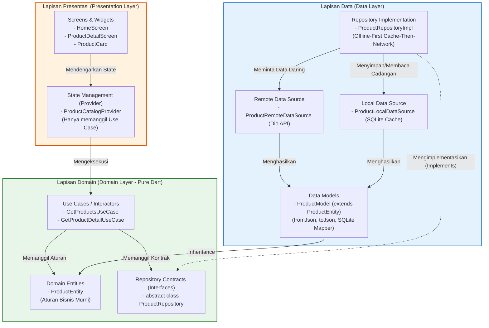

# MODUL 18: ARSITEKTUR FEATURE-FIRST DAN CLEAN ARCHITECTURE (REFACTORING SKALA ENTERPRISE)

---

## A. IDENTITAS MODUL
* **Mata Pelajaran**: Pemrograman Perangkat Bergerak (*Mobile Application Development*)
* **Kelas / Semester**: XI / XII SMK Kompetensi Keahlian Rekayasa Perangkat Lunak (RPL)
* **Alokasi Waktu**: 8 Jam Pelajaran (@ 45 Menit) / 2 Pertemuan Praktikum Terbimbing
* **Judul Modul**: Rekayasa Ulang Arsitektur Aplikasi Mobile: Penerapan Clean Architecture Berbasis Feature-First, Pemisahan 3 Lapisan (Domain, Data, Presentation), dan Pola Repositori pada Proyek SayurHub
* **Model Pembelajaran**: *Project-Based Learning* (PjBL), *Architectural Refactoring*, dan *Code Craftsmanship*
* **Prasyarat**: 
  - [Modul 06: Object-Oriented Programming & Data Modeling](file:///home/arif/flutter-1/docs/modul/06_OBJECT_ORIENTED_PROGRAMMING_DART.md)
  - [Modul 14: State Management dengan Provider](file:///home/arif/flutter-1/docs/modul/14_STATE_MANAGEMENT_PROVIDER.md)
  - [Modul 15: Database Relasional Lokal SQLite](file:///home/arif/flutter-1/docs/modul/15_PENYIMPANAN_DATA_LOKAL_SQLITE.md)
  - [Modul 16: Integrasi REST API dan Networking Dio](file:///home/arif/flutter-1/docs/modul/16_INTEGRASI_REST_API_DAN_NETWORKING.md)
  - [Modul 17: Autentikasi Pengguna & Keamanan Data JWT](file:///home/arif/flutter-1/docs/modul/17_AUTENTIKASI_DAN_KEAMANAN_DATA.md)

---

## B. PETA KONSEP & CAPAIAN PEMBELAJARAN

### B.1 Peta Konsep Arsitektur Feature-First Clean Architecture



### B.2 Capaian Pembelajaran Elemen (CP)
Pada akhir modul ini, peserta didik kompetensi keahlian RPL mampu:
1. Mendiagnosis gejala *Spaghetti Code*, *Tight Coupling*, dan kerapuhan kode pada aplikasi yang tidak menerapkan pemisahan tanggung jawab (*Separation of Concerns*).
2. Memahami prinsip-prinsip arsitektur perangkat lunak bersih (**Clean Architecture**) yang digagas oleh Robert C. Martin (Uncle Bob), khususnya aturan ketergantungan ke dalam (*The Dependency Inversion Principle*).
3. Membandingkan keunggulan organisasi berkas berbasis fitur (**Feature-First**) dibandingkan pendekatan berbasis lapisan horizontal (*Layer-First*) dalam kolaborasi tim pengembang skala industri.
4. Membangun **3 Lapisan Utama** pada sebuah fitur:
   - **Domain Layer**: Merancang *Entity* murni Dart, kontrak antarmuka *Repository*, dan kelas *Use Case* berprinsip *Single Responsibility*.
   - **Data Layer**: Merancang *Data Models* (serialisasi JSON & SQLite), *Remote Data Source*, *Local Data Source*, dan *Repository Implementation*.
   - **Presentation Layer**: Menghubungkan antarmuka visual Material 3 dan *Provider* agar hanya berinteraksi melalui *Use Case*.
5. Mengimplementasikan **Pola Desain Repositori (Repository Pattern)** yang menggabungkan sumber data luring (*SQLite Cache*) dan daring (*REST API Dio*) secara transparan (*Offline-First Architecture*).
6. Melakukan refactoring kode aplikasi SayurHub secara bertahap dan terukur tanpa menimbulkan regresi kerusakan fitur (*Zero Regression Refactoring*).

### B.3 Tujuan Pembelajaran Khusus (TP)
* **Kognitif**:
  - Siswa mampu membedakan perbedaan peran antara `ProductEntity` (Domain) dengan `ProductModel` (Data).
  - Siswa memahami mengapa Domain Layer dilarang mengimpor pustaka antarmuka seperti `flutter/material.dart` atau pustaka jaringan seperti `dio`.
* **Psikomotorik**:
  - Siswa terampil menyusun struktur direktori `domain/`, `data/`, dan `presentation/` di dalam folder fitur `lib/features/catalog/`.
  - Siswa mampu menulis *Unit Test* tiruan (*Mock Repository*) untuk menguji logika bisnis Use Case tanpa bergantung pada peladen internet riil.
* **Afektif**:
  - Membiasakan standar *Clean Code*, kode yang mudah diuji (*testable*), mudah dirawat (*maintainable*), dan siap dikembangkan bersama puluhan programmer lain di industri.

---

## C. MATERI TEORI KOMPREHENSIF

### C.1 Masalah "Spaghetti Code" pada Aplikasi Skala Menengah
Seiring bertambahnya fitur pada aplikasi SayurHub (katalog, keranjang, SQLite, REST API, autentikasi JWT), ada kecenderungan kode menjadi campur aduk:
- Layar UI (`HomeScreen` atau `ProductDetailScreen`) sering kali memanggil langsung `Dio`, mem-parsing JSON, dan mengeksekusi query database SQLite secara bersamaan di dalam metode `build()` atau fungsi *event handler*.
- **Dampak Buruk**:
  1. **Kerapuhan Tinggi (*Fragile Code*)**: Mengubah struktur respon JSON dari backend menyebabkan file antarmuka UI ikut rusak dan error kompilasi.
  2. **Sulit Diuji (*Untestable*)**: Pengembang tidak bisa menguji logika bisnis (misal: kalkulasi diskon atau filter organik) tanpa harus menjalankan emulator dan menunggu panggilan jaringan internet.
  3. **Konflik Tim (*Git Merge Conflicts*)**: Jika sepuluh programmer mengedit file yang sama untuk mengubah UI dan logika database, proses *merge* di Git menjadi mimpi buruk.

---

### C.2 Prinsip Dasar Clean Architecture (Uncle Bob)
Arsitektur Bersih (**Clean Architecture**) memisahkan perangkat lunak menjadi lapisan-lapisan konsentris yang memiliki aturan baku:

> [!IMPORTANT]
> **ATURAN KETERGANTUNGAN MUTLAK (THE DEPENDENCY RULE):**
> Kode pada lapisan dalam **TIDAK BOLEH MENGETAHUI APAPUN** tentang kode pada lapisan luar.
> - Domain Layer berada di pusat terdalam: Sama sekali tidak boleh mengimpor UI (Flutter), Database (SQLite), maupun Jaringan (Dio).
> - Lapisan Luar (Data & Presentation) bergantung ke arah dalam menuju Domain Layer.

```
┌────────────────────────────────────────────────────────┐
│ PRESENTATION LAYER (UI, Widgets, Provider, Controllers)│
│   ┌────────────────────────────────────────────────┐   │
│   │ DATA LAYER (API Client, SQLite, Repositories)  │   │
│   │   ┌────────────────────────────────────────┐   │   │
│   │   │ DOMAIN LAYER (Entities, Use Cases)     │   │   │
│   │   │          [ JANTUNG BISNIS ]            │   │   │
│   │   └────────────────────────────────────────┘   │   │
│   └────────────────────────────────────────────────┘   │
└────────────────────────────────────────────────────────┘
  ARAH DEPENDENSI: Lapisan Luar ──────────> Lapisan Dalam
```

---

### C.3 Layer-First vs Feature-First: Mengapa Industri Memilih Feature-First?

Dalam mengorganisasi berkas proyek Flutter, terdapat dua aliran utama:

```text
PENDEKATAN A: LAYER-FIRST (Pendekatan Tradisional)
lib/
├── models/             (Campur aduk: Product, Cart, User, Order)
├── views/              (Campur aduk: HomeView, CartView, LoginView)
├── controllers/        (Campur aduk seluruh provider aplikasi)
└── services/           (Campur aduk seluruh panggilan database & API)
```
*Kelemahan*: Saat seorang programmer ditugaskan memperbaiki bug pada fitur keranjang belanja, ia harus melompat-lompat membuka 4 folder berbeda yang memuat ratusan file dari fitur-fitur lain.

```text
PENDEKATAN B: FEATURE-FIRST (Pendekatan Skala Enterprise)
lib/
├── features/
│   ├── auth/           (Seluruh kode login & register terisolasi di sini)
│   ├── catalog/        (Seluruh kode katalog sayur terisolasi di sini)
│   │   ├── domain/     (Entity, UseCase, Repository Interface)
│   │   ├── data/       (Model, DataSource, Repository Implementation)
│   │   └── presentation/ (Screens, Widgets, Provider)
│   ├── cart/           (Seluruh kode keranjang terisolasi di sini)
│   └── checkout/       (Seluruh kode checkout terisolasi di sini)
└── core/               (Komponen bersama: network client, theme, utils)
```
*Keunggulan Mutlak*:
1. **Lokalisasi Konteks (*High Cohesion*)**: Semua berkas yang berhubungan dengan fitur katalog berkumpul di satu tempat yang sama.
2. **Skalabilitas Tim (*Team Autonomy*)**: Tim pengembang "Katalog" dapat bekerja independen tanpa pernah bersenggolan dengan tim pengembang "Checkout".
3. **Kemudahan Penghapusan/Pembaruan (*Easy Refactoring*)**: Jika suatu fitur ingin dihapus atau diganti, cukup hapus satu folder fitur tanpa merusak fitur lainnya.

---

### C.4 Anatomi 3 Lapisan dalam Feature-First

#### 1. Lapisan Domain (Domain Layer) — Jantung Bisnis Murni
- **Entity**: Objek bisnis utama aplikasi, contoh: `ProductEntity`. Bersifat murni Dart (*Pure Dart Class*), tidak boleh memuat fungsi serialisasi JSON atau database.
- **Repository Interface**: Deklarasi kontrak abstrak metode yang dibutuhkan, contoh: `abstract class ProductRepository`.
- **Use Case**: Kelas tindakan bisnis tunggal, contoh: `GetProductsUseCase`. Hanya memiliki satu fungsi publik (biasanya menggunakan operator `call()`).

#### 2. Lapisan Data (Data Layer) — Infrastruktur & Repositori
- **Data Model**: Kelas turunan dari Entity, contoh: `ProductModel extends ProductEntity`. Menambahkan kemampuan `fromJson()`, `toJson()`, dan konversi SQLite.
- **Remote Data Source**: Berkomunikasi langsung dengan jaringan luar menggunakan `Dio`.
- **Local Data Source**: Berkomunikasi langsung dengan penyimpanan lokal menggunakan `sqflite`.
- **Repository Implementation**: Mengimplementasikan kontrak dari Domain Layer (`implements ProductRepository`). Mengatur logika cerdas: coba ambil data dari remote, jika gagal ambil dari cache lokal (*Offline-First Cache Strategy*).

#### 3. Lapisan Presentasi (Presentation Layer) — Antarmuka Pengguna
- **Screens & Widgets**: Komponen visual Material 3 (`HomeScreen`, `ProductCard`).
- **State Management (Provider)**: Menampung state antarmuka. **Hanya memanggil Use Case**, sama sekali tidak boleh tahu apakah data diambil dari internet atau memori flash.

---

## D. PEMBAHASAN KODE MENDALAM (CODE WALKTHROUGH)

### D.1 Domain Entity: `ProductEntity`
Mari amati berkas [product_entity.dart](file:///home/arif/flutter-1/sayur_hub/lib/features/catalog/domain/entities/product_entity.dart):

```dart
class ProductEntity {
  final String id;
  final String name;
  final String category;
  final double pricePerKg;
  final int stock;
  final double rating;
  final bool isOrganic;
  final String? imageUrl;
  final String? description;

  const ProductEntity({
    required this.id,
    required this.name,
    required this.category,
    required this.pricePerKg,
    this.stock = 0,
    this.rating = 5.0,
    this.isOrganic = false,
    this.imageUrl,
    this.description,
  });

  // Aturan bisnis domain: Mengecek ketersediaan komoditas
  bool get isAvailable => stock > 0;

  // Aturan bisnis domain: Komoditas premium berstandar ekspor
  bool get isPremiumGrade => isOrganic && rating >= 4.7;
}
```

*Analisis Kunci*:
- Perhatikan bahwa berkas ini **tidak mengimpor pustaka apapun** (`no imports`). Jika di masa depan Flutter digantikan oleh teknologi antarmuka lain, aturan bisnis pada Domain Layer ini tetap 100% utuh tanpa perlu diubah sebaris pun.

---

### D.2 Kontrak Repositori: `ProductRepository`
Mari amati berkas [product_repository.dart](file:///home/arif/flutter-1/sayur_hub/lib/features/catalog/domain/repositories/product_repository.dart):

```dart
import 'package:sayur_hub/features/catalog/domain/entities/product_entity.dart';

abstract class ProductRepository {
  Future<List<ProductEntity>> getProducts({String? category, String? search});
  Future<ProductEntity> getProductById(String id);
}
```

*Analisis Kunci*:
- Ini adalah implementasi prinsip **Dependency Inversion**: Lapisan Domain mendikte format data yang ia butuhkan (`Future<List<ProductEntity>>`), bukan lapisan Data yang mendikte Domain.

---

### D.3 Kasus Penggunaan: `GetProductsUseCase`
Mari amati berkas [get_products_usecase.dart](file:///home/arif/flutter-1/sayur_hub/lib/features/catalog/domain/usecases/get_products_usecase.dart):

```dart
import 'package:sayur_hub/features/catalog/domain/entities/product_entity.dart';
import 'package:sayur_hub/features/catalog/domain/repositories/product_repository.dart';

class GetProductsUseCase {
  final ProductRepository _repository;

  const GetProductsUseCase(this._repository);

  // Menggunakan operator call() agar objek use case dapat dipanggil seperti fungsi
  Future<List<ProductEntity>> call({String? category, String? search}) async {
    return await _repository.getProducts(
      category: category,
      search: search,
    );
  }
}
```

*Analisis Kunci*:
- Penggunaan metode `call()` memungkinkan sintaks pemanggilan yang sangat elegan di Presentation Layer:
  `final products = await getProductsUseCase(category: 'Sayuran');` alih-alih `useCase.execute()`.

---

### D.4 Model Data: `ProductModel`
Mari amati berkas [product_model.dart](file:///home/arif/flutter-1/sayur_hub/lib/features/catalog/data/models/product_model.dart):

```dart
import 'package:sayur_hub/features/catalog/domain/entities/product_entity.dart';

class ProductModel extends ProductEntity {
  const ProductModel({
    required super.id,
    required super.name,
    required super.category,
    required super.pricePerKg,
    super.stock = 0,
    super.rating = 5.0,
    super.isOrganic = false,
    super.imageUrl,
    super.description,
  });

  factory ProductModel.fromJson(Map<String, dynamic> json) {
    return ProductModel(
      id: json['id'] as String,
      name: json['name'] as String,
      category: json['category'] as String,
      pricePerKg: (json['pricePerKg'] ?? json['price_per_kg'] as num).toDouble(),
      stock: (json['stock'] as num?)?.toInt() ?? 0,
      rating: (json['rating'] as num?)?.toDouble() ?? 5.0,
      isOrganic: json['isOrganic'] is bool
          ? json['isOrganic'] as bool
          : (json['is_organic'] == 1),
      imageUrl: (json['imageUrl'] ?? json['image_url']) as String?,
      description: json['description'] as String?,
    );
  }

  Map<String, dynamic> toJson() {
    return {
      'id': id,
      'name': name,
      'category': category,
      'price_per_kg': pricePerKg,
      'stock': stock,
      'rating': rating,
      'is_organic': isOrganic ? 1 : 0,
      'image_url': imageUrl,
      'description': description,
    };
  }
}
```

*Analisis Kunci*:
- **Pewarisan OOP (*Inheritance*)**: Karena `ProductModel` mewarisi `ProductEntity`, maka instansi `ProductModel` secara polimorfis adalah sebuah `ProductEntity`. Lapisan Data dapat langsung mengembalikan model ini ke lapisan Domain tanpa konversi yang rumit.

---

### D.5 Implementasi Repositori: `ProductRepositoryImpl`
Mari amati berkas [product_repository_impl.dart](file:///home/arif/flutter-1/sayur_hub/lib/features/catalog/data/repositories/product_repository_impl.dart):

```dart
class ProductRepositoryImpl implements ProductRepository {
  final ProductRemoteDataSource _remoteDataSource;
  final ProductLocalDataSource _localDataSource;

  ProductRepositoryImpl({
    ProductRemoteDataSource? remoteDataSource,
    ProductLocalDataSource? localDataSource,
  })  : _remoteDataSource = remoteDataSource ?? ProductRemoteDataSourceImpl(),
        _localDataSource = localDataSource ?? ProductLocalDataSourceImpl();

  @override
  Future<List<ProductEntity>> getProducts({String? category, String? search}) async {
    try {
      // 1. Coba ambil data terbaru dari server daring
      final List<ProductModel> remoteProducts =
          await _remoteDataSource.getProducts(category: category, search: search);

      // 2. Jika sukses, perbarui cadangan di cache SQLite lokal
      await _localDataSource.cacheProducts(remoteProducts);

      return remoteProducts;
    } on NetworkException catch (_) {
      // 3. Fallback Offline: Jika internet putus, baca data dari SQLite lokal
      final List<ProductModel> cachedProducts =
          await _localDataSource.getCachedProducts(category: category, search: search);

      if (cachedProducts.isNotEmpty) {
        return cachedProducts;
      }
      rethrow;
    }
  }
}
```

*Analisis Kunci*:
- Inilah keindahan **Pola Repositori**: UI tidak perlu tahu apakah data yang ia tampilkan berasal dari satelit internet atau dari chip memori smartphone. Lapisan Repositori menangani seluruh kompleksitas tersebut di balik layar.

---

## E. PERSIAPAN PRAKTIKUM & STRUKTUR FOLDER ENTERPRISE

### E.1 Peta Transformasi Struktur Direktori
Berikut adalah penataan ulang struktur direktori fitur katalog pada proyek `sayur_hub`:

```text
sayur_hub/lib/features/catalog/
├── domain/                               <-- 1. LAPISAN DOMAIN (PURE DART)
│   ├── entities/
│   │   └── product_entity.dart          <-- Aturan Bisnis Murni
│   ├── repositories/
│   │   └── product_repository.dart      <-- Kontrak Antarmuka (Interface)
│   └── usecases/
│       ├── get_products_usecase.dart    <-- Kasus Penggunaan: Ambil Katalog
│       └── get_product_detail_usecase.dart
├── data/                                 <-- 2. LAPISAN DATA
│   ├── models/
│   │   └── product_model.dart           <-- Model Serialisasi JSON & SQLite
│   ├── datasources/
│   │   ├── product_remote_datasource.dart<-- Panggilan Jaringan Dio
│   │   └── product_local_datasource.dart <-- Kueri Cache SQLite
│   └── repositories/
│       └── product_repository_impl.dart <-- Implementasi Strategi Offline-First
└── presentation/                         <-- 3. LAPISAN PRESENTASI
    ├── providers/
    │   └── product_catalog_provider.dart<-- Hanya Berkomunikasi via Use Case
    └── screens/
        └── product_detail_screen.dart   <-- Tampilan Detail Produk
```

---

## F. LANGKAH DEMI LANGKAH PRAKTIKUM REFACTORING (STEP-BY-STEP)

### Langkah 1: Membangun Domain Entity
1. Buat folder `lib/features/catalog/domain/entities/`.
2. Buat berkas `product_entity.dart`.
3. Definisikan atribut komoditas dan aturan bisnis murni (`isAvailable`, `isPremiumGrade`).
4. Pastikan tidak ada satupun *import* paket luar di dalam berkas ini.

### Langkah 2: Merancang Kontrak Domain Repository
1. Buat folder `lib/features/catalog/domain/repositories/`.
2. Buat berkas `product_repository.dart`.
3. Tulis kelas abstrak `abstract class ProductRepository` yang mendefinisikan tanda tangan metode `getProducts` dan `getProductById`.

### Langkah 3: Mengembangkan Use Case
1. Buat folder `lib/features/catalog/domain/usecases/`.
2. Buat berkas `get_products_usecase.dart`.
3. Injeksi dependensi `ProductRepository` melalui konstruktor kelas dan implementasikan operator `call()`.

### Langkah 4: Membangun Data Model
1. Buat folder `lib/features/catalog/data/models/`.
2. Buat berkas `product_model.dart` yang mewarisi `ProductEntity`.
3. Implementasikan fungsi pabrik `fromJson()` dan metode `toJson()`.

### Langkah 5: Membangun Sumber Data Jarak Jauh dan Lokal
1. Buat folder `lib/features/catalog/data/datasources/`.
2. Buat berkas `product_remote_datasource.dart` yang memanggil endpoint `/products` via `Dio`.
3. Buat berkas `product_local_datasource.dart` yang mengelola tabel cache SQLite `products_cache`.

### Langkah 6: Mengimplementasikan Repositori Cerdas
1. Buat folder `lib/features/catalog/data/repositories/`.
2. Buat berkas `product_repository_impl.dart`.
3. Implementasikan `ProductRepository` dengan strategi penanganan kegagalan (*fallback*) dari jaringan ke cache lokal.

### Langkah 7: Refactoring Presentation Layer (`ProductCatalogProvider`)
1. Buka [product_catalog_provider.dart](file:///home/arif/flutter-1/sayur_hub/lib/core/providers/product_catalog_provider.dart).
2. Ubah dependensinya: Provider kini **HANYA menginjeksi `GetProductsUseCase`**, bukan lagi memanggil langsung `ProductApiService` atau `Dio`.
3. Jalankan pembaruan data melalui pemanggilan `_getProductsUseCase.call()`.

---

## G. ANALISIS & PEMAHAMAN MENDALAM

### G.1 Mengapa Domain Layer Dilarang Mengimpor Flutter Framework?
Jika Domain Layer mengimpor `package:flutter/material.dart`:
- Logika bisnis Anda terikat erat dengan siklus hidup UI Google Flutter.
- Anda tidak dapat membagikan (*sharing*) kode logika bisnis ini ke proyek Dart murni lain (misal: backend Dart Frog, command-line tool, atau web server).
- Proses penulisan *Unit Test* menjadi lebih lambat karena harus memuat mesin grafis Flutter.
- Dengan menjaga Domain Layer murni Dart, logika bisnis Anda bersifat abadi (*timeless*) terhadap pergantian tren UI framework.

---

### G.2 Mengapa Memecah Logika Menjadi Use Case Kecil?
Bayangkan jika seluruh logika bisnis aplikasi diletakkan di dalam satu kelas Service raksasa (5000 baris kode).
Dengan pola **Use Case**:
- Setiap kelas hanya memiliki **satu tugas spesifik** (*Single Responsibility Principle*).
- Nama berkas langsung mencerminkan fitur bisnis aplikasi (`GetProductsUseCase`, `AddToCartUseCase`, `ApplyCouponUseCase`).
- Programmer baru di tim Anda dapat langsung memahami alur aplikasi hanya dengan membaca daftar nama file di folder `usecases/` (*Screaming Architecture*).

---

## H. LATIHAN MANDIRI & TANTANGAN TERSTRUKTUR

### H.1 Latihan Teori (5 Soal Pilihan Ganda & Analisis)

1. **Soal**: Manakah dari lapisan berikut dalam Clean Architecture yang memuat aturan bisnis paling inti dan dilarang memiliki dependensi ke lapisan lain?
   - A. Presentation Layer
   - B. Data Layer
   - C. Domain Layer
   - D. Infrastructure Layer
   *Kunci Jawaban*: **C**. Domain Layer berada di pusat terdalam dan bebas dari dependensi luar (*Pure Business Rules*).

2. **Soal**: Apa peran utama dari kelas `ProductModel` dalam kaitannya dengan `ProductEntity`?
   - A. Menggantikan peran widget tampilan di layar.
   - B. Memperluas Entity dengan menambahkan kemampuan serialisasi/deserialisasi format data teknis (`fromJson`, `toJson`).
   - C. Menghubungkan ponsel ke jaringan satelit.
   - D. Mengubah warna tombol di antarmuka.
   *Kunci Jawaban*: **B**. Model berada di Data Layer dan bertanggung jawab atas pemetaan format data eksternal.

3. **Soal**: Mengapa antarmuka `ProductRepository` diletakkan di Domain Layer, sedangkan implementasinya (`ProductRepositoryImpl`) diletakkan di Data Layer?
   - A. Agar ukuran file APK lebih seimbang.
   - B. Menerapkan *Dependency Inversion Principle*, di mana Domain menentukan kontrak kebutuhan dan Data Layer tunduk pada kontrak tersebut.
   - C. Merupakan keharusan dari sistem operasi Android.
   - D. Menghindari penggunaan memori RAM.
   *Kunci Jawaban*: **B**. Ini adalah inti dari pembalikan dependensi (*Dependency Inversion*).

4. **Soal**: Apa keunggulan arsitektur **Feature-First** dibandingkan **Layer-First** saat proyek dikerjakan oleh tim besar?
   - A. Feature-First membatasi konflik Git (*merge conflicts*) karena seluruh berkas satu fitur terlokalisasi di satu folder.
   - B. Feature-First membuat aplikasi otomatis bebas error tanpa testing.
   - C. Feature-First tidak membutuhkan emulator untuk dijalankan.
   - D. Feature-First menggantikan fungsi database SQLite.
   *Kunci Jawaban*: **A**. Lokalisasi konteks meningkatkan kohesi dan kemandirian tim pengembang.

5. **Soal**: Operator apakah pada bahasa Dart yang memungkinkan instansi kelas Use Case dipanggil secara langsung layaknya sebuah fungsi (`useCase()`)?
   - A. `execute()`
   - B. `call()`
   - C. `run()`
   - D. `invoke()`
   *Kunci Jawaban*: **B**. Operator `call()` adalah fitur bawaan bahasa Dart untuk *callable classes*.

---

### H.2 Latihan Praktik (3 Soal Coding Hands-On)

1. **Praktik 1: Pembuatan `SearchProductsUseCase` Mandiri**
   - *Tugas*: Buat kelas use case baru bernama `SearchProductsUseCase` di folder `domain/usecases/`. Use case ini hanya menerima parameter kata kunci pencarian `String query` dan memanggil repositori. Hubungkan use case ini ke kolom pencarian beranda.
2. **Praktik 2: Penambahan Aturan Bisnis Diskon Volume di `ProductEntity`**
   - *Tugas*: Pada `ProductEntity`, tambahkan getter baru:
     `double getDiscountedPrice(int quantity)`.
     Jika pembelian komoditas $\ge 5$ kg, berikan potongan harga 5%. Uji logika ini menggunakan skrip unit test mandiri tanpa menyentuh UI.
3. **Praktik 3: Data Source Cadangan Memori (*In-Memory Mock Data Source*)**
   - *Tugas*: Buat kelas baru `ProductMockDataSourceImpl` yang mengembalikan data tiruan lokal saat pengembang mengaktifkan mode pengujian laboratorium.

---

### H.3 Tantangan Pemrograman (2 Tantangan Studi Kasus Lanjutan)

1. **Tantangan 1: Refactoring Fitur Autentikasi ke Feature-First Clean Architecture**
   - *Skenario*: Fitur Autentikasi (Modul 17) saat ini masih memusatkan seluruh kode di satu file `auth_provider.dart`.
   - *Instruksi*: Susun ulang folder `lib/features/auth/` menjadi struktur Clean Architecture:
     - `domain/entities/user_entity.dart`
     - `domain/usecases/login_usecase.dart`
     - `data/datasources/auth_remote_datasource.dart`
     - `data/repositories/auth_repository_impl.dart`
2. **Tantangan 2: Pengujian Unit Test Use Case dengan Mockito/Mock Repositori**
   - *Skenario*: Pengembang ingin memastikan bahwa `GetProductsUseCase` selalu mengembalikan data yang benar tanpa perlu menyalakan koneksi internet.
   - *Instruksi*: Tulis pengujian unit test menggunakan kerangka kerja `flutter_test` yang menguji skenario sukses dan skenario galat jaringan.

---

### H.4 Studi Kasus Riil Industri (1 Kasus Nyata)
* **Kasus**: Migrasi Infrastruktur Backend dari REST API ke GraphQL / Firebase Firestore.
* **Kebutuhan Lapangan**:
  Setelah 2 tahun beroperasi, manajemen SayurHub memutuskan memigrasikan backend dari peladen REST API konvensional menuju teknologi GraphQL berkecepatan tinggi.
* **Dampak Arsitektur**:
  Jelaskan mengapa proyek yang menerapkan **Clean Architecture** hanya perlu memodifikasi berkas di **Data Layer** (`RemoteDataSource`), sedangkan ribuan baris kode di **Domain Layer** (Use Cases, Entities) dan **Presentation Layer** (Seluruh UI dan Widget) **SAMA SEKALI TIDAK PERLU DIUBAH**!

---

## I. TROUBLESHOOTING & SOLUSI PRAKTIS

### Error 1: Ketergantungan Melingkar (*Circular Dependency*)
* **Gejala**: Galat kompilasi `A depends on B, and B depends on A`.
* **Penyebab**: Domain Layer mencoba mengimpor kelas dari Data Layer (misal: `ProductRepository` mengimpor `ProductModel`).
* **Solusi**: Pastikan aturan ketergantungan ditaati dengan ketat: Domain Layer **HANYA** boleh mengenal kelas di dalam Domain Layer itu sendiri. Data Layer yang mengimpor Domain, BUKAN sebaliknya.

### Error 2: `Missing concrete implementation` pada Repository
* **Gejala**: Galat kompilasi saat membuat kelas `ProductRepositoryImpl`.
* **Penyebab**: Ada metode baru yang ditambahkan di kontrak antarmuka `ProductRepository` pada Domain Layer, namun belum diimplementasikan di `ProductRepositoryImpl`.
* **Solusi**: Jalankan perbaikan otomatis (*Quick Fix -> Create 1 missing override*) dan lengkapi logika metodenya.

### Error 3: Ketergantungan UI yang Bocor ke Domain Layer
* **Gejala**: Berkas di Domain Layer mengimpor `package:flutter/material.dart` hanya untuk menggunakan tipe data `Color` atau `IconData`.
* **Penyebab**: Mencampuradukkan konsep visual dengan konsep bisnis.
* **Solusi**: Ganti tipe data visual tersebut dengan string identifier bisnis (misal: simpan `'grade_a'` alih-alih `Colors.green`). Penentuan warna visual adalah tugas murni Presentation Layer.

---

## J. PRAKTIKUM INTEGRASI ANTAR-MODUL

Berikut adalah peta integrasi arsitektur bersih pada alur kerja katalog:

```text
[Presentation Layer: HomeScreen] ──> Menangkap input & gestur pengguna
               │
               ▼
[Presentation Layer: ProductCatalogProvider] ──> Mengelola siklus status (loading/success)
               │
               ▼
[Domain Layer: GetProductsUseCase] ──> Menjalankan instruksi bisnis tunggal
               │
               ▼
[Data Layer: ProductRepositoryImpl] ──> Mengoordinasikan sumber data
          ┌────┴──────────────────────────┐
          ▼                               ▼
[RemoteDS: Dio REST API]         [LocalDS: SQLite Cache]
(Modul 16: Dio Client)           (Modul 15: DatabaseHelper)
```

### Pengujian Mandiri Arsitektur via Skrip CLI (`modul_18_clean_arch_demo.dart`)
Jalankan berkas [modul_18_clean_arch_demo.dart](file:///home/arif/flutter-1/sayur_hub/bin/modul_18_clean_arch_demo.dart) untuk memeriksa keabsahan aturan ketergantungan dan isolasi domain:

```bash
dart run bin/modul_18_clean_arch_demo.dart
```

*Keluaran Pengujian yang Diharapkan*:
```text
================================================================
    SAYURHUB MODUL 18: FEATURE-FIRST CLEAN ARCHITECTURE TEST    
================================================================

[1] PENGUJIAN DOMAIN LAYER (PURE DART ENTITY & BUSINESS RULES)
Entitas Domain Dibuat: Bayam Merah Organik
  - Ketersediaan stok (isAvailable): true
  - Status Premium Grade (isPremiumGrade): true

[2] PENGUJIAN USE CASE (SINGLE RESPONSIBILITY PRINCIPLE)
Hasil eksekusi GetProductsUseCase (Semua): 2 item
  - [CA-001] Kangkung Hidroponik Ciwidey (Sayuran Daun) - Stok: 50 kg | Tersedia: true
  - [CA-002] Tomat Cherry Pangalengan (Sayuran Buah) - Stok: 0 kg | Tersedia: false

Hasil eksekusi GetProductsUseCase (Filter Sayuran Buah): 1 item

[3] PENGUJIAN DATA LAYER (PRODUCT MODEL & ENTITY CONVERSION)
ProductModel berhasil di-deserialisasi dari JSON:
  - Name: Wortel Manis Organik
  - Price: Rp 20000.0
  - Is Organic: true
  - Is Premium Grade: true

[4] VERIFIKASI PEMISAHAN LAPISAN CLEAN ARCHITECTURE:
  ✅ Domain Layer: Murni Dart tanpa dependensi Flutter UI.
  ✅ Data Layer: Bertanggung jawab atas SQLite & Dio REST API.
  ✅ Presentation Layer: Provider hanya berinteraksi dengan Use Case.
  ✅ Dependency Inversion: Modul tingkat tinggi tidak bergantung modul tingkat rendah.

================================================================
 SEMUA VALIDASI CLEAN ARCHITECTURE (MODUL 18) BERHASIL 100%!    
================================================================
```

---

## K. EVALUASI MODUL & RUBRIK PENILAIAN

### K.1 Format Rubrik Penilaian Portofolio Siswa (Skala 1 - 4)

| Kriteria Penilaian | Skor 1 (Perlu Bimbingan) | Skor 2 (Cukup) | Skor 3 (Baik) | Skor 4 (Sangat Memuaskan / Profesional) |
| :--- | :--- | :--- | :--- | :--- |
| **Penerapan Clean Architecture & Feature-First** | Struktur folder masih monolitik; kode UI, data, dan model bercampur aduk. | Memisahkan folder namun Domain Layer masih bocor mengimpor Flutter UI atau Dio. | Menerapkan 3 lapisan (Domain, Data, Presentation) secara rapi pada fitur katalog. | Arsitektur sangat bersih, menerapkan pemisahan murni, Dependency Inversion sempurna, dan lokalisasi fitur terisolasi. |
| **Kemandirian Domain Layer & Use Cases** | Tidak ada Use Case; Provider memanggil langsung fungsi database atau API. | Menggunakan Use Case namun masih memuat dependensi format JSON teknis. | Menggunakan Use Case berprinsip *Single Responsibility* yang hanya berkomunikasi via Entity dan Interface. | Domain Layer 100% pure Dart, mudah diuji secara terisolasi tanpa emulator, aturan bisnis kaya (*Rich Domain Model*). |
| **Kualitas Data Layer & Repository Pattern** | Repositori hanya menyalurkan data tanpa menangani fallback atau pemisahan data source. | Memisahkan data source namun penanganan galat jaringan belum dialihkan ke cache lokal. | Repositori mengoordinasikan Remote Data Source dan Local Data Source dengan mulus. | Mengimplementasikan strategi *Offline-First Cache-Then-Network* tangguh, pemetaan model aman, bebas duplikasi kode. |
| **Integritas Refactoring (Zero Regression)** | Refactoring merusak fitur yang ada sebelumnya (banyak layar yang error kompilasi). | Refactoring berhasil namun beberapa rute navigasi dan filter produk menjadi tidak responsif. | Seluruh fitur dari Modul 01-17 tetap berjalan normal 100% pasca-refactoring. | Transisi refactoring sempurna, kode sangat mudah dibaca (*readable*), performa optimal, portofolio siap kerja. |

---

### K.2 Lembar Refleksi Diri Siswa
1. Menurut Anda, mengapa programmer profesional bersedia meluangkan waktu membagi kode ke dalam 3 lapisan (Domain, Data, Presentation) meskipun membutuhkan file yang lebih banyak?
2. Bagaimana analogi peran seorang "Manajer Restoran" dengan konsep "Use Case" di dunia pemrograman?
3. Apa perbedaan mendasar antara `ProductEntity` dengan `ProductModel` yang paling Anda ingat?

---

## L. KESIMPULAN & JEMBATAN KE MODUL BERIKUTNYA

### L.1 Rangkuman Modul 18
Selamat! Anda telah resmi naik kelas dari seorang pembuat aplikasi pemula (*coder*) menjadi seorang **Perancang Perangkat Lunak Profesional (*Software Architect*)**:
1. **Modularitas Tanpa Batas**: Struktur *Feature-First* memberikan kemudahan bagi tim pengembang untuk memperluas aplikasi SayurHub tanpa takut merusak fitur yang sudah stabil.
2. **Kemandirian Logika Bisnis**: Lapisan Domain kini berdiri kokoh dan mandiri (*Pure Dart*), terlindung dari fluktuasi perubahan teknologi UI maupun database.
3. **Pola Repositori Andal**: Menyediakan pengalaman belanja bebas hambatan dengan menyatukan kueri daring (*Dio*) dan luring (*SQLite*) di balik satu pintu gerbang yang rapi.

### L.2 Menuju Modul 19: Fitur Lanjutan (Kamera, Izin Runtime, Multipart Upload, & Infinite Scroll)
Dengan fondasi arsitektur Clean Architecture yang telah tertata rapi, aplikasi SayurHub siap dipersenjatai dengan kemampuan tingkat lanjut perangkat keras smartphone:
- Mengakses kamera perangkat untuk memotret foto profil pembeli dan kartu identitas petani mitra menggunakan pustaka **`image_picker`**.
- Meminta izin hak akses perangkat keras secara sopan dan aman di masa jalan (*Runtime Permissions*) menggunakan **`permission_handler`**.
- Mengunggah berkas gambar foto berukuran besar ke peladen backend menggunakan format **Multipart/Form-Data**.
- Menerapkan fitur **Infinite Scroll Pagination** (gulir tanpa batas) pada katalog produk saat data komoditas berjumlah ribuan barang.

Persiapkan diri Anda untuk mengeksplorasi integrasi perangkat keras smartphone di modul berikutnya!
