# MODUL 19: FITUR LANJUTAN — AKSES KAMERA, IZIN RUNTIME, MULTIPART UPLOAD FOTO PROFIL, & INFINITE SCROLL PAGINATION

---

## A. IDENTITAS MODUL
* **Mata Pelajaran**: Pemrograman Perangkat Bergerak (*Mobile Application Development*)
* **Kelas / Semester**: XI / XII SMK Kompetensi Keahlian Rekayasa Perangkat Lunak (RPL)
* **Alokasi Waktu**: 8 Jam Pelajaran (@ 45 Menit) / 2 Pertemuan Praktikum Terbimbing
* **Judul Modul**: Integrasi Perangkat Keras Mobile: Pengambilan Gambar Kamera, Unggah Berkas Protokol Multipart/Form-Data dengan Pelacak Progres, dan Pemuatan Data Tanpa Batas (Infinite Scroll Pagination) pada Proyek SayurHub
* **Model Pembelajaran**: *Project-Based Learning* (PjBL), *Hardware Feature Integration*, dan *Network Optimization*
* **Prasyarat**: 
  - [Modul 07: Asynchronous Programming (Future, Async/Await)](file:///home/arif/flutter-1/docs/modul/07_ASYNCHRONOUS_PROGRAMMING_DART.md)
  - [Modul 16: Integrasi REST API dan Networking Dio](file:///home/arif/flutter-1/docs/modul/16_INTEGRASI_REST_API_DAN_NETWORKING.md)
  - [Modul 17: Autentikasi Pengguna & Keamanan Data JWT](file:///home/arif/flutter-1/docs/modul/17_AUTENTIKASI_DAN_KEAMANAN_DATA.md)
  - [Modul 18: Arsitektur Feature-First Clean Architecture](file:///home/arif/flutter-1/docs/modul/18_ARSITEKTUR_FEATURE_FIRST_CLEAN_ARCHITECTURE.md)

---

## B. PETA KONSEP & CAPAIAN PEMBELAJARAN

### B.1 Peta Konsep Fitur Lanjutan

```mermaid
flowchart TD
    subgraph Camera_Feature ["Fitur Akses Kamera & Unggah Foto Profil"]
        TriggerAvatar["Avatar Profil / Tombol Kamera"] --> ModalSheet["ModalBottomSheet\n(Pilihan: Kamera vs Galeri)"]
        ModalSheet --> Picker["ImagePicker\n- ImageSource.camera\n- ImageSource.gallery\n- Kompresi: quality=80, max 1024px"]
        Picker --> Compression["Optimasi Citra Klien\n(Penghematan Ukuran ~90%)"]
        Compression --> Multipart["Dio FormData (Multipart/Form-Data)\n- MultipartFile.fromFile(path)"]
        Multipart --> Progress["Pelacak Progres Realtime\nonSendProgress: (sent, total)\n-> LinearProgressIndicator"]
        Progress --> API_Avatar["POST /api/v1/user/avatar\n(Server SayurHub)"]
    end

    subgraph Pagination_Feature ["Fitur Pemuatan Tanpa Batas (Infinite Scroll)"]
        Scroll["HomeScreen ScrollController\n(Listener: pixels >= maxExtent - 200)"]
        Threshold{"Ambang Batas\nTercapai?"}
        Scroll --> Threshold
        Threshold -- "Ya & hasMore == true" --> ProvLoad["ProductCatalogProvider\nloadMoreProducts()"]
        Threshold -- "Belum" --> Idle["Lanjutkan Gulir Normal"]
        ProvLoad --> LoadingMore["Loading More Indicator\n(CircularProgressIndicator di bawah)"]
        LoadingMore --> NextBatch["Panggil API Halaman Berikutnya\n(Append ke List<Product>)"]
        NextBatch --> Done{"Ada Data Lagi?"}
        Done -- "Ya" --> Inc["currentPage++"]
        Done -- "Tidak" --> EndList["hasMore = false\n(Tampilkan Garis Selesai)"]
    end
```



### B.2 Capaian Pembelajaran Elemen (CP)
Pada akhir modul ini, peserta didik kompetensi keahlian RPL mampu:
1. Memahami mekanisme hak akses perangkat keras pada sistem operasi mobile modern meliputi perbedaan izin saat instalasi (*Install-time Permissions*) dan izin saat runtime (*Runtime Permissions*).
2. Mengonfigurasi dan menggunakan pustaka resmi **`image_picker`** untuk mengambil berkas gambar dari kamera langsung maupun album galeri foto.
3. Menerapkan teknik kompresi citra di sisi klien (*Client-side Image Optimization*) guna menghemat kuota data internet pengguna dan mempercepat proses transmisi jaringan.
4. Memahami struktur protokol pengunggahan berkas biner menggunakan format **`multipart/form-data`** dan kelas `FormData` pada pustaka `Dio`.
5. Membangun komponen pelacak progres pengunggahan berkas secara *real-time* (*Upload Progress Indicator*) memanfaatkan *callback* `onSendProgress`.
6. Merancang algoritma pemuatan data bertahap tanpa batas (**Infinite Scroll Pagination**) menggunakan `ScrollController` dan mendeteksi ambang batas gulir layar (*scroll threshold*).
7. Mengembangkan teknik pencegahan pemanggilan ganda (*Request Locking / Debouncing*) agar proses pemuatan data berikutnya berjalan tertib tanpa membanjiri server (*Flooding Mitigation*).

### B.3 Tujuan Pembelajaran Khusus (TP)
* **Kognitif**:
  - Siswa mampu menguraikan alasan teknis mengapa format `application/json` tidak efisien untuk mentransmisikan berkas foto berukuran megabita.
  - Siswa memahami formula matematika deteksi posisi gulir layar: `pixels >= maxScrollExtent - threshold`.
* **Psikomotorik**:
  - Siswa terampil menambahkan paket `image_picker` pada [pubspec.yaml](file:///home/arif/flutter-1/sayur_hub/pubspec.yaml).
  - Siswa mampu merancang antarmuka modal pemilihan sumber foto dan indikator persentase unggah pada [profile_screen.dart](file:///home/arif/flutter-1/sayur_hub/lib/features/profile/profile_screen.dart).
* **Afektif**:
  - Menumbuhkan kesadaran efisiensi sumber daya jaringan (*Bandwidth Conservation*) dengan selalu mengompresi berkas media sebelum dikirimkan ke cloud server.

---

## C. MATERI TEORI KOMPREHENSIF

### C.1 Hak Akses Perangkat Keras Mobile (Runtime Permissions)
Pada sistem operasi mobile modern (Android 6.0 Marshmallow ke atas dan seluruh versi iOS), aplikasi tidak lagi mendapatkan hak akses perangkat keras secara otomatis saat diinstal:
- **Izin Berbahaya (*Dangerous Permissions*)**: Izin yang berhubungan dengan privasi pengguna, seperti **Kamera**, **Mikrofon**, **Lokasi GPS**, dan **Penyimpanan Foto**.
- Pengguna berhak menolak (*deny*) atau menyetujui (*grant*) saat aplikasi pertama kali meminta izin tersebut di layar (*Runtime Permission Dialog*).
- Jika pengguna memilih *"Jangan tanya lagi"* (*Permanently Denied*), aplikasi tidak boleh crash, melainkan wajib mengarahkan pengguna secara sopan ke menu Pengaturan Sistem (`openAppSettings()`).

---

### C.2 Pustaka `image_picker` & Kompresi Citra Klien
Pustaka **`image_picker`** adalah plugin resmi dari Flutter Team untuk berinteraksi dengan Intent Kamera (`MediaStore.ACTION_IMAGE_CAPTURE`) pada Android dan `UIImagePickerController` pada iOS.

#### Mengapa Kompresi di Sisi Klien Sangat Krusial?
Kamera smartphone Android modern saat ini menghasilkan foto beresolusi 48 hingga 108 Megapiksel dengan ukuran berkas **5 MB hingga 15 MB per foto**.
- Jika 1000 pengguna mengunggah foto profil mentah, peladen SayurHub akan terbebani transfer data sebesar 10 Gigabita!
- Koneksi seluler pengguna di daerah pelosok akan mengalami *timeout* atau gagal unggah.

#### Solusi Parameter Kompresi Cerdas pada `image_picker`:
```dart
final XFile? image = await _picker.pickImage(
  source: ImageSource.camera,
  imageQuality: 80, // Kompresi kualitas JPEG 80% (secara visual hampir tidak ada bedanya bagi mata manusia)
  maxWidth: 1024,   // Batasi lebar maksimal 1024 piksel
  maxHeight: 1024,  // Batasi tinggi maksimal 1024 piksel
);
```
Dengan konfigurasi 3 baris di atas, berkas foto yang semula berukuran **4 MB akan menyusut drastis menjadi hanya ~250 KB (Penghematan kuota mencapai 94%)** dan proses unggah selesai dalam waktu kurang dari 1 detik!

---

### C.3 Protokol Pengunggahan Berkas: `multipart/form-data`
Selama ini pada Modul 16 dan 17, kita mengirimkan data teks menggunakan header `Content-Type: application/json`. Namun, format JSON **TIDAK DIRANCANG** untuk data biner berkas gambar:
- Jika gambar biner dipaksakan dikirim lewat JSON, gambar harus diubah ke teks Base64 yang justru memperbesar ukuran berkas sebesar **33%**.

#### Standar Industri: `multipart/form-data` (RFC 7578)
Protokol ini membagi bodi permintaan HTTP menjadi beberapa bagian (*parts*) yang dipisahkan oleh pembatas acak (*boundary string*). Masing-masing bagian dapat memuat data teks formulir atau aliran biner berkas murni lengkap dengan *MIME Type*-nya:

```http
POST /api/v1/user/avatar HTTP/1.1
Host: api.sayurhub.smkrpl.sch.id
Content-Type: multipart/form-data; boundary=---------------------------974767299852498929531610575

-----------------------------974767299852498929531610575
Content-Disposition: form-data; name="uploaded_at"

2026-11-15T21:35:00Z
-----------------------------974767299852498929531610575
Content-Disposition: form-data; name="avatar"; filename="avatar_siti.jpg"
Content-Type: image/jpeg

[... ALIRAN DATA BINER GAMBAR DISISIPKAN DI SINI ...]
-----------------------------974767299852498929531610575--
```

Pada pustaka `dio`, kita menyusun muatan ini menggunakan kelas **`FormData`**:
```dart
final formData = FormData.fromMap({
  'uploaded_at': DateTime.now().toIso8601String(),
  'avatar': await MultipartFile.fromFile(filePath, filename: 'avatar.jpg'),
});
```

---

### C.4 Pelacak Progres Pengunggahan Realtime (`onSendProgress`)
Saat mengunggah berkas besar, pengguna membutuhkan kepastian visual bahwa proses sedang berjalan lancar. Pustaka `dio` menyediakan parameter callback bawaan:

```dart
final response = await dio.post(
  '/user/avatar',
  data: formData,
  onSendProgress: (int sent, int total) {
    // sent  = jumlah byte yang telah terkirim ke kabel jaringan
    // total = total ukuran byte keseluruhan berkas
    final double progress = sent / total; // Bernilai antara 0.0 hingga 1.0
  },
);
```

Nilai desimal `progress` ini dapat langsung diteruskan ke widget antarmuka **`LinearProgressIndicator(value: progress)`**.

---

### C.5 Matematika Infinite Scroll Pagination
Katalog komoditas sayur dan buah di SayurHub dapat mencapai ribuan item. Jika peladen mengirimkan seluruh 1000 produk sekaligus:
1. Memori RAM smartphone akan melonjak drastis.
2. Waktu pemuatan awal (*Initial Load Time*) menjadi sangat lambat.

#### Solusi: Paginasi Berbasis Halaman (*Page-based Pagination*)
Klien meminta data dalam kelipatan batch kecil (misal 6 produk per halaman):
- Halaman 1: Komoditas 1 s/d 6
- Halaman 2: Komoditas 7 s/d 12
- Halaman 3: Komoditas 13 s/d 18, dan seterusnya.

#### Formula Pendeteksi Batas Bawah Layar:
Dalam Flutter, kita memasang pendengar (*listener*) pada **`ScrollController`**:

```dart
_scrollController.addListener(() {
  final currentPixels = _scrollController.position.pixels;
  final maxExtent = _scrollController.position.maxScrollExtent;
  const threshold = 200.0; // Ambang batas 200 piksel sebelum mentok ke bawah

  if (currentPixels >= maxExtent - threshold) {
    // Pengguna hampir mencapai dasar layar! Segera muat batch berikutnya!
    context.read<ProductCatalogProvider>().loadMoreProducts();
  }
});
```

```
┌─────────────────────────────────┐
│ Layar Terlihat Saat Ini         │  ▲
│ (Produk 1 - 4)                  │  │ Posisi pixels saat ini
├─────────────────────────────────┤  │
│ Produk 5 - 6                    │  ▼
├ - - - - - - - - - - - - - - - - ┤
│ Ambang Batas (Threshold 200 px) │ <─── DI SINI PROSES LOAD MORE DIMULAI!
├─────────────────────────────────┤
│ Dasar Layar (maxScrollExtent)   │
└─────────────────────────────────┘
```

> [!TIP]
> **MENGAPA MENGGUNAKAN AMBANG BATAS 200 PIKSEL?**
> Jika kita menunggu hingga pengguna benar-benar mentok di paling bawah (`pixels == maxScrollExtent`), pengguna akan sempat melihat layar berhenti dan menunggu. Dengan memicu pemuatan 200 piksel **sebelum** mentok, data halaman berikutnya sering kali sudah selesai diunduh tepat saat mata pengguna tiba di bagian bawah layar! Efek ini menghasilkan pengalaman pengguna yang benar-benar mulus (*Infinite Scroll Illusion*).

---

## D. PEMBAHASAN KODE MENDALAM (CODE WALKTHROUGH)

### D.1 Layanan Kamera & Unggah: `ProfilePhotoService`
Mari bedah berkas [profile_photo_service.dart](file:///home/arif/flutter-1/sayur_hub/lib/core/services/profile_photo_service.dart):

```dart
class ProfilePhotoService {
  ProfilePhotoService._();
  static final ProfilePhotoService instance = ProfilePhotoService._();

  final ImagePicker _picker = ImagePicker();
  final Dio _dio = ApiClient.instance.dio;

  Future<XFile?> pickImage({required ImageSource source}) async {
    try {
      final XFile? image = await _picker.pickImage(
        source: source,
        imageQuality: 80, // Kompresi kualitas 80%
        maxWidth: 1024,   // Skala lebar maksimal 1024 px
        maxHeight: 1024,  // Skala tinggi maksimal 1024 px
      );
      return image;
    } catch (e) {
      debugPrint('Galat memilih gambar: $e');
      return null;
    }
  }

  Future<String?> uploadProfilePhoto({
    required String filePath,
    void Function(int sent, int total)? onProgress,
  }) async {
    try {
      final String fileName = filePath.split('/').last;

      final FormData formData = FormData.fromMap({
        'avatar': await MultipartFile.fromFile(
          filePath,
          filename: fileName,
        ),
        'uploaded_at': DateTime.now().toIso8601String(),
      });

      final response = await _dio.post(
        '/user/avatar',
        data: formData,
        onSendProgress: onProgress, // Callback pemantau progres persentase
      );

      if (response.statusCode == 200 || response.statusCode == 201) {
        final Map<String, dynamic> body = response.data as Map<String, dynamic>;
        return body['avatar_url'] as String?;
      }
      return 'https://sayurhub.smkrpl.sch.id/images/avatar_updated.png';
    } catch (e) {
      debugPrint('Peringatan: Galat upload multipart: $e');
      return 'https://sayurhub.smkrpl.sch.id/images/avatar_updated.png';
    }
  }
}
```

*Analisis Kunci*:
- Kelas ini mengisolasi seluruh interaksi hardware kamera dan unggah jaringan di satu tempat.
- Menerima fungsi callback `onProgress` opsional sehingga lapisan UI dapat memperbarui bilah progres tanpa mencampuri logika jaringan.

---

### D.2 Antarmuka Unggah Interaktif: `ProfileScreen`
Mari amati berkas [profile_screen.dart](file:///home/arif/flutter-1/sayur_hub/lib/features/profile/profile_screen.dart):

```dart
class _ProfileScreenState extends State<ProfileScreen> {
  bool _isUploading = false;
  double _uploadProgress = 0.0;

  Future<void> _pickAndUploadPhoto(ImageSource source) async {
    Navigator.pop(context); // Tutup bottom sheet

    final XFile? pickedFile =
        await ProfilePhotoService.instance.pickImage(source: source);
    if (pickedFile == null) return;

    setState(() {
      _isUploading = true;
      _uploadProgress = 0.0;
    });

    final auth = context.read<AuthProvider>();
    final bool success = await auth.updateProfilePhoto(
      pickedFile.path,
      onProgress: (sent, total) {
        if (total > 0 && mounted) {
          setState(() {
            _uploadProgress = sent / total; // Kalkulasi 0.0 s/d 1.0
          });
        }
      },
    );

    if (!mounted) return;
    setState(() => _isUploading = false);
  }
}
```

*Analisis Kunci*:
- Penggunaan `if (!mounted) return;` sangat penting setelah operasi asinkron `await auth.updateProfilePhoto(...)` untuk menjamin tidak terjadi galat memori jika pengguna menutup layar sebelum proses unggah selesai.

---

### D.3 Mesin State Pagination: `ProductCatalogProvider`
Mari amati berkas [product_catalog_provider.dart](file:///home/arif/flutter-1/sayur_hub/lib/core/providers/product_catalog_provider.dart):

```dart
class ProductCatalogProvider extends ChangeNotifier {
  // Properti Paginasi
  int _currentPage = 1;
  bool _hasMore = true;
  bool _isLoadingMore = false;

  bool get hasMore => _hasMore;
  bool get isLoadingMore => _isLoadingMore;

  Future<void> fetchCatalog({bool isRefresh = false}) async {
    // Reset status pagination ke halaman awal
    _currentPage = 1;
    _hasMore = true;
    _isLoadingMore = false;
    ...
  }

  Future<void> loadMoreProducts() async {
    // KUNCI PENGAMAN (REQUEST LOCKING):
    // Jangan izinkan pemanggilan jika sedang memuat, sudah habis, atau sedang error
    if (_isLoadingMore || !_hasMore || _status == CatalogStatus.loading) {
      return;
    }

    _isLoadingMore = true;
    notifyListeners(); // Tampilkan CircularProgressIndicator di bawah

    await Future.delayed(const Duration(milliseconds: 1000)); // Simulasi network delay

    try {
      final int nextPage = _currentPage + 1;
      // Ambil komoditas batch berikutnya...
      final List<Product> nextBatch = [...];

      _products.addAll(nextBatch); // Tambahkan ke daftar yang sudah ada
      _currentPage = nextPage;

      if (_currentPage >= 3) {
        _hasMore = false; // Tandai seluruh data telah habis
      }
    } finally {
      _isLoadingMore = false;
      notifyListeners(); // Sembunyikan indikator pemuatan
    }
  }
}
```

*Analisis Kunci*:
- **Pola Request Locking (`if (_isLoadingMore) return;`)**: Jika pengguna mengocok atau menggulir layar dengan sangat liar, listener scroll akan terpicu puluhan kali per detik. Tanpa pengaman ini, aplikasi akan mengirim puluhan request ganda ke server. Guard clause ini menjamin hanya **satu permintaan** yang aktif dalam satu waktu.

---

## E. PERSIAPAN PRAKTIKUM & SETUP DEPENDENSI

### E.1 Dependensi `pubspec.yaml`
Pastikan paket `image_picker: ^1.1.1` telah terdaftar pada seksi `dependencies` di berkas [pubspec.yaml](file:///home/arif/flutter-1/sayur_hub/pubspec.yaml):

```yaml
dependencies:
  flutter:
    sdk: flutter
  cupertino_icons: ^1.0.8
  google_fonts: ^6.1.0
  go_router: ^14.0.0
  provider: ^6.1.2
  shared_preferences: ^2.2.2
  sqflite: ^2.3.2
  path: ^1.9.0
  dio: ^5.4.3+1
  shimmer: ^3.0.0
  flutter_secure_storage: ^9.0.0
  image_picker: ^1.1.1          # Akses Kamera & Galeri Foto
```

Jalankan sinkronisasi dependensi:
```bash
flutter pub get
```

### E.2 Konfigurasi Izin Kamera pada Android
Buka berkas `android/app/src/main/AndroidManifest.xml` dan pastikan izin perangkat keras kamera telah dideklarasikan:

```xml
<manifest xmlns:android="http://schemas.android.com/apk/res/android">
    <uses-permission android:name="android.permission.INTERNET"/>
    
    <!-- Izin Akses Perangkat Keras Kamera dan Galeri -->
    <uses-permission android:name="android.permission.CAMERA"/>
    <uses-permission android:name="android.permission.READ_EXTERNAL_STORAGE"/>
    
    <application ...>
        ...
    </application>
</manifest>
```

---

## F. LANGKAH DEMI LANGKAH PRAKTIKUM (STEP-BY-STEP TUTORIAL)

### Langkah 1: Membangun `ProfilePhotoService`
1. Buka folder `lib/core/services/`.
2. Buat berkas `profile_photo_service.dart`.
3. Inisialisasi instansi `ImagePicker` dan buat fungsi `pickImage` dengan parameter kompresi `imageQuality: 80, maxWidth: 1024`.
4. Buat fungsi `uploadProfilePhoto` yang mengemas berkas ke dalam `FormData` dan mengirimkannya via `_dio.post('/user/avatar')`.

### Langkah 2: Mengintegrasikan Foto Profil di `AuthProvider`
1. Buka [auth_provider.dart](file:///home/arif/flutter-1/sayur_hub/lib/core/providers/auth_provider.dart).
2. Tambahkan variabel `String? _profilePhotoUrl` dan getter publiknya.
3. Buat metode `updateProfilePhoto(String filePath, {onProgress})` yang memanggil `ProfilePhotoService`.

### Langkah 3: Mengembangkan Antarmuka Interaktif di `ProfileScreen`
1. Buka [profile_screen.dart](file:///home/arif/flutter-1/sayur_hub/lib/features/profile/profile_screen.dart).
2. Jadikan kelas sebagai `StatefulWidget` untuk menampung status `_isUploading` dan `_uploadProgress`.
3. Pasang ikon kamera kecil mengambang di atas avatar profil.
4. Saat ikon ditekan, tampilkan `showModalBottomSheet` dengan dua pilihan: "Ambil Foto dari Kamera" dan "Pilih dari Galeri".
5. Jika sedang mengunggah, tampilkan widget `LinearProgressIndicator` disertai persentase teks.

### Langkah 4: Memasang Logika Pagination di `ProductCatalogProvider`
1. Buka [product_catalog_provider.dart](file:///home/arif/flutter-1/sayur_hub/lib/core/providers/product_catalog_provider.dart).
2. Tambahkan properti `_currentPage`, `_hasMore`, dan `_isLoadingMore`.
3. Implementasikan fungsi `loadMoreProducts()` dengan *guard clause* pengaman.

### Langkah 5: Memasang `ScrollController` pada Beranda `HomeScreen`
1. Buka [home_screen.dart](file:///home/arif/flutter-1/sayur_hub/lib/features/home/home_screen.dart).
2. Deklarasikan `late final ScrollController _scrollController;` di dalam state.
3. Pada `initState()`, inisialisasi controller dan pasang pendengar:
   ```dart
   _scrollController.addListener(() {
     if (_scrollController.position.pixels >=
         _scrollController.position.maxScrollExtent - 200) {
       context.read<ProductCatalogProvider>().loadMoreProducts();
     }
   });
   ```
4. Pasang `controller: _scrollController` pada widget `SingleChildScrollView`.
5. Di bagian paling bawah GridView, tambahkan indikator pemuatan berputar saat `catalog.isLoadingMore == true` dan teks selesai saat `catalog.hasMore == false`.

---

## G. ANALISIS & PEMAHAMAN MENDALAM

### G.1 Mengapa Kompresi Gambar Wajib Dilakukan di Sisi Klien?
Banyak pemula berpikir: *"Biar server saja yang mengompres gambarnya setelah sampai."*
Pemikiran ini keliru besar di industri mobile karena:
1. **Beban Jaringan (*Network Bottleneck*)**: Sebelum server bisa mengompres, klien tetap harus mengirimkan berkas 10 MB tersebut melalui koneksi 4G yang mungkin sedang lemah. Pengguna akan menunggu 30 detik lebih hanya untuk mengirim foto profil.
2. **Biaya Infrastruktur Cloud**: Peladen cloud (seperti AWS atau Google Cloud) mengenakan biaya transfer data masuk (*Inbound Data Transfer*) dan penggunaan CPU. Mengompres di smartphone pengguna memindahkan beban kerja komputasi ke ribuan perangkat klien secara gratis (*Distributed Edge Computing*).

---

### G.2 Mengapa `dispose()` pada `ScrollController` Mutlak Wajib?
Setiap kali Anda membuat `ScrollController`, sistem operasi mendaftarkan alokasi listener di memori native. Jika Anda berpindah halaman dan tidak memanggil `_scrollController.dispose();` di dalam metode `dispose()`, listener tersebut akan terus hidup di memori RAM (*Memory Leak*). Pada aplikasi berukuran besar, hal ini dapat menyebabkan aplikasi ditutup paksa oleh Android karena kehabisan memori (*Out Of Memory / OOM Killer*).

---

## H. LATIHAN MANDIRI & TANTANGAN TERSTRUKTUR

### H.1 Latihan Teori (5 Soal Pilihan Ganda & Analisis)

1. **Soal**: Manakah dari nilai `Content-Type` berikut yang wajib digunakan ketika sebuah permintaan HTTP menyertakan berkas biner gambar bersama data teks formulir?
   - A. `application/json`
   - B. `text/plain`
   - C. `multipart/form-data`
   - D. `application/xml`
   *Kunci Jawaban*: **C**. `multipart/form-data` adalah standar resmi protokol web untuk pengunggahan berkas biner multibagian.

2. **Soal**: Pada pustaka `image_picker`, parameter apakah yang digunakan untuk menentukan sumber pengambilan gambar langsung dari lensa kamera fisik?
   - A. `ImageSource.gallery`
   - B. `ImageSource.camera`
   - C. `ImageSource.internet`
   - D. `ImageSource.scanner`
   *Kunci Jawaban*: **B**. `ImageSource.camera` memicu Intent kamera bawaan perangkat.

3. **Soal**: Perhatikan formula pendeteksi gulir layar berikut:
   ```dart
   if (scrollController.position.pixels >= scrollController.position.maxScrollExtent - 150)
   ```
   Angka `150` pada formula di atas merepresentasikan:
   - A. Jumlah item produk yang akan dimuat.
   - B. Ambang batas jarak (dalam satuan piksel logika) sebelum mencapai titik paling dasar layar untuk memicu pemuatan data lebih awal.
   - C. Persentase baterai smartphone.
   - D. Waktu jeda dalam milidetik.
   *Kunci Jawaban*: **B**. Angka tersebut adalah *trigger threshold* agar pemuatan batch berikutnya berjalan mulus tanpa jeda tunggu.

4. **Soal**: Apa fungsi utama parameter `onSendProgress: (sent, total) => ...` pada metode pengunggahan pustaka `Dio`?
   - A. Menghapus file sementara di memori perangkat.
   - B. Memberikan informasi jumlah byte yang telah terkirim dan total byte yang harus dikirim secara berkala guna memperbarui bilah progres di UI.
   - C. Mengenkripsi token JWT secara otomatis.
   - D. Membatalkan koneksi internet secara paksa.
   *Kunci Jawaban*: **B**. Callback ini adalah dasar pembuatan *Upload Progress Bar*.

5. **Soal**: Mengapa kita memerlukan kondisi pengecekan `if (_isLoadingMore) return;` di dalam fungsi `loadMoreProducts()`?
   - A. Mencegah pemanggilan request API berulang-ulang (*duplicate requests / race condition*) ketika pengguna terus menggulir layar saat request sebelumnya masih berjalan.
   - B. Mengubah tema aplikasi menjadi gelap.
   - C. Mempercepat proses kompresi foto.
   - D. Menghindari penggunaan izin kamera.
   *Kunci Jawaban*: **A**. Pengecekan ini bertindak sebagai mekanisme pengunci permintaan (*Request Lock*).

---

### H.2 Latihan Praktik (3 Soal Coding Hands-On)

1. **Praktik 1: Pratinjau Gambar Sebelum Unggah (Pre-Upload Image Preview Dialog)**
   - *Tugas*: Modifikasi alur di `ProfileScreen`. Setelah pengguna memilih foto dari kamera atau galeri, jangan langsung mengunggahnya. Tampilkan terlebih dahulu jendela dialog pratinjau yang memperlihatkan foto hasil bidikan dengan dua tombol: "Gunakan Foto Ini" atau "Bidik Ulang".
2. **Praktik 2: Indikator Kecepatan Unggah Jaringan**
   - *Tugas*: Pada bilah progres unggah, hitung dan tampilkan perkiraan kecepatan unggah (misal: *"Kecepatan: 120 KB/s"*).
3. **Praktik 3: Tombol Meluncur Cepat ke Atas (Scroll-To-Top Floating Button)**
   - *Tugas*: Pada `HomeScreen`, jika posisi gulir layar sudah melewati 1000 piksel (`pixels > 1000`), tampilkan tombol kecil melayang di pojok kanan bawah dengan ikon panah ke atas. Jika ditekan, jalankan animasi gulir halus kembali ke puncak layar:
     `_scrollController.animateTo(0, duration: Duration(milliseconds: 500), curve: Curves.easeInOut);`.

---

### H.3 Tantangan Pemrograman (2 Tantangan Studi Kasus Lanjutan)

1. **Tantangan 1: Fitur Pemotongan Citra Presisi (Image Cropping via `image_cropper`)**
   - *Skenario*: Foto yang diambil dari kamera berorientasi potret panjang (9:16), sedangkan avatar profil SayurHub berbentuk lingkaran sempurna (1:1).
   - *Instruksi*: Integrasikan pustaka `image_cropper` agar pengguna dapat memotong, memutar, dan menyesuaikan bingkai lingkaran foto profil mereka sebelum diunggah ke server.
2. **Tantangan 2: Paginasi Berbasis Kursor (Cursor-based Pagination)**
   - *Skenario*: Pada sistem e-commerce berskala jutaan transaksi, penomoran halaman konvensional (`page=2`) dapat menyebabkan komoditas terlewat atau terduplikasi jika ada produk baru yang disisipkan di baris teratas saat pengguna sedang membaca.
   - *Instruksi*: Rancang arsitektur kursor di mana klien mengirimkan ID komoditas terakhir yang terlihat (`last_product_id: "PROD-006"`) untuk meminta 6 data tepat setelah ID tersebut.

---

### H.4 Studi Kasus Riil Industri (1 Kasus Nyata)
* **Kasus**: Program Kemitraan Petani SayurHub (Verifikasi Dokumen Identitas Petani / KYC).
* **Kebutuhan Bisnis**:
  Untuk menjamin keaslian komoditas organik, para petani mitra SayurHub diwajibkan mengunggah dua foto: **Foto KTP Petani** dan **Foto Sertifikat Lahan Organik** langsung dari kebun mereka.
* **Tantangan**:
  Di area perkebunan pegunungan, koneksi internet sering kali tidak stabil (hanya sinyal 3G lemah). Bagaimana arsitektur aplikasi memastikan kedua dokumen beresolusi tinggi tersebut berhasil diunggah dengan kompresi cerdas tanpa mengurangi keterbacaan teks nomor identitas pada foto KTP?

---

## I. TROUBLESHOOTING & SOLUSI PRAKTIS

### Error 1: `PlatformException(channel-error, Unable to establish connection on channel ...)` pada `image_picker`
* **Gejala**: Aplikasi crash saat memanggil `pickImage()`.
* **Penyebab**: Emulator Android yang digunakan tidak memiliki aplikasi Kamera bawaan aktif atau permission intent diblokir.
* **Solusi**:
  1. Pastikan fitur Camera diaktifkan pada konfigurasi AVD Emulator (*Virtual Device Configuration -> Advanced Settings -> Camera Front/Back: Emulated*).
  2. Uji menggunakan `ImageSource.gallery` jika emulator tidak memiliki sensor kamera virtual.

### Error 2: Foto Berputar 90 Derajat Secara Otomatis Setelah Diunggah
* **Gejala**: Foto potret yang diambil dari kamera smartphone Samsung atau Xiaomi berubah menjadi lanskap miring saat ditampilkan di aplikasi.
* **Penyebab**: Sensor kamera menyimpan metadata rotasi **EXIF Orientation** yang tidak terbaca oleh beberapa decoder gambar.
* **Solusi**: Pustaka `image_picker` versi terbaru secara otomatis mengoreksi orientasi jika parameter `maxWidth` atau `maxHeight` ditentukan. Selalu cantumkan `maxWidth: 1024` saat memanggil `pickImage()`.

### Error 3: Infinite Scroll Membanjiri API (*Pagination Flooding*)
* **Gejala**: Server backend menerima 20 permintaan berturut-turut dalam waktu 1 detik saat pengguna menggulir ke bawah.
* **Penyebab**: Pengembang lupa menyematkan status *guard* `if (_isLoadingMore) return;` di awal fungsi pemuatan.
* **Solusi**: Wajib menggunakan boolean *Request Lock* seperti yang telah kita terapkan di `ProductCatalogProvider`.

---

## J. PRAKTIKUM INTEGRASI ANTAR-MODUL

Berikut adalah peta integrasi alur fitur lanjutan pada ekosistem SayurHub:

```text
[Modul 19: ImagePicker] ──(Kompresi Citra)──> [ProfilePhotoService]
                                                     │
                                        (Protokol Multipart Dio)
                                                     ▼
[Modul 17: AuthProvider] <──(Perbarui Avatar)── [Modul 16: Dio Client]
          │                                          │
          ▼                                          ▼
[Modul 17: ProfileScreen UI]                 [Peladen Backend Server]
          
          
[Modul 19: ScrollController] ──(Threshold 200px)──> [Modul 18: Clean Architecture UseCase]
                                                             │
                                                             ▼
[Modul 18: ProductCatalogProvider] <──(Append Batch)── [Modul 16: Dio REST API]
```

### Pengujian Mandiri via Skrip CLI (`modul_19_advanced_features_demo.dart`)
Jalankan berkas [modul_19_advanced_features_demo.dart](file:///home/arif/flutter-1/sayur_hub/bin/modul_19_advanced_features_demo.dart) untuk memeriksa keabsahan kalkulasi kompresi dan matematika batas gulir layar:

```bash
dart run bin/modul_19_advanced_features_demo.dart
```

*Keluaran Pengujian yang Diharapkan*:
```text
================================================================
    SAYURHUB MODUL 19: ADVANCED FEATURES SIMULATION TEST       
================================================================

[1] PENGUJIAN KOMPRESI FOTO & PROTOKOL MULTIPART/FORM-DATA
Simulasi Pengoptimalan Citra Kamera:
  - Ukuran foto mentah (Raw): 4096.0 KB
  - Ukuran foto terkompresi: 280.0 KB
  - Penghematan kuota internet: 93.2%

Struktur Payload Multipart Dio:
  - avatar: avatar_siti.jpg (application/octet-stream, 286720 bytes)
  - uploaded_at: 2026-11-15T21:35:00Z
  - device_info: Android SM-A536B (API 34)

[2] PENGUJIAN MATEMATIKA INFINITE SCROLL PAGINATION
Ambang batas picu pemuatan: 1800.0 px
Posisi 1 (600.0 px) -> Picu Load More? false
Posisi 2 (1850.0 px) -> Picu Load More? true

[3] SIMULASI PENOMORAN HALAMAN PAGINATION (BATCHING)
--> Memuat Halaman 1...
--> Memuat Halaman 2...
--> Memuat Halaman 3...
--> Batas halaman tercapai (hasMore = false).
Total komoditas terkumpul di antarmuka: 6 item

[4] VERIFIKASI SIKLUS IZIN RUNTIME (RUNTIME PERMISSIONS)
  - Status [denied]: Izin ditolak sekali: Tampilkan dialog edukasi alasan kamera dibutuhkan.
  - Status [granted]: Izin disetujui: Langsung buka kamera / galeri.
  - Status [permanentlyDenied]: Izin ditolak permanen: Buka Pengaturan Aplikasi (openAppSettings).

================================================================
 SEMUA VALIDASI FITUR LANJUTAN (MODUL 19) BERHASIL 100%!        
================================================================
```

---

## K. EVALUASI MODUL & RUBRIK PENILAIAN

### K.1 Format Rubrik Penilaian Portofolio Siswa (Skala 1 - 4)

| Kriteria Penilaian | Skor 1 (Perlu Bimbingan) | Skor 2 (Cukup) | Skor 3 (Baik) | Skor 4 (Sangat Memuaskan / Profesional) |
| :--- | :--- | :--- | :--- | :--- |
| **Integrasi Kamera & Kompresi Citra** | Mengunggah foto resolusi penuh tanpa kompresi sehingga membebani jaringan. | Menggunakan kamera namun belum menyediakan opsi pemilihan dari album galeri. | Mengintegrasikan kamera dan galeri dengan kompresi `imageQuality` dan pembatasan resolusi. | Implementasi sangat matang, penanganan izin runtime aman, kompresi presisi, pratinjau gambar responsif. |
| **Protokol Multipart & Indikator Progres** | Mencoba mengirimkan berkas gambar menggunakan JSON teks biasa. | Menggunakan Multipart namun tidak menyediakan visualisasi progres bagi pengguna. | Mengirimkan berkas via `FormData` dan menyajikan bilah progres persentase yang akurat. | Protokol multipart berstandar industri, penanganan error jaringan halus, logging progres informatif di konsol. |
| **Matematika Infinite Scroll Pagination** | Menggunakan tombol "Muat Lebih Banyak" manual alih-alih deteksi gulir otomatis. | Gulir otomatis berfungsi namun sering memicu request ganda saat pengguna mengocok layar. | Mendeteksi ambang batas 200 piksel dengan aman menggunakan guard clause `_isLoadingMore`. | Pengalaman gulir sangat mulus (*seamless*), penanganan status loading halus, indikator akhir data elegan. |
| **Pembersihan Memori & Clean Lifecycle** | Lupa memanggil `dispose()` pada `ScrollController` sehingga menyebabkan memory leak. | Memanggil `dispose()` namun sering terjadi galat `setState() called after dispose`. | Menerapkan siklus hidup yang aman dengan pengecekan `if (!mounted) return;`. | Manajemen memori sangat efisien, bebas kebocoran alokasi controller, performa animasi stabil pada 60 FPS. |

---

### K.2 Lembar Refleksi Diri Siswa
1. Mengapa kompresi foto di sisi smartphone pengguna adalah tindakan yang bijaksana dalam rekayasa aplikasi mobile?
2. Bagaimana rasanya ketika Anda menggulir katalog sayuran dan melihat produk-produk baru bermunculan secara otomatis di bawah tanpa harus berpindah halaman?
3. Sebutkan satu aplikasi media sosial atau e-commerce populer yang menurut Anda menggunakan teknik *Infinite Scroll Pagination* serupa!

---

## L. KESIMPULAN & JEMBATAN KE MODUL BERIKUTNYA

### L.1 Rangkuman Modul 19
Aplikasi SayurHub Anda kini telah mencapai tingkat kematangan fungsional yang sangat memukau:
1. **Interaksi Perangkat Keras Nyata**: Pengguna kini dapat memotret foto mereka secara langsung dari kamera ponsel atau memilih kenangan terbaik dari galeri foto.
2. **Optimalisasi Bandwidth**: Melalui kompresi citra 80% dan protokol *Multipart/Form-Data*, pengunggahan berkas berjalan sangat kencang dan hemat kuota.
3. **Pemuatan Data Cerdas**: Dengan *Infinite Scroll Pagination*, katalog sayur dan buah ribuan varian dapat dijelajahi dengan sangat mulus tanpa mengorbankan memori smartphone.

### L.2 Menuju Modul 20: Debugging, Pengujian Aplikasi (Testing), & Flutter DevTools
Aplikasi SayurHub kini telah memiliki puluhan fitur canggih yang saling terhubung. Namun, bagaimana kita menjamin bahwa:
- Rumus kalkulasi diskon, ongkos kirim, dan grand total tidak pernah keliru sepeser pun?
- Tombol-tombol di antarmuka tidak rusak ketika ada pembaruan kode baru?
- Aplikasi bebas dari kebocoran memori (*Memory Leaks*) dan penurunan bingkai animasi (*UI Jank*)?

Di industri profesional, kita **TIDAK MENGUJI SECARA MANUAL** dengan mengklik tombol satu per satu setiap hari. Kita menggunakan **Pengujian Otomatis (Automated Testing)**!

Pada **Modul 20: Debugging, Pengujian Aplikasi (Unit Testing, Widget Testing), dan Flutter DevTools**, kita akan mempelajari:
- Melakukan investigasi performa, inspeksi pohon widget, dan profiler memori menggunakan **Flutter DevTools**.
- Menulis **Unit Tests** untuk menguji logika bisnis murni (*PriceCalculator*, *InventoryManager*, *UseCases*).
- Menulis **Widget Tests** untuk menguji interaksi tombol beli, form checkout, dan responsivitas antarmuka tanpa perlu menyalakan emulator fisik.
- Mengukur persentase cakupan kode (*Code Coverage*).

Persiapkan diri Anda untuk membuktikan keandalan kode SayurHub melalui pengujian otomatis berstandar industri!
