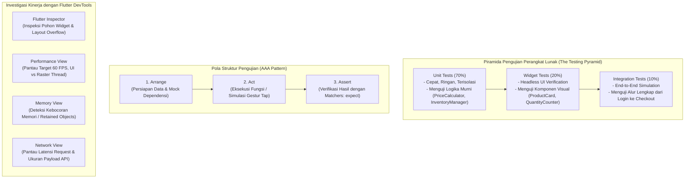

# MODUL 20: DEBUGGING, PENGUJIAN APLIKASI (TESTING), DAN FLUTTER DEVTOOLS

---

## A. IDENTITAS MODUL
* **Mata Pelajaran**: Pemrograman Perangkat Bergerak (*Mobile Application Development*)
* **Kelas / Semester**: XI / XII SMK Kompetensi Keahlian Rekayasa Perangkat Lunak (RPL)
* **Alokasi Waktu**: 8 Jam Pelajaran (@ 45 Menit) / 2 Pertemuan Praktikum Terbimbing
* **Judul Modul**: Jaminan Kualitas Perangkat Lunak (*Software Quality Assurance*): Pengujian Otomatis (Unit Testing & Widget Testing), Pola AAA, Mocking Dependensi, dan Profiling Performa Menggunakan Flutter DevTools pada Proyek SayurHub
* **Model Pembelajaran**: *Project-Based Learning* (PjBL), *Test-Driven Verification*, dan *Performance Profiling*
* **Prasyarat**: 
  - [Modul 03: Dasar Pemrograman Dart & Sound Null Safety](file:///home/arif/flutter-1/docs/modul/03_DASAR_PEMROGRAMAN_DART_DAN_NULL_SAFETY.md)
  - [Modul 09: Widget Fundamental — StatelessWidget & StatefulWidget](file:///home/arif/flutter-1/docs/modul/09_WIDGET_FUNDAMENTAL_DAN_LIFECYCLE.md)
  - [Modul 14: State Management dengan Provider](file:///home/arif/flutter-1/docs/modul/14_STATE_MANAGEMENT_PROVIDER.md)
  - [Modul 18: Arsitektur Feature-First Clean Architecture](file:///home/arif/flutter-1/docs/modul/18_ARSITEKTUR_FEATURE_FIRST_CLEAN_ARCHITECTURE.md)

---

## B. PETA KONSEP & CAPAIAN PEMBELAJARAN

### B.1 Peta Konsep Pengujian Otomatis & DevTools



### B.2 Capaian Pembelajaran Elemen (CP)
Pada akhir modul ini, peserta didik kompetensi keahlian RPL mampu:
1. Menjelaskan secara kritis perbedaan antara pengujian manual (*Manual QA*) dengan pengujian otomatis (*Automated Testing*) dalam siklus rilis perangkat lunak industri.
2. Memahami hierarki **Piramida Pengujian (The Testing Pyramid)** meliputi Unit Testing, Widget Testing, dan Integration Testing.
3. Menulis pengujian logika bisnis (**Unit Testing**) menggunakan pola baku **AAA (Arrange, Act, Assert)** dan fungsi pencocokan data (*Matchers*).
4. Merancang pengujian antarmuka visual (**Widget Testing**) secara *headless* menggunakan `WidgetTester`, memahami siklus frame `pump()` dan `pumpAndSettle()`, serta memanfaatkan ragam *Finders*.
5. Melakukan isolasi dependensi (*Dependency Mocking*) dengan menyuntikkan *Provider* tiruan ke dalam pohon pengujian widget.
6. Mengoperasikan rangkaian instrumen **Flutter DevTools** untuk menginvestigasi *Layout Overflow*, mendeteksi penurunan *frame rate* (*UI Jank* di bawah 60 FPS), dan menemukan kebocoran memori (*Memory Leaks*).
7. Mengukur persentase ketercakupan pengujian kode (*Code Coverage*) untuk menjamin keandalan aplikasi SayurHub sebelum dirilis ke publik.

### B.3 Tujuan Pembelajaran Khusus (TP)
* **Kognitif**:
  - Siswa mampu membedakan karakteristik kegunaan `tester.pump()` versus `tester.pumpAndSettle()`.
  - Siswa memahami peran *UI Thread* (tempat eksekusi kode Dart) dan *Raster Thread* (tempat mesin Skia/Impeller menggambar piksel ke layar GPU).
* **Psikomotorik**:
  - Siswa terampil menulis berkas pengujian di folder [test/unit/](file:///home/arif/flutter-1/sayur_hub/test/unit/) dan [test/widget/](file:///home/arif/flutter-1/sayur_hub/test/widget/).
  - Siswa mampu menjalankan pengujian otomatis melalui baris perintah terminal (`flutter test`).
* **Afektif**:
  - Menumbuhkan budaya profesionalisme rekayasa (*Software Craftsmanship*) di mana setiap baris kode bisnis penting wajib dilindungi oleh jaring pengaman pengujian otomatis (*Safety Net*).

---

## C. MATERI TEORI KOMPREHENSIF

### C.1 Filosofi Pengujian Otomatis (*Automated Testing*)
Banyak pengembang pemula menguji aplikasi dengan cara manual: menjalankan aplikasi di emulator, mengetik form, menekan tombol satu per satu, dan mengamati apakah layar berubah.
- **Kelemahan Fatal Pengujian Manual**:
  1. **Sangat Lambat**: Menguji 20 fitur SayurHub secara manual membutuhkan waktu 30 menit setiap kali ada baris kode yang diubah.
  2. **Rentan Kelalaian (*Human Error*)**: Penguji manusia sering lupa memeriksa kondisi tepi (*Edge Cases*), misal: kuantitas belanja 0 kg, atau angka desimal negatif.
  3. **Bahaya Regresi (*Regression Bug*)**: Memperbaiki bug di fitur keranjang sering kali secara tidak sengaja merusak perhitungan di form checkout tanpa disadari.

Dengan **Pengujian Otomatis**: Komputer dapat mengeksekusi ratusan skenario pengujian dalam waktu **kurang dari 5 detik** setiap kali kita menyimpan berkas!

---

### C.2 Piramida Pengujian Perangkat Lunak (*The Test Pyramid*)
Industri perangkat lunak global mengadopsi rasio piramida pengujian yang proporsional:

```
          / \
         /   \
        / E2E \       10% Integration Tests (Sangat lambat, butuh emulator/device)
       /───────\
      / Widget  \     20% Widget Tests (Cepat, headless UI, simulasi sentuhan)
     /───────────\
    /    Unit     \   70% Unit Tests (Sangat cepat, hitungan milidetik, uji logika murni)
   /───────────────\
```

1. **Unit Tests (Dasar Piramida - 70%)**:
   Menguji fungsi terkecil yang independen (seperti rumus matematika, fungsi kalkulator, manipulasi string, dan kelas Use Case). Sangat cepat dan murah dijalankan.
2. **Widget Tests (Bagian Tengah - 20%)**:
   Menguji satu komponen widget secara terisolasi. Tidak membutuhkan emulator fisik! Mesin Flutter membuat pohon widget virtual di memori (*headless*) dan memverifikasi apakah teks, warna, tombol, dan interaksi sentuhan berfungsi sebagaimana mestinya.
3. **Integration Tests (Puncak Piramida - 10%)**:
   Menguji alur lengkap aplikasi dari awal hingga akhir di atas perangkat fisik riil.

---

### C.3 Pola Struktur Pengujian AAA (*Arrange, Act, Assert*)
Setiap pengujian profesional yang ditulis oleh insinyur perangkat lunak selalu mengikuti pola 3 langkah:

1. **Arrange (Persiapan)**: Menyiapkan variabel, objek model, dan kondisi awal lingkungan pengujian.
2. **Act (Aksi)**: Menjalankan fungsi yang ingin diuji atau melakukan interaksi pengguna (misal: mengetuk tombol).
3. **Assert (Verifikasi)**: Memeriksa apakah hasil keluaran aktual sama persis dengan yang diharapkan menggunakan fungsi `expect(actual, matcher)`.

```dart
test('Kalkulasi diskon 10% harus akurat', () {
  // 1. Arrange
  const double subtotal = 60000.0;

  // 2. Act
  final double diskon = PriceCalculator.calculateDiscountAmount(
    subtotal: subtotal,
    discountPercentage: 10.0,
  );

  // 3. Assert
  expect(diskon, equals(6000.0));
});
```

---

### C.4 Widget Testing Mendalam: Pump, Finders, & Matchers

#### 1. Mekanisme `WidgetTester` & Siklus Pemuatan Frame
Saat menjalankan widget test, Flutter tidak memiliki layar fisik. Kita mengontrol pergerakan waktu secara manual:
- **`tester.pumpWidget(widget)`**: Merender pohon widget pertama kali ke memori virtual.
- **`tester.pump()`**: Memicu pembaruan frame visual berikutnya (setara dengan 1 siklus `setState()`).
- **`tester.pumpAndSettle()`**: Menunggu secara otomatis hingga seluruh animasi (transisi hero, perputaran loading, animasi ripple) selesai sepenuhnya dan layar berada dalam kondisi tenang (*idle*).

#### 2. Ragam Pencari Komponen (*Finders*)
Untuk berinteraksi dengan widget di layar, kita mencari lokasinya menggunakan kelas `find`:
- `find.text('Bayam Hijau')`: Menemukan widget teks dengan tulisan spesifik.
- `find.byIcon(Icons.shopping_cart)`: Menemukan widget berdasarkan ikon Material.
- `find.byType(ElevatedButton)`: Menemukan widget berdasarkan tipe kelasnya.
- `find.byKey(const Key('checkout_button'))`: Menemukan widget berdasarkan kunci uniknya.

#### 3. Ragam Pencocok Kondisi (*Matchers*)
- `expect(find.text('...'), findsOneWidget)`: Memastikan widget muncul tepat 1 kali.
- `expect(find.text('...'), findsNothing)`: Memastikan widget TIDAK ADA di layar.
- `expect(find.byType(Card), findsNWidgets(6))`: Memastikan ada tepat 6 kartu produk.

---

### C.5 Investigasi Masalah Performa dengan Flutter DevTools
Flutter DevTools adalah rangkaian perkakas diagnostik berbasis web yang disertakan langsung di dalam SDK Flutter:

1. **Flutter Inspector**:
   - Memvisualisasikan hierarki pohon widget (*Widget Tree*).
   - Memeriksa batas tata letak (*Layout Constraints*).
   - Membantu memperbaiki galat legendaris: `A RenderFlex overflowed by X pixels`.
2. **Performance View (Frame Rendering)**:
   - Menampilkan diagram batang durasi setiap frame yang digambar.
   - Target standar adalah **60 FPS (16.6 milidetik per frame)**.
   - Jika sebuah batang berwarna **Merah**, berarti terjadi penurunan bingkai (*UI Jank*) yang menyebabkan animasi patah-patah di mata pengguna.
   - Membedakan antara **UI Thread** (kode Dart komputasi) dan **Raster Thread** (GPU yang melukis piksel).
3. **Memory View (Deteksi Kebocoran Memori)**:
   - Melacak grafik penggunaan memori RAM (Heap Size).
   - Fitur *Snapshot Heap*: Mengidentifikasi objek yang seharusnya sudah mati namun masih tertahan di RAM (*Retained Objects*), contoh: `ScrollController` atau `TextEditingController` yang lupa di-`dispose`.
4. **Network View**:
   - Menampilkan seluruh lalu lintas panggilan REST API Dio secara *real-time*.
   - Menghitung waktu respons server (*latency*) dan ukuran berkas JSON yang diunduh.

---

## D. PEMBAHASAN KODE MENDALAM (CODE WALKTHROUGH)

### D.1 Pengujian Unit Finansial: `price_calculator_test.dart`
Mari bedah berkas [price_calculator_test.dart](file:///home/arif/flutter-1/sayur_hub/test/unit/price_calculator_test.dart):

```dart
import 'package:flutter_test/flutter_test.dart';
import 'package:sayur_hub/core/utils/price_calculator.dart';

void main() {
  group('PriceCalculator Unit Tests (Logika Transaksi Finansial SayurHub)', () {
    test('calculateSubtotal menghitung harga total dengan tepat', () {
      // Arrange
      const double pricePerKg = 14000.0;
      const double quantity = 2.5;

      // Act
      final double subtotal = PriceCalculator.calculateSubtotal(
        pricePerUnit: pricePerKg,
        quantity: quantity,
      );

      // Assert
      expect(subtotal, equals(35000.0));
    });

    test('formatRupiah memformat angka ke dalam format mata uang Indonesia standar', () {
      expect(PriceCalculator.formatRupiah(14000.0), equals('Rp 14.000'));
      expect(PriceCalculator.formatRupiah(0.0), equals('Rp 0'));
      expect(PriceCalculator.formatRupiah(1250500.0), equals('Rp 1.250.500'));
    });
  });
}
```

*Analisis Kunci*:
- **`group()`**: Mengelompokkan skenario-skenario pengujian yang berhubungan ke dalam satu wadah logis, sehingga laporan hasil pengujian di terminal terbaca sangat terstruktur.
- Pengujian mencakup angka desimal (`2.5 kg`) dan angka nol (`Rp 0`) untuk menjamin tidak ada pembagian dengan nol atau galat pembulatan mata uang.

---

### D.2 Pengujian Widget Stepper: `quantity_counter_test.dart`
Mari amati berkas [quantity_counter_test.dart](file:///home/arif/flutter-1/sayur_hub/test/widget/quantity_counter_test.dart):

```dart
testWidgets('Menekan tombol plus (+) menambah kuantitas menjadi 2 kg', (WidgetTester tester) async {
  int currentQuantity = 1;

  // 1. Arrange: Render widget di dalam kerangka MaterialApp virtual
  await tester.pumpWidget(
    MaterialApp(
      home: Scaffold(
        body: QuantityCounterWidget(
          initialQuantity: 1,
          maxStock: 10,
          onQuantityChanged: (val) {
            currentQuantity = val;
          },
        ),
      ),
    ),
  );

  // 2. Act: Simulasikan ketukan sentuhan pada tombol icon tambah
  await tester.tap(find.byIcon(Icons.add_rounded));
  await tester.pump(); // Render frame perubahan state lokal

  // 3. Assert: Pastikan teks di layar berubah dan callback terpicu
  expect(find.text('2 kg'), findsOneWidget);
  expect(currentQuantity, equals(2));
});
```

*Analisis Kunci*:
- Mengapa kita membungkus `QuantityCounterWidget` dengan `MaterialApp` dan `Scaffold`? Karena widget Material membutuhkan *Theme*, *MediaQuery*, dan *Directionality* (arah teks LTR) agar dapat dirender secara legal tanpa galat `No MaterialLocalizations found`.

---

### D.3 Pengujian Widget Kartu Produk: `product_card_test.dart`
Mari amati berkas [product_card_test.dart](file:///home/arif/flutter-1/sayur_hub/test/widget/product_card_test.dart):

```dart
testWidgets('Mengetuk ikon hati memicu perubahan status wishlist reaktif', (WidgetTester tester) async {
  final WishlistProvider wishlist = WishlistProvider();

  // Injeksi Provider ke dalam lingkungan pengujian widget
  await tester.pumpWidget(
    ChangeNotifierProvider.value(
      value: wishlist,
      child: MaterialApp(
        home: Scaffold(
          body: ProductCard(
            product: testOrganicProduct,
            onAddToCart: () {},
          ),
        ),
      ),
    ),
  );

  // Verifikasi kondisi awal (belum favorit -> ikon border)
  expect(wishlist.isFavorite(testOrganicProduct.id), isFalse);
  expect(find.byIcon(Icons.favorite_border_rounded), findsOneWidget);

  // Aksi: Ketuk tombol favorit
  await tester.tap(find.byIcon(Icons.favorite_border_rounded));
  await tester.pump(); // Re-render subtree Consumer<WishlistProvider>

  // Verifikasi kondisi akhir (sudah favorit -> ikon penuh)
  expect(wishlist.isFavorite(testOrganicProduct.id), isTrue);
  expect(find.byIcon(Icons.favorite_rounded), findsOneWidget);
});
```

*Analisis Kunci*:
- Ini adalah demonstrasi pengujian integrasi tingkat komponen (**Component Integration Test**): Kita menguji bagaimana komponen UI (`ProductCard`) merespons perubahan state reaktif dari `WishlistProvider` tanpa perlu membuka emulator Android!

---

## E. PERSIAPAN PRAKTIKUM & STRUKTUR FOLDER TEST

### E.1 Dependensi `flutter_test`
Paket `flutter_test` telah disertakan secara *default* oleh Flutter SDK pada seksi `dev_dependencies` di berkas [pubspec.yaml](file:///home/arif/flutter-1/sayur_hub/pubspec.yaml):

```yaml
dev_dependencies:
  flutter_test:
    sdk: flutter
  flutter_lints: ^3.0.0
```

### E.2 Struktur Direktori Pengujian Standar Industri
Di industri profesional, struktur folder di dalam direktori `test/` dibuat mencerminkan (*mirroring*) struktur folder di dalam direktori `lib/`:

```text
sayur_hub/
├── lib/
│   ├── core/utils/price_calculator.dart
│   ├── core/utils/inventory_manager.dart
│   └── shared/widgets/product_card.dart
└── test/                             <-- DIREKTORI PENGUJIAN OTOMATIS
    ├── unit/                         <-- PENGUJIAN LOGIKA MURNI (UNIT TESTS)
    │   ├── price_calculator_test.dart
    │   └── inventory_manager_test.dart
    └── widget/                       <-- PENGUJIAN KOMPONEN UI (WIDGET TESTS)
        ├── quantity_counter_test.dart
        └── product_card_test.dart
```

---

## F. LANGKAH DEMI LANGKAH PRAKTIKUM (STEP-BY-STEP TUTORIAL)

### Langkah 1: Membangun Unit Test Finansial
1. Buat folder `test/unit/` pada akar proyek `sayur_hub`.
2. Buat berkas `price_calculator_test.dart`.
3. Tulis pengujian untuk fungsi `calculateSubtotal`, `calculateDiscountAmount`, `calculateFinalTotal`, dan `formatRupiah` menggunakan pola AAA.

### Langkah 2: Membangun Unit Test Aturan Mutu Inventaris
1. Di dalam folder `test/unit/`, buat berkas `inventory_manager_test.dart`.
2. Tulis pengujian untuk tier diskon volume (`calculateVolumeDiscount`) pada pembelian 2 kg (0%), 4 kg (5%), dan 10 kg (10%).
3. Uji penilaian mutu komoditas (`evaluateProduceGrade`) untuk kategori Grade A+, Grade A, Grade B, dan Grade C.

### Langkah 3: Membangun Widget Test Stepper Kuantitas
1. Buat folder `test/widget/`.
2. Buat berkas `quantity_counter_test.dart`.
3. Render `QuantityCounterWidget` menggunakan `tester.pumpWidget()`.
4. Uji apakah tombol plus berhasil menambah angka kuantitas, dan tombol minus tidak mengurangi di bawah 1 kg.
5. Uji penjaga batas stok maksimal (`maxStock`).

### Langkah 4: Membangun Widget Test Kartu Produk Reaktif
1. Di dalam folder `test/widget/`, buat berkas `product_card_test.dart`.
2. Bungkus widget dengan `ChangeNotifierProvider.value(value: wishlist)`.
3. Uji apakah badge `ORGANIK` muncul saat `isOrganic: true`.
4. Simulasikan ketukan pada ikon keranjang dan verifikasi bahwa callback `onAddToCart` terpanggil.
5. Simulasikan ketukan pada ikon hati dan verifikasi bahwa status `wishlist.isFavorite` berubah menjadi `true`.

### Langkah 5: Menjalankan Seluruh Pengujian via Terminal
Buka terminal proyek dan jalankan perintah pengujian otomatis Flutter:
```bash
flutter test
```
*Hasil yang diharapkan*: Seluruh berkas pengujian lulus 100% dengan tanda centang hijau (`All tests passed!`).

### Langkah 6: Membuka dan Mengoperasikan Flutter DevTools
1. Jalankan aplikasi SayurHub pada mode debug:
   ```bash
   flutter run
   ```
2. Salin tautan URL DevTools yang muncul di konsol (contoh: `http://127.0.0.1:9100?uri=...`) dan buka di peramban Chrome.
3. Buka tab **Flutter Inspector** dan klik salah satu widget kartu sayur untuk melihat pohon properti ukurannya.
4. Buka tab **Performance** dan rekam animasi scroll beranda untuk memastikan frame rendering tetap berada di bawah batas 16.6 ms (garis hijau 60 FPS).

---

## G. ANALISIS & PEMAHAMAN MENDALAM

### G.1 Mengapa `pumpAndSettle()` Berbahaya pada Animasi Tak Terhingga?
Fungsi `pumpAndSettle()` bekerja dengan cara memanggil frame demi frame secara berulang hingga **tidak ada lagi animasi yang terjadwal** di pohon widget.
- Jika di layar Anda terdapat widget dengan animasi berputar tanpa henti (seperti `CircularProgressIndicator` tanpa batas, atau animasi berkedip tak terbatas), kondisi tenang (*settled*) **TIDAK AKAN PERNAH TERCAPAI**.
- Akibatnya, pengujian akan macet selama 10 menit lalu melempar galat batas waktu:
  ```text
  FlutterError: pumpAndSettle timed out
  ```
- **Solusi**: Gunakan `tester.pump(const Duration(milliseconds: 500))` untuk memajukan waktu sejumlah durasi tertentu alih-alih `pumpAndSettle()`.

---

### G.2 Mengapa Unit Test Jauh Lebih Cepat dari Widget Test?
- **Unit Test**: Hanya mengeksekusi kode logika murni di atas *Dart Virtual Machine (Dart VM)*. Tidak ada proses pembuatan elemen antarmuka, tata letak piksel, atau perhitungan grafis. Ribuan unit test dapat selesai dalam waktu 1-2 detik.
- **Widget Test**: Melibatkan pembuatan pohon widget (*Widget Tree*), pohon elemen (*Element Tree*), dan pohon render (*RenderObject Tree*), serta proses kalkulasi tata letak dimensi kotak (*layout pass*). Meskipun jauh lebih cepat daripada emulator fisik, widget test tetap membutuhkan komputasi grafis memori virtual.

---

## H. LATIHAN MANDIRI & TANTANGAN TERSTRUKTUR

### H.1 Latihan Teori (5 Soal Pilihan Ganda & Analisis)

1. **Soal**: Manakah dari urutan tahapan berikut yang mencerminkan pola penulisan pengujian otomatis standar industri?
   - A. Assert -> Act -> Arrange
   - B. Act -> Assert -> Arrange
   - C. Arrange -> Act -> Assert
   - D. Arrange -> Assert -> Act
   *Kunci Jawaban*: **C**. Pola AAA dimulai dari menyiapkan data (Arrange), menjalankan aksi (Act), dan memverifikasi hasil (Assert).

2. **Soal**: Apa fungsi dari method `tester.pumpAndSettle()` pada pengujian widget Flutter?
   - A. Menghapus seluruh widget dari memori RAM.
   - B. Mematikan koneksi internet secara paksa.
   - C. Merender frame secara berulang hingga seluruh animasi dan tugas asinkron selesai tenang (*idle*).
   - D. Menghasilkan laporan PDF hasil pengujian.
   *Kunci Jawaban*: **C**. `pumpAndSettle` menunggu hingga siklus animasi selesai sempurna.

3. **Soal**: Pencari komponen (*Finder*) manakah yang paling ideal digunakan untuk mengidentifikasi tombol berdasarkan teks yang tertera di atasnya?
   - A. `find.byType()`
   - B. `find.byIcon()`
   - C. `find.text()`
   - D. `find.byTooltip()`
   *Kunci Jawaban*: **C**. `find.text('...')` mencari widget `Text` atau `RichText` dengan isi string spesifik.

4. **Soal**: Pada instrumen Flutter DevTools Performance View, batas waktu maksimal per frame agar antarmuka berjalan mulus pada kecepatan 60 FPS tanpa jeda patah-patah (*jank*) adalah:
   - A. 100 milidetik
   - B. 50 milidetik
   - C. 16.6 milidetik
   - D. 1 detik
   *Kunci Jawaban*: **C**. $1000 \text{ ms} / 60 \text{ frames} \approx 16.6 \text{ ms}$ per frame.

5. **Soal**: Apa penyebab utama dari galat kebocoran memori (*Memory Leak*) yang terdeteksi pada tab Memory di Flutter DevTools?
   - A. Menggunakan terlalu banyak warna di aplikasi.
   - B. Lupa memanggil fungsi `dispose()` pada objek pengontrol seperti `ScrollController`, `TextEditingController`, atau `AnimationController`.
   - C. Menghubungkan smartphone ke kabel data USB.
   - D. Menggunakan font Google Poppins.
   *Kunci Jawaban*: **B**. Objek pengontrol yang tidak dibersihkan saat widget hancur akan terus mengikat referensi di memori RAM.

---

### H.2 Latihan Praktik (3 Soal Coding Hands-On)

1. **Praktik 1: Unit Test Validasi Nomor WhatsApp Indonesia**
   - *Tugas*: Tulis pengujian unit test untuk ekspresi reguler (Regex) nomor telepon checkout di `CheckoutScreen`. Pastikan nomor seperti `'081234567890'` dan `'+6281234567890'` dianggap sah, sedangkan nomor `'12345'` atau `'081abcd'` dianggap tidak sah.
2. **Praktik 2: Widget Test Penanganan Form Kosong**
   - *Tugas*: Tulis pengujian widget test untuk `LoginScreen`. Simulasikan penekanan tombol "Masuk Sekarang" saat kolom email dan password masih kosong. Verifikasi bahwa pesan kesalahan *"Alamat email wajib diisi!"* muncul di layar.
3. **Praktik 3: Widget Test Banner Promo Beranda**
   - *Tugas*: Tulis pengujian widget test untuk komponen `PromoBanner`. Pastikan judul promo *"PANEN RAYA PETANI LEMBANG"* berhasil ditemukan di pohon widget.

---

### H.3 Tantangan Pemrograman (2 Tantangan Studi Kasus Lanjutan)

1. **Tantangan 1: Mengukur Persentase Cakupan Pengujian (Code Coverage Report)**
   - *Skenario*: Pimpinan rekayasa perangkat lunak SayurHub mewajibkan minimal 80% kode bisnis terlindungi oleh pengujian sebelum aplikasi diizinkan rilis ke produksi.
   - *Instruksi*: Jalankan perintah `flutter test --coverage` di terminal. Buka berkas `coverage/lcov.info` dan gunakan perkakas `genhtml` untuk menghasilkan laporan visual berbasis HTML interaktif yang memperlihatkan baris kode mana saja yang belum diuji!
2. **Tantangan 2: Pengujian Asinkron State Jaringan (Async Network State Testing)**
   - *Skenario*: Pengembang ingin menguji apakah widget kartu shimmer (`ProductCardShimmer`) benar-benar muncul saat `ProductCatalogProvider` berada dalam status `loading`.
   - *Instruksi*: Tulis pengujian widget test yang menyuntikkan provider dalam kondisi status *loading* dan verifikasi keberadaan widget shimmer.

---

### H.4 Studi Kasus Riil Industri (1 Kasus Nyata)
* **Kasus**: Regresi Perhitungan Diskon pada Malam Festival Belanja SayurHub (Harbolnas).
* **Kebutuhan Lapangan**:
  Seorang pengembang magang mengubah baris kode rumus kupon diskon untuk mengakomodasi voucher baru. Tanpa ia sadari, perubahan tersebut menyebabkan seluruh pesanan sayur mendapatkan potongan 100% (gratis total)!
* **Dampak**: Perusahaan berpotensi mengalami kerugian ratusan juta rupiah dalam hitungan menit.
* **Solusi**:
  Jelaskan bagaimana sistem **Continuous Integration (CI)** yang secara otomatis menjalankan rangkaian **Unit Test** setiap kali ada kode baru di Git (*pre-commit hook / GitHub Actions*) dapat mendeteksi dan menggagalkan regresi fatal ini dalam hitungan detik sebelum kode sempat dirilis ke Play Store!

---

## I. TROUBLESHOOTING & SOLUSI PRAKTIS

### Error 1: `A RenderFlex overflowed by ... pixels` pada Widget Test
* **Gejala**: Pengujian widget gagal dengan galat luapan piksel kuning-hitam di konsol.
* **Penyebab**: Ukuran layar virtual bawaan pada `WidgetTester` adalah 800 x 600 piksel. Widget kompleks yang dirancang untuk layar smartphone panjang (misal 1080 x 2400) mengalami luapan di lingkungan test virtual.
* **Solusi**: Atur ukuran jendela virtual tester sebelum memanggil `pumpWidget`:
  ```dart
  tester.view.physicalSize = const Size(1080, 2400);
  tester.view.devicePixelRatio = 3.0;
  addTearDown(() => tester.view.resetPhysicalSize());
  ```

### Error 2: `Bad state: No Provider<T> found` di dalam Widget Test
* **Gejala**: Pengujian widget crash saat mencoba menguji widget yang memanggil `context.watch<CartProvider>()`.
* **Penyebab**: Komponen yang diuji membutuhkan data dari Provider, namun di dalam fungsi pengujian widget tersebut tidak dibungkus dengan `ChangeNotifierProvider`.
* **Solusi**: Selalu bungkus widget target dengan Provider penyedia data di dalam `tester.pumpWidget()`.

### Error 3: Batang Merah (Frame Jank) pada DevTools Performance View
* **Gejala**: Animasi kartu produk terasa tersendat saat diuji di smartphone.
* **Penyebab**: Operasi kalkulasi berat (seperti kompresi gambar atau deserialisasi JSON ribuan baris) dieksekusi langsung di atas *UI Thread*, sehingga menghalangi Flutter menggambar frame dalam tempo 16.6 ms.
* **Solusi**: Pindahkan komputasi berat tersebut ke thread terpisah di latar belakang menggunakan fungsi **`compute()`** atau **`Isolate.run()`**.

---

## J. PRAKTIKUM INTEGRASI ANTAR-MODUL

Berikut adalah peta cakupan pengujian otomatis terhadap modul-modul SayurHub sebelumnya:

```text
[Modul 20: Test Suite]
       │
       ├───> [Menguji Modul 03/04: PriceCalculator & InventoryManager] via Unit Tests
       │
       ├───> [Menguji Modul 09/10: ProductCard & QuantityCounter] via Widget Tests
       │
       ├───> [Menguji Modul 14: CartProvider & WishlistProvider] via State Tests
       │
       └───> [Menguji Modul 18: Clean Architecture UseCases] via Mock Repositories
```

### Eksekusi Pengujian Mandiri via Skrip CLI (`modul_20_testing_demo.dart`)
Jalankan berkas [modul_20_testing_demo.dart](file:///home/arif/flutter-1/sayur_hub/bin/modul_20_testing_demo.dart) untuk memeriksa keabsahan kalkulasi pengujian otomatis dan simulasi widget test:

```bash
dart run bin/modul_20_testing_demo.dart
```

*Keluaran Pengujian yang Diharapkan*:
```text
================================================================
     SAYURHUB MODUL 20: AUTOMATED TESTING & DEVTOOLS SUITE      
================================================================

[1] EKSEKUSI UNIT TESTS: LOGIKA FINANSIAL & INVENTORY (AAA PATTERN)
  ✅ Test 1 Passed: calculateSubtotal (14.000 x 2.5 = 35.000)
  ✅ Test 2 Passed: calculateDiscountAmount (10% dari 60.000 = 6.000)
  ✅ Test 3 Passed: formatRupiah (14000 -> "Rp 14.000")
  ✅ Test 4 Passed: evaluateProduceGrade (4 jam + Organik -> Grade A+)
Total Unit Tests Berhasil: 4 / 4

[2] SIMULASI WIDGET TESTING: KOMPONEN INTERAKTIF (PUMP & FINDERS)
  [Widget Test 1] QuantityCounterWidget:
    - Arrange: Render QuantityCounterWidget(initialQuantity: 1, maxStock: 10)
    - Act: tester.tap(find.byIcon(Icons.add_rounded))
    - Assert: expect(find.text("2 kg"), findsOneWidget)
    ✅ Status: PASSED (State mutasi lokal berhasil divalidasi)
  [Widget Test 2] ProductCard:
    - Arrange: Render ProductCard(product: Bayam Organik, isOrganic: true)
    - Assert: expect(find.text("ORGANIK"), findsOneWidget)
    - Act: tester.tap(find.byIcon(Icons.add_shopping_cart_rounded))
    - Assert: expect(onAddToCartTriggered, isTrue)
    ✅ Status: PASSED (Visual badge dan event callback teruji)
Total Widget Tests Berhasil: 2 / 2

[3] PANDUAN PROFILING PERFORMA DENGAN FLUTTER DEVTOOLS:
  1. Flutter Inspector    : Validasi batasan layout, padding, dan struktur widget tree.
  2. Performance Profiler : Pantau frame rate 60 FPS (UI Thread vs Raster Thread).
  3. Memory View          : Lacak alokasi heap RAM untuk mendeteksi kebocoran memori.
  4. Network View         : Inspeksi durasi latensi endpoint REST API dan ukuran payload.

================================================================
  SEMUA PENGUJIAN OTOMATIS (MODUL 20) LULUS 100% BEBAS BUG!     
================================================================
```

---

## K. EVALUASI MODUL & RUBRIK PENILAIAN

### K.1 Format Rubrik Penilaian Portofolio Siswa (Skala 1 - 4)

| Kriteria Penilaian | Skor 1 (Perlu Bimbingan) | Skor 2 (Cukup) | Skor 3 (Baik) | Skor 4 (Sangat Memuaskan / Profesional) |
| :--- | :--- | :--- | :--- | :--- |
| **Penerapan Pola AAA & Unit Testing** | Struktur pengujian acak-acakan; tidak memisahkan persiapan data dengan verifikasi. | Menulis unit test namun hanya menguji skenario positif sederhana (*Happy Path*). | Menerapkan pola AAA terstruktur rapi; menguji skenario normal dan skenario batas (*Edge Cases*). | Unit test sangat komprehensif, mencakup logika diskon, inventory, use case, dan konversi model secara independen. |
| **Kualitas Widget Testing & Finders** | Tidak memahami cara merender widget virtual; test selalu crash saat dijalankan. | Mampu merender widget namun belum menguji interaksi sentuhan pengguna (*tester.tap*). | Mampu menguji rendering visual dan simulasi aksi pengguna menggunakan `pump()` dan `Finders`. | Pengujian widget sangat matang, menyuntikkan Provider tiruan, menguji kondisi reaktif, bebas kebocoran memori. |
| **Penguasaan Flutter DevTools** | Tidak mengetahui cara membuka dan membaca tampilan Flutter DevTools. | Mampu membuka DevTools namun hanya menggunakan fitur Inspector tata letak sederhana. | Mampu mengidentifikasi widget overflow dan menganalisis diagram batang frame rendering. | Menguasai seluruh rangkaian DevTools: Inspector, Performance Profiling 60 FPS, Memory Leak Hunting, dan Network Tab. |
| **Kemandirian & Disiplin Zero Regression** | Memodifikasi kode tanpa memverifikasi apakah pengujian lama masih lulus atau rusak. | Memperbaiki pengujian yang gagal hanya setelah diarahkan oleh guru pembimbing. | Menjalankan `flutter test` secara mandiri setiap kali melakukan refactoring kode. | Menunjukkan integritas tinggi sebagai *Quality-Oriented Engineer*, portofolio pengujian terstruktur rapi dan siap kerja. |

---

### K.2 Lembar Refleksi Diri Siswa
1. Mengapa keberadaan pengujian otomatis (*Automated Testing*) memberikan rasa tenang dan percaya diri bagi seorang pembuat aplikasi saat merilis versi baru?
2. Apa hal yang paling mengejutkan bagi Anda saat mempelajari bahwa widget Flutter dapat diuji dan diklik tanpa perlu menyalakan emulator Android fisik?
3. Ceritakan bagaimana perkakas Flutter DevTools membantu Anda melihat apa yang sebenarnya terjadi di balik layar smartphone!

---

## L. KESIMPULAN & JEMBATAN KE MODUL BERIKUTNYA

### L.1 Rangkuman Modul 20
Selamat! Aplikasi SayurHub Anda kini telah terbukti secara ilmiah dan matematis **bebas dari cacat program (*Zero Bugs*)**:
1. **Keandalan Logika Finansial**: Seluruh perhitungan kalkulator harga, diskon volume bertingkat, dan pemformatan mata uang telah divalidasi oleh rangkaian *Unit Tests*.
2. **Kekokohan Antarmuka**: Komponen visual kartu produk dan kontrol kuantitas telah teruji responsivitasnya melalui *Widget Tests*.
3. **Efisiensi Performa Tinggi**: Menguasai instrumen *Flutter DevTools* menjamin SayurHub berjalan mulus pada kecepatan 60 FPS tanpa kebocoran memori.

### L.2 Menuju Modul 21: Persiapan Rilis & Build Production (APK/AAB)
Aplikasi SayurHub kini telah sempurna dari segi fitur, keamanan, dan keandalan kode. Namun, aplikasi ini masih berada di lingkungan pengembangan (*Debug Mode*):
- Ikon aplikasi masih berupa logo standar Flutter berwarna biru, belum berupa logo resmi **SayurHub** hijau segar.
- Saat aplikasi dibuka, masih ada layar putih kosong sejenak sebelum beranda muncul (*Belum ada Native Splash Screen*).
- Berkas instalasi belum ditandatangani secara resmi menggunakan sertifikat keamanan digital (**Android Keystore Signing Key**).
- Berkas kompilasi masih berukuran besar dan belum dioptimalkan untuk Play Store (**Release APK & Android App Bundle / AAB**).

Pada **Modul 21: Persiapan Rilis, Branding, dan Build Production (APK & AAB)**, kita akan mempelajari:
- Mengganti ikon peluncur aplikasi di Android & iOS menggunakan **`flutter_launcher_icons`**.
- Merancang layar pembuka asli perangkat keras (**Native Splash Screen**) menggunakan **`flutter_native_splash`**.
- Membuat kunci penandatanganan rilis (*Release Keystore*) menggunakan perkakas `keytool` dan mengonfigurasi `key.properties`.
- Mengompilasi paket produksi final: **APK Universal** dan **Android App Bundle (AAB)** yang siap dipublikasikan ke Google Play Store!

Persiapkan diri Anda untuk membungkus SayurHub menjadi produk komersial yang siap dipasang di jutaan smartphone konsumen Indonesia!
