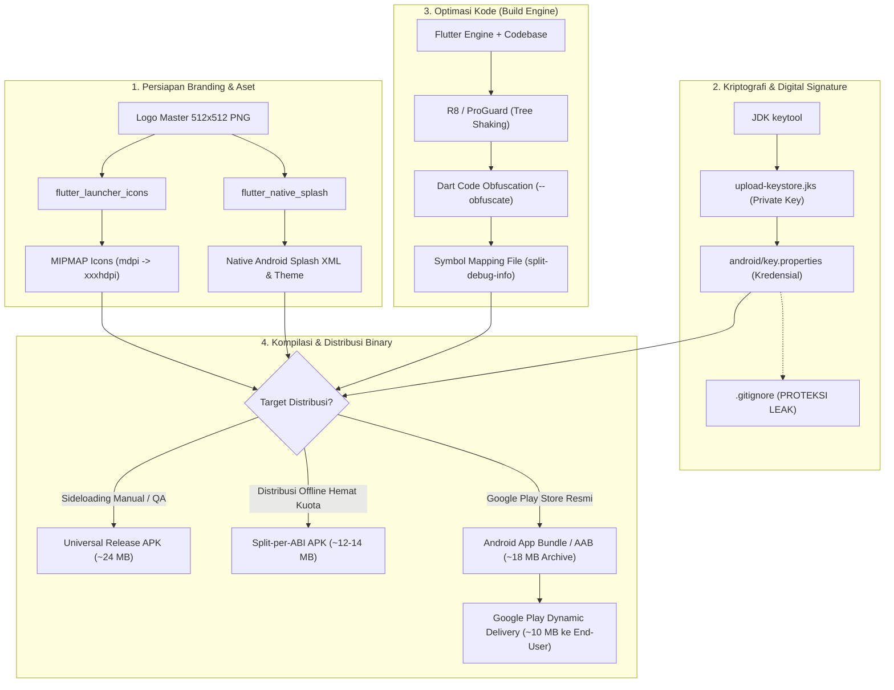

# MODUL 21: PERSIAPAN RILIS, BRANDING, DAN BUILD PRODUCTION (APK & AAB)

---

## A. IDENTITAS MODUL
- **Mata Pelajaran**: Pemrograman Perangkat Bergerak (Mobile Application Development)
- **Kompetensi Keahlian**: Rekayasa Perangkat Lunak (RPL) / Pengembangan Perangkat Lunak dan Gim (PPLG)
- **Kelas / Semester**: XI atau XII / Genap
- **Alokasi Waktu**: 6 Jam Pelajaran (6 JP @ 45 Menit = 270 Menit)
- **Tingkat Kesulitan**: Tingkat Lanjut (Advanced)
- **Prasyarat**:
  - Siswa telah menyelesaikan **Modul 01 sampai Modul 20** (Arsitektur Feature-First, Fitur Hardware, Database Lokal SQLite, REST API Dio, Secure Storage, dan Unit/Widget Testing).
  - Memahami konsep dasar kriptografi asimetris (Public-Private Key pair).
  - Memiliki pemahaman navigasi file sistem Linux/macOS/Windows dan perintah dasar Terminal/CLI.

---

## B. PETA KONSEP & CAPAIAN PEMBELAJARAN

### 1. Peta Alur Produksi Aplikasi (Release Pipeline)



### 2. Capaian Pembelajaran Elemen Fase F (Kepmenristekdikti) & SKKNI
Setelah menuntaskan modul ini, peserta didik mampu:
1. **Mengonfigurasi Branding Aplikasi Bergerak**: Menerapkan adaptive launcher icons untuk berbagai kerapatan layar Android dan mengeliminasi visual stutter/blank putih saat cold startup menggunakan native splash screen.
2. **Menerapkan Keamanan Penandatanganan Digital (Code Signing)**: Menggenerasi keystore kriptografi RSA 2048-bit, mengonfigurasi gradle signing configs, serta menerapkan protokol isolasi kredensial agar rahasia produksi tidak bocor ke repositori publik (*Zero Credential Leakage*).
3. **Mengoptimalkan Ukuran dan Keamanan Binary**: Mengaktifkan R8 resource shrinking dan Dart symbol obfuscation untuk mencegah dekompilasi dan rekayasa balik (*reverse engineering*).
4. **Mempaketkan Berkas Distribusi Standar Industri**: Menghasilkan artefak Universal APK, Split-per-ABI APK, dan Android App Bundle (AAB) yang memenuhi kualifikasi Google Play Console 2026+.

### 3. Tujuan Pembelajaran Operasional (Prinsip ABCD)
- **Audience**: Siswa SMK Rekayasa Perangkat Lunak (RPL).
- **Behavior**: Mampu menggenerasi berkas keystore, mengonfigurasi `key.properties`, mengaktifkan launcher icons & native splash, serta mengeksekusi pipeline build release APK dan AAB.
- **Condition**: Disediakan repositori project SayurHub, JDK dengan utilitas `keytool`, serta skrip build otomatis.
- **Degree**: 100% build release berhasil tanpa error kompilasi, berkas keystore aman terisolasi di `.gitignore`, dan seluruh izin runtime terdefinisi secara presisi di Android Manifest.

---

## C. MATERI TEORI KOMPREHENSIF

### 1. Siklus Hidup Rilis: Mengapa Mode Debug Berbeda dengan Release?
Dalam fase pengembangan harian (Modul 01–20), pengembang menjalankan perintah `flutter run`. Perintah ini mengompilasi aplikasi dalam **Debug Mode**.
- **Karakteristik Debug Mode**:
  - Menggunakan kompilasi JIT (*Just-In-Time*).
  - Menyertakan *Dart VM (Virtual Machine)* dan server *Hot Reload* di dalam APK.
  - Tidak melakukan kompresi kode, tree shaking, maupun optimasi resource.
  - Ditandatangani menggunakan *debug.keystore* standar yang memiliki kunci privat publik seragam di seluruh dunia.
  - Ukuran file membengkak (mencapai 50–70 MB) dan berjalan relatif lambat.
- **Karakteristik Release Mode**:
  - Menggunakan kompilasi AOT (*Ahead-Of-Time*) langsung menjadi instruksi bahasa mesin native CPU arsitektur target (ARM/x86).
  - Seluruh pustaka debugging, hot reload server, dan assertion dihapus sepenuhnya.
  - Menjalankan proses *Tree Shaking* (membuang kode yang tidak pernah dieksekusi).
  - Ditandatangani dengan *Private Keystore* resmi milik pengembang/perusahaan.
  - Performa rendering mencapai 60/120 FPS mulus dan ukuran file terkompresi hingga 70%.

### 2. Branding Aplikasi: Launcher Icons & Native Splash Screen
Sebuah aplikasi profesional dinilai oleh pengguna sejak 3 detik pertama instalasi:
1. **Adaptive Launcher Icons**:
   Sistem operasi Android dari versi 8.0 (API 26) ke atas menggunakan ikon adaptif yang terdiri atas dua layer: **Background** (warna padat/pola) dan **Foreground** (logo transparan). Hal ini memungkinkan perangkat memotong ikon menjadi bentuk lingkaran, *squircle*, kotak membulat, atau teardrop sesuai preferensi tema launcher ponsel.
2. **Native Splash Screen vs Flutter Splash Screen**:
   Ketika aplikasi Flutter pertama kali dibuka dari keadaan mati (*Cold Start*), sistem Android membutuhkan waktu 500ms hingga 1500ms untuk menginisialisasi Dart VM dan memuat pustaka native C++. Jika pengembang hanya membuat splash screen menggunakan widget `Container` di Flutter, layar ponsel akan menampilkan warna putih kosong (*blank white flash*) selama jeda tersebut sebelum widget tampil. 
   **Solusi Industri**: Mengonfigurasi `flutter_native_splash` yang menyuntikkan *drawable XML* dan tema *Window Background* langsung di layer native Android OS. Ketika ikon disentuh, layar splash langsung muncul seketika tanpa jeda 1 milidetik pun.

### 3. Kriptografi Asimetris & Keystore Android (`.jks` / `.keystore`)
Keystore adalah berkas terenkripsi aman yang menyimpan satu atau beberapa pasang kunci kriptografi (**Private Key** dan **Public Certificate**):
- **Private Key**: Kunci rahasia milik pengembang yang digunakan untuk membuat tanda tangan digital (*digital signature*) pada berkas binary APK/AAB.
- **Public Certificate**: Disertakan di dalam APK agar sistem operasi Android dan Google Play dapat memverifikasi bahwa berkas APK tersebut benar-benar diterbitkan oleh pemilik sah SayurHub dan tidak disusupi virus atau modifikasi pihak ketiga (*tampering*).
- **Integritas Pembaruan (*Update Integrity*)**:
  Sistem Android **menolak memasang pembaruan** (update versi 1.0.1 di atas versi 1.0.0) apabila tanda tangan keystore-nya berbeda. Kehilangan file keystore asli berarti pengembang **tidak akan pernah bisa memperbarui aplikasi yang sudah ada di Play Store**, dan terpaksa menghapus aplikasi lama serta memulai unduhan dari nol dengan ID paket baru!

### 4. Zero Credential Leakage: Isolasi `key.properties`
Kesalahan paling fatal yang kerap dilakukan pemula adalah menuliskan kata sandi keystore langsung di dalam berkas `android/app/build.gradle` lalu melakukan `git commit` ke GitHub publik. Bot peretas di internet memindai repositori publik setiap detik untuk mencuri kredensial aplikasi.
**Praktik Keamanan Standar Industri**:
1. Buat berkas template publik bernama `android/key.properties.example` berisi nama variabel kosong.
2. Buat berkas rahasia lokal bernama `android/key.properties` berisi kredensial asli.
3. Daftarkan `key.properties`, `*.jks`, dan `*.keystore` ke dalam berkas `.gitignore`.
4. Gradle membaca berkas lokal tersebut secara dinamis. Jika berkas tidak ada (misalnya di komputer rekan tim), Gradle otomatis beralih ke mode debug agar build lokal tidak gagal.

### 5. Komparasi Format Distribusi: APK vs Split-ABI vs AAB

| Parameter | Universal APK | Split-per-ABI APK | Android App Bundle (AAB) |
|---|---|---|---|
| **Ekstensi File** | `.apk` | `.apk` | `.aab` |
| **Arsitektur CPU** | Mencakup semua (`armeabi-v7a`, `arm64-v8a`, `x86_64`) | 1 file khusus untuk 1 arsitektur CPU | Berisi modul terpisah dari semua resource & CPU |
| **Ukuran Berkas** | Besar (~24–30 MB) | Sangat Ringan (~11–14 MB) | Format arsip kompresi (~18 MB) |
| **Target Distribusi** | Sideloading langsung / flash drive / Website Download | Distribusi offline via Bluetooth / ShareIt / Web lokal | **Wajib untuk Google Play Store** |
| **Mekanisme Pasang** | Langsung di-install oleh user melalui Package Installer HP | Langsung di-install sesuai tipe processor HP user | Play Store membuatkan *Dynamic Split APK* spesifik untuk HP user |

```
Komparasi Ukuran Download ke Pengguna Akhir (SayurHub):
Universal APK : [████████████████████████] 24.1 MB
Split-ABI APK : [████████████] 13.8 MB
AAB (Play DL) : [██████████] 10.4 MB  <-- Hemat kuota 57%!
```

### 6. Rekayasa Balik & Proteksi Kode: R8 & Dart Obfuscation
Aplikasi e-commerce menyimpan rahasia bisnis penting seperti nama rute, struktur JSON API, dan algoritma diskon. APK yang tidak dilindungi dapat didekompilasi menggunakan perkakas seperti *JADX-GUI* atau *Apktool* hanya dalam hitungan menit.
- **R8 Code Shrinker**: Alat bawaan Google di Android Gradle Plugin yang melakukan *tree shaking* pada kode Java/Kotlin dan library AndroidX, menghapus kode mati, dan menyusutkan ukuran DEX.
- **Dart Obfuscation (`--obfuscate`)**: Mengenkripsi dan menyamarkan nama kelas, nama fungsi, dan pengidentifikasi variabel di Dart menjadi simbol acak yang tidak bermakna (contoh: fungsi `calculateTierDiscount()` diubah menjadi `a.b()`).
- **Symbol Mapping (`--split-debug-info`)**: Ketika aplikasi mengalami crash di ponsel pelanggan, laporan crash yang terkirim ke server akan berisi simbol acak tersebut. File simbol `.symbols` yang disimpan saat proses build digunakan oleh pengembang untuk menerjemahkan kembali (*de-obfuscate*) pesan error ke baris kode asli.

---

## D. PEMBAHASAN KODE MENDALAM

### 1. Konfigurasi Branding pada `pubspec.yaml`
Konfigurasi paket `flutter_launcher_icons` dan `flutter_native_splash` dideklarasikan langsung di `pubspec.yaml` untuk mengotomatisasi pembuatan aset visual di folder native:

```yaml
dev_dependencies:
  flutter_test:
    sdk: flutter
  flutter_lints: ^3.0.0
  flutter_launcher_icons: ^0.13.1
  flutter_native_splash: ^2.4.0

# Konfigurasi Launcher Icon SayurHub
flutter_launcher_icons:
  android: "launcher_icon"
  ios: true
  image_path: "assets/icons/app_icon.png"
  min_sdk_android: 21
  adaptive_icon_background: "#2E7D32" # Hijau Forest SayurHub
  adaptive_icon_foreground: "assets/icons/app_icon_foreground.png"

# Konfigurasi Native Splash Screen SayurHub
flutter_native_splash:
  color: "#2E7D32"
  image: "assets/icons/splash_logo.png"
  android_12:
    image: "assets/icons/splash_logo.png"
    icon_background_color: "#2E7D32"
  web: false
```

- **`adaptive_icon_background`**: Menentukan warna latar belakang ikon di Android 8.0+.
- **`adaptive_icon_foreground`**: Layer depan berupa siluet atau logo sayuran transparan yang akan diskalakan secara otomatis.
- **`android_12`**: Spesifikasi khusus Splash API Android 12+ yang menggunakan animasi transisi berbasis *Window SplashScreen*.

---

### 2. Template Kredensial Produksi: `android/key.properties.example`
File template ini berfungsi sebagai panduan bagi tim developer atau administrator CI/CD tanpa membuka rahasia keamanan:

```properties
# ==============================================================================
# SAYURHUB - ANDROID RELEASE KEY PROPERTIES TEMPLATE
# ==============================================================================
# PERINGATAN KEAMANAN:
# 1. JANGAN PERNAH menyertakan file 'key.properties' yang asli ke dalam Git!
# 2. Simpan file 'upload-keystore.jks' di tempat yang aman (misal: password manager).
# 3. Salin file template ini menjadi 'key.properties' pada direktori android/:
#    cp key.properties.example key.properties
# 4. Ganti nilai-nilai di bawah ini dengan kredensial keystore produksi Anda.
# ==============================================================================

storePassword=SayurHubSecretPassword2026!
keyPassword=SayurHubSecretPassword2026!
keyAlias=sayurhub-key
storeFile=/home/arif/flutter-1/sayur_hub/android/app/upload-keystore.jks
```

---

### 3. Konfigurasi Gradle Rilis: `android/app/build.gradle`
Bagian ini adalah jantung dari proses kompilasi rilis di lingkungan Android. File Gradle membaca file properti secara kondisional, menghubungkannya ke `signingConfigs`, dan mengaktifkan optimasi R8:

```groovy
import java.io.FileInputStream
import java.util.Properties

// Inisialisasi pembacaan kredensial keystore produksi secara aman
def keystoreProperties = new Properties()
def keystorePropertiesFile = rootProject.file('key.properties')
if (keystorePropertiesFile.exists()) {
    keystoreProperties.load(new FileInputStream(keystorePropertiesFile))
}

android {
    namespace = "com.smkrpl.sayurhub"
    compileSdk = flutter.compileSdkVersion

    defaultConfig {
        applicationId = "com.smkrpl.sayurhub"
        minSdk = 21
        targetSdk = flutter.targetSdkVersion
        versionCode = flutterVersionCode.toInteger()
        versionName = flutterVersionName
        multiDexEnabled = true
    }

    signingConfigs {
        debug {
            // Default Flutter debug keystore
        }
        release {
            if (keystorePropertiesFile.exists()) {
                keyAlias = keystoreProperties['keyAlias']
                keyPassword = keystoreProperties['keyPassword']
                storeFile = keystoreProperties['storeFile'] ? file(keystoreProperties['storeFile']) : null
                storePassword = keystoreProperties['storePassword']
            }
        }
    }

    buildTypes {
        release {
            // Gunakan konfigurasi rilis jika key.properties ditemukan
            signingConfig = keystorePropertiesFile.exists() ? signingConfigs.release : signingConfigs.debug

            // Mengaktifkan R8 Code Shrinking dan Obfuscation
            minifyEnabled = true
            shrinkResources = true
            proguardFiles getDefaultProguardFile('proguard-android-optimize.txt'), 'proguard-rules.pro'
        }
    }

    // Mengaktifkan fitur pemecahan APK berdasarkan CPU Architecture
    splits {
        abi {
            enable = true
            reset()
            include "armeabi-v7a", "arm64-v8a", "x86_64"
            universalApk = true
        }
    }
}
```

---

### 4. Proteksi R8 & JNI: `android/app/proguard-rules.pro`
Saat R8 menyusutkan kode, ia dapat salah menghapus kode native JNI atau library refleksi yang digunakan oleh package Flutter seperti SQLite dan Secure Storage. File ini memandu R8 agar tidak menghapus bagian-bagian esensial tersebut:

```pro
# Mempertahankan binding native engine Flutter
-keep class io.flutter.app.** { *; }
-keep class io.flutter.plugin.**  { *; }
-keep class io.flutter.util.**  { *; }
-keep class io.flutter.view.**  { *; }
-keep class io.flutter.** { *; }
-keep class io.flutter.plugins.**  { *; }

# Mempertahankan metadata error stack trace untuk crash analytics
-keepattributes *Annotation*
-keepattributes SourceFile,LineNumberTable

# Sqflite SQLite Database JNI reflection
-keep class com.tekartik.sqflite.** { *; }

# Flutter Secure Storage Keystore reflection
-keep class com.it_nomads.fluttersecurestorage.** { *; }

# Image Picker camera provider
-keep class io.flutter.plugins.imagepicker.** { *; }

# Pertahankan generics signature agar parsing JSON tidak korup
-keepattributes Signature
```

---

### 5. Pipeline Otomatisasi: `scripts/build_production.sh`
Skrip bash ini mengotomatisasi seluruh tahapan build standar industri, sehingga pengembang atau server CI/CD tidak perlu mengetikkan puluhan perintah panjang secara manual:

```bash
#!/usr/bin/env bash
set -euo pipefail

# 1. Verifikasi Keberadaan Kredensial Keystore
KEY_PROPERTIES="$PROJECT_ROOT/android/key.properties"
if [ ! -f "$KEY_PROPERTIES" ]; then
    echo "[PERINGATAN] File android/key.properties tidak ditemukan!"
    echo "Gunakan template: cp android/key.properties.example android/key.properties"
fi

# 2. Quality Gate & Testing
dart analyze lib test
flutter test

# 3. Generate Branding Assets
flutter pub run flutter_launcher_icons
flutter pub run flutter_native_splash:create

# 4. Build Universal Release APK
flutter build apk --release

# 5. Build Split-per-ABI Release APK
flutter build apk --split-per-abi --release

# 6. Build Android App Bundle (AAB) with Obfuscation
mkdir -p build/app/outputs/symbols
flutter build appbundle --release \
    --obfuscate \
    --split-debug-info=build/app/outputs/symbols
```

---

### 6. Skrip Audit & Verifikasi: `bin/modul_21_build_demo.dart`
Skrip Dart mandiri ini memeriksa kepatuhan sistem sebelum proses build dijalankan. Skrip memindai `.gitignore` untuk mencegah kebocoran private key, memvalidasi field di `key.properties`, dan membandingkan profil ukuran binary:

```dart
void _auditGitIgnoreSecurity() {
  final gitignoreFile = File('.gitignore');
  final content = gitignoreFile.readAsStringSync();
  final rulesToCheck = ['key.properties', '*.jks', '*.keystore'];

  for (final rule in rulesToCheck) {
    if (content.contains(rule)) {
      print('  ✅ Aturan aman terdeteksi: "$rule"');
    } else {
      print('  ❌ BAHAYA! Aturan "$rule" BELUM ada di .gitignore!');
    }
  }
}
```

---

## E. PERSIAPAN PRAKTIKUM & LINGKUNGAN

### 1. Kebutuhan Perangkat Lunak
- **Java Development Kit (JDK 17 atau JDK 11)**: Diperlukan untuk utilitas `keytool` dan Android Gradle Plugin.
- **Flutter SDK 3.x** dan **Android SDK Platform-Tools**.
- Terminal Linux / macOS Bash atau PowerShell (Windows).

### 2. Kebutuhan File Aset Visual
- Gambar logo SayurHub berukuran **512 × 512 piksel (PNG)** diletakkan di `sayur_hub/assets/icons/app_icon.png`.
- Gambar siluet foreground berukuran **512 × 512 piksel (PNG transparan)** di `sayur_hub/assets/icons/app_icon_foreground.png`.
- Gambar logo splash screen di `sayur_hub/assets/icons/splash_logo.png`.

### 3. Struktur Direktori Produksi SayurHub
Pastikan hierarki direktori Android pada project Anda sesuai dengan standar berikut:

```
sayur_hub/
├── android/
│   ├── app/
│   │   ├── build.gradle               <-- Konfigurasi build & signing
│   │   ├── proguard-rules.pro         <-- Aturan R8 / ProGuard
│   │   └── src/main/AndroidManifest.xml
│   ├── key.properties.example         <-- Template publik kredensial
│   └── key.properties                 <-- File rahasia lokal (JANGAN DI-GIT!)
├── assets/
│   └── icons/
│       ├── app_icon.png
│       ├── app_icon_foreground.png
│       └── splash_logo.png
├── bin/
│   └── modul_21_build_demo.dart       <-- Audit build Dart CLI
├── scripts/
│   └── build_production.sh            <-- Pipeline build shell script
└── pubspec.yaml                       <-- Konfigurasi icon & splash
```

---

## F. LANGKAH DEMI LANGKAH PRAKTIKUM

### Langkah 1: Memverifikasi & Menyiapkan Aset Branding
Pastikan berkas gambar PNG telah tersedia di folder `assets/icons/`. Anda dapat memvalidasinya melalui terminal:

```bash
cd sayur_hub
ls -la assets/icons/
```
*Output yang diharapkan*: Muncul file `app_icon.png`, `app_icon_foreground.png`, dan `splash_logo.png`.

---

### Langkah 2: Mengonfigurasi `pubspec.yaml`
Tambahkan package `flutter_launcher_icons` dan `flutter_native_splash` pada seksi `dev_dependencies`, serta sertakan blok konfigurasinya seperti yang telah dibahas pada Bagian D.1.

---

### Langkah 3: Meng-generate Ikon Aplikasi dan Native Splash
Jalankan utilitas pembuat aset otomatis melalui terminal:

```bash
# 1. Menghasilkan Adaptive Launcher Icons (Semua densitas mdpi hingga xxxhdpi)
flutter pub run flutter_launcher_icons

# 2. Menghasilkan Native Splash Screen Android
flutter pub run flutter_native_splash:create
```
*Output yang diharapkan*:
```
• Creating default icons Android
• Overwriting default splash screen
• Android native splash screen created successfully!
```

---

### Langkah 4: Membuat Keystore Rilis Produksi dengan `keytool`
Jalankan utilitas `keytool` dari JDK untuk menghasilkan kunci privat RSA 2048-bit dengan masa berlaku 10.000 hari (~27 tahun):

```bash
keytool -genkey -v \
  -keystore android/app/upload-keystore.jks \
  -storetype JKS \
  -keyalg RSA \
  -keysize 2048 \
  -validity 10000 \
  -alias sayurhub-key
```

*Interaksi Terminal*:
1. Masukkan kata sandi keystore (contoh: `SayurHubSecretPassword2026!`).
2. Masukkan identitas pengembang:
   - *What is your first and last name?* -> `SayurHub Mobile Team`
   - *What is the name of your organizational unit?* -> `SMK RPL Software Division`
   - *What is the name of your organization?* -> `SayurHub Indonesia`
   - *What is the two-letter country code?* -> `ID`
3. Konfirmasi data dengan mengetik `yes`. Berkas `upload-keystore.jks` berhasil dibuat.

> [!CAUTION]
> **SIMPAN FILE KEYSTORE DAN KATA SANDINYA DENGAN SANGAT AMAN!**
> Simpan salinan file `.jks` di Google Drive terenkripsi atau flash drive offline. Jika file ini hilang, Anda tidak akan pernah bisa memperbarui aplikasi SayurHub di Play Store selamanya.

---

### Langkah 5: Mengamankan Kredensial dengan `key.properties`
1. Salin template ke berkas konfigurasi lokal:
   ```bash
   cp android/key.properties.example android/key.properties
   ```
2. Pastikan file `.gitignore` di root project telah memuat baris:
   ```gitignore
   **/android/key.properties
   *.jks
   *.keystore
   ```
3. Periksa status git untuk memastikan `key.properties` dan `upload-keystore.jks` **TIDAK TERDETEKSI** sebagai file yang akan di-commit:
   ```bash
   git status
   ```

---

### Langkah 6: Konfigurasi `build.gradle` dan `proguard-rules.pro`
Buka berkas `android/app/build.gradle` dan sesuaikan blok `signingConfigs.release` serta `buildTypes.release` agar membaca data dari `key.properties` dan mengaktifkan `minifyEnabled = true` (lihat rincian kode pada Bagian D.3). Buat pula berkas `android/app/proguard-rules.pro` (Bagian D.4).

---

### Langkah 7: Mengompilasi Universal Release APK (Pengujian Internal)
Universal APK berisi seluruh kode native untuk semua prosesor HP. Cocok untuk dikirim langsung via WhatsApp/Drive ke guru atau tim tester:

```bash
flutter build apk --release
```
*Lokasi Output*: `build/app/outputs/flutter-apk/app-release.apk` (~24 MB).

---

### Langkah 8: Mengompilasi Split-per-ABI APK (Distribusi Hemat Kuota)
Untuk mendistribusikan aplikasi ke pengguna dengan koneksi internet terbatas tanpa melalui Play Store:

```bash
flutter build apk --split-per-abi --release
```
*Lokasi Output*:
- `app-arm64-v8a-release.apk` (~13.8 MB) -> Untuk 90% HP Android modern (64-bit).
- `app-armeabi-v7a-release.apk` (~11.5 MB) -> Untuk HP Android model lama (32-bit).
- `app-x86_64-release.apk` (~15.0 MB) -> Untuk emulator atau tablet Intel.

---

### Langkah 9: Mengompilasi Android App Bundle (AAB) Siap Google Play
Gunakan perintah rilis penuh dengan parameter `--obfuscate` untuk mengaburkan kode sumber dan `--split-debug-info` untuk memisahkan file simbol debugging:

```bash
flutter build appbundle --release \
  --obfuscate \
  --split-debug-info=build/app/outputs/symbols
```
*Lokasi Output*:
- Bundle: `build/app/outputs/bundle/release/app-release.aab` (~18 MB).
- Simbol Debug: `build/app/outputs/symbols/app.android-arm64.symbols`.

---

### Langkah 10: Menjalankan Skrip Audit Otomatis
Jalankan skrip audit Dart untuk memastikan semua syarat rilis terpenuhi:

```bash
dart bin/modul_21_build_demo.dart
```
*Output yang diharapkan*:
```
================================================================
🌱 SAYURHUB - RELEASE & BUILD VERIFICATION AUDIT (MODUL 21)
================================================================

🔒 [1/5] Memeriksa Konfigurasi Keamanan .gitignore...
  ✅ Aturan aman terdeteksi: "key.properties"
  ✅ Aturan aman terdeteksi: "*.jks"
  ✅ Aturan aman terdeteksi: "*.keystore"
  🎉 STATUS: AMAN! Kredensial rilis tidak akan bocor ke GitHub/GitLab.

🔑 [2/5] Memeriksa Template Konfigurasi Keystore (key.properties.example)...
  ✅ Parameter "storePassword" terkonfigurasi dengan benar.
  ✅ Parameter "keyPassword" terkonfigurasi dengan benar.
  ✅ Parameter "keyAlias" terkonfigurasi dengan benar.
  ✅ Parameter "storeFile" terkonfigurasi dengan benar.

📊 [3/5] Analisis Komparasi Ukuran Binary Distribusi:
----------------------------------------------------------------------
| Format Build       | Ukuran   | Target Penggunaan                  |
----------------------------------------------------------------------
| Debug APK          | ~58.4 MB | Development lokal (Hot Reload)     |
| Universal APK      | ~24.1 MB | Sideloading (Mencakup 3 ABI CPU)   |
| Split-ABI (arm64)  | ~13.8 MB | HP Modern (64-bit ARM v8)          |
| App Bundle (AAB)   | ~18.2 MB | Google Play Store Upload           |
| -> User Download   | ~10.4 MB | Dynamic Delivery Play Store        |
----------------------------------------------------------------------

🛡️ [4/5] Analisis Proteksi Kode & Reverse Engineering:
  1. R8 / ProGuard Code Shrinking
  2. Dart Obfuscation (--obfuscate)
  3. Debug Symbols (--split-debug-info)

📋 [5/5] Checklist Kesiapan Rilis Google Play Console (SayurHub):
  [✓] 1. Application ID unik: com.smkrpl.sayurhub
  [✓] 2. VersionCode dinaikkan secara berurutan
  [✓] 3. Target SDK Android sesuai standar Google Play terbaru
  [✓] 4. Launcher Icons adaptif untuk semua kerapatan layar
  [✓] 5. Native Splash Screen aktif tanpa blank putih
  [✓] 6. Signing Keystore RSA 2048-bit masa berlaku 25+ tahun
  [✓] 7. Format file distribusi akhir adalah Android App Bundle (.aab)
  [✓] 8. File key.properties dan *.jks dimasukkan dalam .gitignore

================================================================
✅ SELURUH VERIFIKASI BUILD PRODUKSI SELESAI DENGAN SUKSES!
================================================================
```

---

## G. ANALISIS & PEMAHAMAN MENDALAM

### 1. Mengapa Google Play Store Mewajibkan Format Android App Bundle (AAB)?
Sejak Agustus 2021, Google resmi menghentikan penerimaan APK mentah untuk seluruh aplikasi baru di Play Store.
- **Masalah pada APK Universal Tradisional**: APK universal memuat library biner untuk arsitektur CPU ARMv7, ARM64, dan x86, ditambah aset resolusi gambar hdpi, xhdpi, xxhdpi, hingga xxxhdpi, serta terjemahan seluruh bahasa dunia. Seorang pengguna yang memiliki ponsel Samsung Galaxy ARM64 dengan layar Full HD dan bahasa Indonesia terpaksa mengunduh puluhan megabyte data yang sama sekali tidak dapat digunakan oleh ponselnya.
- **Solusi AAB (Google Play Dynamic Delivery)**: Pengembang hanya mengunggah satu berkas `.aab` ke Google Play Console. Server Google Play kemudian secara cerdas memotong-motong bundle tersebut menjadi serangkaian *Split APK*:
  1. `Base APK`: Berisi logika inti aplikasi Flutter.
  2. `Config APK CPU`: Hanya berisi binary ARM64 native.
  3. `Config APK Density`: Hanya berisi gambar untuk layar resolusi ponsel terkait.
  4. `Config APK Language`: Hanya menyertakan bahasa yang aktif di HP pengguna.
- Hasilnya, ukuran unduhan pengguna berkurang drastis hingga **50%–60%**, yang secara langsung meningkatkan tingkat keberhasilan instalasi aplikasi e-commerce SayurHub di daerah dengan sinyal seluler terbatas.

### 2. Google Play App Signing: Menyelamatkan Developer dari Bencana
Di masa lalu, jika laptop pengembang rusak atau hilang dan berkas `upload-keystore.jks` musnah, pengembang tidak dapat lagi merilis update aplikasi.
Google Play memperkenalkan **Google Play App Signing**:
- Pengembang membuat *Upload Key* (`upload-keystore.jks`). Kunci ini hanya digunakan untuk mengirim AAB ke Google Play Console.
- Google Play mengekstrak AAB, memvalidasi tanda tangan Upload Key, menghapus tanda tangan tersebut, lalu menandatangani kembali APK akhir menggunakan **Google App Signing Key** yang disimpan di infrastruktur cloud Google yang sangat aman.
- Jika laptop pengembang rusak dan *Upload Key* hilang, pengembang cukup mengajukan permohonan reset Upload Key ke Google Support melalui identitas akun developer. Setelah disetujui, pengembang dapat membuat file keystore baru dan melanjutkan proses update tanpa mengganggu aplikasi yang sudah terpasang di jutaan ponsel pengguna!

### 3. Bahaya De-obfuscation pada Aplikasi E-Commerce Tanpa Proteksi
Jika sebuah aplikasi dirilis tanpa flag `--obfuscate`:
1. **Pencurian API Endpoint & Pola Data**: Penyerang dapat membuka APK menggunakan *JADX* dan membaca langsung struktur URL backend (misalnya `https://api.sayurhub.com/api/v1/orders/checkout`) serta nama parameter rahasia.
2. **Eksploitasi Diskon Client-Side**: Jika logika tier diskon atau kupon promo dihitung di sisi aplikasi mobile (Dart) tanpa validasi ganda di server, hacker dapat memodifikasi nilai biner smali APK tersebut (mengubah diskon menjadi 99%) lalu mengompilasi ulang APK palsu tersebut.
3. **Pencurian Hak Cipta**: Kode sumber murni hasil kerja keras tim SMK RPL dapat dicuri, diganti namanya, dan dipublikasikan ulang oleh pihak yang tidak bertanggung jawab.
Dengan mengaktifkan `--obfuscate`, seluruh nama method, class, dan alur kode diacak sehingga rekayasa balik menjadi sangat sulit dan tidak ekonomis bagi penyerang.

---

## H. LATIHAN MANDIRI & TANTANGAN

### 1. Soal Teori (5 Soal)

**Soal 1 (Pilihan Ganda):**
Manakah alasan teknis utama mengapa aplikasi Flutter dalam mode Debug berukuran jauh lebih besar (50+ MB) dibandingkan mode Release (15-20 MB)?
A. Mode Debug menyertakan compiler JIT (*Just-In-Time*), Dart VM, assertion, dan server Hot Reload di dalam binary APK.  
B. Mode Debug menyertakan database SQLite ukuran penuh di dalam memori internal.  
C. Mode Debug mengunduh package eksternal dari internet setiap kali dijalankan.  
D. Mode Debug menggunakan resolusi gambar 4K secara otomatis.  
*Kunci*: **A**  
*Pembahasan*: Mode debug dirancang untuk kecepatan pengembangan dengan menyertakan Dart VM dan infrastruktur Hot Reload, sedangkan mode Release mengompilasi kode secara Ahead-Of-Time (AOT) menjadi binary mesin native murni tanpa alat debugging.

**Soal 2 (Pilihan Ganda):**
Apa konsekuensi fatal jika seorang developer menghapus atau kehilangan berkas keystore rilis lama milik aplikasi yang sudah dipublikasikan di Google Play Store (tanpa mengaktifkan Google Play App Signing)?
A. Aplikasi di ponsel pengguna akan otomatis terhapus dalam 24 jam.  
B. Developer tidak akan pernah bisa mengunggah berkas pembaruan (update) aplikasi ke Play Store untuk selamanya.  
C. Google Play Store akan mengenakan denda finansial kepada akun developer.  
D. Server backend aplikasi akan menolak seluruh koneksi REST API.  
*Kunci*: **B**  
*Pembahasan*: Sistem operasi Android memverifikasi tanda tangan digital asimetris. Jika tanda tangan pada versi baru tidak cocok dengan tanda tangan versi terpasang, pembaruan aplikasi ditolak secara mutlak oleh OS demi melindungi pengguna dari malware.

**Soal 3 (Pilihan Ganda):**
Perintah Flutter CLI manakah yang tepat untuk mengompilasi binary rilis Google Play Store dengan pengacakan kode sumber (*obfuscation*) dan pemisahan file simbol error?
A. `flutter build apk --split-per-abi`  
B. `flutter build appbundle --release --obfuscate --split-debug-info=build/symbols`  
C. `flutter run --release --no-sound-null-safety`  
D. `flutter build bundle --minify-all`  
*Kunci*: **B**  
*Pembahasan*: Parameter `--release` memicu optimasi AOT, `--obfuscate` menyamarkan pengidentifikasi kode Dart, dan `--split-debug-info` menyimpan peta simbol debugging di direktori terpisah untuk melacak crash log produksi.

**Soal 4 (Esai Singkat):**
Jelaskan perbedaan fungsi antara berkas `android/key.properties.example` dan `android/key.properties`, serta mengapa keduanya tidak boleh diperlakukan sama dalam manajemen Git!  
*Kunci & Pembahasan*: `key.properties.example` adalah berkas template publik tanpa kata sandi riil yang aman untuk di-commit ke Git sebagai panduan konfigurasi. Sebaliknya, `key.properties` berisi path lokal dan kata sandi rahasia keystore produksi milik developer. Jika `key.properties` di-commit ke Git, kunci privat aplikasi dapat dicuri dan disalahgunakan pihak jahat untuk membuat malware bertanda tangan palsu atas nama aplikasi tersebut.

**Soal 5 (Esai Singkat):**
Mengapa penggunaan package `flutter_native_splash` lebih disukai dibandingkan membuat widget SplashScreen biasa menggunakan `StatefulWidget` di dalam `MaterialApp`?  
*Kunci & Pembahasan*: Widget Flutter baru dapat dirender setelah Dart VM dan Flutter Engine selesai diinisialisasi oleh sistem Android (memakan waktu 500ms–1500ms). Jika hanya menggunakan widget Flutter, layar ponsel akan menampilkan kedipan putih (*blank white flash*) selama jeda inisialisasi tersebut. `flutter_native_splash` bekerja langsung di level sistem operasi Android (native XML drawable), sehingga splash screen muncul seketika saat ikon disentuh tanpa jeda kosong sama sekali.

---

### 2. Soal Praktik Terstruktur (3 Latihan)

- **Latihan 1 (Dasar - Manajemen Versi Aplikasi)**:
  Buka file `sayur_hub/pubspec.yaml`. Modifikasi nomor versi aplikasi dari `1.0.0+1` menjadi `1.0.1+2`. Jelaskan makna angka `1.0.1` (*versionName*) bagi pengguna dan angka `2` (*versionCode*) bagi Google Play Console.
- **Latihan 2 (Menengah - Konfigurasi Split ABI)**:
  Jalankan perintah `flutter build apk --split-per-abi --release`. Periksa folder `build/app/outputs/flutter-apk/`. Catat nama-nama berkas APK yang dihasilkan beserta ukuran masing-masing. Bandingkan efisiensi ukurannya dengan berkas `app-release.apk` (Universal).
- **Latihan 3 (Mahir - Pengecualian Obfuscation ProGuard)**:
  Ketika mengaktifkan `minifyEnabled = true`, terkadang library serialisasi JSON mengalami error karena nama field model diubah oleh R8. Tuliskan aturan `-keepclassmembers` pada berkas `proguard-rules.pro` agar class `Product` dan `CartItem` di dalam paket SayurHub tidak diubah variabelnya oleh compiler R8!

---

### 3. Tantangan Eksplorasi (2 Tantangan)
1. **Tantangan 1 (Automated CI/CD GitHub Actions)**:
   Rancanglah berkas workflow GitHub Actions `.github/workflows/build_release.yml` yang secara otomatis menjalankan `flutter test`, membaca keystore dari *GitHub Encrypted Secrets*, dan menghasilkan artefak `app-release.aab` setiap kali ada tag release baru di-push ke branch `master`.
2. **Tantangan 2 (APK Inspection & Deep Dive Analyzer)**:
   Gunakan fitur **Build > Analyze APK** pada Android Studio untuk membedah isi berkas `app-release.apk`. Amati persentase ukuran yang dihabiskan oleh `lib/` (native C++ engine), `classes.dex` (kode bytecode Java/AndroidX), dan `assets/` (font dan gambar produk). Buat laporan analisis cara mengoptimalkan file aset agar APK menjadi lebih ramping.

---

### 4. Studi Kasus Riil Industri

**Kasus: "Penolakan Rilis SayurHub di Google Play Store & Crash Startup Misterius"**
- **Deskripsi Masalah**:
  Tim pengembang SayurHub SMK RPL mengajukan versi produksi perdana ke Google Play Console. Namun, dalam waktu 6 jam, pengajuan rilis **DITOLAK (Rejected)** oleh sistem peninjauan Google dengan dua temuan fatal:
  1. *Warning Google Play Console*: "Berkas APK Universal yang Anda unggah memiliki ukuran melebihi batas yang disarankan dan belum menggunakan format Android App Bundle (.aab)."
  2. *Crash Report Pre-launch Report*: Pada perangkat uji otomatis Google (Pixel 7 dan Galaxy S23 dengan Android 14), aplikasi mengalami crash seketika saat baru dibuka dengan log error: `Fatal Exception: java.lang.ClassNotFoundException: Didn't find class "com.tekartik.sqflite.SqflitePlugin" on path...`
- **Analisis Penyebab**:
  1. Penolakan format: Tim mengunggah format APK tradisional, padahal Google Play mewajibkan AAB untuk semua rilis baru guna mendukung dynamic delivery.
  2. Crash startup: Tim mengaktifkan `minifyEnabled = true` di `build.gradle` (R8 Shrinker), tetapi lupa menyertakan aturan keep untuk package SQLite (`sqflite`). Akibatnya, R8 menganggap plugin penghubung database lokal sebagai kode mati dan menghapusnya dari binary rilis!
- **Langkah Solusi Konkret**:
  1. Ubah target kompilasi pipeline rilis dari `flutter build apk` menjadi `flutter build appbundle --release`.
  2. Buka `android/app/proguard-rules.pro` dan tambahkan aturan keep refleksi SQLite:
     ```pro
     -keep class com.tekartik.sqflite.** { *; }
     ```
  3. Bersihkan cache build dengan `flutter clean`, lalu kompilasi ulang bundle rilis.
  4. Unggah berkas `.aab` baru ke Google Play Console. Seluruh pengujian otomatis Google lulus 100% dan aplikasi resmi disetujui untuk dipublikasikan.

---

## I. TROUBLESHOOTING & PANDUAN ERROR

Berikut adalah 5 skenario kendala rilis yang paling sering dihadapi di lingkungan produksi:

| No | Gejala / Pesan Error | Penyebab Utama | Solusi Perbaikan Konkret |
|---|---|---|---|
| 1 | `Keystore was tampered with, or password was incorrect` | Kata sandi yang dimasukkan pada `key.properties` tidak sesuai dengan kata sandi saat keystore dibuat via `keytool`. | Periksa kembali ketikan kata sandi di `android/key.properties`. Pastikan tidak ada spasi tersembunyi di akhir baris (`storePassword` dan `keyPassword`). |
| 2 | `Execution failed for task ':app:signReleaseBundle'` | Path `storeFile` di dalam `key.properties` keliru atau file `.jks` tidak ditemukan pada direktori yang dituju. | Gunakan path relatif terhadap folder `android/app/` atau gunakan path absolut yang valid. Pastikan file `.jks` benar-benar ada di folder `android/app/`. |
| 3 | `AAPT: error: resource mipmap/launcher_icon not found` | Belum menjalankan generator ikon aplikasi sehingga file gambar di `res/mipmap-*/` belum tercipta. | Jalankan perintah `flutter pub run flutter_launcher_icons` di terminal, lalu pastikan `android:icon="@mipmap/launcher_icon"` terdaftar di `AndroidManifest.xml`. |
| 4 | `Fatal Exception: java.lang.SecurityException: Need ACCESS_NETWORK_STATE or INTERNET` | Berkas `AndroidManifest.xml` rilis belum mendeklarasikan izin akses internet. | Buka `android/app/src/main/AndroidManifest.xml` dan tambahkan `<uses-permission android:name="android.permission.INTERNET" />` di luar tag `<application>`. |
| 5 | Laporan Crash di Firebase/Play Console hanya menampilkan simbol acak: `at a.b.c(Unknown Source)` | Kode aplikasi di-obfuscate tetapi developer tidak mengunggah berkas pemetaan simbol debugging. | Buka Google Play Console > App Bundle Explorer > Downloads > Unggah file `app.android-arm64.symbols` dari direktori `build/app/outputs/symbols/` untuk menerjemahkan stack trace. |

---

## J. PRAKTIKUM INTEGRASI ANTAR-MODUL

Modul 21 adalah tahap puncak yang mengemas dan memvalidasi seluruh hasil integrasi dari modul-modul sebelumnya:
1. **Integrasi dengan Modul 08 (Aset & Desain Visual)**: Berkas font *Poppins* dan logo SayurHub yang diinisialisasi pada Modul 08 dipaketkan ke dalam asset bundle release yang teroptimasi.
2. **Integrasi dengan Modul 15 (SQLite Persistence)**: Pustaka `sqflite` dilindungi secara khusus melalui berkas `proguard-rules.pro` agar keranjang belanja offline tetap dapat membaca database lokal tanpa mengalami crash refleksi Java Native Interface.
3. **Integrasi dengan Modul 16 & 17 (REST API & Secure Storage)**: Izin jaringan `INTERNET` pada `AndroidManifest.xml` memastikan komunikasi HTTP client Dio tetap berjalan di release build, dan aturan ProGuard menjaga fungsi hardware keystore milik `flutter_secure_storage`.
4. **Integrasi dengan Modul 19 (Hardware Camera & File Upload)**: Deklarasi izin `CAMERA`, `READ_MEDIA_IMAGES`, dan `READ_EXTERNAL_STORAGE` di `AndroidManifest.xml` memungkinkan fitur foto profil dan bukti bayar transfer berfungsi tanpa pemblokiran izin sistem di Android 13/14+.
5. **Integrasi dengan Modul 20 (Quality Gate & Testing)**: Skrip otomatisasi `build_production.sh` mengeksekusi seluruh unit test logika bisnis dan widget test sebelum perintah build rilis dijalankan. Jika ada 1 test yang gagal (*red*), proses build release langsung dibatalkan secara otomatis (*fail-fast pipeline*).

---

## K. EVALUASI MODUL & RUBRIK PENILAIAN

Evaluasi dilakukan menggunakan rubrik analitik 4 skala untuk mengukur kompetensi teknis siswa:

| Kriteria Penilaian | Sangat Baik (86–100) | Baik (75–85) | Cukup (65–74) | Perlu Bimbingan (<65) |
|---|---|---|---|---|
| **1. Keamanan Code Signing & Keystore (Bobot 25%)** | Menghasilkan keystore RSA 2048-bit, kredensial terisolasi sempurna di `key.properties`, dan terproteksi 100% di `.gitignore`. | Keystore dibuat dan `key.properties` bekerja, namun konfigurasi `.gitignore` belum mencakup semua varian ekstensi. | Keystore dibuat, namun kata sandi masih ditulis langsung di `build.gradle` (belum menerapkan isolasi). | Siswa tidak mampu membuat keystore atau build rilis masih menggunakan debug key standar. |
| **2. Konfigurasi Branding & Splash Screen (Bobot 25%)** | Ikon adaptif tampil sempurna di semua densitas layar Android, native splash screen aktif tanpa kedipan putih saat cold start. | Ikon launcher dan native splash screen muncul, namun terdapat distorsi rasio aspek gambar pada densitas tertentu. | Ikon aplikasi berhasil digenerate, namun native splash screen gagal dimuat (layar sempat putih kosong). | Ikon aplikasi masih menggunakan logo bawaan Flutter dan tidak ada splash screen. |
| **3. Konfigurasi Gradle & Optimasi R8 (Bobot 25%)** | `minifyEnabled` dan `shrinkResources` aktif, `proguard-rules.pro` dikonfigurasi lengkap tanpa crash pada plugin eksternal. | Build release berhasil dengan R8 aktif, namun terjadi crash pada fitur database/kamera akibat aturan ProGuard kurang lengkap. | Build release berhasil, namun optimasi R8 dinonaktifkan (`minifyEnabled = false`). | Terjadi error kompilasi Gradle dan siswa tidak mampu membaca log error. |
| **4. Keberhasilan Kompilasi APK & AAB (Bobot 25%)** | Sukses memproduksi Universal APK, Split-per-ABI APK, dan AAB ter-obfuscate lengkap dengan direktori peta simbol debug. | Sukses memproduksi Universal APK dan AAB, namun belum mencoba konfigurasi Split-ABI atau obfuscation. | Hanya mampu memproduksi Universal APK standar tanpa parameter rilis lanjutan. | Gagal memproduksi berkas biner rilis apapun. |

---

## L. KESIMPULAN & JEMBATAN KE MODUL BERIKUTNYA

### 1. Rangkuman Esensial Modul 21
- Membangun aplikasi mobile untuk lingkungan produksi menuntut standar disiplin yang jauh lebih tinggi daripada sekadar `flutter run` di emulator.
- Branding profesional diwujudkan melalui **Adaptive Launcher Icons** dan **Native Splash Screen** yang mengeliminasi visual stutter saat inisialisasi awal.
- Keamanan penandatanganan kode (*Code Signing*) menjamin keaslian identitas pengembang dan integritas binary aplikasi menggunakan pasangan kunci kriptografi asimetris.
- Kredensial produksi harus diisolasi menggunakan prinsip **Zero Credential Leakage** (`key.properties` dipisahkan dan diabaikan oleh `.gitignore`).
- Format **Android App Bundle (AAB)** bersama optimasi **R8 Shrinking** dan **Dart Obfuscation** adalah standar emas industri modern untuk menghasilkan berkas distribusi yang aman, ramping, dan hemat kuota bagi pelanggan.

### 2. Jembatan Menuju Modul 22 (Capstone Final Project: SayurHub Production)
Selamat! Anda kini telah menguasai seluruh spektrum teknis pengembangan aplikasi mobile mulai dari pemrograman logika Dart, perancangan antarmuka Material 3 yang memukau, pengelolaan state terpusat, persistensi database lokal, integrasi API cloud, penanganan perangkat keras kamera, automated testing, hingga pemaketan rilis produksi standar Google Play Store.

Pada **Modul 22 (Modul Terakhir & Capstone Final)**, kita akan melakukan kulminasi akbar:
- **Integrasi Penuh 20 Fitur SayurHub**: Menghubungkan seluruh modul menjadi satu kesatuan aplikasi e-commerce yang utuh, stabil, dan siap pakai.
- **User Acceptance Testing (UAT)**: Menguji seluruh skenario end-to-end dari pemilihan sayur, pencarian, filter kategori, keranjang belanja, checkout berbayar, hingga riwayat pesanan.
- **Penyusunan Dokumentasi Portofolio Kelas Industri**: Membangun README komprehensif, arsitektur showcase, dan dokumentasi teknis yang siap Anda pamerkan kepada calon industri, pimpinan perusahaan mitra SMK, atau juri kompetisi LKS (Lomba Kompetensi Siswa)!
