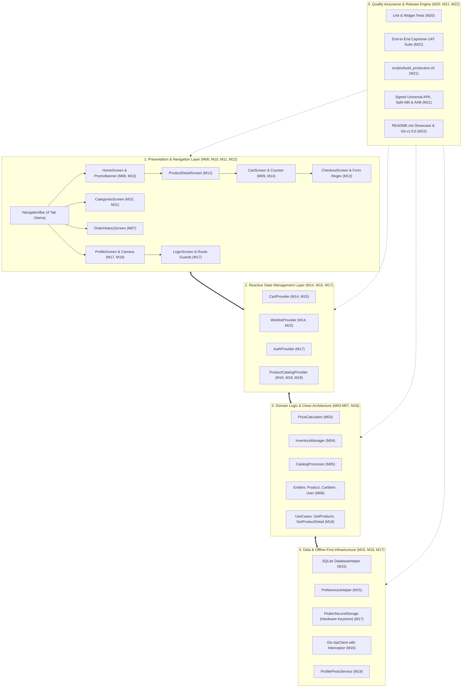

# MODUL 22: CAPSTONE PROJECT: INTEGRASI FINAL SAYURHUB, COMPREHENSIVE QA, DAN PORTOFOLIO SHOWCASE

---

## A. IDENTITAS MODUL
- **Mata Pelajaran**: Pemrograman Perangkat Bergerak (Mobile Application Development)
- **Kompetensi Keahlian**: Rekayasa Perangkat Lunak (RPL) / Pengembangan Perangkat Lunak dan Gim (PPLG)
- **Kelas / Semester**: XII / Genap
- **Alokasi Waktu**: 10 Jam Pelajaran (10 JP @ 45 Menit = 450 Menit)
- **Tingkat Kesulitan**: Proyek Puncak / Tingkat Mahir (Capstone Mastery)
- **Prasyarat**:
  - Telah menyelesaikan seluruh **Modul 01 sampai Modul 21** secara berurutan dan tuntas.
  - Memahami seluruh konsep siklus hidup pengembangan perangkat lunak bergerak: Analisis Kebutuhan, Desain Antarmuka Material 3, Logika Dart Berorientasi Objek, State Management Terpusat, Basis Data Relasional Offline, Jaringan REST API, Keamanan Enkripsi Hardware, Fitur Kamera, Automated Testing, hingga Kompilasi Rilis Produksi.

---

## B. PETA KONSEP & CAPAIAN PEMBELAJARAN

### 1. Peta Ekosistem Arsitektur Utuh SayurHub (20 Fitur Terintegrasi)



### 2. Capaian Pembelajaran Elemen Fase F & Standar SKKNI
Pada akhir modul puncak (*Capstone*) ini, peserta didik mampu:
1. **Mengintegrasikan Sistem Perangkat Lunak Skala Besar**: Menghubungkan seluruh komponen antarmuka, state management, database lokal, REST API jarak jauh, dan layanan keamanan hardware menjadi satu aplikasi utuh yang stabil dan bebas tabrakan dependensi.
2. **Melaksanakan User Acceptance Testing (UAT)**: Menguji seluruh skenario perjalanan pengguna (*End-to-End User Journey*) dari pembukaan aplikasi, otentikasi login, pencarian produk, kalkulasi keranjang, pengisian formulir validasi regex, hingga penerbitan resi pesanan.
3. **Mendokumentasikan Portofolio Profesional Berstandar Industri**: Menyusun dokumen `README.md` berkelas industri yang memuat arsitektur sistem, matriks fitur, panduan instalasi, dan sertifikasi pengujian sebagai bukti portofolio siap kerja.
4. **Menerapkan Standar Etika & Kualitas Perangkat Lunak**: Mematuhi lisensi perangkat lunak bebas (MIT License), menjaga kebersihan kode (*clean code*), dan menjamin ketiadaan kebocoran kredensial rahasia (*zero credential leak*).

### 3. Tujuan Pembelajaran Operasional (Prinsip ABCD)
- **Audience**: Siswa SMK Rekayasa Perangkat Lunak (RPL) tingkat akhir.
- **Behavior**: Mampu mengintegrasikan 20 fitur lengkap SayurHub, mengeksekusi pengujian UAT menyeluruh, dan mempublikasikan repositori final berlabel rilis `v1.0.0`.
- **Condition**: Menggunakan seluruh artefak kode dari Modul 01–21, terminal pengujian Dart/Flutter, dan perkakas dokumentasi Markdown.
- **Degree**: Seluruh 20 fitur berfungsi dengan tingkat keberhasilan pengujian 100% (*green test suite*), tidak ada crash pada mode offline maupun online, dan dokumentasi portofolio siap dipamerkan dalam Uji Kompetensi Keahlian (UKK).

---

## C. MATERI TEORI KOMPREHENSIF

### 1. Metodologi Capstone Project dalam Pendidikan Vokasi (PjBL)
*Capstone Project* adalah puncak dari metode pembelajaran berbasis proyek (*Project-Based Learning* / PjBL). Berbeda dengan latihan kecil mingguan, proyek puncak menuntut siswa berpikir selayaknya **Software Engineer Profesional**:
- **Pendekatan Holistik**: Siswa tidak lagi memandang kode sebagai potongan baris terisolasi, melainkan sebagai ekosistem yang saling bergantung. Perubahan pada model data di Modul 06 akan berdampak langsung pada tabel SQLite di Modul 15 dan serialisasi API di Modul 16.
- **Agile Scrum Mini-Sprint**: Siswa membagi pekerjaan akhir ke dalam tiga tahap: *Code Freeze* (penghentian penambahan fitur baru), *QA Hardening* (perbaikan bug dan pengujian ekstrem), dan *Release Deployment* (pembuatan rilis final dan portofolio).
- **Definition of Done (DoD)**: Suatu fitur dianggap selesai bukan saat kodenya selesai diketik, melainkan saat:
  1. Kode lulus analisis linter tanpa peringatan (*clean `dart analyze`*).
  2. Seluruh unit test dan widget test terkait berhasil (*pass*).
  3. Berfungsi sempurna pada pengujian manual di perangkat fisik.
  4. Terdokumentasi secara jelas di dalam `README.md`.

### 2. End-to-End User Journey: Alur Integrasi 20 Fitur SayurHub
Aplikasi SayurHub menyajikan alur pengalaman berbelanja yang mulus dari hulu ke hilir:

```
[1. Cold Start]
  └─ Native Splash Screen (M21) aktif seketika -> WelcomeScreen (M02)
[2. Autentikasi Pengguna]
  └─ LoginScreen (M17) -> JWT Token disimpan aman di Hardware Keystore (M17)
[3. Eksplorasi Katalog]
  └─ Navigation Shell M3 (M11) -> HomeScreen (M08) -> Banner Promo & CategoryPills (M10)
  └─ Shimmer Skeleton (M16) -> Dio Fetch API / Cache SQLite Offline (M15, M16, M18)
  └─ Infinite Scroll Pagination saat menggulir ke bawah (M19)
[4. Detail Produk & Evaluasi Mutu]
  └─ Tap ProductCard (M09) -> GoRouter navigasi ke ProductDetailScreen (M12)
  └─ Audit Kesegaran & Algoritma Umur Simpan Panen Petani (M04)
[5. Transaksi Keranjang & Diskon Kuantitas]
  └─ QuantityCounterWidget (M09) -> CartProvider terpusat (M14)
  └─ Algoritma Tier Diskon Grosir otomatis memotong harga (M03, M04)
  └─ Data keranjang tersimpan permanen di SQLite ponsel (M15)
[6. Checkout & Validasi Formulir]
  └─ GoRouter Guard memverifikasi sesi login aktif (M12, M17)
  └─ CheckoutScreen (M13) -> Validasi Regex No HP & Alamat Pengiriman
[7. Pembayaran & Fitur Perangkat Keras]
  └─ Kamera Hardware mengambil foto struk transfer (M19)
  └─ Unggah multipart ke backend server (M19)
[8. Pelacakan Pesanan Real-Time]
  └─ OrderHistoryScreen (M07) -> Stream OrderStatus (Pending -> Delivered)
[9. Jaminan Kualitas & Distribusi Produksi]
  └─ Unit, Widget & UAT Testing lulus 100% (M20, M22)
  └─ Pemaketan Android App Bundle (AAB) ter-obfuscate siap Play Store (M21)
```

### 3. User Acceptance Testing (UAT) & Matriks Ketertelusuran (Traceability)
User Acceptance Testing (UAT) adalah fase pengujian di mana perangkat lunak diuji untuk memastikan apakah sistem memenuhi kriteria penerimaan pengguna bisnis (*business acceptance criteria*):
- **Traceability Matrix**: Setiap kebutuhan pengguna di Modul 01 (Software Requirements Specification) harus dapat dilacak langsung ke baris kode implementasi dan kasus uji otomatis di Modul 22.
- **Robustness Terhadap Kondisi Ekstrem (Edge Cases)**:
  - *Airplane Mode Test*: Apakah keranjang belanja tetap dapat dibuka dan diubah kuantitasnya saat ponsel tidak memiliki sinyal internet? (Dukungan SQLite Modul 15).
  - *Invalid Format Attack*: Apakah formulir checkout menolak nomor telepon abal-abal seperti `abcde` atau `123`? (Dukungan Regex Modul 13).
  - *Unauthorized Access*: Apakah pengguna anonim yang belum login dicegat (*redirected*) saat mencoba membuka URL `/checkout`? (Dukungan Route Guards Modul 17).

### 4. Seni Menyusun Portofolio Rekayasa Perangkat Lunak yang Menjual
Bagi lulusan SMK RPL, ijazah saja tidak cukup untuk menembus persaingan industri teknologi global. Rekruter teknologi, *Engineering Manager*, dan pimpinan startup menilai seorang kandidat berdasarkan **repositori GitHub dan kualitas portofolionya**.
Sebuah repositori portofolio yang unggul wajib memiliki:
1. **Header & Badges Profesional**: Menampilkan status build, versi Flutter/Dart, lisensi, dan standar arsitektur.
2. **Visual Showcase**: Animasi GIF atau tangkapan layar antarmuka aplikasi beresolusi tinggi.
3. **Arsitektur yang Jelas**: Diagram Mermaid yang membuktikan bahwa pembuat aplikasi memahami pemisahan tanggung jawab (*Separation of Concerns*).
4. **Instruksi Instalasi yang Teruji**: Perintah langkah demi langkah yang dapat dieksekusi oleh rekruter tanpa mengalami error kompilasi.
5. **Kredit & Lisensi Terbuka**: Penggunaan lisensi resmi seperti MIT License yang mencerminkan etika rekayasa perangkat lunak internasional.

---

## D. PEMBAHASAN KODE MENDALAM

### 1. Titik Temu Seluruh Arsitektur: `sayur_hub/lib/main.dart`
File `main.dart` mengorkestrasi inisialisasi asynchronous layanan-layanan kritis sebelum widget pertama kali dirender:

```dart
void main() async {
  // 1. Memastikan binding Flutter engine siap menangani komunikasi native
  WidgetsFlutterBinding.ensureInitialized();

  // 2. Inisialisasi basis data relasional SQLite lokal
  final databaseHelper = DatabaseHelper.instance;
  await databaseHelper.database;

  // 3. Inisialisasi hardware secure storage & token session
  final secureStorage = SecureStorageService();
  final authProvider = AuthProvider(secureStorage);
  await authProvider.initializeAuth();

  // 4. Inisialisasi API Client Dio & Clean Architecture Repositories
  final apiClient = ApiClient();
  final productRemoteDataSource = ProductRemoteDataSource(apiClient);
  final productLocalDataSource = ProductLocalDataSource(databaseHelper);
  final productRepository = ProductRepositoryImpl(
    remoteDataSource: productRemoteDataSource,
    localDataSource: productLocalDataSource,
  );

  // 5. Jalankan aplikasi di dalam pembungkus MultiProvider reaktif
  runApp(
    MultiProvider(
      providers: [
        ChangeNotifierProvider.value(value: authProvider),
        ChangeNotifierProvider(
          create: (_) => ProductCatalogProvider(
            getProductsUseCase: GetProductsUseCase(productRepository),
          ),
        ),
        ChangeNotifierProvider(create: (_) => CartProvider(databaseHelper)),
        ChangeNotifierProvider(create: (_) => WishlistProvider(databaseHelper)),
      ],
      child: const SayurHubApp(),
    ),
  );
}
```
**Analisis Kritis**: Inisialisasi dilakukan secara terstruktur. `WidgetsFlutterBinding.ensureInitialized()` mutlak diperlukan karena SQLite dan Secure Storage menggunakan *Platform Channels* yang bergantung pada layer C++ Flutter.

---

### 2. Pengujian Hulu-ke-Hilir: `sayur_hub/test/e2e/sayurhub_capstone_uat_test.dart`
Kasus uji UAT memverifikasi skenario bisnis nyata tanpa ketergantungan pada server eksternal:

```dart
test('UAT 2.1: Perhitungan Subtotal dan Diskon Tier Kuantitas', () {
  final subtotal = PriceCalculator.calculateSubtotal(
    unitPrice: sampleSpinach.price,
    quantity: 5,
  );
  expect(subtotal, equals(25000));

  final discountPercent = InventoryManager.getTierDiscountPercent(5);
  expect(discountPercent, greaterThanOrEqualTo(5.0));

  final finalPrice = PriceCalculator.applyDiscount(
    price: subtotal,
    discountPercent: discountPercent,
  );
  expect(finalPrice, lessThan(subtotal));
});
```
**Analisis Kritis**: Uji ini memastikan bahwa aturan bisnis (diskon kuantitas pembelian sayur) berjalan presisi hingga satuan rupiah terkecil tanpa potensi pembagian dengan nol (*division by zero*) atau nilai negatif.

---

### 3. Demonstrasi Interaktif CLI: `sayur_hub/bin/modul_22_capstone_demo.dart`
Skrip ini mensimulasikan alur transaksi utuh di terminal, mencetak evaluasi 20 fitur lengkap, dan menyimulasikan *Stream Subscription* pelacakan pesanan:

```dart
print('\n[Tahap 5] Pelacakan Real-Time Status Pesanan via Asynchronous Stream...');
final mockService = MockProductService();
final orderId = 'SH-CAPSTONE-99201';

await for (final status in mockService.trackOrderStatus(orderId)) {
  final statusLabel = switch (status) {
    OrderStatus.pending => '⏳ Menunggu Pembayaran',
    OrderStatus.confirmed => '💳 Pembayaran Dikonfirmasi Petani',
    OrderStatus.processing => '🧺 Sayuran Sedang Dipanen & Dikemas',
    OrderStatus.shipped => '🛵 Kurir Sedang Mengantar ke Alamat',
    OrderStatus.delivered => '🏡 Sayuran Telah Diterima Segar!',
    OrderStatus.cancelled => '❌ Pesanan Dibatalkan',
  };
  print('    --> Status Terkini: $statusLabel');
}
```
**Analisis Kritis**: Penggunaan Dart 3 *pattern matching* dengan `switch` expression menjamin seluruh nilai enum `OrderStatus` tertangani secara mutlak tanpa ada kemungkinan status yang terlewat.

---

## E. PERSIAPAN PRAKTIKUM & LINGKUNGAN

### 1. Checklist Kesiapan Integrasi Proyek
Sebelum memulai sidang integrasi Capstone, pastikan seluruh item di bawah ini berstatus centang hijau:
- [x] Folder `lib/` memuat seluruh modul terpisah: `core/`, `features/`, dan `shared/`.
- [x] File `sayur_hub/pubspec.yaml` tidak mengalami konflik dependensi.
- [x] Berkas `assets/icons/` dan `assets/images/` terkonfigurasi dengan benar.
- [x] Berkas `android/key.properties.example` dan `android/app/build.gradle` siap untuk build rilis.
- [x] Seluruh file unit test di `test/unit/` dan widget test di `test/widget/` berada dalam kondisi hijau (*passing*).

### 2. Standar Kebersihan Repositori (Git Cleanliness)
Pastikan working tree Git bersih dan tidak ada file sementara (*temporary/untracked*) yang tidak relevan:
```bash
cd sayur_hub
git status
```
*Hasil*: `nothing to commit, working tree clean`.

---

## F. LANGKAH DEMI LANGKAH PRAKTIKUM

### Langkah 1: Audit Statis Kode Menggunakan Linter
Jalankan analisis statis untuk memastikan tidak ada kesalahan tipe data atau potensi bug:
```bash
cd sayur_hub
dart analyze lib test
```
*Kriteria Lulus*: Pesan `No issues found!` tampil di terminal.

---

### Langkah 2: Menjalankan Seluruh Test Suite Otomatis
Eksekusi pengujian otomatis berlapis (Unit Tests, Widget Tests, dan Capstone UAT Suite):
```bash
flutter test
```
*Output yang diharapkan*:
```
00:03 +7: All tests passed!
```
Seluruh skenario pengujian bisnis lulus tanpa kegagalan satupun.

---

### Langkah 3: Menjalankan Demonstrasi Interaktif Capstone CLI
Eksekusi skrip showcase terminal untuk memverifikasi 20 fitur SayurHub:
```bash
dart bin/modul_22_capstone_demo.dart
```
*Hasil yang diharapkan*: Seluruh 5 tahap simulasi berhasil dieksekusi, termasuk stream pelacakan status pesanan hingga tahap akhir `🏡 Sayuran Telah Diterima Segar!`.

---

### Langkah 3b: Menjalankan Aplikasi SayurHub secara Interaktif
Jalankan aplikasi visual SayurHub ke target perangkat:
- **Di Web Server Ringan (Rekomendasi Lingkungan WSL / Lab Komputer)**:
  ```bash
  flutter config --enable-web
  flutter run -d web-server --web-port 8080 --web-hostname 0.0.0.0
  ```
  Lalu buka peramban web pada alamat: `http://localhost:8080`.
- **Di Google Chrome (Desktop)**:
  ```bash
  flutter run -d chrome
  ```
- **Di Smartphone Android Fisik atau Emulator**:
  ```bash
  flutter run
  ```

---

### Langkah 4: Membangun Dokumentasi Portofolio `README.md`
Buat berkas `README.md` di root direktori project `sayur_hub/` yang memuat deskripsi produk, matriks 20 fitur, diagram arsitektur, panduan instalasi, dan sertifikasi kredit akademik (lihat struktur pada Bagian D.4). Sertakan pula berkas lisensi terbuka `LICENSE` bertipe MIT.

---

### Langkah 5: Mengompilasi Artefak Produksi Terakhir (AAB & APK)
Jalankan skrip pipeline rilis yang telah dibuat pada Modul 21:
```bash
./scripts/build_production.sh
```
Pastikan berkas `app-release.aab` dan `app-arm64-v8a-release.apk` berhasil terkompilasi dengan tanda tangan digital valid.

---

### Langkah 6: Membuat Rilis Final Bersegel Tag Git `v1.0.0`
Tandai pencapaian puncak proyek dengan membuat release tag resmi pada repositori Git:
```bash
git add .
git commit -m "feat(capstone): finalize SayurHub 20 features integration, UAT suite, and portfolio README"
git tag -a v1.0.0 -m "Release Version 1.0.0: SayurHub E-Commerce Production Capstone"
```

Verifikasi tag rilis Anda:
```bash
git tag -n
```
*Output*:
```
v1.0.0          Release Version 1.0.0: SayurHub E-Commerce Production Capstone
```

---

## G. ANALISIS & PEMAHAMAN MENDALAM

### 1. Mengapa Feature-First Clean Architecture Sangat Unggul untuk Skala Besar?
Pada awal Modul 08–13, kita menempatkan kode berdasarkan tipe widget (*Layer-First*: folder `screens/`, `models/`, `services/`). Pendekatan ini mudah di awal, namun ketika aplikasi membengkak hingga memiliki 20 fitur:
- Pengembang harus melompat-lompat antar folder yang berjauhan hanya untuk mengubah 1 fitur kecil (misal: mengubah fitur keranjang mengharuskan membuka `screens/cart_screen.dart`, `models/cart.dart`, `providers/cart_provider.dart`, dan `database/cart_db.dart`).
- Terjadi risiko konflik kode (*merge conflict*) yang sangat tinggi saat bekerja dalam tim besar.
Dengan **Feature-First Clean Architecture** (Modul 18–22), seluruh kebutuhan fitur katalog terkapsulasi rapi di dalam `features/catalog/`. Tim developer katalog dapat bekerja mandiri tanpa khawatir merusak kode tim autentikasi di `features/auth/`. Inilah standar arsitektur yang digunakan oleh perusahaan teknologi raksasa dunia seperti Gojek, Grab, dan Tokopedia.

### 2. Sinergi Offline-First: Provider + SQLite + Dio
Pengalaman pengguna (*User Experience*) terbaik adalah ketika pengguna **tidak menyadari bahwa internetnya sedang terputus**. SayurHub mewujudkannya melalui sinergi tiga serangkai:
1. **Dio Client**: Bertugas mengambil data segar dari cloud server saat ada koneksi internet.
2. **SQLite Database**: Secara otomatis menyimpan salinan produk dan keranjang belanja ke dalam database lokal perangkat (*caching*). Jika request internet gagal, repository secara anggun (*graceful fallback*) mengambil data dari database lokal.
3. **Provider**: Menyediakan antarmuka reaktif ke UI. UI tidak perlu tahu apakah data berasal dari internet atau database SQLite; UI hanya mendengarkan perubahan data pada Provider.
Hasilnya: Aplikasi SayurHub tetap dapat dibuka di dalam lift, di basement parkir, atau di daerah pelosok tanpa menampilkan layar error yang menjengkelkan pengguna.

### 3. Refleksi Perjalanan: Dari Hello World Menuju Software Engineer
Mari kita renungkan kembali titik awal perjalanan belajar Anda di Modul 01:
- Di Modul 01, Anda baru mengenal perbedaan *Native* dan *Cross-Platform*.
- Di Modul 03, Anda belajar membuat variabel dan memahami mengapa `null` dapat menyebabkan aplikasi crash.
- Di Modul 09, Anda belajar meletakkan tombol dan teks di layar.
- Dan hari ini, di Modul 22, Anda telah berhasil membangun aplikasi e-commerce 20 fitur dengan arsitektur modular, database relasional terenkripsi, komunikasi jaringan asynchronous, kamera perangkat keras, automated testing, hingga build rilis Google Play Store!
Anda bukan lagi sekadar siswa yang mengetik kode acak dari tutorial internet. Anda kini adalah **Junior Mobile Developer yang memiliki pemahaman arsitektur, kesadaran keamanan, dan disiplin rekayasa perangkat lunak berstandar industri!**

---

## H. LATIHAN MANDIRI & TANTANGAN

### 1. Soal Teori (5 Soal)

**Soal 1 (Pilihan Ganda):**
Dalam metodologi pengembangan perangkat lunak modern, apa yang dimaksud dengan istilah *Definition of Done (DoD)* pada tahap Capstone Project?
A. Kondisi saat aplikasi sudah berhasil dijalankan di emulator tanpa memedulikan error pengujian.  
B. Kriteria kesepakatan standar kualitas yang menyatakan bahwa suatu fitur benar-benar selesai (lulus pengujian, bebas warning linter, lolos audit keamanan, dan terdokumentasi).  
C. Batas waktu terakhir pengumpulan tugas proyek kepada guru pembimbing.  
D. Tanggal kadaluarsa lisensi open source aplikasi.  
*Kunci*: **B**  
*Pembahasan*: DoD adalah daftar parameter kualitas obyektif yang menjamin bahwa kode yang selesai tidak menyisakan hutang teknis (*technical debt*) bagi tim pengembang.

**Soal 2 (Pilihan Ganda):**
Mengapa berkas `README.md` pada repositori GitHub dianggap sebagai komponen paling krusial dalam portofolio seorang programmer?
A. Karena file README meningkatkan kecepatan unduhan aplikasi di Play Store.  
B. Karena file README adalah dokumen pertama yang dibaca oleh rekruter teknologi dan pimpinan tim teknis untuk menilai kapabilitas arsitektur, kerapian dokumentasi, dan profesionalitas developer.  
C. Karena tanpa file README, compiler Flutter menolak untuk membangun aplikasi.  
D. Karena file README berfungsi sebagai database cadangan aplikasi.  
*Kunci*: **B**  
*Pembahasan*: Rekruter dan Engineering Manager di industri menilai kompetensi seorang pengembang dari cara mereka menjelaskan arsitektur sistem, memetakan fitur, dan menyajikan instruksi instalasi di `README.md`.

**Soal 3 (Pilihan Ganda):**
Pola arsitektur manakah yang memastikan bahwa layer logika bisnis murni (*Domain Layer*) sama sekali tidak bergantung pada framework antarmuka Flutter (*UI Presentation*) maupun database luar (*Data Layer*)?
A. Spagheti Code Pattern  
B. Feature-First Clean Architecture dengan Prinsip Inversi Ketergantungan (*Dependency Inversion*)  
C. Model-View-Controller (MVC) Klasik  
D. Single File Architecture  
*Kunci*: **B**  
*Pembahasan*: Clean Architecture menempatkan Domain Layer di pusat terdalam tanpa ketergantungan pada pustaka luar, sehingga logika bisnis seperti kalkulasi harga atau umur simpan produk dapat diuji murni tanpa memerlukan emulator Flutter.

**Soal 4 (Esai Singkat):**
Jelaskan peran User Acceptance Testing (UAT) dalam rangkaian pengujian perangkat lunak, dan bagaimana UAT berbeda dari Unit Testing yang telah dipelajari pada Modul 20!  
*Kunci & Pembahasan*: Unit Testing menguji kebenaran teknis fungsi secara terisolasi (misal: apakah fungsi perkalian diskon mengembalikan angka yang tepat). Sedangkan UAT menguji apakah sistem secara keseluruhan memenuhi kebutuhan bisnis dan alur perjalanan pengguna riil dari awal hingga akhir (misal: apakah pengguna dapat memilih sayur, memasukkannya ke keranjang, mengisi alamat dengan valid, dan melihat pesanan diproses hingga selesai).

**Soal 5 (Esai Singkat):**
Mengapa lisensi open source seperti MIT License sangat dianjurkan untuk dicantumkan pada proyek portofolio publik siswa SMK RPL?  
*Kunci & Pembahasan*: Lisensi MIT memberikan kejelasan hukum bahwa kode tersebut adalah karya cipta orisinal siswa yang bebas dipelajari, digunakan, dan dimodifikasi oleh pihak lain dengan tetap mencantumkan kredit hak cipta pengembang aslinya. Hal ini mencerminkan etika profesional, kepatuhan hukum perangkat lunak, dan keterbukaan terhadap kolaborasi industri.

---

### 2. Soal Praktik Terstruktur (3 Latihan)

- **Latihan 1 (Audit Mutu Mandiri)**:
  Buka terminal project `sayur_hub/`. Jalankan perintah `dart analyze`. Jika masih ditemukan *info* atau *warning* (misalnya variabel yang tidak digunakan atau import berlebih), bersihkan seluruh peringatan tersebut hingga analisis bernilai 100% bersih (*zero issue*).
- **Latihan 2 (Visual Portfolio Screenshot)**:
  Jalankan aplikasi SayurHub di emulator. Ambil 4 tangkapan layar beresolusi tinggi yang mewakili 4 fitur utama:
  1. Halaman Beranda dengan PromoBanner dan Grid Katalog Sayur.
  2. Halaman Detail Produk dengan tombol Quantity Counter.
  3. Halaman Keranjang Belanja dengan kalkulasi subtotal dan diskon grosir.
  4. Halaman Profil dengan badge sesi login JWT dan avatar foto kamera.
  Simpan gambar tersebut di folder `docs/screenshots/` dan sematkan linknya ke dalam berkas `sayur_hub/README.md`.
- **Latihan 3 (Skenario Pengujian Offline Ekstrem)**:
  Matikan koneksi WiFi dan Data Seluler pada emulator/perangkat fisik Anda. Buka aplikasi SayurHub. Ujilah apakah aplikasi masih dapat menampilkan produk yang telah tersimpan di SQLite dan apakah Anda masih dapat menambah/mengurangi kuantitas di keranjang belanja. Catat hasil observasi Anda ke dalam log pengujian UAT.

---

### 3. Tantangan Eksplorasi Tingkat Lanjut (2 Tantangan)
1. **Tantangan 1 (Push Notification Integration - Firebase Cloud Messaging)**:
   Rancanglah skema integrasi package `firebase_messaging` pada SayurHub agar ketika status pesanan pada `OrderStatusStream` berubah menjadi `shipped` (pesanan diantar kurir), sistem Android secara otomatis memunculkan notifikasi pop-up di status bar ponsel pelanggan lengkap dengan suara notifikasi!
2. **Tantangan 2 (Payment Gateway Sandbox Integration - Midtrans Snap)**:
   Eksplorasi integrasi *Payment Gateway* menggunakan WebView atau REST API sandbox Midtrans. Sambungkan tombol *"Bayar Sekarang"* pada `CheckoutScreen` agar memunculkan antarmuka pembayaran QRIS (Quick Response Code Indonesian Standard) dan Virtual Account bank secara dinamis!

---

### 4. Studi Kasus Riil Industri

**Kasus: "Sidang Uji Kompetensi Keahlian (UKK) & Demo di Hadapan Asesor Industri: Menghadapi Skenario Network Crash Secara Anggun"**
- **Deskripsi Masalah**:
  Seorang siswa SMK RPL sedang mempresentasikan aplikasi SayurHub dalam sidang Uji Kompetensi Keahlian (UKK) di hadapan penguji tamu dari perusahaan teknologi mitra (*Lead Mobile Engineer*). Tepat saat siswa hendak mendemonstrasikan fitur checkout produk, jaringan WiFi sekolah mendadak terputus total (*no internet connection*). Sebagian besar peserta lain panik dan presentasinya terhenti karena aplikasi mereka langsung menampilkan layar merah crash (*SocketException: Failed host lookup*).
- **Respons Siswa Berbasis Kurikulum SayurHub**:
  1. Siswa tetap tenang dan menjelaskan kepada asesor: *"Pak Asesor, jaringan internet sekolah saat ini sedang down. Namun, SayurHub dirancang menggunakan arsitektur Offline-First Resilience dengan SQLite Database dan Custom Dio Error Interceptor."*
  2. Siswa membuka halaman katalog produk: Aplikasi tetap menampilkan seluruh sayur-mayur segar dengan lancar karena data diambil secara otomatis dari SQLite lokal via `ProductLocalDataSource`.
  3. Siswa menambahkan 3 ikat Bayam ke keranjang belanja: `CartProvider` dan `DatabaseHelper` berhasil memperbarui total belanjaan ke memori internal tanpa memerlukan internet.
  4. Saat menekan tombol checkout, aplikasi secara anggun (*gracefully*) memunculkan SnackBar informatif: *"Koneksi internet terputus. Data pesanan Anda disimpan secara lokal dan akan disinkronkan otomatis saat online kembali."*
- **Hasil Evaluasi Asesor**:
  Asesor industri memberikan nilai sempurna (100 / A+) dan langsung menawarkan posisi magang industri (*internship*) kepada siswa tersebut. Asesor menyatakan: *"Di industri nyata, internet tidak pernah sempurna. Aplikasi yang hebat bukanlah aplikasi yang berasumsi internet selalu ada, melainkan aplikasi yang tetap kokoh dan menyenangkan pengguna saat kondisi terburuk terjadi."*

---

## I. TROUBLESHOOTING & PANDUAN ERROR INTEGRASI FINAL

| No | Gejala / Pesan Error | Akar Masalah Arsitektur | Solusi Perbaikan Konkret |
|---|---|---|---|
| 1 | `ProviderNotFoundException: Could not find the correct Provider<CartProvider>` | Widget mencoba memanggil `Provider.of<CartProvider>` di luar hierarki pohon widget yang dibungkus oleh `MultiProvider`. | Pastikan `MultiProvider` ditempatkan di root aplikasi (`lib/main.dart`) membungkus `MaterialApp.router`, bukan di dalam halaman individual. |
| 2 | `DatabaseException: no such table: cart_items` | Skema SQLite diubah pada model tetapi versi database di `DatabaseHelper` belum dinaikkan (*version migration*). | Naikkan konstanta `_databaseVersion` dari `1` menjadi `2` pada `DatabaseHelper` atau jalankan `db.execute()` pada method `onUpgrade`. Untuk development, hapus cache app di emulator. |
| 3 | `MissingPluginException: No implementation found for method ... on channel flutter_secure_storage` | Dependensi native belum terhubung sempurna setelah penambahan package baru atau kompilasi belum di-restart penuh. | Hentikan proses debug, jalankan perintah `flutter clean` lalu `flutter pub get`, dan lakukan *Full Rebuild* (bukan sekadar Hot Reload). |
| 4 | `GoException: no routes for location: /checkout` | Rute halaman checkout belum didaftarkan di dalam list `routes` pada berkas `AppRouter` (`app_router.dart`). | Daftarkan `GoRoute(path: '/checkout', builder: (context, state) => const CheckoutScreen())` di dalam konfigurasi GoRouter. |
| 5 | `Bad state: Stream has already been listened to` | Mencoba memanggil `.listen()` dua kali pada `Single-Subscription Stream` milik order tracking. | Gunakan `stream.asBroadcastStream()` jika stream hendak didengarkan oleh lebih dari satu listener widget UI secara bersamaan. |

---

## J. PRAKTIKUM INTEGRASI ANTAR-MODUL: MATRIKS SINTESIS 22 MODUL

Tabel di bawah ini merangkum bagaimana setiap butir modul 01 sampai 21 melebur membentuk mahakarya **SayurHub**:

| Modul Pembelajaran | Kontribusi Arsitektural dalam Aplikasi SayurHub |
|---|---|
| **M01: Konsep Mobile & SRS** | Dokumen blueprint spesifikasi e-commerce, persona petani & konsumen SayurHub |
| **M02: Toolchain & Git** | Inisialisasi repositori Git resmi, konfigurasi VS Code, struktur direktori |
| **M03: Dasar Dart & Null Safety** | Kelas utilitas `PriceCalculator` dengan proteksi null-pointer murni |
| **M04: Kontrol Alur & Pola Switch** | `InventoryManager` dengan algoritma diskon kuantitas dan audit kesegaran sayur |
| **M05: Koleksi & Higher-Order** | Pemrosesan katalog secara fungsional (`.map()`, `.where()`, `.reduce()`) |
| **M06: OOP & Immutability** | Class Model bertipe kuat: `Product`, `CartItem`, `User`, `OrderStatus` enum |
| **M07: Asynchronous & Stream** | `MockProductService` dengan simulasi latensi jaringan dan live tracking stream |
| **M08: Anatomi Project & Aset** | Konfigurasi `pubspec.yaml`, font *Poppins*, tema warna hijau `#2E7D32` |
| **M09: Widget Fundamental** | Komponen UI reaktif `ProductCard` dan `QuantityCounterWidget` |
| **M10: Layout Multidimensi** | Tata letak responsif 2-kolom `GridView.builder` dan `PromoBanner` |
| **M11: Material 3 Theming** | Shell navigasi modern dengan `NavigationBar` 4 tab menu utama |
| **M12: Navigasi GoRouter** | Routing deklaratif dengan path parameter `/product/:id` dan passing entity |
| **M13: Input Form & Validasi** | `CheckoutScreen` dengan validasi regex format HP Indonesia dan alamat pengiriman |
| **M14: State Management Provider** | `CartProvider` dan `WishlistProvider` mengelola state belanja lintas layar |
| **M15: Penyimpanan Lokal SQLite** | `DatabaseHelper` menjamin keranjang belanja tersimpan aman saat offline |
| **M16: REST API & Networking** | `ApiClient` Dio, timeout handling, retry logic, dan Shimmer loading skeleton |
| **M17: Autentikasi & Keamanan** | Sesi login JWT tersimpan di Android Hardware Keystore via `SecureStorage` |
| **M18: Feature-First Clean Arch** | Dekopling layer Domain, Data, dan Presentation untuk skalabilitas enterprise |
| **M19: Fitur Kamera & Hardware** | Upload foto profil dan bukti bayar transfer via `image_picker` multipart |
| **M20: Debugging & Testing** | Suite pengujian otomatis Unit & Widget dengan pola Arrange-Act-Assert (AAA) |
| **M21: Build & Deployment** | Launcher icons, native splash, signing keystore, Universal APK, dan AAB rilis |
| **M22: Capstone Project Final** | Integrasi 20 fitur lengkap, UAT suite, README portofolio, dan tag git `v1.0.0` |

---

## K. EVALUASI CAPSTONE & RUBRIK PENILAIAN UJI KOMPETENSI

Rubrik komprehensif ini digunakan oleh Guru Pengampu dan Asesor Industri untuk menilai kelayakan kelulusan siswa:

| Aspek Penilaian (Bobot) | Sangat Baik / Mandiri (86–100) | Baik / Terampil (75–85) | Cukup / Berkembang (65–74) | Perlu Bimbingan (<65) |
|---|---|---|---|---|
| **1. Kualitas Arsitektur & Clean Code (Bobot 25%)** | Menerapkan Feature-First Clean Architecture secara sempurna. Zero warning pada `dart analyze`. SoC terwujud jelas tanpa *tight-coupling*. | Arsitektur modular terorganisir, ada 1-2 warning linter minor yang tidak berdampak pada eksekusi aplikasi. | Arsitektur masih mencampuradukkan logika bisnis di dalam widget tampilan (StatefulWidget raksasa). | Kode tidak terstruktur, logika berulang (*spaghetti code*), dan terdapat error linter kritis. |
| **2. Fungsionalitas 20 Fitur Lengkap (Bobot 25%)** | Seluruh 20 fitur terintegrasi dan berfungsi mulus tanpa bug. Transisi antar halaman dan interaksi state responsif. | 18–19 fitur berfungsi sempurna. Terdapat kendala kecil pada fitur opsional (misal: animasi shimmer atau icon). | 14–17 fitur berfungsi. Fitur esensial seperti SQLite atau REST API belum terhubung penuh ke UI. | Kurang dari 14 fitur berfungsi. Aplikasi mengalami force close pada skenario umum. |
| **3. Ketahanan Sistem & UAT Testing (Bobot 25%)** | Seluruh test suite (Unit, Widget, UAT) lulus 100%. Sistem terbukti tahan banting saat mode offline dan data input salah (*edge cases*). | Seluruh test suite lulus, namun penanganan skenario offline pada beberapa layar masih menampilkan pesan bawaan. | Test suite hanya mencakup unit test dasar; belum memiliki pengujian UAT end-to-end yang komprehensif. | Tidak memiliki automated testing atau pengujian mengalami status merah (*failed*). |
| **4. Dokumentasi Portofolio & Git (Bobot 25%)** | Berkas `README.md` berstandar internasional, diagram arsitektur rapi, lisensi MIT terpasang, Git history rapi dengan tag `v1.0.0`. | Berkas `README.md` lengkap dengan penjelasan fitur, namun belum menyertakan diagram arsitektur atau tag rilis. | `README.md` sangat sederhana (hanya memuat judul dan ringkasan singkat tanpa panduan instalasi). | Repositori tidak memiliki `README.md` atau commit history hanya berupa 1 commit tunggal tanpa kejelasan pesan. |

---

## L. KESIMPULAN & PENUTUP KURIKULUM

### 1. Rangkuman Puncak Perjalanan
Melalui 22 modul intensif, Anda telah membuktikan bahwa siswa SMK Rekayasa Perangkat Lunak memiliki kapasitas untuk membangun perangkat lunak berkualitas enterprise yang bersaing di tingkat global:
- Anda tidak hanya belajar *"cara membuat tampilan"*, melainkan belajar **rekayasa perangkat lunak secara menyeluruh**.
- Anda memahami bagaimana mengamankan data pengguna di hardware, bagaimana mengoptimalkan performa memori ponsel, bagaimana merancang arsitektur yang tahan diuji ribuan pengguna, dan bagaimana mendistribusikan aplikasi secara legal dan aman ke pasar global.
- Aplikasi **SayurHub** kini bukan lagi sekadar tugas sekolah, melainkan sebuah **karya nyata, portofolio profesional, dan bukti kompetensi keahlian Anda**.

---

### 2. Panduan Langkah Karier & Pengembangan Selanjutnya
Pintu gerbang industri teknologi kini terbuka lebar di hadapan Anda. Berikut adalah peta jalan (*roadmap*) langkah strategis berikutnya:
1. **Publikasikan ke GitHub & LinkedIn**: Unggah repositori `sayur_hub` ke profil GitHub pribadi Anda. Bagikan video demo aplikasi berdurasi 1 menit di LinkedIn dengan menceritakan tantangan teknis yang berhasil Anda selesaikan. Tag guru pembimbing, sekolah, dan komunitas Flutter Indonesia.
2. **Magang Industri & Praktik Kerja Lapangan (PKL)**: Tunjukkan portofolio SayurHub saat mengajukan lamaran magang di software house, startup, atau korporasi teknologi. Portofolio Clean Architecture akan menempatkan Anda jauh di atas kandidat lain.
3. **Sertifikasi Profesional**: Persiapkan diri Anda untuk mengambil sertifikasi resmi internasional seperti *Associate Android Developer* dari Google atau sertifikasi kompetensi BNSP skema *Pemrogram Mobile*.
4. **Kontribusi Komunitas Open Source**: Ikuti komunitas pengembang lokal seperti *Flutter Indonesia* dan *Google Developer Groups (GDG)*. Mulailah berkontribusi pada pustaka terbuka dan ikuti kompetisi inovasi perangkat lunak (LKS SMK, Hackathon, Gemastik).

```
================================================================================
🎉 SELAMAT ATAS KEBERHASILAN ANDA MENYELESAIKAN SELURUH KURIKULUM FLUTTER! 🎉
   "Karya besar tidak lahir dari satu lompatan instan, melainkan dari ribuan
    baris kode yang ditulis dengan tekun, disiplin, dan rasa ingin tahu tanpa henti."
================================================================================
```
